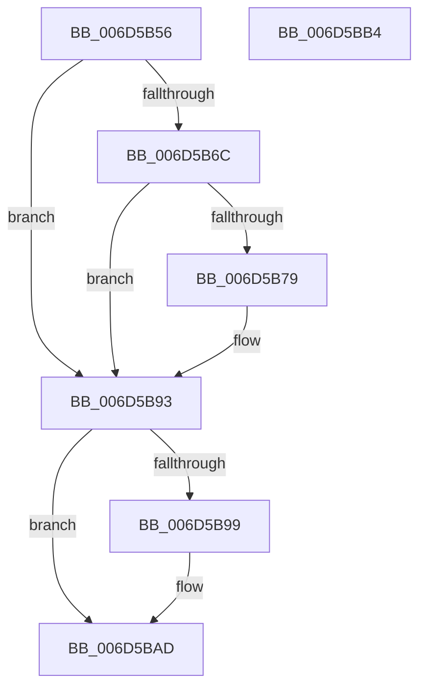

# RtlpFreeHeap$fin$0

- RVA: `0x006D5B56`–`0x006D5BB5` (길이 `95` bytes)
- VA: `0x00000001406D5B56`
- 실행 섹션: `.text`
- PDB 이름 있음: `예`; PDB Function 태그: `예`
- unwind 정보 RVA: `0x000CFB78`
- 디코드: `29`개 명령, `95/95` bytes 표시
- 미해석 바이트: `0` (있으면 어셈블리에 `.byte`로 보존)

> 이 문서는 커널 이미지의 기계어와 PDB 기호를 분석해 생성했습니다. 4번과 5번은 함수 원형과 자료형을 바이너리 사용 방식에서 추정한 C 해석이며 원본 소스 복구 결과는 아닙니다.

## 1. Dependencies

- 직접 호출 지점: **1**; 고유 호출 대상: **1**
- 직접 호출자로 확인된 함수: **0**
- RIP 상대 이미지 참조: **0**

### Outgoing calls
- `0x006D5BA7` → [ExReleaseResourceLite](../25/ExReleaseResourceLite_function_0025FA10.md) (function, `0x0025FA10`)

### Direct callers
- 이 함수 시작 RVA로 연결되는 직접 call은 확인되지 않았습니다. 간접 호출은 완전히 역산할 수 없습니다.

### Static image references
- 디코드된 RIP-relative 메모리 참조가 없습니다.

## 2. Other-region calls and transfers

- 다른 실행 섹션으로 향하는 call: **0**
- 별도 외부 분기/꼬리 이동을 확인하지 못했습니다.

## 3. Assembly (complete function range)

```asm
006D5B56  40 55                           push rbp
006D5B58  57                              push rdi
006D5B59  48 83 EC 38                     sub rsp, 0x38
006D5B5D  48 8B EA                        mov rbp, rdx
006D5B60  48 8B 95 C0 00 00 00            mov rdx, qword ptr [rbp + 0xc0]
006D5B67  48 85 D2                        test rdx, rdx
006D5B6A  74 27                           je 0x1406d5b93
006D5B6C  48 8B BD B0 00 00 00            mov rdi, qword ptr [rbp + 0xb0]
006D5B73  83 7F 7C 00                     cmp dword ptr [rdi + 0x7c], 0
006D5B77  74 1A                           je 0x1406d5b93
006D5B79  8A 4A 0A                        mov cl, byte ptr [rdx + 0xa]
006D5B7C  32 4A 09                        xor cl, byte ptr [rdx + 9]
006D5B7F  32 4A 08                        xor cl, byte ptr [rdx + 8]
006D5B82  88 4A 0B                        mov byte ptr [rdx + 0xb], cl
006D5B85  8B 42 08                        mov eax, dword ptr [rdx + 8]
006D5B88  8B 8F 88 00 00 00               mov ecx, dword ptr [rdi + 0x88]
006D5B8E  33 C8                           xor ecx, eax
006D5B90  89 4A 08                        mov dword ptr [rdx + 8], ecx
006D5B93  80 7D 30 00                     cmp byte ptr [rbp + 0x30], 0
006D5B97  74 14                           je 0x1406d5bad
006D5B99  48 8B 8D B0 00 00 00            mov rcx, qword ptr [rbp + 0xb0]
006D5BA0  48 8B 89 60 01 00 00            mov rcx, qword ptr [rcx + 0x160]
006D5BA7  E8 64 9E B8 FF                  call 0x14025fa10
006D5BAC  90                              nop
006D5BAD  48 83 C4 38                     add rsp, 0x38
006D5BB1  5F                              pop rdi
006D5BB2  5D                              pop rbp
006D5BB3  C3                              ret
006D5BB4  CC                              int3
```

## 4. C-style interpretation (structured pseudocode)

```c
__int64 __fastcall RtlpFreeHeap_fin_0(__int64 a1, __int64 a2)
{
    __int64 result;
    __int64 v_rsp;

    v_rsp = (v_rsp) - (56);
    if (*(unsigned __int64 *)(a2 + 192) == 0) goto loc_006D5B93;
    if ((*(unsigned int *)(*(unsigned __int64 *)(a2 + 176) + 124)) != 0) {
        a1 = *(unsigned __int8 *)(*(unsigned __int64 *)(a2 + 192) + 10);
        a1 = (unsigned __int8)((a1) ^ (*(unsigned __int8 *)(*(unsigned __int64 *)(a2 + 192) + 9)));
        a1 = (unsigned __int8)((a1) ^ (*(unsigned __int8 *)(*(unsigned __int64 *)(a2 + 192) + 8)));
        *(unsigned __int8 *)(*(unsigned __int64 *)(a2 + 192) + 11) = (unsigned __int8)(a1);
        result = *(unsigned int *)(*(unsigned __int64 *)(a2 + 192) + 8);
        a1 = *(unsigned int *)(*(unsigned __int64 *)(a2 + 176) + 136);
        a1 = (unsigned int)((a1) ^ ((unsigned int)(result)));
        *(unsigned int *)(*(unsigned __int64 *)(a2 + 192) + 8) = (unsigned int)(a1);
    }
    if ((*(unsigned __int8 *)(a2 + 48)) != 0) {
        a1 = *(unsigned __int64 *)(a2 + 176);
        a1 = *(unsigned __int64 *)(a1 + 352);
        result = ExReleaseResourceLite(a1, *(unsigned __int64 *)(a2 + 192), a3, a4);
    }
    v_rsp = (v_rsp) + (56);
    return result;
}
```

## 5. (Beta) C Style

```c
int64_t RtlpFreeHeap_fin_0(int64_t Arg1, void *Arg2)
{
    uint8_t *arg2 = (uint8_t *)Arg2;

    int64_t result;
    int64_t local_rsp;

    local_rsp = (local_rsp) - (56);
    if (*(uint64_t *)(arg2 + 0xC0) == 0) goto loc_006D5B93;
    if ((*(uint32_t *)(*(uint64_t *)(arg2 + 0xB0) + 0x7C)) != 0) {
        Arg1 = *(uint8_t *)(*(uint64_t *)(arg2 + 0xC0) + 0xA);
        Arg1 = (uint8_t)((Arg1) ^ (*(uint8_t *)(*(uint64_t *)(arg2 + 0xC0) + 0x9)));
        Arg1 = (uint8_t)((Arg1) ^ (*(uint8_t *)(*(uint64_t *)(arg2 + 0xC0) + 0x8)));
        *(uint8_t *)(*(uint64_t *)(arg2 + 0xC0) + 0xB) = (uint8_t)(Arg1);
        result = *(uint32_t *)(*(uint64_t *)(arg2 + 0xC0) + 0x8);
        Arg1 = *(uint32_t *)(*(uint64_t *)(arg2 + 0xB0) + 0x88);
        Arg1 = (uint32_t)((Arg1) ^ ((uint32_t)(result)));
        *(uint32_t *)(*(uint64_t *)(arg2 + 0xC0) + 0x8) = (uint32_t)(Arg1);
    }
    if ((*(uint8_t *)(arg2 + 0x30)) != 0) {
        Arg1 = *(uint64_t *)(arg2 + 0xB0);
        Arg1 = *(uint64_t *)(Arg1 + 0x160);
        result = ExReleaseResourceLite(Arg1, *(uint64_t *)(arg2 + 0xC0), a3, a4);
    }
    local_rsp = (local_rsp) + (56);
    return result;
}
```

### 관측된 메모리 오프셋

구조체 형식이 확인되지 않은 접근은 인자 기준의 오프셋으로만 기록했습니다.

| 기준 인자 | 오프셋 표현 | 폭 (bit) | 접근 |
|---|---:|---:|---|
| `Arg2` | `+ 0x30` | `8` | `R` |
| `Arg2` | `+ 0xB0` | `64` | `R` |
| `Arg2` | `+ 0xC0` | `64` | `R` |

## 6. Execution-region graph

[열기: 2D/3D 그래프와 함수 탐색 컨트롤 패널](../../../control-panel.html?section=text&rva=0x006D5B56&view=graph)

- 2D 그래프는 위에서 아래로 흐르고, 3D 그래프는 빈 공간을 드래그해 회전합니다. Shift+드래그는 이동, 휠은 확대·축소, 함수 노드 선택은 대상 보고서 이동입니다.

### Static fallback


