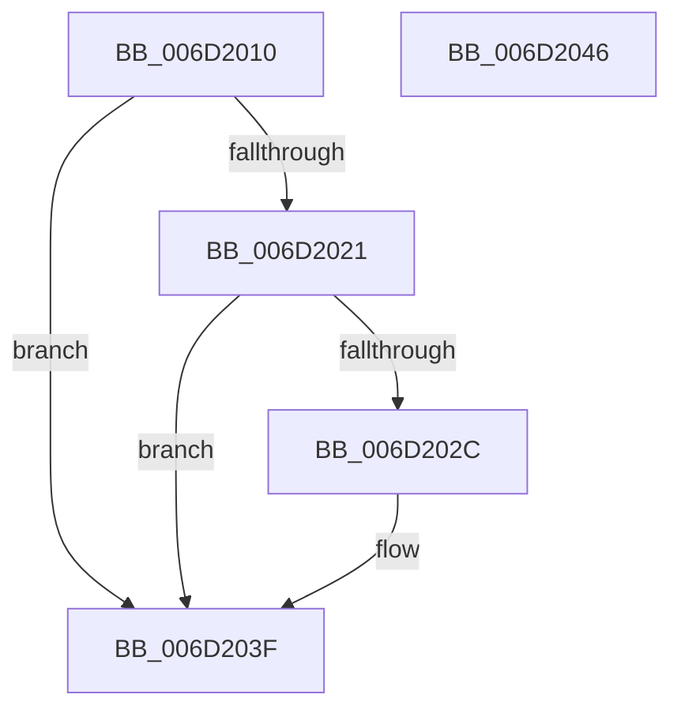

# RtlpUpcaseUnicodeStringPrivate$fin$0

- RVA: `0x006D2010`–`0x006D2047` (길이 `55` bytes)
- VA: `0x00000001406D2010`
- 실행 섹션: `.text`
- PDB 이름 있음: `예`; PDB Function 태그: `예`
- unwind 정보 RVA: `0x00072D5C`
- 디코드: `19`개 명령, `55/55` bytes 표시
- 미해석 바이트: `0` (있으면 어셈블리에 `.byte`로 보존)

> 이 문서는 커널 이미지의 기계어와 PDB 기호를 분석해 생성했습니다. 4번과 5번은 함수 원형과 자료형을 바이너리 사용 방식에서 추정한 C 해석이며 원본 소스 복구 결과는 아닙니다.

## 1. Dependencies

- 직접 호출 지점: **1**; 고유 호출 대상: **1**
- 직접 호출자로 확인된 함수: **0**
- RIP 상대 이미지 참조: **0**

### Outgoing calls
- `0x006D2032` → [ExFreePoolWithTag](../../poolcode/B8/ExFreePoolWithTag_function_00B82870.md) (function, `0x00B82870`)

### Direct callers
- 이 함수 시작 RVA로 연결되는 직접 call은 확인되지 않았습니다. 간접 호출은 완전히 역산할 수 없습니다.

### Static image references
- 디코드된 RIP-relative 메모리 참조가 없습니다.

## 2. Other-region calls and transfers

- 다른 실행 섹션으로 향하는 call: **1**
  - `0x006D2032` → [ExFreePoolWithTag](../../poolcode/B8/ExFreePoolWithTag_function_00B82870.md) (`.text` → `POOLCODE`)
- 별도 외부 분기/꼬리 이동을 확인하지 못했습니다.

## 3. Assembly (complete function range)

```asm
006D2010  40 53                           push rbx
006D2012  55                              push rbp
006D2013  48 83 EC 28                     sub rsp, 0x28
006D2017  48 8B EA                        mov rbp, rdx
006D201A  0F B6 C1                        movzx eax, cl
006D201D  84 C9                           test cl, cl
006D201F  74 1E                           je 0x1406d203f
006D2021  48 8B 5D 50                     mov rbx, qword ptr [rbp + 0x50]
006D2025  48 83 7B 08 00                  cmp qword ptr [rbx + 8], 0
006D202A  74 13                           je 0x1406d203f
006D202C  33 D2                           xor edx, edx
006D202E  48 8B 4B 08                     mov rcx, qword ptr [rbx + 8]
006D2032  E8 39 08 4B 00                  call 0x140b82870
006D2037  48 C7 43 08 00 00 00 00         mov qword ptr [rbx + 8], 0
006D203F  48 83 C4 28                     add rsp, 0x28
006D2043  5D                              pop rbp
006D2044  5B                              pop rbx
006D2045  C3                              ret
006D2046  CC                              int3
```

## 4. C-style interpretation (structured pseudocode)

```c
__int64 __fastcall RtlpUpcaseUnicodeStringPrivate_fin_0(unsigned __int8 a1, __int64 a2)
{
    __int64 result;
    __int64 v_rsp;

    v_rsp = (v_rsp) - (40);
    if (a1 == 0) goto loc_006D203F;
    result = a1;
    if ((*(unsigned __int64 *)(*(unsigned __int64 *)(a2 + 80) + 8)) != 0) {
        a2 = 0;
        a1 = *(unsigned __int64 *)(*(unsigned __int64 *)(a2 + 80) + 8);
        result = ExFreePoolWithTag(a1, a2, a3, a4);
        *(unsigned __int64 *)(*(unsigned __int64 *)(a2 + 80) + 8) = 0;
    }
    v_rsp = (v_rsp) + (40);
    return result;
}
```

## 5. (Beta) C Style

```c
int64_t RtlpUpcaseUnicodeStringPrivate_fin_0(uint8_t Arg1, void *Arg2)
{
    uint8_t *arg2 = (uint8_t *)Arg2;

    int64_t result;
    int64_t local_rsp;

    local_rsp = (local_rsp) - (40);
    if (Arg1 == 0) goto loc_006D203F;
    result = Arg1;
    if ((*(uint64_t *)(*(uint64_t *)(arg2 + 0x50) + 0x8)) != 0) {
        Arg2 = 0;
        Arg1 = *(uint64_t *)(*(uint64_t *)(arg2 + 0x50) + 0x8);
        result = ExFreePoolWithTag(Arg1, Arg2, a3, a4);
        *(uint64_t *)(*(uint64_t *)(arg2 + 0x50) + 0x8) = 0;
    }
    local_rsp = (local_rsp) + (40);
    return result;
}
```

### 관측된 메모리 오프셋

구조체 형식이 확인되지 않은 접근은 인자 기준의 오프셋으로만 기록했습니다.

| 기준 인자 | 오프셋 표현 | 폭 (bit) | 접근 |
|---|---:|---:|---|
| `Arg2` | `+ 0x50` | `64` | `R` |

## 6. Execution-region graph

[열기: 2D/3D 그래프와 함수 탐색 컨트롤 패널](../../../control-panel.html?section=text&rva=0x006D2010&view=graph)

- 2D 그래프는 위에서 아래로 흐르고, 3D 그래프는 빈 공간을 드래그해 회전합니다. Shift+드래그는 이동, 휠은 확대·축소, 함수 노드 선택은 대상 보고서 이동입니다.

### Static fallback


