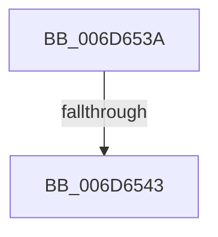

# sub_006D653A

- RVA: `0x006D653A`–`0x006D6551` (길이 `23` bytes)
- VA: `0x00000001406D653A`
- 실행 섹션: `.text`
- PDB 이름 있음: `아니요`; PDB Function 태그: `아니요`
- unwind 정보 RVA: `0x0005CD84`
- 디코드: `6`개 명령, `23/23` bytes 표시
- 미해석 바이트: `0` (있으면 어셈블리에 `.byte`로 보존)

> 이 문서는 커널 이미지의 기계어와 PDB 기호를 분석해 생성했습니다. 4번과 5번은 함수 원형과 자료형을 바이너리 사용 방식에서 추정한 C 해석이며 원본 소스 복구 결과는 아닙니다.

## 1. Dependencies

- 직접 호출 지점: **0**; 고유 호출 대상: **0**
- 직접 호출자로 확인된 함수: **0**
- RIP 상대 이미지 참조: **0**

### Outgoing calls
- 직접 디코드된 call 명령이 없습니다.

### Direct callers
- 이 함수 시작 RVA로 연결되는 직접 call은 확인되지 않았습니다. 간접 호출은 완전히 역산할 수 없습니다.

### Static image references
- 디코드된 RIP-relative 메모리 참조가 없습니다.

## 2. Other-region calls and transfers

- 다른 실행 섹션으로 향하는 call: **0**
- call이 아닌 외부 분기/꼬리 이동: **2**
  - `0x006D653D` → [sub_002055DD + 0x173](../20/Unknown_function_002055DD.md) (`tail-transfer`)
  - `0x006D654C` → [sub_002055DD + 0x6A](../20/Unknown_function_002055DD.md) (`tail-transfer`)

## 3. Assembly (complete function range)

```asm
006D653A  83 F8 03                        cmp eax, 3
006D653D  0F 84 0D F2 B2 FF               je 0x140205750
006D6543  FF C8                           dec eax
006D6545  41 3B C4                        cmp eax, r12d
006D6548  44 0F 46 E7                     cmovbe r12d, edi
006D654C  E9 F6 F0 B2 FF                  jmp 0x140205647
```

## 4. C-style interpretation (structured pseudocode)

```c
__int64 __fastcall sub_006D653A(void)
{
    __int64 result;
    __int64 v_r12;

    result = (unsigned int)((result) - 1);
    if (((unsigned int)(result)) <= ((unsigned int)(v_r12))) { v_r12 = (unsigned int)(v_rdi); }
}
```

## 5. (Beta) C Style

```c
void sub_006D653A(void)
{
    int64_t result;
    int64_t local_r12;

    result = (uint32_t)((result) - 1);
    if (((uint32_t)(result)) <= ((uint32_t)(local_r12))) { local_r12 = (uint32_t)(local_rdi); }
}
```

## 6. Execution-region graph

[열기: 2D/3D 그래프와 함수 탐색 컨트롤 패널](../../../control-panel.html?section=text&rva=0x006D653A&view=graph)

- 2D 그래프는 위에서 아래로 흐르고, 3D 그래프는 빈 공간을 드래그해 회전합니다. Shift+드래그는 이동, 휠은 확대·축소, 함수 노드 선택은 대상 보고서 이동입니다.

### Static fallback


