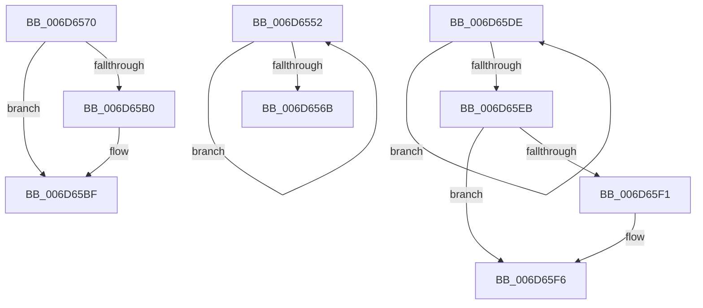

# sub_006D6552

- RVA: `0x006D6552`–`0x006D65FC` (길이 `170` bytes)
- VA: `0x00000001406D6552`
- 실행 섹션: `.text`
- PDB 이름 있음: `아니요`; PDB Function 태그: `아니요`
- unwind 정보 RVA: `0x0005D530`
- 디코드: `38`개 명령, `170/170` bytes 표시
- 미해석 바이트: `0` (있으면 어셈블리에 `.byte`로 보존)

> 이 문서는 커널 이미지의 기계어와 PDB 기호를 분석해 생성했습니다. 4번과 5번은 함수 원형과 자료형을 바이너리 사용 방식에서 추정한 C 해석이며 원본 소스 복구 결과는 아닙니다.

## 1. Dependencies

- 직접 호출 지점: **6**; 고유 호출 대상: **6**
- 직접 호출자로 확인된 함수: **0**
- RIP 상대 이미지 참조: **7**

### Outgoing calls
- `0x006D655A` → [KeYieldProcessorEx](../3F/KeYieldProcessorEx_function_003FBD00.md) (function, `0x003FBD00`)
- `0x006D6575` → [KiSetForceIdleState](../48/KiSetForceIdleState_function_0048DCC0.md) (function, `0x0048DCC0`)
- `0x006D6582` → [RtlGetInterruptTimePrecise](../20/RtlGetInterruptTimePrecise_function_0020A4C0.md) (function, `0x0020A4C0`)
- `0x006D65CB` → [KeInsertQueueDpc](../20/KeInsertQueueDpc_function_00207C50.md) (function, `0x00207C50`)
- `0x006D65D3` → [PoTraceForceIdleReset](../5D/PoTraceForceIdleReset_function_005D5C5C.md) (function, `0x005D5C5C`)
- `0x006D65F1` → [KiRemoveSystemWorkPriorityKick](../26/KiRemoveSystemWorkPriorityKick_function_002631D0.md) (function, `0x002631D0`)

### Direct callers
- 이 함수 시작 RVA로 연결되는 직접 call은 확인되지 않았습니다. 간접 호출은 완전히 역산할 수 없습니다.

### Static image references
- `0x006D655F` → RVA `0x00F23140` (`.data`; read)
- `0x006D6587` → RVA `0x00FC51BC` (`ALMOSTRO`; read)
- `0x006D6594` → RVA `0x00F21FB0` (`.data`; read)
- `0x006D659D` → RVA `0x00F23148` (`.data`; write)
- `0x006D65A4` → RVA `0x00F23418` (`.data`; read)
- `0x006D65B8` → RVA `0x00F233E2` (`.data`; write)
- `0x006D65C2` → RVA `0x00F233E0` (`.data`; read)

## 2. Other-region calls and transfers

- 다른 실행 섹션으로 향하는 call: **0**
- call이 아닌 외부 분기/꼬리 이동: **3**
  - `0x006D656B` → [sub_00208EAD + 0x1F](../20/Unknown_function_00208EAD.md) (`tail-transfer`)
  - `0x006D65D9` → [sub_00208EAD + 0x3C](../20/Unknown_function_00208EAD.md) (`tail-transfer`)
  - `0x006D65F7` → [KiCallInterruptServiceRoutine + 0x22](../20/KiCallInterruptServiceRoutine_function_00208970.md) (`tail-transfer`)

## 3. Assembly (complete function range)

```asm
006D6552  48 8D 8C 24 80 00 00 00         lea rcx, [rsp + 0x80]
006D655A  E8 A1 57 D2 FF                  call 0x1403fbd00
006D655F  48 8B 05 DA CB 84 00            mov rax, qword ptr [rip + 0x84cbda]
006D6566  48 85 C0                        test rax, rax
006D6569  75 E7                           jne 0x1406d6552
006D656B  E9 5C 29 B3 FF                  jmp 0x140208ecc
006D6570  B9 03 00 00 00                  mov ecx, 3
006D6575  E8 46 77 DB FF                  call 0x14048dcc0
006D657A  48 8D 8C 24 88 00 00 00         lea rcx, [rsp + 0x88]
006D6582  E8 39 3F B3 FF                  call 0x14020a4c0
006D6587  8B 0D 2F EC 8E 00               mov ecx, dword ptr [rip + 0x8eec2f]
006D658D  48 69 D1 80 96 98 00            imul rdx, rcx, 0x989680
006D6594  8B 0D 16 BA 84 00               mov ecx, dword ptr [rip + 0x84ba16]
006D659A  48 03 C2                        add rax, rdx
006D659D  48 89 05 A4 CB 84 00            mov qword ptr [rip + 0x84cba4], rax
006D65A4  48 8B 05 6D CE 84 00            mov rax, qword ptr [rip + 0x84ce6d]
006D65AB  48 85 C0                        test rax, rax
006D65AE  75 0F                           jne 0x1406d65bf
006D65B0  B8 00 08 00 00                  mov eax, 0x800
006D65B5  66 03 C8                        add cx, ax
006D65B8  66 89 0D 23 CE 84 00            mov word ptr [rip + 0x84ce23], cx
006D65BF  45 33 C0                        xor r8d, r8d
006D65C2  48 8D 0D 17 CE 84 00            lea rcx, [rip + 0x84ce17]
006D65C9  33 D2                           xor edx, edx
006D65CB  E8 80 16 B3 FF                  call 0x140207c50
006D65D0  41 8B CF                        mov ecx, r15d
006D65D3  E8 84 F6 EF FF                  call 0x1405d5c5c
006D65D8  90                              nop
006D65D9  E9 0B 29 B3 FF                  jmp 0x140208ee9
006D65DE  8B D0                           mov edx, eax
006D65E0  0F BA F2 15                     btr edx, 0x15
006D65E4  F0 41 0F B1 10                  lock cmpxchg dword ptr [r8], edx
006D65E9  75 F3                           jne 0x1406d65de
006D65EB  0F BA E0 15                     bt eax, 0x15
006D65EF  73 05                           jae 0x1406d65f6
006D65F1  E8 DA CB B8 FF                  call 0x1402631d0
006D65F6  FB                              sti
006D65F7  E9 96 23 B3 FF                  jmp 0x140208992
```

## 4. C-style interpretation (structured pseudocode)

```c
__int64 __fastcall sub_006D6552(__int64 a1, __int64 a2, int a3, __int64 a4, __int64 a5, __int64 a6, __int64 a7, __int64 a8, __int64 a9, __int64 a10, __int64 a11, __int64 a12, __int64 a13, __int64 a14, __int64 a15, __int64 a16)
{
    __int64 result;
    unsigned __int64 v_stack_p88;

    result = KeYieldProcessorEx(a16, a2, a3, a4);
    if (*(unsigned __int64 *)(v_rip + 8702938) != 0) goto loc_006D6552;
}
```

## 5. (Beta) C Style

```c
int64_t sub_006D6552(int64_t Arg1, int64_t Arg2, int32_t Arg3, int64_t Arg4, uint64_t Arg5, uint64_t Arg6, uint64_t Arg7, uint64_t Arg8, uint64_t Arg9, uint64_t Arg10, uint64_t Arg11, uint64_t Arg12, uint64_t Arg13, uint64_t Arg14, uint64_t Arg15, int64_t Arg16)
{
    int64_t result;
    uint64_t v_stack_p88;

    result = KeYieldProcessorEx(Arg16, Arg2, Arg3, Arg4);
    if (*(uint64_t *)(v_rip + 0x84CBDA) != 0) goto loc_006D6552;
}
```

## 6. Execution-region graph

[열기: 2D/3D 그래프와 함수 탐색 컨트롤 패널](../../../control-panel.html?section=text&rva=0x006D6552&view=graph)

- 2D 그래프는 위에서 아래로 흐르고, 3D 그래프는 빈 공간을 드래그해 회전합니다. Shift+드래그는 이동, 휠은 확대·축소, 함수 노드 선택은 대상 보고서 이동입니다.

### Static fallback


