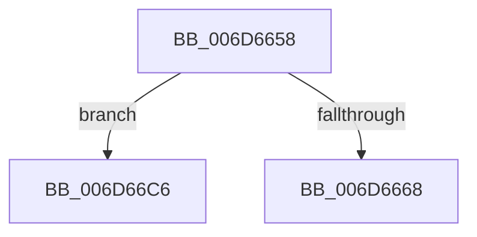

# sub_006D6658

- RVA: `0x006D6658`–`0x006D66EB` (길이 `147` bytes)
- VA: `0x00000001406D6658`
- 실행 섹션: `.text`
- PDB 이름 있음: `아니요`; PDB Function 태그: `아니요`
- unwind 정보 RVA: `0x0005D860`
- 디코드: `28`개 명령, `147/147` bytes 표시
- 미해석 바이트: `0` (있으면 어셈블리에 `.byte`로 보존)

> 이 문서는 커널 이미지의 기계어와 PDB 기호를 분석해 생성했습니다. 4번과 5번은 함수 원형과 자료형을 바이너리 사용 방식에서 추정한 C 해석이며 원본 소스 복구 결과는 아닙니다.

## 1. Dependencies

- 직접 호출 지점: **6**; 고유 호출 대상: **6**
- 직접 호출자로 확인된 함수: **0**
- RIP 상대 이미지 참조: **0**

### Outgoing calls
- `0x006D665F` → [ExAcquireRundownProtection](../21/ExAcquireRundownProtection_function_00216620.md) (function, `0x00216620`)
- `0x006D6675` → [KiStackAttachProcess](../21/KiStackAttachProcess_function_00216820.md) (function, `0x00216820`)
- `0x006D669C` → [IopCompleteRequest](../20/IopCompleteRequest_function_0020AF50.md) (function, `0x0020AF50`)
- `0x006D66AB` → [KiUnstackDetachProcess](../21/KiUnstackDetachProcess_function_00217D30.md) (function, `0x00217D30`)
- `0x006D66B7` → [ExReleaseRundownProtection](../34/ExReleaseRundownProtection_function_00349E80.md) (function, `0x00349E80`)
- `0x006D66D0` → [IopDropIrp](../21/IopDropIrp_function_002107B0.md) (function, `0x002107B0`)

### Direct callers
- 이 함수 시작 RVA로 연결되는 직접 call은 확인되지 않았습니다. 간접 호출은 완전히 역산할 수 없습니다.

### Static image references
- 디코드된 RIP-relative 메모리 참조가 없습니다.

## 2. Other-region calls and transfers

- 다른 실행 섹션으로 향하는 call: **0**
- call이 아닌 외부 분기/꼬리 이동: **2**
  - `0x006D66C1` → [IoRemoveIoCompletion + 0x1F1](../20/IoRemoveIoCompletion_function_0020B580.md) (`tail-transfer`)
  - `0x006D66E6` → [IoRemoveIoCompletion + 0x7A0](../20/IoRemoveIoCompletion_function_0020B580.md) (`tail-transfer`)

## 3. Assembly (complete function range)

```asm
006D6658  49 8D 8F E8 01 00 00            lea rcx, [r15 + 0x1e8]
006D665F  E8 BC FF B3 FF                  call 0x140216620
006D6664  84 C0                           test al, al
006D6666  74 5E                           je 0x1406d66c6
006D6668  4C 8D 84 24 A8 00 00 00         lea r8, [rsp + 0xa8]
006D6670  33 D2                           xor edx, edx
006D6672  49 8B CF                        mov rcx, r15
006D6675  E8 A6 01 B4 FF                  call 0x140216820
006D667A  48 8D 44 24 48                  lea rax, [rsp + 0x48]
006D667F  48 89 44 24 20                  mov qword ptr [rsp + 0x20], rax
006D6684  4C 8D 8F C0 00 00 00            lea r9, [rdi + 0xc0]
006D668B  4C 8D 44 24 48                  lea r8, [rsp + 0x48]
006D6690  48 8D 94 24 80 00 00 00         lea rdx, [rsp + 0x80]
006D6698  48 8D 4F 78                     lea rcx, [rdi + 0x78]
006D669C  E8 AF 48 B3 FF                  call 0x14020af50
006D66A1  33 D2                           xor edx, edx
006D66A3  48 8D 8C 24 A8 00 00 00         lea rcx, [rsp + 0xa8]
006D66AB  E8 80 16 B4 FF                  call 0x140217d30
006D66B0  49 8D 8F E8 01 00 00            lea rcx, [r15 + 0x1e8]
006D66B7  E8 C4 37 C7 FF                  call 0x140349e80
006D66BC  4C 8B 64 24 30                  mov r12, qword ptr [rsp + 0x30]
006D66C1  E9 AB 50 B3 FF                  jmp 0x14020b771
006D66C6  48 8B 97 C0 00 00 00            mov rdx, qword ptr [rdi + 0xc0]
006D66CD  48 8B CF                        mov rcx, rdi
006D66D0  E8 DB A0 B3 FF                  call 0x1402107b0
006D66D5  C7 44 24 50 20 01 00 C0         mov dword ptr [rsp + 0x50], 0xc0000120
006D66DD  48 C7 44 24 58 00 00 00 00      mov qword ptr [rsp + 0x58], 0
006D66E6  E9 35 56 B3 FF                  jmp 0x14020bd20
```

## 4. C-style interpretation (structured pseudocode)

```c
__int64 __fastcall sub_006D6658(__int64 a1, int a2, __int64 a3, __int64 a4, __int64 a5, __int64 a6, __int64 a7, __int64 a8, __int64 a9, __int64 a10, __int64 a11, __int64 a12, __int64 a13, __int64 a14, __int64 a15, __int64 a16, __int64 a17, __int64 a18, __int64 a19, __int64 a20, __int64 a21)
{
    __int64 result;
    unsigned __int64 v_stack_p20;
    unsigned int v_stack_p50;
    unsigned __int64 v_stack_p58;

    result = ExAcquireRundownProtection(v_r15 + 488, a2, a3, a4);
    if ((unsigned __int8)(result) == 0) goto loc_006D66C6;
    a2 = 0;
    result = KiStackAttachProcess(v_r15, a2, a21, a4);
    v_stack_p20 = a9;
    result = IopCompleteRequest(v_rdi + 120, a16, a9, v_rdi + 192);
    a2 = 0;
    result = KiUnstackDetachProcess(a21, a2, a9, v_rdi + 192);
    result = ExReleaseRundownProtection(v_r15 + 488, a2, a9, v_rdi + 192);
loc_006D66C6:
    result = IopDropIrp(v_rdi, *(unsigned __int64 *)(v_rdi + 192), a9, v_rdi + 192);
    v_stack_p50 = 0xC0000120ULL;
    v_stack_p58 = 0;
}
```

## 5. (Beta) C Style

```c
int64_t sub_006D6658(int64_t Arg1, int32_t Arg2, int64_t Arg3, int64_t Arg4, uint64_t Arg5, int64_t Arg6, uint64_t Arg7, uint64_t Arg8, int64_t Arg9, uint64_t Arg10, uint64_t Arg11, uint64_t Arg12, uint64_t Arg13, uint64_t Arg14, uint64_t Arg15, int64_t Arg16, uint64_t Arg17, uint64_t Arg18, uint64_t Arg19, uint64_t Arg20, int64_t Arg21)
{
    int64_t result;
    uint64_t v_stack_p20;
    uint32_t v_stack_p50;
    uint64_t v_stack_p58;

    result = ExAcquireRundownProtection(local_r15 + 488, Arg2, Arg3, Arg4);
    if ((uint8_t)(result) == 0) goto loc_006D66C6;
    Arg2 = 0;
    result = KiStackAttachProcess(local_r15, Arg2, Arg21, Arg4);
    v_stack_p20 = Arg9;
    result = IopCompleteRequest(local_rdi + 120, Arg16, Arg9, local_rdi + 192);
    Arg2 = 0;
    result = KiUnstackDetachProcess(Arg21, Arg2, Arg9, local_rdi + 192);
    result = ExReleaseRundownProtection(local_r15 + 488, Arg2, Arg9, local_rdi + 192);
loc_006D66C6:
    result = IopDropIrp(local_rdi, *(uint64_t *)(local_rdi + 0xC0), Arg9, local_rdi + 192);
    v_stack_p50 = 0xC0000120ULL;
    v_stack_p58 = 0;
}
```

## 6. Execution-region graph

[열기: 2D/3D 그래프와 함수 탐색 컨트롤 패널](../../../control-panel.html?section=text&rva=0x006D6658&view=graph)

- 2D 그래프는 위에서 아래로 흐르고, 3D 그래프는 빈 공간을 드래그해 회전합니다. Shift+드래그는 이동, 휠은 확대·축소, 함수 노드 선택은 대상 보고서 이동입니다.

### Static fallback


