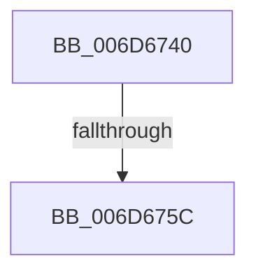

# sub_006D6740

- RVA: `0x006D6740`–`0x006D678D` (길이 `77` bytes)
- VA: `0x00000001406D6740`
- 실행 섹션: `.text`
- PDB 이름 있음: `아니요`; PDB Function 태그: `아니요`
- unwind 정보 RVA: `0x0005E31C`
- 디코드: `18`개 명령, `77/77` bytes 표시
- 미해석 바이트: `0` (있으면 어셈블리에 `.byte`로 보존)

> 이 문서는 커널 이미지의 기계어와 PDB 기호를 분석해 생성했습니다. 4번과 5번은 함수 원형과 자료형을 바이너리 사용 방식에서 추정한 C 해석이며 원본 소스 복구 결과는 아닙니다.

## 1. Dependencies

- 직접 호출 지점: **1**; 고유 호출 대상: **1**
- 직접 호출자로 확인된 함수: **0**
- RIP 상대 이미지 참조: **0**

### Outgoing calls
- `0x006D674E` → [ExAllocatePool2](../../poolcode/B8/ExAllocatePool2_function_00B820F0.md) (function, `0x00B820F0`)

### Direct callers
- 이 함수 시작 RVA로 연결되는 직접 call은 확인되지 않았습니다. 간접 호출은 완전히 역산할 수 없습니다.

### Static image references
- 디코드된 RIP-relative 메모리 참조가 없습니다.

## 2. Other-region calls and transfers

- 다른 실행 섹션으로 향하는 call: **1**
  - `0x006D674E` → [ExAllocatePool2](../../poolcode/B8/ExAllocatePool2_function_00B820F0.md) (`.text` → `POOLCODE`)
- call이 아닌 외부 분기/꼬리 이동: **2**
  - `0x006D6756` → [IoBoostThreadIoPriority + 0x4B6](../21/IoBoostThreadIoPriority_function_00216110.md) (`tail-transfer`)
  - `0x006D6788` → [IoBoostThreadIoPriority + 0x48C](../21/IoBoostThreadIoPriority_function_00216110.md) (`tail-transfer`)

## 3. Assembly (complete function range)

```asm
006D6740  BA 30 00 00 00                  mov edx, 0x30
006D6745  41 B8 49 6F 42 43               mov r8d, 0x43426f49
006D674B  8D 4A 10                        lea ecx, [rdx + 0x10]
006D674E  E8 9D B9 4A 00                  call 0x140b820f0
006D6753  48 85 C0                        test rax, rax
006D6756  0F 84 6A FE B3 FF               je 0x1402165c6
006D675C  48 8B 4D A0                     mov rcx, qword ptr [rbp - 0x60]
006D6760  4C 8B 44 24 30                  mov r8, qword ptr [rsp + 0x30]
006D6765  8B 54 24 24                     mov edx, dword ptr [rsp + 0x24]
006D6769  48 89 48 20                     mov qword ptr [rax + 0x20], rcx
006D676D  48 8B 4C 24 28                  mov rcx, qword ptr [rsp + 0x28]
006D6772  48 89 45 A0                     mov qword ptr [rbp - 0x60], rax
006D6776  48 89 48 08                     mov qword ptr [rax + 8], rcx
006D677A  48 89 30                        mov qword ptr [rax], rsi
006D677D  66 89 58 28                     mov word ptr [rax + 0x28], bx
006D6781  4C 89 40 10                     mov qword ptr [rax + 0x10], r8
006D6785  89 50 18                        mov dword ptr [rax + 0x18], edx
006D6788  E9 0F FE B3 FF                  jmp 0x14021659c
```

## 4. C-style interpretation (structured pseudocode)

```c
__int64 __fastcall sub_006D6740(__int64 a1, __int64 a2, __int64 a3, __int64 a4, __int64 a5, __int64 a6)
{
    __int64 result;
    unsigned int v_stack_p24;

    result = ExAllocatePool2(48 + 16, 48, (unsigned int)(0x43426F49ULL), a4);
    *(unsigned __int64 *)(result + 32) = *(unsigned __int64 *)(v_rbp - 96);
    *(unsigned __int64 *)(v_rbp - 96) = result;
    *(unsigned __int64 *)(result + 8) = a5;
    *(unsigned __int64 *)(result) = v_rsi;
    *(unsigned __int16 *)(result + 40) = (unsigned __int16)(v_rbx);
    *(unsigned __int64 *)(result + 16) = a6;
    *(unsigned int *)(result + 24) = (unsigned int)((unsigned int)(v_stack_p24));
}
```

## 5. (Beta) C Style

```c
int64_t sub_006D6740(int64_t Arg1, int64_t Arg2, int64_t Arg3, int64_t Arg4, int64_t Arg5, int64_t Arg6)
{
    int64_t result;
    uint32_t v_stack_p24;

    result = ExAllocatePool2(48 + 16, 48, (uint32_t)(0x43426F49ULL), Arg4);
    *(uint64_t *)(result + 0x20) = *(uint64_t *)(local_rbp - 0x60);
    *(uint64_t *)(local_rbp - 0x60) = result;
    *(uint64_t *)(result + 0x8) = Arg5;
    *(uint64_t *)(result) = local_rsi;
    *(uint16_t *)(result + 0x28) = (uint16_t)(local_rbx);
    *(uint64_t *)(result + 0x10) = Arg6;
    *(uint32_t *)(result + 0x18) = (uint32_t)((uint32_t)(v_stack_p24));
}
```

## 6. Execution-region graph

[열기: 2D/3D 그래프와 함수 탐색 컨트롤 패널](../../../control-panel.html?section=text&rva=0x006D6740&view=graph)

- 2D 그래프는 위에서 아래로 흐르고, 3D 그래프는 빈 공간을 드래그해 회전합니다. Shift+드래그는 이동, 휠은 확대·축소, 함수 노드 선택은 대상 보고서 이동입니다.

### Static fallback


