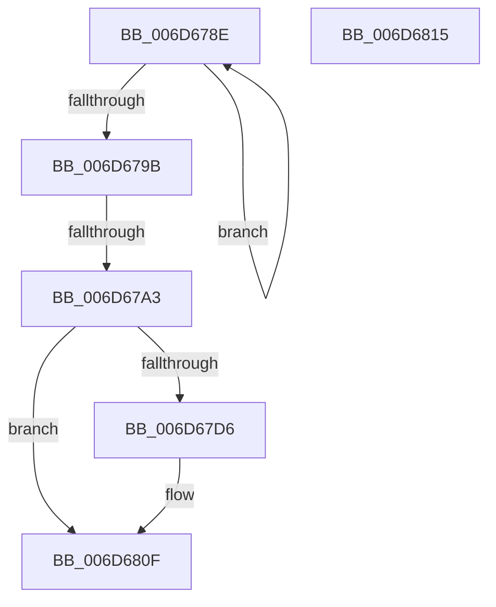

# sub_006D678E

- RVA: `0x006D678E`–`0x006D6848` (길이 `186` bytes)
- VA: `0x00000001406D678E`
- 실행 섹션: `.text`
- PDB 이름 있음: `아니요`; PDB Function 태그: `아니요`
- unwind 정보 RVA: `0x0005E370`
- 디코드: `43`개 명령, `186/186` bytes 표시
- 미해석 바이트: `0` (있으면 어셈블리에 `.byte`로 보존)

> 이 문서는 커널 이미지의 기계어와 PDB 기호를 분석해 생성했습니다. 4번과 5번은 함수 원형과 자료형을 바이너리 사용 방식에서 추정한 C 해석이며 원본 소스 복구 결과는 아닙니다.

## 1. Dependencies

- 직접 호출 지점: **3**; 고유 호출 대상: **3**
- 직접 호출자로 확인된 함수: **0**
- RIP 상대 이미지 참조: **2**

### Outgoing calls
- `0x006D67B9` → [DbgPrintEx](../35/DbgPrintEx_function_00359290.md) (function, `0x00359290`)
- `0x006D67CC` → [ExAllocatePool2](../../poolcode/B8/ExAllocatePool2_function_00B820F0.md) (function, `0x00B820F0`)
- `0x006D6809` → [ExQueueWorkItem](../2F/ExQueueWorkItem_function_002F9520.md) (function, `0x002F9520`)

### Direct callers
- 이 함수 시작 RVA로 연결되는 직접 call은 확인되지 않았습니다. 간접 호출은 완전히 역산할 수 없습니다.

### Static image references
- `0x006D67AE` → RVA `0x006D02F0` (` ?? ::FNODOBFM::`string'`; read)
- `0x006D6815` → RVA `0x0065D5E0` (`ExpResourceTimeoutCaptureLiveDump`; read)

## 2. Other-region calls and transfers

- 다른 실행 섹션으로 향하는 call: **1**
  - `0x006D67CC` → [ExAllocatePool2](../../poolcode/B8/ExAllocatePool2_function_00B820F0.md) (`.text` → `POOLCODE`)
- call이 아닌 외부 분기/꼬리 이동: **3**
  - `0x006D679D` → [ExpWaitForResource + 0xC0](../21/ExpWaitForResource_function_002166F0.md) (`tail-transfer`)
  - `0x006D6810` → [ExpWaitForResource + 0xC0](../21/ExpWaitForResource_function_002166F0.md) (`tail-transfer`)
  - `0x006D6843` → [ExpWaitForResource + 0xC0](../21/ExpWaitForResource_function_002166F0.md) (`tail-transfer`)

## 3. Assembly (complete function range)

```asm
006D678E  0F B6 C8                        movzx ecx, al
006D6791  80 C9 01                        or cl, 1
006D6794  F0 0F B0 4E 50                  lock cmpxchg byte ptr [rsi + 0x50], cl
006D6799  75 F3                           jne 0x1406d678e
006D679B  A8 01                           test al, 1
006D679D  0F 85 0D 00 B4 FF               jne 0x1402167b0
006D67A3  45 33 E4                        xor r12d, r12d
006D67A6  44 89 64 24 30                  mov dword ptr [rsp + 0x30], r12d
006D67AB  4C 8B CE                        mov r9, rsi
006D67AE  4C 8D 05 3B 9B FF FF            lea r8, [rip - 0x64c5]
006D67B5  33 D2                           xor edx, edx
006D67B7  33 C9                           xor ecx, ecx
006D67B9  E8 D2 2A C8 FF                  call 0x140359290
006D67BE  41 8D 54 24 38                  lea edx, [r12 + 0x38]
006D67C3  8D 4A 08                        lea ecx, [rdx + 8]
006D67C6  41 B8 52 65 54 6F               mov r8d, 0x6f546552
006D67CC  E8 1F B9 4A 00                  call 0x140b820f0
006D67D1  48 85 C0                        test rax, rax
006D67D4  74 39                           je 0x1406d680f
006D67D6  4C 89 68 10                     mov qword ptr [rax + 0x10], r13
006D67DA  48 89 40 18                     mov qword ptr [rax + 0x18], rax
006D67DE  4C 89 20                        mov qword ptr [rax], r12
006D67E1  65 48 8B 0C 25 88 01 00 00      mov rcx, qword ptr gs:[0x188]
006D67EA  48 89 48 20                     mov qword ptr [rax + 0x20], rcx
006D67EE  48 89 70 28                     mov qword ptr [rax + 0x28], rsi
006D67F2  8B 0B                           mov ecx, dword ptr [rbx]
006D67F4  89 48 30                        mov dword ptr [rax + 0x30], ecx
006D67F7  8B 8C 24 A8 00 00 00            mov ecx, dword ptr [rsp + 0xa8]
006D67FE  89 48 34                        mov dword ptr [rax + 0x34], ecx
006D6801  41 8D 54 24 01                  lea edx, [r12 + 1]
006D6806  48 8B C8                        mov rcx, rax
006D6809  E8 12 2D C2 FF                  call 0x1402f9520
006D680E  90                              nop
006D680F  CC                              int3
006D6810  E9 9B FF B3 FF                  jmp 0x1402167b0
006D6815  4C 8D 2D C4 6D F8 FF            lea r13, [rip - 0x7923c]
006D681C  44 8B B4 24 A0 00 00 00         mov r14d, dword ptr [rsp + 0xa0]
006D6824  48 8B BC 24 98 00 00 00         mov rdi, qword ptr [rsp + 0x98]
006D682C  48 8B B4 24 90 00 00 00         mov rsi, qword ptr [rsp + 0x90]
006D6834  44 8B 64 24 30                  mov r12d, dword ptr [rsp + 0x30]
006D6839  44 8B 7C 24 34                  mov r15d, dword ptr [rsp + 0x34]
006D683E  48 8B 5C 24 40                  mov rbx, qword ptr [rsp + 0x40]
006D6843  E9 68 FF B3 FF                  jmp 0x1402167b0
```

## 4. C-style interpretation (structured pseudocode)

```c
__int64 __fastcall sub_006D678E(__int64 a1, int a2, __int64 a3, __int64 a4, __int64 a5, __int64 a6, __int64 a7, __int64 a8, __int64 a9, __int64 a10, __int64 a11, __int64 a12, __int64 a13, __int64 a14, __int64 a15, __int64 a16, __int64 a17, __int64 a18, __int64 a19, __int64 a20, unsigned int a21)
{
    __int64 result;
    __int64 v_r12;
    unsigned int v_stack_p30;
    unsigned int v_stack_p34;
    unsigned __int64 v_stack_p40;
    unsigned __int64 v_stack_p90;
    unsigned __int64 v_stack_p98;
    unsigned int v_stack_pA0;

    a1 = (unsigned __int8)(((unsigned __int8)(result)) | (1));
    if (condition_is_not_equal) goto loc_006D678E;
    v_r12 = 0;
    v_stack_p30 = 0;
    a2 = 0;
    a1 = 0;
    result = DbgPrintEx(a1, a2, v_rip - 25797, v_rsi);
    result = ExAllocatePool2(v_r12 + 56 + 8, v_r12 + 56, (unsigned int)(0x6F546552ULL), v_rsi);
    if (result != 0) {
        *(unsigned __int64 *)(result + 16) = v_r13;
        *(unsigned __int64 *)(result + 24) = result;
        *(unsigned __int64 *)(result) = 0;
        a1 = *(unsigned __int64 *)(gs_base + (0 + 392));
        *(unsigned __int64 *)(result + 32) = a1;
        *(unsigned __int64 *)(result + 40) = v_rsi;
        a1 = *(unsigned int *)(v_rbx);
        *(unsigned int *)(result + 48) = (unsigned int)(a1);
        a1 = a21;
        *(unsigned int *)(result + 52) = (unsigned int)(a1);
        a2 = v_r12 + 1;
        a1 = result;
        result = ExQueueWorkItem(a1, a2, (unsigned int)(0x6F546552ULL), v_rsi);
    }
}
```

## 5. (Beta) C Style

```c
int64_t sub_006D678E(int64_t Arg1, int32_t Arg2, int64_t Arg3, int64_t Arg4, uint64_t Arg5, uint64_t Arg6, uint64_t Arg7, uint64_t Arg8, uint64_t Arg9, uint64_t Arg10, uint64_t Arg11, uint64_t Arg12, uint64_t Arg13, uint64_t Arg14, uint64_t Arg15, uint64_t Arg16, uint64_t Arg17, uint64_t Arg18, uint64_t Arg19, uint64_t Arg20, uint32_t Arg21)
{
    int64_t result;
    int64_t local_r12;
    uint32_t v_stack_p30;
    uint32_t v_stack_p34;
    uint64_t v_stack_p40;
    uint64_t v_stack_p90;
    uint64_t v_stack_p98;
    uint32_t v_stack_pA0;

    Arg1 = (uint8_t)(((uint8_t)(result)) | (1));
    if (condition_is_not_equal) goto loc_006D678E;
    local_r12 = 0;
    v_stack_p30 = 0;
    Arg2 = 0;
    Arg1 = 0;
    result = DbgPrintEx(Arg1, Arg2, v_rip - 25797, local_rsi);
    result = ExAllocatePool2(local_r12 + 56 + 8, local_r12 + 56, (uint32_t)(0x6F546552ULL), local_rsi);
    if (result != 0) {
        *(uint64_t *)(result + 0x10) = local_r13;
        *(uint64_t *)(result + 0x18) = result;
        *(uint64_t *)(result) = 0;
        Arg1 = *(uint64_t *)(gs_base + (0 + 0x188));
        *(uint64_t *)(result + 0x20) = Arg1;
        *(uint64_t *)(result + 0x28) = local_rsi;
        Arg1 = *(uint32_t *)(local_rbx);
        *(uint32_t *)(result + 0x30) = (uint32_t)(Arg1);
        Arg1 = Arg21;
        *(uint32_t *)(result + 0x34) = (uint32_t)(Arg1);
        Arg2 = local_r12 + 1;
        Arg1 = result;
        result = ExQueueWorkItem(Arg1, Arg2, (uint32_t)(0x6F546552ULL), local_rsi);
    }
}
```

## 6. Execution-region graph

[열기: 2D/3D 그래프와 함수 탐색 컨트롤 패널](../../../control-panel.html?section=text&rva=0x006D678E&view=graph)

- 2D 그래프는 위에서 아래로 흐르고, 3D 그래프는 빈 공간을 드래그해 회전합니다. Shift+드래그는 이동, 휠은 확대·축소, 함수 노드 선택은 대상 보고서 이동입니다.

### Static fallback


