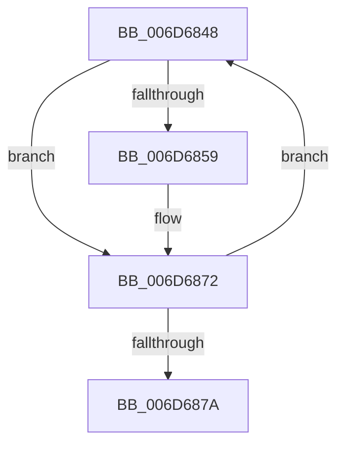

# sub_006D6848

- RVA: `0x006D6848`–`0x006D6893` (길이 `75` bytes)
- VA: `0x00000001406D6848`
- 실행 섹션: `.text`
- PDB 이름 있음: `아니요`; PDB Function 태그: `아니요`
- unwind 정보 RVA: `0x0005E758`
- 디코드: `17`개 명령, `75/75` bytes 표시
- 미해석 바이트: `0` (있으면 어셈블리에 `.byte`로 보존)

> 이 문서는 커널 이미지의 기계어와 PDB 기호를 분석해 생성했습니다. 4번과 5번은 함수 원형과 자료형을 바이너리 사용 방식에서 추정한 C 해석이며 원본 소스 복구 결과는 아닙니다.

## 1. Dependencies

- 직접 호출 지점: **1**; 고유 호출 대상: **1**
- 직접 호출자로 확인된 함수: **0**
- RIP 상대 이미지 참조: **1**

### Outgoing calls
- `0x006D686D` → [KeAddGroupAffinityEx](../25/KeAddGroupAffinityEx_function_0025B6C0.md) (function, `0x0025B6C0`)

### Direct callers
- 이 함수 시작 RVA로 연결되는 직접 call은 확인되지 않았습니다. 간접 호출은 완전히 역산할 수 없습니다.

### Static image references
- `0x006D687A` → RVA `0x00FC6ADD` (`ALMOSTRO`; read)

## 2. Other-region calls and transfers

- 다른 실행 섹션으로 향하는 call: **0**
- call이 아닌 외부 분기/꼬리 이동: **1**
  - `0x006D6891` → [sub_006D6893 + 0x10](Unknown_function_006D6893.md) (`tail-transfer`)

## 3. Assembly (complete function range)

```asm
006D6848  4C 8B 47 08                     mov r8, qword ptr [rdi + 8]
006D684C  8B C5                           mov eax, ebp
006D684E  48 8B 77 10                     mov rsi, qword ptr [rdi + 0x10]
006D6852  87 47 18                        xchg dword ptr [rdi + 0x18], eax
006D6855  85 C0                           test eax, eax
006D6857  75 19                           jne 0x1406d6872
006D6859  41 0F B6 90 D0 00 00 00         movzx edx, byte ptr [r8 + 0xd0]
006D6861  48 8D 4C 24 20                  lea rcx, [rsp + 0x20]
006D6866  4D 8B 80 C8 00 00 00            mov r8, qword ptr [r8 + 0xc8]
006D686D  E8 4E 4E B8 FF                  call 0x14025b6c0
006D6872  48 8B FE                        mov rdi, rsi
006D6875  48 85 F6                        test rsi, rsi
006D6878  75 CE                           jne 0x1406d6848
006D687A  F6 05 5C 02 8F 00 04            test byte ptr [rip + 0x8f025c], 4
006D6881  48 8B B4 24 68 01 00 00         mov rsi, qword ptr [rsp + 0x168]
006D6889  48 8B AC 24 60 01 00 00         mov rbp, qword ptr [rsp + 0x160]
006D6891  74 10                           je 0x1406d68a3
```

## 4. C-style interpretation (structured pseudocode)

```c
__int64 __fastcall sub_006D6848(__int64 a1, __int64 a2, __int64 a3, __int64 a4, __int64 a5, __int64 a6, __int64 a7, __int64 a8, __int64 a9, __int64 a10, __int64 a11, __int64 a12, __int64 a13, __int64 a14, __int64 a15, __int64 a16, __int64 a17, __int64 a18, __int64 a19, __int64 a20, __int64 a21, __int64 a22, __int64 a23, __int64 a24, __int64 a25, __int64 a26, __int64 a27, __int64 a28, __int64 a29, __int64 a30, __int64 a31, __int64 a32, __int64 a33, __int64 a34, __int64 a35, __int64 a36, __int64 a37, __int64 a38, __int64 a39, __int64 a40, __int64 a41, __int64 a42, __int64 a43, __int64 a44, __int64 a45)
{
    __int64 result;
    unsigned __int64 v_stack_p20;

    result = (unsigned int)((unsigned int)(v_rbp));
    if ((unsigned int)((unsigned int)((unsigned int)(v_rbp))) == 0) {
        a2 = *(unsigned __int8 *)(*(unsigned __int64 *)(v_rdi + 8) + 208);
        a1 = v_stack_p20;
        a3 = *(unsigned __int64 *)(*(unsigned __int64 *)(v_rdi + 8) + 200);
        result = KeAddGroupAffinityEx(a1, a2, a3, a4);
    }
    if (*(unsigned __int64 *)(v_rdi + 16) != 0) goto loc_006D6848;
}
```

## 5. (Beta) C Style

```c
int64_t sub_006D6848(int64_t Arg1, int64_t Arg2, int64_t Arg3, int64_t Arg4, uint64_t Arg5, uint64_t Arg6, uint64_t Arg7, uint64_t Arg8, uint64_t Arg9, uint64_t Arg10, uint64_t Arg11, uint64_t Arg12, uint64_t Arg13, uint64_t Arg14, uint64_t Arg15, uint64_t Arg16, uint64_t Arg17, uint64_t Arg18, uint64_t Arg19, uint64_t Arg20, uint64_t Arg21, uint64_t Arg22, uint64_t Arg23, uint64_t Arg24, uint64_t Arg25, uint64_t Arg26, uint64_t Arg27, uint64_t Arg28, uint64_t Arg29, uint64_t Arg30, uint64_t Arg31, uint64_t Arg32, uint64_t Arg33, uint64_t Arg34, uint64_t Arg35, uint64_t Arg36, uint64_t Arg37, uint64_t Arg38, uint64_t Arg39, uint64_t Arg40, uint64_t Arg41, uint64_t Arg42, uint64_t Arg43, int64_t Arg44, int64_t Arg45)
{
    int64_t result;
    uint64_t v_stack_p20;

    result = (uint32_t)((uint32_t)(local_rbp));
    if ((uint32_t)((uint32_t)((uint32_t)(local_rbp))) == 0) {
        Arg2 = *(uint8_t *)(*(uint64_t *)(local_rdi + 0x8) + 0xD0);
        Arg1 = v_stack_p20;
        Arg3 = *(uint64_t *)(*(uint64_t *)(local_rdi + 0x8) + 0xC8);
        result = KeAddGroupAffinityEx(Arg1, Arg2, Arg3, Arg4);
    }
    if (*(uint64_t *)(local_rdi + 0x10) != 0) goto loc_006D6848;
}
```

## 6. Execution-region graph

[열기: 2D/3D 그래프와 함수 탐색 컨트롤 패널](../../../control-panel.html?section=text&rva=0x006D6848&view=graph)

- 2D 그래프는 위에서 아래로 흐르고, 3D 그래프는 빈 공간을 드래그해 회전합니다. Shift+드래그는 이동, 휠은 확대·축소, 함수 노드 선택은 대상 보고서 이동입니다.

### Static fallback


