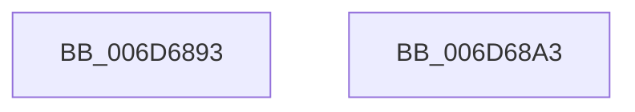

# sub_006D6893

- RVA: `0x006D6893`–`0x006D68B5` (길이 `34` bytes)
- VA: `0x00000001406D6893`
- 실행 섹션: `.text`
- PDB 이름 있음: `아니요`; PDB Function 태그: `아니요`
- unwind 정보 RVA: `0x0005E778`
- 디코드: `9`개 명령, `34/34` bytes 표시
- 미해석 바이트: `0` (있으면 어셈블리에 `.byte`로 보존)

> 이 문서는 커널 이미지의 기계어와 PDB 기호를 분석해 생성했습니다. 4번과 5번은 함수 원형과 자료형을 바이너리 사용 방식에서 추정한 C 해석이며 원본 소스 복구 결과는 아닙니다.

## 1. Dependencies

- 직접 호출 지점: **2**; 고유 호출 대상: **2**
- 직접 호출자로 확인된 함수: **0**
- RIP 상대 이미지 참조: **0**

### Outgoing calls
- `0x006D6898` → [HvlWakeVirtualProcessors](../58/HvlWakeVirtualProcessors_function_0058AA80.md) (function, `0x0058AA80`)
- `0x006D68AA` → [HalRequestIpi](../2D/HalRequestIpi_function_002D1720.md) (function, `0x002D1720`)

### Direct callers
- 이 함수 시작 RVA로 연결되는 직접 call은 확인되지 않았습니다. 간접 호출은 완전히 역산할 수 없습니다.

### Static image references
- 디코드된 RIP-relative 메모리 참조가 없습니다.

## 2. Other-region calls and transfers

- 다른 실행 섹션으로 향하는 call: **0**
- call이 아닌 외부 분기/꼬리 이동: **2**
  - `0x006D689E` → [sub_00217C3C + 0x45](../21/Unknown_function_00217C3C.md) (`tail-transfer`)
  - `0x006D68B0` → [sub_00217C3C + 0x45](../21/Unknown_function_00217C3C.md) (`tail-transfer`)

## 3. Assembly (complete function range)

```asm
006D6893  48 8D 4C 24 20                  lea rcx, [rsp + 0x20]
006D6898  E8 E3 41 EB FF                  call 0x14058aa80
006D689D  90                              nop
006D689E  E9 DE 13 B4 FF                  jmp 0x140217c81
006D68A3  48 8D 54 24 20                  lea rdx, [rsp + 0x20]
006D68A8  33 C9                           xor ecx, ecx
006D68AA  E8 71 AE BF FF                  call 0x1402d1720
006D68AF  90                              nop
006D68B0  E9 CC 13 B4 FF                  jmp 0x140217c81
```

## 4. C-style interpretation (structured pseudocode)

```c
__int64 __fastcall sub_006D6893(void)
{
    __int64 result;
    unsigned __int64 v_stack_p20;

    result = HvlWakeVirtualProcessors(v_stack_p20, a2, a3, a4);
}
```

## 5. (Beta) C Style

```c
void sub_006D6893(void)
{
    int64_t result;
    uint64_t v_stack_p20;

    result = HvlWakeVirtualProcessors(v_stack_p20, a2, a3, a4);
}
```

## 6. Execution-region graph

[열기: 2D/3D 그래프와 함수 탐색 컨트롤 패널](../../../control-panel.html?section=text&rva=0x006D6893&view=graph)

- 2D 그래프는 위에서 아래로 흐르고, 3D 그래프는 빈 공간을 드래그해 회전합니다. Shift+드래그는 이동, 휠은 확대·축소, 함수 노드 선택은 대상 보고서 이동입니다.

### Static fallback


