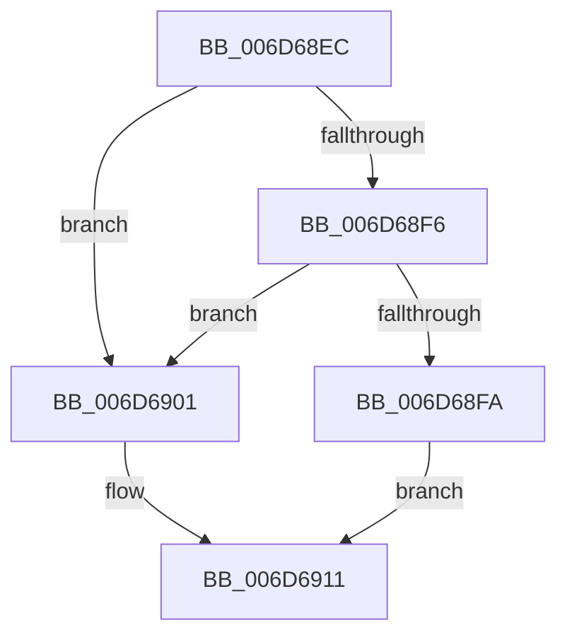

# sub_006D68EC

- RVA: `0x006D68EC`–`0x006D6927` (길이 `59` bytes)
- VA: `0x00000001406D68EC`
- 실행 섹션: `.text`
- PDB 이름 있음: `아니요`; PDB Function 태그: `아니요`
- unwind 정보 RVA: `0x0005EF54`
- 디코드: `15`개 명령, `59/59` bytes 표시
- 미해석 바이트: `0` (있으면 어셈블리에 `.byte`로 보존)

> 이 문서는 커널 이미지의 기계어와 PDB 기호를 분석해 생성했습니다. 4번과 5번은 함수 원형과 자료형을 바이너리 사용 방식에서 추정한 C 해석이며 원본 소스 복구 결과는 아닙니다.

## 1. Dependencies

- 직접 호출 지점: **0**; 고유 호출 대상: **0**
- 직접 호출자로 확인된 함수: **0**
- RIP 상대 이미지 참조: **0**

### Outgoing calls
- 직접 디코드된 call 명령이 없습니다.

### Direct callers
- 이 함수 시작 RVA로 연결되는 직접 call은 확인되지 않았습니다. 간접 호출은 완전히 역산할 수 없습니다.

### Static image references
- 디코드된 RIP-relative 메모리 참조가 없습니다.

## 2. Other-region calls and transfers

- 다른 실행 섹션으로 향하는 call: **0**
- call이 아닌 외부 분기/꼬리 이동: **1**
  - `0x006D6922` → [sub_0021BAB9 + 0x1E3](../21/Unknown_function_0021BAB9.md) (`tail-transfer`)

## 3. Assembly (complete function range)

```asm
006D68EC  4C 8B 64 24 38                  mov r12, qword ptr [rsp + 0x38]
006D68F1  45 85 ED                        test r13d, r13d
006D68F4  74 0B                           je 0x1406d6901
006D68F6  85 D2                           test edx, edx
006D68F8  74 07                           je 0x1406d6901
006D68FA  B8 01 00 00 00                  mov eax, 1
006D68FF  EB 10                           jmp 0x1406d6911
006D6901  41 FF C7                        inc r15d
006D6904  B8 01 00 00 00                  mov eax, 1
006D6909  41 83 FF 0E                     cmp r15d, 0xe
006D690D  41 0F 46 C7                     cmovbe eax, r15d
006D6911  44 0F B6 7D 67                  movzx r15d, byte ptr [rbp + 0x67]
006D6916  4C 8B 75 8F                     mov r14, qword ptr [rbp - 0x71]
006D691A  41 89 84 24 E0 83 00 00         mov dword ptr [r12 + 0x83e0], eax
006D6922  E9 75 53 B4 FF                  jmp 0x14021bc9c
```

## 4. C-style interpretation (structured pseudocode)

```c
__int64 __fastcall sub_006D68EC(__int64 a1, int a2, __int64 a3, __int64 a4, __int64 a5, __int64 a6, __int64 a7)
{
    __int64 result;
    __int64 v_r15;

    if ((unsigned int)(v_r13) == 0) goto loc_006D6901;
    if (a2 == 0) goto loc_006D6901;
    goto loc_006D6911;
loc_006D6901:
    v_r15 = (unsigned int)((v_r15) + 1);
    result = 1;
    if (((unsigned int)(v_r15)) <= 14) { result = (unsigned int)(v_r15); }
loc_006D6911:
    *(unsigned int *)(a7 + 33760) = (unsigned int)(result);
}
```

## 5. (Beta) C Style

```c
int64_t sub_006D68EC(int64_t Arg1, int32_t Arg2, int64_t Arg3, int64_t Arg4, uint64_t Arg5, uint64_t Arg6, void *Arg7)
{
    uint8_t *arg7 = (uint8_t *)Arg7;

    int64_t result;
    int64_t local_r15;

    if ((uint32_t)(local_r13) == 0) goto loc_006D6901;
    if (Arg2 == 0) goto loc_006D6901;
    goto loc_006D6911;
loc_006D6901:
    local_r15 = (uint32_t)((local_r15) + 1);
    result = 1;
    if (((uint32_t)(local_r15)) <= 14) { result = (uint32_t)(local_r15); }
loc_006D6911:
    *(uint32_t *)(arg7 + 0x83E0) = (uint32_t)(result);
}
```

### 관측된 메모리 오프셋

구조체 형식이 확인되지 않은 접근은 인자 기준의 오프셋으로만 기록했습니다.

| 기준 인자 | 오프셋 표현 | 폭 (bit) | 접근 |
|---|---:|---:|---|
| `Arg7` | `+ 0x83E0` | `32` | `W` |

## 6. Execution-region graph

[열기: 2D/3D 그래프와 함수 탐색 컨트롤 패널](../../../control-panel.html?section=text&rva=0x006D68EC&view=graph)

- 2D 그래프는 위에서 아래로 흐르고, 3D 그래프는 빈 공간을 드래그해 회전합니다. Shift+드래그는 이동, 휠은 확대·축소, 함수 노드 선택은 대상 보고서 이동입니다.

### Static fallback


