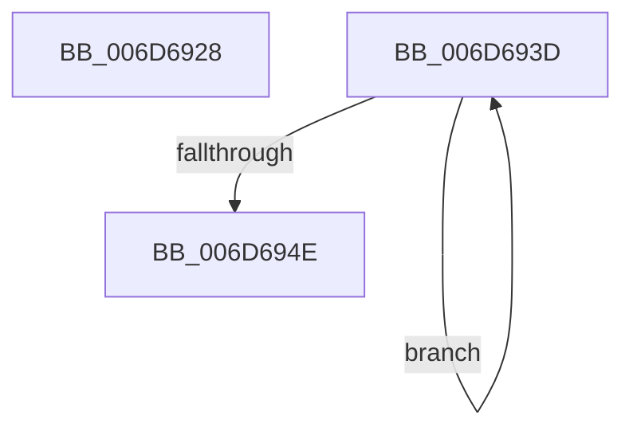

# sub_006D6928

- RVA: `0x006D6928`–`0x006D6953` (길이 `43` bytes)
- VA: `0x00000001406D6928`
- 실행 섹션: `.text`
- PDB 이름 있음: `아니요`; PDB Function 태그: `아니요`
- unwind 정보 RVA: `0x0005EF88`
- 디코드: `11`개 명령, `43/43` bytes 표시
- 미해석 바이트: `0` (있으면 어셈블리에 `.byte`로 보존)

> 이 문서는 커널 이미지의 기계어와 PDB 기호를 분석해 생성했습니다. 4번과 5번은 함수 원형과 자료형을 바이너리 사용 방식에서 추정한 C 해석이며 원본 소스 복구 결과는 아닙니다.

## 1. Dependencies

- 직접 호출 지점: **1**; 고유 호출 대상: **1**
- 직접 호출자로 확인된 함수: **0**
- RIP 상대 이미지 참조: **1**

### Outgoing calls
- `0x006D6941` → [KeYieldProcessorEx](../3F/KeYieldProcessorEx_function_003FBD00.md) (function, `0x003FBD00`)

### Direct callers
- 이 함수 시작 RVA로 연결되는 직접 call은 확인되지 않았습니다. 간접 호출은 완전히 역산할 수 없습니다.

### Static image references
- `0x006D6928` → RVA `0x00FC6B04` (`ALMOSTRO`; read)

## 2. Other-region calls and transfers

- 다른 실행 섹션으로 향하는 call: **0**
- call이 아닌 외부 분기/꼬리 이동: **2**
  - `0x006D6938` → [KiQueueReadyThread + 0x78B](../21/KiQueueReadyThread_function_0021C7B0.md) (`tail-transfer`)
  - `0x006D694E` → [KiQueueReadyThread + 0x3C2](../21/KiQueueReadyThread_function_0021C7B0.md) (`tail-transfer`)

## 3. Assembly (complete function range)

```asm
006D6928  8B 3D D6 01 8F 00               mov edi, dword ptr [rip + 0x8f01d6]
006D692E  C1 EF 0C                        shr edi, 0xc
006D6931  40 80 E7 01                     and dil, 1
006D6935  89 7D CF                        mov dword ptr [rbp - 0x31], edi
006D6938  E9 FE 65 B4 FF                  jmp 0x14021cf3b
006D693D  48 8D 4D E7                     lea rcx, [rbp - 0x19]
006D6941  E8 BA 53 D2 FF                  call 0x1403fbd00
006D6946  48 8B 03                        mov rax, qword ptr [rbx]
006D6949  48 85 C0                        test rax, rax
006D694C  75 EF                           jne 0x1406d693d
006D694E  E9 1F 62 B4 FF                  jmp 0x14021cb72
```

## 4. C-style interpretation (structured pseudocode)

```c
__int64 __fastcall sub_006D6928(void)
{
    __int64 v_rdi;

    v_rdi = (unsigned int)(((unsigned int)(*(unsigned int *)(v_rip + 9372118))) >> (12));
    v_rdi = (unsigned __int8)((v_rdi) & (1));
    *(unsigned int *)(v_rbp - 49) = (unsigned int)(v_rdi);
}
```

## 5. (Beta) C Style

```c
void sub_006D6928(void)
{
    int64_t local_rdi;

    local_rdi = (uint32_t)(((uint32_t)(*(uint32_t *)(v_rip + 0x8F01D6))) >> (12));
    local_rdi = (uint8_t)((local_rdi) & (1));
    *(uint32_t *)(local_rbp - 0x31) = (uint32_t)(local_rdi);
}
```

## 6. Execution-region graph

[열기: 2D/3D 그래프와 함수 탐색 컨트롤 패널](../../../control-panel.html?section=text&rva=0x006D6928&view=graph)

- 2D 그래프는 위에서 아래로 흐르고, 3D 그래프는 빈 공간을 드래그해 회전합니다. Shift+드래그는 이동, 휠은 확대·축소, 함수 노드 선택은 대상 보고서 이동입니다.

### Static fallback


