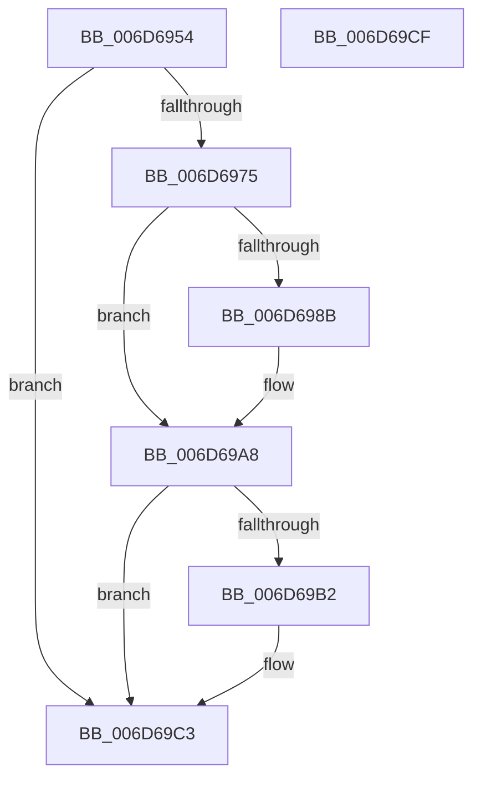

# sub_006D6954

- RVA: `0x006D6954`–`0x006D69E9` (길이 `149` bytes)
- VA: `0x00000001406D6954`
- 실행 섹션: `.text`
- PDB 이름 있음: `아니요`; PDB Function 태그: `아니요`
- unwind 정보 RVA: `0x0005F0C0`
- 디코드: `34`개 명령, `149/149` bytes 표시
- 미해석 바이트: `0` (있으면 어셈블리에 `.byte`로 보존)

> 이 문서는 커널 이미지의 기계어와 PDB 기호를 분석해 생성했습니다. 4번과 5번은 함수 원형과 자료형을 바이너리 사용 방식에서 추정한 C 해석이며 원본 소스 복구 결과는 아닙니다.

## 1. Dependencies

- 직접 호출 지점: **1**; 고유 호출 대상: **1**
- 직접 호출자로 확인된 함수: **0**
- RIP 상대 이미지 참조: **0**

### Outgoing calls
- `0x006D69A2` → [KeBugCheckEx](../4F/KeBugCheckEx_function_004FD660.md) (function, `0x004FD660`)

### Direct callers
- 이 함수 시작 RVA로 연결되는 직접 call은 확인되지 않았습니다. 간접 호출은 완전히 역산할 수 없습니다.

### Static image references
- 디코드된 RIP-relative 메모리 참조가 없습니다.

## 2. Other-region calls and transfers

- 다른 실행 섹션으로 향하는 call: **0**
- call이 아닌 외부 분기/꼬리 이동: **2**
  - `0x006D69CA` → [sub_0021D7F8 + 0xDA2](../21/Unknown_function_0021D7F8.md) (`tail-transfer`)
  - `0x006D69E4` → [sub_0021D7F8 + 0xEF0](../21/Unknown_function_0021D7F8.md) (`tail-transfer`)

## 3. Assembly (complete function range)

```asm
006D6954  FE C1                           inc cl
006D6956  41 88 8B 38 03 00 00            mov byte ptr [r11 + 0x338], cl
006D695D  41 8B 87 58 03 00 00            mov eax, dword ptr [r15 + 0x358]
006D6964  44 0F AB D0                     bts eax, r10d
006D6968  41 89 87 58 03 00 00            mov dword ptr [r15 + 0x358], eax
006D696F  41 83 F9 20                     cmp r9d, 0x20
006D6973  74 4E                           je 0x1406d69c3
006D6975  49 0F BE D1                     movsx rdx, r9b
006D6979  4C 8B C2                        mov r8, rdx
006D697C  4A 8D 0C 3A                     lea rcx, [rdx + r15]
006D6980  0F B6 81 38 03 00 00            movzx eax, byte ptr [rcx + 0x338]
006D6987  84 C0                           test al, al
006D6989  75 1D                           jne 0x1406d69a8
006D698B  41 B9 02 00 00 00               mov r9d, 2
006D6991  48 C7 44 24 20 00 00 00 00      mov qword ptr [rsp + 0x20], 0
006D699A  49 8B D7                        mov rdx, r15
006D699D  B9 57 01 00 00                  mov ecx, 0x157
006D69A2  E8 B9 6C E2 FF                  call 0x1404fd660
006D69A7  CC                              int3
006D69A8  2C 01                           sub al, 1
006D69AA  88 81 38 03 00 00               mov byte ptr [rcx + 0x338], al
006D69B0  75 11                           jne 0x1406d69c3
006D69B2  41 8B 87 58 03 00 00            mov eax, dword ptr [r15 + 0x358]
006D69B9  0F BB D0                        btc eax, edx
006D69BC  41 89 87 58 03 00 00            mov dword ptr [r15 + 0x358], eax
006D69C3  45 89 B7 00 04 00 00            mov dword ptr [r15 + 0x400], r14d
006D69CA  E9 CB 7B B4 FF                  jmp 0x14021e59a
006D69CF  41 8B D7                        mov edx, r15d
006D69D2  B9 C2 00 00 40                  mov ecx, 0x400000c2
006D69D7  48 C1 EA 20                     shr rdx, 0x20
006D69DB  41 8B C7                        mov eax, r15d
006D69DE  0F 30                           wrmsr
006D69E0  4C 8B 7D 67                     mov r15, qword ptr [rbp + 0x67]
006D69E4  E9 FF 7C B4 FF                  jmp 0x14021e6e8
```

## 4. C-style interpretation (structured pseudocode)

```c
__int64 __fastcall sub_006D6954(unsigned __int8 a1, __int64 a2, __int64 a3, int a4)
{
    __int64 result;
    unsigned __int64 v_stack_p20;

    a1 = (unsigned __int8)((a1) + 1);
    *(unsigned __int8 *)(v_r11 + 824) = a1;
    *(unsigned int *)(v_r15 + 856) = (unsigned int)((unsigned int)(*(unsigned int *)(v_r15 + 856)));
    if (a4 == 32) goto loc_006D69C3;
    result = *(unsigned __int8 *)((__int8)((unsigned __int8)(a4)) + v_r15 * 1 + 824);
    if ((unsigned __int8)(*(unsigned __int8 *)((__int8)((unsigned __int8)(a4)) + v_r15 * 1 + 824)) == 0) {
        a4 = 2;
        v_stack_p20 = 0;
        a2 = v_r15;
        a1 = 343;
        result = KeBugCheckEx(a1, a2, (__int8)((unsigned __int8)(a4)), a4);
    }
    result = (unsigned __int8)((result) - (1));
    *(unsigned __int8 *)(a1 + 824) = (unsigned __int8)(result);
    if (!(condition_is_not_equal)) {
        result = *(unsigned int *)(v_r15 + 856);
        *(unsigned int *)(v_r15 + 856) = (unsigned int)(result);
    }
    *(unsigned int *)(v_r15 + 1024) = (unsigned int)(v_r14);
}
```

## 5. (Beta) C Style

```c
int64_t sub_006D6954(uint8_t Arg1, int64_t Arg2, int64_t Arg3, int32_t Arg4)
{
    int64_t result;
    uint64_t v_stack_p20;

    Arg1 = (uint8_t)((Arg1) + 1);
    *(uint8_t *)(local_r11 + 0x338) = Arg1;
    *(uint32_t *)(local_r15 + 0x358) = (uint32_t)((uint32_t)(*(uint32_t *)(local_r15 + 0x358)));
    if (Arg4 == 32) goto loc_006D69C3;
    result = *(uint8_t *)((int8_t)((uint8_t)(Arg4)) + local_r15 * 1 + 0x338);
    if ((uint8_t)(*(uint8_t *)((int8_t)((uint8_t)(Arg4)) + local_r15 * 1 + 0x338)) == 0) {
        Arg4 = 2;
        v_stack_p20 = 0;
        Arg2 = local_r15;
        Arg1 = 343;
        result = KeBugCheckEx(Arg1, Arg2, (int8_t)((uint8_t)(Arg4)), Arg4);
    }
    result = (uint8_t)((result) - (1));
    *(uint8_t *)(Arg1 + 0x338) = (uint8_t)(result);
    if (!(condition_is_not_equal)) {
        result = *(uint32_t *)(local_r15 + 0x358);
        *(uint32_t *)(local_r15 + 0x358) = (uint32_t)(result);
    }
    *(uint32_t *)(local_r15 + 0x400) = (uint32_t)(local_r14);
}
```

## 6. Execution-region graph

[열기: 2D/3D 그래프와 함수 탐색 컨트롤 패널](../../../control-panel.html?section=text&rva=0x006D6954&view=graph)

- 2D 그래프는 위에서 아래로 흐르고, 3D 그래프는 빈 공간을 드래그해 회전합니다. Shift+드래그는 이동, 휠은 확대·축소, 함수 노드 선택은 대상 보고서 이동입니다.

### Static fallback


