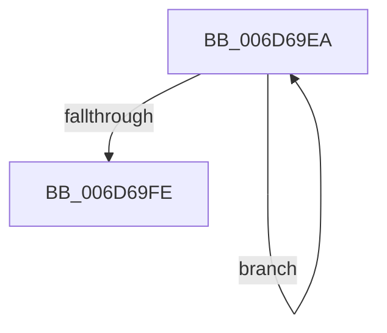

# sub_006D69EA

- RVA: `0x006D69EA`–`0x006D6A03` (길이 `25` bytes)
- VA: `0x00000001406D69EA`
- 실행 섹션: `.text`
- PDB 이름 있음: `아니요`; PDB Function 태그: `아니요`
- unwind 정보 RVA: `0x0005F4C4`
- 디코드: `7`개 명령, `25/25` bytes 표시
- 미해석 바이트: `0` (있으면 어셈블리에 `.byte`로 보존)

> 이 문서는 커널 이미지의 기계어와 PDB 기호를 분석해 생성했습니다. 4번과 5번은 함수 원형과 자료형을 바이너리 사용 방식에서 추정한 C 해석이며 원본 소스 복구 결과는 아닙니다.

## 1. Dependencies

- 직접 호출 지점: **1**; 고유 호출 대상: **1**
- 직접 호출자로 확인된 함수: **0**
- RIP 상대 이미지 참조: **0**

### Outgoing calls
- `0x006D69EE` → [KeYieldProcessorEx](../3F/KeYieldProcessorEx_function_003FBD00.md) (function, `0x003FBD00`)

### Direct callers
- 이 함수 시작 RVA로 연결되는 직접 call은 확인되지 않았습니다. 간접 호출은 완전히 역산할 수 없습니다.

### Static image references
- 디코드된 RIP-relative 메모리 참조가 없습니다.

## 2. Other-region calls and transfers

- 다른 실행 섹션으로 향하는 call: **0**
- call이 아닌 외부 분기/꼬리 이동: **1**
  - `0x006D69FE` → [KiSetPriorityThread + 0x362](../22/KiSetPriorityThread_function_00220E78.md) (`tail-transfer`)

## 3. Assembly (complete function range)

```asm
006D69EA  48 8D 4D C8                     lea rcx, [rbp - 0x38]
006D69EE  E8 0D 53 D2 FF                  call 0x1403fbd00
006D69F3  48 8B 07                        mov rax, qword ptr [rdi]
006D69F6  45 33 C0                        xor r8d, r8d
006D69F9  48 85 C0                        test rax, rax
006D69FC  75 EC                           jne 0x1406d69ea
006D69FE  E9 D7 A7 B4 FF                  jmp 0x1402211da
```

## 4. C-style interpretation (structured pseudocode)

```c
__int64 __fastcall sub_006D69EA(__int64 a1, __int64 a2, int a3)
{
    __int64 result;

    result = KeYieldProcessorEx(v_rbp - 56, a2, a3, a4);
    a3 = 0;
    if (*(unsigned __int64 *)(v_rdi) != 0) goto loc_006D69EA;
}
```

## 5. (Beta) C Style

```c
int64_t sub_006D69EA(int64_t Arg1, int64_t Arg2, int32_t Arg3)
{
    int64_t result;

    result = KeYieldProcessorEx(local_rbp - 56, Arg2, Arg3, a4);
    Arg3 = 0;
    if (*(uint64_t *)(local_rdi) != 0) goto loc_006D69EA;
}
```

## 6. Execution-region graph

[열기: 2D/3D 그래프와 함수 탐색 컨트롤 패널](../../../control-panel.html?section=text&rva=0x006D69EA&view=graph)

- 2D 그래프는 위에서 아래로 흐르고, 3D 그래프는 빈 공간을 드래그해 회전합니다. Shift+드래그는 이동, 휠은 확대·축소, 함수 노드 선택은 대상 보고서 이동입니다.

### Static fallback


