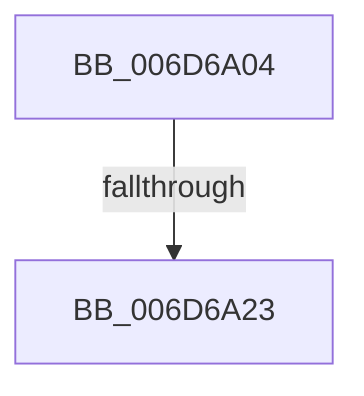

# sub_006D6A04

- RVA: `0x006D6A04`–`0x006D6A73` (길이 `111` bytes)
- VA: `0x00000001406D6A04`
- 실행 섹션: `.text`
- PDB 이름 있음: `아니요`; PDB Function 태그: `아니요`
- unwind 정보 RVA: `0x0005F748`
- 디코드: `25`개 명령, `111/111` bytes 표시
- 미해석 바이트: `0` (있으면 어셈블리에 `.byte`로 보존)

> 이 문서는 커널 이미지의 기계어와 PDB 기호를 분석해 생성했습니다. 4번과 5번은 함수 원형과 자료형을 바이너리 사용 방식에서 추정한 C 해석이며 원본 소스 복구 결과는 아닙니다.

## 1. Dependencies

- 직접 호출 지점: **3**; 고유 호출 대상: **3**
- 직접 호출자로 확인된 함수: **0**
- RIP 상대 이미지 참조: **3**

### Outgoing calls
- `0x006D6A12` → [ExAllocatePool2](../../poolcode/B8/ExAllocatePool2_function_00B820F0.md) (function, `0x00B820F0`)
- `0x006D6A57` → [KeInitializeApc](../42/KeInitializeApc_function_00428510.md) (function, `0x00428510`)
- `0x006D6A68` → [KeInsertQueueApc](../20/KeInsertQueueApc_function_00203F10.md) (function, `0x00203F10`)

### Direct callers
- 이 함수 시작 RVA로 연결되는 직접 call은 확인되지 않았습니다. 간접 호출은 완전히 역산할 수 없습니다.

### Static image references
- `0x006D6A32` → RVA `0x00A64260` (`IopRaiseHardError`; read)
- `0x006D6A3E` → RVA `0x0071AC40` (`IopAbortRequest`; read)
- `0x006D6A4A` → RVA `0x009071C0` (`AlpcpFreeBuffer`; read)

## 2. Other-region calls and transfers

- 다른 실행 섹션으로 향하는 call: **1**
  - `0x006D6A12` → [ExAllocatePool2](../../poolcode/B8/ExAllocatePool2_function_00B820F0.md) (`.text` → `POOLCODE`)
- call이 아닌 외부 분기/꼬리 이동: **2**
  - `0x006D6A1D` → [IoRaiseHardError + 0x1F5](../22/IoRaiseHardError_function_002230D0.md) (`tail-transfer`)
  - `0x006D6A6E` → [IoRaiseHardError + 0x1FF](../22/IoRaiseHardError_function_002230D0.md) (`tail-transfer`)

## 3. Assembly (complete function range)

```asm
006D6A04  BA 58 00 00 00                  mov edx, 0x58
006D6A09  8D 4A E8                        lea ecx, [rdx - 0x18]
006D6A0C  41 B8 4B 41 50 43               mov r8d, 0x4350414b
006D6A12  E8 D9 B6 4A 00                  call 0x140b820f0
006D6A17  48 8B F0                        mov rsi, rax
006D6A1A  48 85 C0                        test rax, rax
006D6A1D  0F 84 A2 C8 B4 FF               je 0x1402232c5
006D6A23  44 0F BE 47 46                  movsx r8d, byte ptr [rdi + 0x46]
006D6A28  48 89 7C 24 38                  mov qword ptr [rsp + 0x38], rdi
006D6A2D  C6 44 24 30 00                  mov byte ptr [rsp + 0x30], 0
006D6A32  48 8D 05 27 D8 38 00            lea rax, [rip + 0x38d827]
006D6A39  48 89 44 24 28                  mov qword ptr [rsp + 0x28], rax
006D6A3E  48 8D 05 FB 41 04 00            lea rax, [rip + 0x441fb]
006D6A45  48 89 44 24 20                  mov qword ptr [rsp + 0x20], rax
006D6A4A  4C 8D 0D 6F 07 23 00            lea r9, [rip + 0x23076f]
006D6A51  49 8B D6                        mov rdx, r14
006D6A54  48 8B CE                        mov rcx, rsi
006D6A57  E8 B4 1A D5 FF                  call 0x140428510
006D6A5C  45 33 C9                        xor r9d, r9d
006D6A5F  4D 8B C4                        mov r8, r12
006D6A62  49 8B D7                        mov rdx, r15
006D6A65  48 8B CE                        mov rcx, rsi
006D6A68  E8 A3 D4 B2 FF                  call 0x140203f10
006D6A6D  90                              nop
006D6A6E  E9 5C C8 B4 FF                  jmp 0x1402232cf
```

## 4. C-style interpretation (structured pseudocode)

```c
__int64 __fastcall sub_006D6A04(void)
{
    __int64 result;
    unsigned __int64 v_stack_p20;
    unsigned __int64 v_stack_p28;
    unsigned __int8 v_stack_p30;
    unsigned __int64 v_stack_p38;

    result = ExAllocatePool2(88 - 24, 88, (unsigned int)(0x4350414BULL), a4);
    v_stack_p38 = v_rdi;
    v_stack_p30 = 0;
    v_stack_p28 = v_rip + 3725351;
    v_stack_p20 = v_rip + 279035;
    result = KeInitializeApc(result, v_r14, (__int8)(*(unsigned __int8 *)(v_rdi + 70)), v_rip + 2295663);
    a4 = 0;
    result = KeInsertQueueApc(result, v_r15, v_r12, a4);
}
```

## 5. (Beta) C Style

```c
void sub_006D6A04(void)
{
    int64_t result;
    uint64_t v_stack_p20;
    uint64_t v_stack_p28;
    uint8_t v_stack_p30;
    uint64_t v_stack_p38;

    result = ExAllocatePool2(88 - 24, 88, (uint32_t)(0x4350414BULL), a4);
    v_stack_p38 = local_rdi;
    v_stack_p30 = 0;
    v_stack_p28 = v_rip + 3725351;
    v_stack_p20 = v_rip + 279035;
    result = KeInitializeApc(result, local_r14, (int8_t)(*(uint8_t *)(local_rdi + 0x46)), v_rip + 2295663);
    a4 = 0;
    result = KeInsertQueueApc(result, local_r15, local_r12, a4);
}
```

## 6. Execution-region graph

[열기: 2D/3D 그래프와 함수 탐색 컨트롤 패널](../../../control-panel.html?section=text&rva=0x006D6A04&view=graph)

- 2D 그래프는 위에서 아래로 흐르고, 3D 그래프는 빈 공간을 드래그해 회전합니다. Shift+드래그는 이동, 휠은 확대·축소, 함수 노드 선택은 대상 보고서 이동입니다.

### Static fallback


