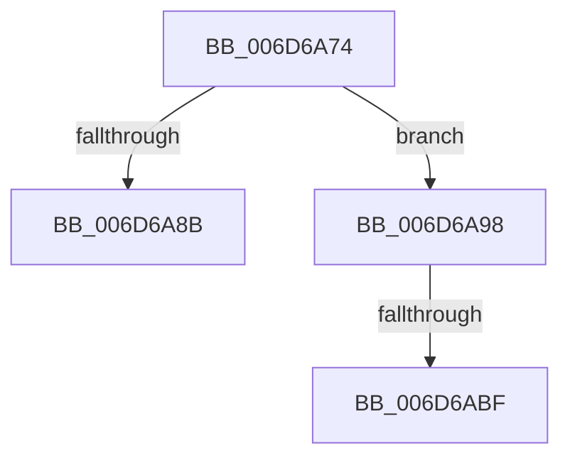

# sub_006D6A74

- RVA: `0x006D6A74`–`0x006D6AD0` (길이 `92` bytes)
- VA: `0x00000001406D6A74`
- 실행 섹션: `.text`
- PDB 이름 있음: `아니요`; PDB Function 태그: `아니요`
- unwind 정보 RVA: `0x0005F828`
- 디코드: `23`개 명령, `92/92` bytes 표시
- 미해석 바이트: `0` (있으면 어셈블리에 `.byte`로 보존)

> 이 문서는 커널 이미지의 기계어와 PDB 기호를 분석해 생성했습니다. 4번과 5번은 함수 원형과 자료형을 바이너리 사용 방식에서 추정한 C 해석이며 원본 소스 복구 결과는 아닙니다.

## 1. Dependencies

- 직접 호출 지점: **3**; 고유 호출 대상: **3**
- 직접 호출자로 확인된 함수: **0**
- RIP 상대 이미지 참조: **0**

### Outgoing calls
- `0x006D6A80` → [SepAdtCopyToLsaSharedMemory](../../page/7A/SepAdtCopyToLsaSharedMemory_function_007A37EC.md) (function, `0x007A37EC`)
- `0x006D6A8D` → [SepAuditFailed](../../page/86/SepAuditFailed_function_0086EE20.md) (function, `0x0086EE20`)
- `0x006D6AC5` → [ExFreePoolWithTag](../../poolcode/B8/ExFreePoolWithTag_function_00B82870.md) (function, `0x00B82870`)

### Direct callers
- 이 함수 시작 RVA로 연결되는 직접 call은 확인되지 않았습니다. 간접 호출은 완전히 역산할 수 없습니다.

### Static image references
- 디코드된 RIP-relative 메모리 참조가 없습니다.

## 2. Other-region calls and transfers

- 다른 실행 섹션으로 향하는 call: **3**
  - `0x006D6A80` → [SepAdtCopyToLsaSharedMemory](../../page/7A/SepAdtCopyToLsaSharedMemory_function_007A37EC.md) (`.text` → `PAGE`)
  - `0x006D6A8D` → [SepAuditFailed](../../page/86/SepAuditFailed_function_0086EE20.md) (`.text` → `PAGE`)
  - `0x006D6AC5` → [ExFreePoolWithTag](../../poolcode/B8/ExFreePoolWithTag_function_00B82870.md) (`.text` → `POOLCODE`)
- call이 아닌 외부 분기/꼬리 이동: **3**
  - `0x006D6A93` → [SepRmDispatchDataToLsa + 0xB7](../22/SepRmDispatchDataToLsa_function_0022395C.md) (`tail-transfer`)
  - `0x006D6AB9` → [SepRmDispatchDataToLsa + 0x162](../22/SepRmDispatchDataToLsa_function_0022395C.md) (`tail-transfer`)
  - `0x006D6ACB` → [SepRmDispatchDataToLsa + 0x162](../22/SepRmDispatchDataToLsa_function_0022395C.md) (`tail-transfer`)

## 3. Assembly (complete function range)

```asm
006D6A74  49 8B 8E 10 03 00 00            mov rcx, qword ptr [r14 + 0x310]
006D6A7B  4C 8D 4C 24 40                  lea r9, [rsp + 0x40]
006D6A80  E8 67 CD 0C 00                  call 0x1407a37ec
006D6A85  8B D8                           mov ebx, eax
006D6A87  85 C0                           test eax, eax
006D6A89  79 0D                           jns 0x1406d6a98
006D6A8B  8B C8                           mov ecx, eax
006D6A8D  E8 8E 83 19 00                  call 0x14086ee20
006D6A92  90                              nop
006D6A93  E9 7B CF B4 FF                  jmp 0x140223a13
006D6A98  48 8B 44 24 40                  mov rax, qword ptr [rsp + 0x40]
006D6A9D  48 89 45 80                     mov qword ptr [rbp - 0x80], rax
006D6AA1  C7 44 24 7C 03 00 00 00         mov dword ptr [rsp + 0x7c], 3
006D6AA9  C7 44 24 50 10 00 38 00         mov dword ptr [rsp + 0x50], 0x380010
006D6AB1  8B 47 10                        mov eax, dword ptr [rdi + 0x10]
006D6AB4  83 E8 04                        sub eax, 4
006D6AB7  3B C6                           cmp eax, esi
006D6AB9  0F 87 FF CF B4 FF               ja 0x140223abe
006D6ABF  48 8B 4F 18                     mov rcx, qword ptr [rdi + 0x18]
006D6AC3  33 D2                           xor edx, edx
006D6AC5  E8 A6 BD 4A 00                  call 0x140b82870
006D6ACA  90                              nop
006D6ACB  E9 EE CF B4 FF                  jmp 0x140223abe
```

## 4. C-style interpretation (structured pseudocode)

```c
__int64 __fastcall sub_006D6A74(__int64 a1, int a2, __int64 a3, __int64 a4, __int64 a5, __int64 a6, __int64 a7, __int64 a8)
{
    __int64 result;
    unsigned int v_stack_p50;
    unsigned int v_stack_p7C;

    result = SepAdtCopyToLsaSharedMemory(*(unsigned __int64 *)(v_r14 + 784), a2, a3, a8);
    if (!sign_flag) goto loc_006D6A98;
    result = SepAuditFailed((unsigned int)((unsigned int)(result)), a2, a3, a8);
loc_006D6A98:
    *(unsigned __int64 *)(v_rbp - 128) = a8;
    v_stack_p7C = 3;
    v_stack_p50 = 0x380010ULL;
    result = (unsigned int)(((unsigned int)(*(unsigned int *)(v_rdi + 16))) - (4));
    a2 = 0;
    result = ExFreePoolWithTag(*(unsigned __int64 *)(v_rdi + 24), a2, a3, a8);
}
```

## 5. (Beta) C Style

```c
int64_t sub_006D6A74(int64_t Arg1, int32_t Arg2, int64_t Arg3, int64_t Arg4, uint64_t Arg5, uint64_t Arg6, uint64_t Arg7, int64_t Arg8)
{
    int64_t result;
    uint32_t v_stack_p50;
    uint32_t v_stack_p7C;

    result = SepAdtCopyToLsaSharedMemory(*(uint64_t *)(local_r14 + 0x310), Arg2, Arg3, Arg8);
    if (!sign_flag) goto loc_006D6A98;
    result = SepAuditFailed((uint32_t)((uint32_t)(result)), Arg2, Arg3, Arg8);
loc_006D6A98:
    *(uint64_t *)(local_rbp - 0x80) = Arg8;
    v_stack_p7C = 3;
    v_stack_p50 = 0x380010ULL;
    result = (uint32_t)(((uint32_t)(*(uint32_t *)(local_rdi + 0x10))) - (4));
    Arg2 = 0;
    result = ExFreePoolWithTag(*(uint64_t *)(local_rdi + 0x18), Arg2, Arg3, Arg8);
}
```

## 6. Execution-region graph

[열기: 2D/3D 그래프와 함수 탐색 컨트롤 패널](../../../control-panel.html?section=text&rva=0x006D6A74&view=graph)

- 2D 그래프는 위에서 아래로 흐르고, 3D 그래프는 빈 공간을 드래그해 회전합니다. Shift+드래그는 이동, 휠은 확대·축소, 함수 노드 선택은 대상 보고서 이동입니다.

### Static fallback


