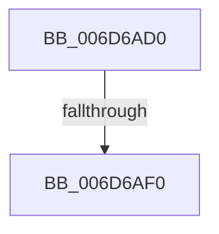

# sub_006D6AD0

- RVA: `0x006D6AD0`–`0x006D6B00` (길이 `48` bytes)
- VA: `0x00000001406D6AD0`
- 실행 섹션: `.text`
- PDB 이름 있음: `아니요`; PDB Function 태그: `아니요`
- unwind 정보 RVA: `0x0005F9AC`
- 디코드: `12`개 명령, `48/48` bytes 표시
- 미해석 바이트: `0` (있으면 어셈블리에 `.byte`로 보존)

> 이 문서는 커널 이미지의 기계어와 PDB 기호를 분석해 생성했습니다. 4번과 5번은 함수 원형과 자료형을 바이너리 사용 방식에서 추정한 C 해석이며 원본 소스 복구 결과는 아닙니다.

## 1. Dependencies

- 직접 호출 지점: **3**; 고유 호출 대상: **2**
- 직접 호출자로 확인된 함수: **0**
- RIP 상대 이미지 참조: **0**

### Outgoing calls
- `0x006D6AD6` → [ExFreePoolWithTag](../../poolcode/B8/ExFreePoolWithTag_function_00B82870.md) (function, `0x00B82870`)
- `0x006D6AE0` → [ExFreePoolWithTag](../../poolcode/B8/ExFreePoolWithTag_function_00B82870.md) (function, `0x00B82870`)
- `0x006D6AF5` → [SepAuditFailedRaisedIrql](../60/SepAuditFailedRaisedIrql_function_0060B894.md) (function, `0x0060B894`)

### Direct callers
- 이 함수 시작 RVA로 연결되는 직접 call은 확인되지 않았습니다. 간접 호출은 완전히 역산할 수 없습니다.

### Static image references
- 디코드된 RIP-relative 메모리 참조가 없습니다.

## 2. Other-region calls and transfers

- 다른 실행 섹션으로 향하는 call: **2**
  - `0x006D6AD6` → [ExFreePoolWithTag](../../poolcode/B8/ExFreePoolWithTag_function_00B82870.md) (`.text` → `POOLCODE`)
  - `0x006D6AE0` → [ExFreePoolWithTag](../../poolcode/B8/ExFreePoolWithTag_function_00B82870.md) (`.text` → `POOLCODE`)
- call이 아닌 외부 분기/꼬리 이동: **2**
  - `0x006D6AEA` → [SepAdtLogAuditRecord + 0x126](../22/SepAdtLogAuditRecord_function_00224B6C.md) (`tail-transfer`)
  - `0x006D6AFB` → [SepAdtLogAuditRecord + 0x126](../22/SepAdtLogAuditRecord_function_00224B6C.md) (`tail-transfer`)

## 3. Assembly (complete function range)

```asm
006D6AD0  48 8B 4B 18                     mov rcx, qword ptr [rbx + 0x18]
006D6AD4  33 D2                           xor edx, edx
006D6AD6  E8 95 BD 4A 00                  call 0x140b82870
006D6ADB  33 D2                           xor edx, edx
006D6ADD  48 8B CB                        mov rcx, rbx
006D6AE0  E8 8B BD 4A 00                  call 0x140b82870
006D6AE5  80 7C 24 20 00                  cmp byte ptr [rsp + 0x20], 0
006D6AEA  0F 85 A2 E1 B4 FF               jne 0x140224c92
006D6AF0  B9 01 00 00 C0                  mov ecx, 0xc0000001
006D6AF5  E8 9A 4D F3 FF                  call 0x14060b894
006D6AFA  90                              nop
006D6AFB  E9 92 E1 B4 FF                  jmp 0x140224c92
```

## 4. C-style interpretation (structured pseudocode)

```c
__int64 __fastcall sub_006D6AD0(__int64 a1, int a2)
{
    __int64 result;
    unsigned __int8 v_stack_p20;

    a2 = 0;
    result = ExFreePoolWithTag(*(unsigned __int64 *)(v_rbx + 24), a2, a3, a4);
    a2 = 0;
    result = ExFreePoolWithTag(v_rbx, a2, a3, a4);
    result = SepAuditFailedRaisedIrql((unsigned int)(0xC0000001ULL), a2, a3, a4);
}
```

## 5. (Beta) C Style

```c
int64_t sub_006D6AD0(int64_t Arg1, int32_t Arg2)
{
    int64_t result;
    uint8_t v_stack_p20;

    Arg2 = 0;
    result = ExFreePoolWithTag(*(uint64_t *)(local_rbx + 0x18), Arg2, a3, a4);
    Arg2 = 0;
    result = ExFreePoolWithTag(local_rbx, Arg2, a3, a4);
    result = SepAuditFailedRaisedIrql((uint32_t)(0xC0000001ULL), Arg2, a3, a4);
}
```

## 6. Execution-region graph

[열기: 2D/3D 그래프와 함수 탐색 컨트롤 패널](../../../control-panel.html?section=text&rva=0x006D6AD0&view=graph)

- 2D 그래프는 위에서 아래로 흐르고, 3D 그래프는 빈 공간을 드래그해 회전합니다. Shift+드래그는 이동, 휠은 확대·축소, 함수 노드 선택은 대상 보고서 이동입니다.

### Static fallback


