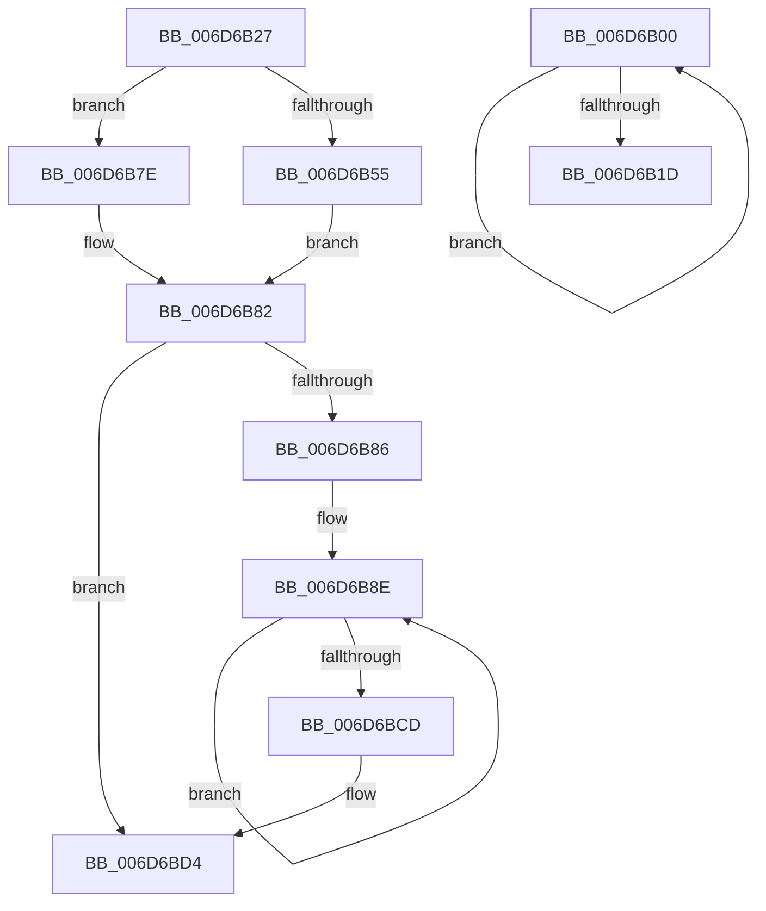

# sub_006D6B00

- RVA: `0x006D6B00`–`0x006D6BDE` (길이 `222` bytes)
- VA: `0x00000001406D6B00`
- 실행 섹션: `.text`
- PDB 이름 있음: `아니요`; PDB Function 태그: `아니요`
- unwind 정보 RVA: `0x0005F9DC`
- 디코드: `62`개 명령, `222/222` bytes 표시
- 미해석 바이트: `0` (있으면 어셈블리에 `.byte`로 보존)

> 이 문서는 커널 이미지의 기계어와 PDB 기호를 분석해 생성했습니다. 4번과 5번은 함수 원형과 자료형을 바이너리 사용 방식에서 추정한 C 해석이며 원본 소스 복구 결과는 아닙니다.

## 1. Dependencies

- 직접 호출 지점: **2**; 고유 호출 대상: **1**
- 직접 호출자로 확인된 함수: **0**
- RIP 상대 이미지 참조: **0**

### Outgoing calls
- `0x006D6B5F` → [memcpy](../6C/memcpy_function_006C6840.md) (function, `0x006C6840`)
- `0x006D6BAE` → [memcpy](../6C/memcpy_function_006C6840.md) (function, `0x006C6840`)

### Direct callers
- 이 함수 시작 RVA로 연결되는 직접 call은 확인되지 않았습니다. 간접 호출은 완전히 역산할 수 없습니다.

### Static image references
- 디코드된 RIP-relative 메모리 참조가 없습니다.

## 2. Other-region calls and transfers

- 다른 실행 섹션으로 향하는 call: **0**
- call이 아닌 외부 분기/꼬리 이동: **2**
  - `0x006D6B22` → [SepAdtMarshallAuditRecord + 0x59](../22/SepAdtMarshallAuditRecord_function_00224DD8.md) (`tail-transfer`)
  - `0x006D6BD9` → [SepAdtMarshallAuditRecord + 0x169](../22/SepAdtMarshallAuditRecord_function_00224DD8.md) (`tail-transfer`)

## 3. Assembly (complete function range)

```asm
006D6B00  49 8B 00                        mov rax, qword ptr [r8]
006D6B03  4D 8D 40 10                     lea r8, [r8 + 0x10]
006D6B07  0F B6 48 01                     movzx ecx, byte ptr [rax + 1]
006D6B0B  8D 0C 8D 0F 00 00 00            lea ecx, [rcx*4 + 0xf]
006D6B12  41 23 CD                        and ecx, r13d
006D6B15  03 D1                           add edx, ecx
006D6B17  49 83 E9 01                     sub r9, 1
006D6B1B  75 E3                           jne 0x1406d6b00
006D6B1D  4C 8B 6C 24 70                  mov r13, qword ptr [rsp + 0x70]
006D6B22  E9 0A E3 B4 FF                  jmp 0x140224e31
006D6B27  49 8B 7F 18                     mov rdi, qword ptr [r15 + 0x18]
006D6B2B  48 8B C6                        mov rax, rsi
006D6B2E  48 8B DE                        mov rbx, rsi
006D6B31  0F 10 07                        movups xmm0, xmmword ptr [rdi]
006D6B34  F3 0F 7F 06                     movdqu xmmword ptr [rsi], xmm0
006D6B38  49 2B 06                        sub rax, qword ptr [r14]
006D6B3B  48 83 C6 10                     add rsi, 0x10
006D6B3F  49 89 04 24                     mov qword ptr [r12], rax
006D6B43  48 8B CE                        mov rcx, rsi
006D6B46  8B 07                           mov eax, dword ptr [rdi]
006D6B48  4C 8B 6F 08                     mov r13, qword ptr [rdi + 8]
006D6B4C  48 89 4C 24 28                  mov qword ptr [rsp + 0x28], rcx
006D6B51  85 C0                           test eax, eax
006D6B53  74 29                           je 0x1406d6b7e
006D6B55  44 8B C0                        mov r8d, eax
006D6B58  49 8B D5                        mov rdx, r13
006D6B5B  49 C1 E0 04                     shl r8, 4
006D6B5F  E8 DC FC FE FF                  call 0x1406c6840
006D6B64  48 8B 4C 24 28                  mov rcx, qword ptr [rsp + 0x28]
006D6B69  48 8B C6                        mov rax, rsi
006D6B6C  49 2B 06                        sub rax, qword ptr [r14]
006D6B6F  48 89 43 08                     mov qword ptr [rbx + 8], rax
006D6B73  8B 07                           mov eax, dword ptr [rdi]
006D6B75  48 C1 E0 04                     shl rax, 4
006D6B79  48 03 F0                        add rsi, rax
006D6B7C  EB 04                           jmp 0x1406d6b82
006D6B7E  48 89 6B 08                     mov qword ptr [rbx + 8], rbp
006D6B82  39 2F                           cmp dword ptr [rdi], ebp
006D6B84  76 4E                           jbe 0x1406d6bd4
006D6B86  4D 8D 65 08                     lea r12, [r13 + 8]
006D6B8A  4C 8D 69 08                     lea r13, [rcx + 8]
006D6B8E  48 8B C6                        mov rax, rsi
006D6B91  48 8B CE                        mov rcx, rsi
006D6B94  49 2B 06                        sub rax, qword ptr [r14]
006D6B97  49 89 45 00                     mov qword ptr [r13], rax
006D6B9B  49 8B 14 24                     mov rdx, qword ptr [r12]
006D6B9F  0F B6 42 01                     movzx eax, byte ptr [rdx + 1]
006D6BA3  48 8D 1C 85 08 00 00 00         lea rbx, [rax*4 + 8]
006D6BAB  4C 8B C3                        mov r8, rbx
006D6BAE  E8 8D FC FE FF                  call 0x1406c6840
006D6BB3  48 8D 43 07                     lea rax, [rbx + 7]
006D6BB7  FF C5                           inc ebp
006D6BB9  48 83 E0 F8                     and rax, 0xfffffffffffffff8
006D6BBD  4D 8D 6D 10                     lea r13, [r13 + 0x10]
006D6BC1  48 03 F0                        add rsi, rax
006D6BC4  4D 8D 64 24 10                  lea r12, [r12 + 0x10]
006D6BC9  3B 2F                           cmp ebp, dword ptr [rdi]
006D6BCB  72 C1                           jb 0x1406d6b8e
006D6BCD  4C 8B 64 24 30                  mov r12, qword ptr [rsp + 0x30]
006D6BD2  33 ED                           xor ebp, ebp
006D6BD4  4C 8B 6C 24 70                  mov r13, qword ptr [rsp + 0x70]
006D6BD9  E9 63 E3 B4 FF                  jmp 0x140224f41
```

## 4. C-style interpretation (structured pseudocode)

```c
__int64 __fastcall sub_006D6B00(__int64 a1, int a2, __int64 a3, __int64 a4, __int64 a5, __int64 a6, __int64 a7, __int64 a8, __int64 a9, __int64 a10, __int64 a11, __int64 a12, __int64 a13, __int64 a14)
{
    unsigned __int64 v_stack_p28;
    unsigned __int64 v_stack_p30;
    unsigned __int64 v_stack_p70;

    a1 = (unsigned int)((*(unsigned __int8 *)(*(unsigned __int64 *)(a3) + 1) * 4 + 15) & ((unsigned int)(v_r13)));
    a2 = (unsigned int)((a2) + ((unsigned int)(a1)));
    a4 = (a4) - (1);
    if (condition_is_not_equal) goto loc_006D6B00;
}
```

## 5. (Beta) C Style

```c
int64_t sub_006D6B00(int64_t Arg1, int32_t Arg2, void *Arg3, int64_t Arg4, uint64_t Arg5, uint64_t Arg6, uint64_t Arg7, uint64_t Arg8, uint64_t Arg9, uint64_t Arg10, uint64_t Arg11, uint64_t Arg12, uint64_t Arg13, int64_t Arg14)
{
    uint8_t *arg3 = (uint8_t *)Arg3;

    uint64_t v_stack_p28;
    uint64_t v_stack_p30;
    uint64_t v_stack_p70;

    Arg1 = (uint32_t)((*(uint8_t *)(*(uint64_t *)(arg3) + 0x1) * 4 + 15) & ((uint32_t)(local_r13)));
    Arg2 = (uint32_t)((Arg2) + ((uint32_t)(Arg1)));
    Arg4 = (Arg4) - (1);
    if (condition_is_not_equal) goto loc_006D6B00;
}
```

### 관측된 메모리 오프셋

구조체 형식이 확인되지 않은 접근은 인자 기준의 오프셋으로만 기록했습니다.

| 기준 인자 | 오프셋 표현 | 폭 (bit) | 접근 |
|---|---:|---:|---|
| `Arg3` | `+ 0x0` | `64` | `R` |
| `Arg3` | `+ 0x10` | `64` | `R` |

## 6. Execution-region graph

[열기: 2D/3D 그래프와 함수 탐색 컨트롤 패널](../../../control-panel.html?section=text&rva=0x006D6B00&view=graph)

- 2D 그래프는 위에서 아래로 흐르고, 3D 그래프는 빈 공간을 드래그해 회전합니다. Shift+드래그는 이동, 휠은 확대·축소, 함수 노드 선택은 대상 보고서 이동입니다.

### Static fallback


