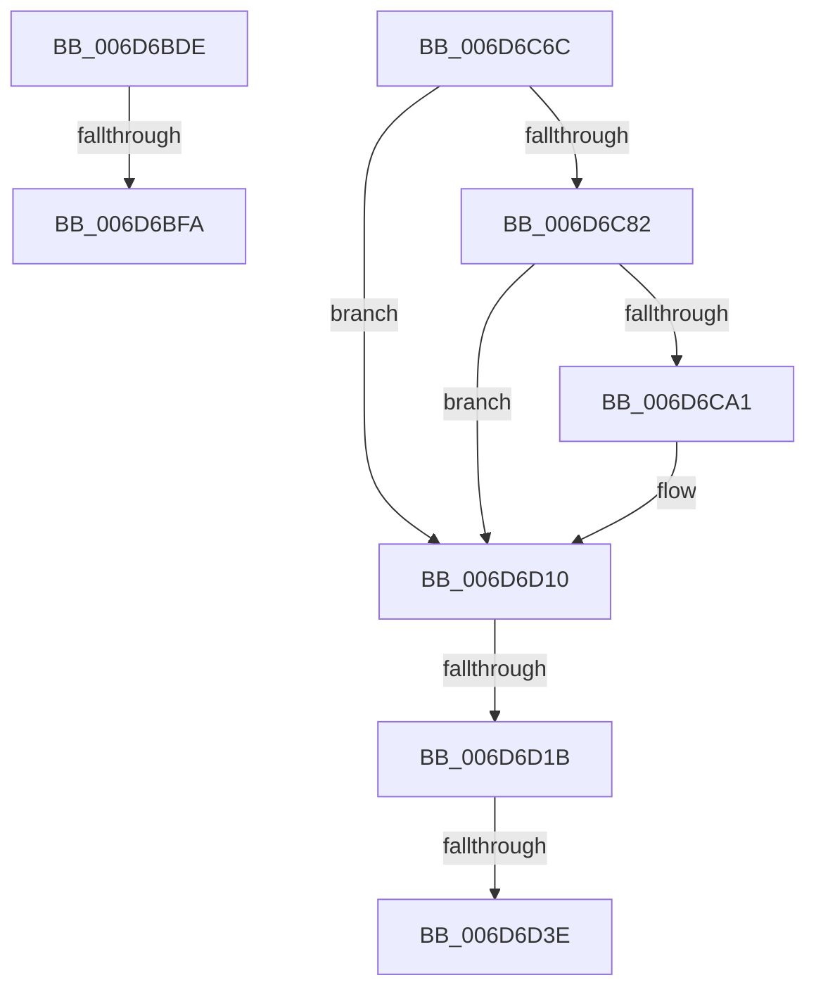

# sub_006D6BDE

- RVA: `0x006D6BDE`–`0x006D6DBE` (길이 `480` bytes)
- VA: `0x00000001406D6BDE`
- 실행 섹션: `.text`
- PDB 이름 있음: `아니요`; PDB Function 태그: `아니요`
- unwind 정보 RVA: `0x0005FAE4`
- 디코드: `102`개 명령, `480/480` bytes 표시
- 미해석 바이트: `0` (있으면 어셈블리에 `.byte`로 보존)

> 이 문서는 커널 이미지의 기계어와 PDB 기호를 분석해 생성했습니다. 4번과 5번은 함수 원형과 자료형을 바이너리 사용 방식에서 추정한 C 해석이며 원본 소스 복구 결과는 아닙니다.

## 1. Dependencies

- 직접 호출 지점: **6**; 고유 호출 대상: **2**
- 직접 호출자로 확인된 함수: **0**
- RIP 상대 이미지 참조: **0**

### Outgoing calls
- `0x006D6BED` → [EtwpLevelKeywordEnabled](../2F/EtwpLevelKeywordEnabled_function_002FD110.md) (function, `0x002FD110`)
- `0x006D6C61` → [EtwpEventWriteFull](../22/EtwpEventWriteFull_function_00225C10.md) (function, `0x00225C10`)
- `0x006D6C98` → [EtwpLevelKeywordEnabled](../2F/EtwpLevelKeywordEnabled_function_002FD110.md) (function, `0x002FD110`)
- `0x006D6D0B` → [EtwpEventWriteFull](../22/EtwpEventWriteFull_function_00225C10.md) (function, `0x00225C10`)
- `0x006D6D31` → [EtwpLevelKeywordEnabled](../2F/EtwpLevelKeywordEnabled_function_002FD110.md) (function, `0x002FD110`)
- `0x006D6DB3` → [EtwpEventWriteFull](../22/EtwpEventWriteFull_function_00225C10.md) (function, `0x00225C10`)

### Direct callers
- 이 함수 시작 RVA로 연결되는 직접 call은 확인되지 않았습니다. 간접 호출은 완전히 역산할 수 없습니다.

### Static image references
- 디코드된 RIP-relative 메모리 참조가 없습니다.

## 2. Other-region calls and transfers

- 다른 실행 섹션으로 향하는 call: **0**
- call이 아닌 외부 분기/꼬리 이동: **5**
  - `0x006D6BF4` → [EtwpDiskProvTraceDisk + 0x124](../22/EtwpDiskProvTraceDisk_function_00225A1C.md) (`tail-transfer`)
  - `0x006D6C67` → [EtwpDiskProvTraceDisk + 0x124](../22/EtwpDiskProvTraceDisk_function_00225A1C.md) (`tail-transfer`)
  - `0x006D6D15` → [EtwpDiskProvTraceDisk + 0x135](../22/EtwpDiskProvTraceDisk_function_00225A1C.md) (`tail-transfer`)
  - `0x006D6D38` → [EtwpDiskProvTraceDisk + 0x135](../22/EtwpDiskProvTraceDisk_function_00225A1C.md) (`tail-transfer`)
  - `0x006D6DB9` → [EtwpDiskProvTraceDisk + 0x135](../22/EtwpDiskProvTraceDisk_function_00225A1C.md) (`tail-transfer`)

## 3. Assembly (complete function range)

```asm
006D6BDE  48 8B 4B 28                     mov rcx, qword ptr [rbx + 0x28]
006D6BE2  4C 8B 47 08                     mov r8, qword ptr [rdi + 8]
006D6BE6  48 83 C1 60                     add rcx, 0x60
006D6BEA  8A 57 04                        mov dl, byte ptr [rdi + 4]
006D6BED  E8 1E 65 C2 FF                  call 0x1402fd110
006D6BF2  84 C0                           test al, al
006D6BF4  0F 84 46 EF B4 FF               je 0x140225b40
006D6BFA  0F B7 53 66                     movzx edx, word ptr [rbx + 0x66]
006D6BFE  48 8D 45 F7                     lea rax, [rbp - 9]
006D6C02  48 8B 4B 20                     mov rcx, qword ptr [rbx + 0x20]
006D6C06  45 33 C9                        xor r9d, r9d
006D6C09  48 89 84 24 80 00 00 00         mov qword ptr [rsp + 0x80], rax
006D6C11  45 33 C0                        xor r8d, r8d
006D6C14  0F B7 43 62                     movzx eax, word ptr [rbx + 0x62]
006D6C18  48 89 74 24 78                  mov qword ptr [rsp + 0x78], rsi
006D6C1D  66 89 44 24 70                  mov word ptr [rsp + 0x70], ax
006D6C22  48 8B 43 28                     mov rax, qword ptr [rbx + 0x28]
006D6C26  48 89 44 24 68                  mov qword ptr [rsp + 0x68], rax
006D6C2B  48 8D 45 FF                     lea rax, [rbp - 1]
006D6C2F  48 89 44 24 60                  mov qword ptr [rsp + 0x60], rax
006D6C34  4C 89 7C 24 58                  mov qword ptr [rsp + 0x58], r15
006D6C39  4C 89 74 24 50                  mov qword ptr [rsp + 0x50], r14
006D6C3E  C7 44 24 48 01 00 00 00         mov dword ptr [rsp + 0x48], 1
006D6C46  4C 89 6C 24 40                  mov qword ptr [rsp + 0x40], r13
006D6C4B  4C 89 64 24 38                  mov qword ptr [rsp + 0x38], r12
006D6C50  66 44 89 6C 24 30               mov word ptr [rsp + 0x30], r13w
006D6C56  66 44 89 6C 24 28               mov word ptr [rsp + 0x28], r13w
006D6C5C  48 89 7C 24 20                  mov qword ptr [rsp + 0x20], rdi
006D6C61  E8 AA EF B4 FF                  call 0x140225c10
006D6C66  90                              nop
006D6C67  E9 D4 EE B4 FF                  jmp 0x140225b40
006D6C6C  0F 57 C0                        xorps xmm0, xmm0
006D6C6F  0F 11 45 FF                     movups xmmword ptr [rbp - 1], xmm0
006D6C73  0F 11 45 0F                     movups xmmword ptr [rbp + 0xf], xmm0
006D6C77  66 44 39 6B 68                  cmp word ptr [rbx + 0x68], r13w
006D6C7C  0F 84 8E 00 00 00               je 0x1406d6d10
006D6C82  48 8B 43 20                     mov rax, qword ptr [rbx + 0x20]
006D6C86  4C 8B 47 08                     mov r8, qword ptr [rdi + 8]
006D6C8A  8A 57 04                        mov dl, byte ptr [rdi + 4]
006D6C8D  48 8B 88 90 02 00 00            mov rcx, qword ptr [rax + 0x290]
006D6C94  48 83 C1 60                     add rcx, 0x60
006D6C98  E8 73 64 C2 FF                  call 0x1402fd110
006D6C9D  84 C0                           test al, al
006D6C9F  74 6F                           je 0x1406d6d10
006D6CA1  48 8B 4B 20                     mov rcx, qword ptr [rbx + 0x20]
006D6CA5  48 8D 45 F7                     lea rax, [rbp - 9]
006D6CA9  0F B7 53 68                     movzx edx, word ptr [rbx + 0x68]
006D6CAD  45 33 C9                        xor r9d, r9d
006D6CB0  48 89 84 24 80 00 00 00         mov qword ptr [rsp + 0x80], rax
006D6CB8  45 33 C0                        xor r8d, r8d
006D6CBB  0F B7 43 62                     movzx eax, word ptr [rbx + 0x62]
006D6CBF  48 8B 89 90 02 00 00            mov rcx, qword ptr [rcx + 0x290]
006D6CC6  48 89 74 24 78                  mov qword ptr [rsp + 0x78], rsi
006D6CCB  66 89 44 24 70                  mov word ptr [rsp + 0x70], ax
006D6CD0  48 8D 45 FF                     lea rax, [rbp - 1]
006D6CD4  4C 89 6C 24 68                  mov qword ptr [rsp + 0x68], r13
006D6CD9  48 89 44 24 60                  mov qword ptr [rsp + 0x60], rax
006D6CDE  4C 89 7C 24 58                  mov qword ptr [rsp + 0x58], r15
006D6CE3  4C 89 74 24 50                  mov qword ptr [rsp + 0x50], r14
006D6CE8  C7 44 24 48 01 00 00 00         mov dword ptr [rsp + 0x48], 1
006D6CF0  4C 89 6C 24 40                  mov qword ptr [rsp + 0x40], r13
006D6CF5  4C 89 64 24 38                  mov qword ptr [rsp + 0x38], r12
006D6CFA  66 44 89 6C 24 30               mov word ptr [rsp + 0x30], r13w
006D6D00  66 44 89 6C 24 28               mov word ptr [rsp + 0x28], r13w
006D6D06  48 89 7C 24 20                  mov qword ptr [rsp + 0x20], rdi
006D6D0B  E8 00 EF B4 FF                  call 0x140225c10
006D6D10  66 44 39 6B 6A                  cmp word ptr [rbx + 0x6a], r13w
006D6D15  0F 84 36 EE B4 FF               je 0x140225b51
006D6D1B  48 8B 43 28                     mov rax, qword ptr [rbx + 0x28]
006D6D1F  4C 8B 47 08                     mov r8, qword ptr [rdi + 8]
006D6D23  8A 57 04                        mov dl, byte ptr [rdi + 4]
006D6D26  48 8B 88 90 02 00 00            mov rcx, qword ptr [rax + 0x290]
006D6D2D  48 83 C1 60                     add rcx, 0x60
006D6D31  E8 DA 63 C2 FF                  call 0x1402fd110
006D6D36  84 C0                           test al, al
006D6D38  0F 84 13 EE B4 FF               je 0x140225b51
006D6D3E  48 8B 4B 28                     mov rcx, qword ptr [rbx + 0x28]
006D6D42  48 8D 45 F7                     lea rax, [rbp - 9]
006D6D46  4C 8B 53 20                     mov r10, qword ptr [rbx + 0x20]
006D6D4A  45 33 C9                        xor r9d, r9d
006D6D4D  0F B7 53 6A                     movzx edx, word ptr [rbx + 0x6a]
006D6D51  45 33 C0                        xor r8d, r8d
006D6D54  48 89 84 24 80 00 00 00         mov qword ptr [rsp + 0x80], rax
006D6D5C  0F B7 43 62                     movzx eax, word ptr [rbx + 0x62]
006D6D60  48 89 74 24 78                  mov qword ptr [rsp + 0x78], rsi
006D6D65  66 89 44 24 70                  mov word ptr [rsp + 0x70], ax
006D6D6A  48 8B 81 90 02 00 00            mov rax, qword ptr [rcx + 0x290]
006D6D71  49 8B 8A 90 02 00 00            mov rcx, qword ptr [r10 + 0x290]
006D6D78  48 89 44 24 68                  mov qword ptr [rsp + 0x68], rax
006D6D7D  48 8D 45 FF                     lea rax, [rbp - 1]
006D6D81  48 89 44 24 60                  mov qword ptr [rsp + 0x60], rax
006D6D86  4C 89 7C 24 58                  mov qword ptr [rsp + 0x58], r15
006D6D8B  4C 89 74 24 50                  mov qword ptr [rsp + 0x50], r14
006D6D90  C7 44 24 48 01 00 00 00         mov dword ptr [rsp + 0x48], 1
006D6D98  4C 89 6C 24 40                  mov qword ptr [rsp + 0x40], r13
006D6D9D  4C 89 64 24 38                  mov qword ptr [rsp + 0x38], r12
006D6DA2  66 44 89 6C 24 30               mov word ptr [rsp + 0x30], r13w
006D6DA8  66 44 89 6C 24 28               mov word ptr [rsp + 0x28], r13w
006D6DAE  48 89 7C 24 20                  mov qword ptr [rsp + 0x20], rdi
006D6DB3  E8 58 EE B4 FF                  call 0x140225c10
006D6DB8  90                              nop
006D6DB9  E9 93 ED B4 FF                  jmp 0x140225b51
```

## 4. C-style interpretation (structured pseudocode)

```c
__int64 __fastcall sub_006D6BDE(__int64 a1, __int64 a2, __int64 a3, int a4)
{
    __int64 result;
    unsigned __int64 v_stack_p20;
    unsigned __int16 v_stack_p28;
    unsigned __int16 v_stack_p30;
    unsigned __int64 v_stack_p38;
    unsigned __int64 v_stack_p40;
    unsigned int v_stack_p48;
    unsigned __int64 v_stack_p50;
    unsigned __int64 v_stack_p58;
    unsigned __int64 v_stack_p60;
    unsigned __int64 v_stack_p68;
    unsigned __int16 v_stack_p70;
    unsigned __int64 v_stack_p78;
    unsigned __int64 v_stack_p80;

    a1 = (*(unsigned __int64 *)(v_rbx + 40)) + (96);
    result = EtwpLevelKeywordEnabled(a1, *(unsigned __int8 *)(v_rdi + 4), *(unsigned __int64 *)(v_rdi + 8), a4);
    a4 = 0;
    v_stack_p80 = v_rbp - 9;
    a3 = 0;
    v_stack_p78 = v_rsi;
    v_stack_p70 = (unsigned __int16)(*(unsigned __int16 *)(v_rbx + 98));
    v_stack_p68 = *(unsigned __int64 *)(v_rbx + 40);
    v_stack_p60 = v_rbp - 1;
    v_stack_p58 = v_r15;
    v_stack_p50 = v_r14;
    v_stack_p48 = 1;
    v_stack_p40 = v_r13;
    v_stack_p38 = v_r12;
    v_stack_p30 = (unsigned __int16)(v_r13);
    v_stack_p28 = (unsigned __int16)(v_r13);
    v_stack_p20 = v_rdi;
    result = EtwpEventWriteFull(*(unsigned __int64 *)(v_rbx + 32), *(unsigned __int16 *)(v_rbx + 102), a3, a4);
}
```

## 5. (Beta) C Style

```c
int64_t sub_006D6BDE(int64_t Arg1, int64_t Arg2, int64_t Arg3, int32_t Arg4)
{
    int64_t result;
    uint64_t v_stack_p20;
    uint16_t v_stack_p28;
    uint16_t v_stack_p30;
    uint64_t v_stack_p38;
    uint64_t v_stack_p40;
    uint32_t v_stack_p48;
    uint64_t v_stack_p50;
    uint64_t v_stack_p58;
    uint64_t v_stack_p60;
    uint64_t v_stack_p68;
    uint16_t v_stack_p70;
    uint64_t v_stack_p78;
    uint64_t v_stack_p80;

    Arg1 = (*(uint64_t *)(local_rbx + 0x28)) + (96);
    result = EtwpLevelKeywordEnabled(Arg1, *(uint8_t *)(local_rdi + 0x4), *(uint64_t *)(local_rdi + 0x8), Arg4);
    Arg4 = 0;
    v_stack_p80 = local_rbp - 9;
    Arg3 = 0;
    v_stack_p78 = local_rsi;
    v_stack_p70 = (uint16_t)(*(uint16_t *)(local_rbx + 0x62));
    v_stack_p68 = *(uint64_t *)(local_rbx + 0x28);
    v_stack_p60 = local_rbp - 1;
    v_stack_p58 = local_r15;
    v_stack_p50 = local_r14;
    v_stack_p48 = 1;
    v_stack_p40 = local_r13;
    v_stack_p38 = local_r12;
    v_stack_p30 = (uint16_t)(local_r13);
    v_stack_p28 = (uint16_t)(local_r13);
    v_stack_p20 = local_rdi;
    result = EtwpEventWriteFull(*(uint64_t *)(local_rbx + 0x20), *(uint16_t *)(local_rbx + 0x66), Arg3, Arg4);
}
```

## 6. Execution-region graph

[열기: 2D/3D 그래프와 함수 탐색 컨트롤 패널](../../../control-panel.html?section=text&rva=0x006D6BDE&view=graph)

- 2D 그래프는 위에서 아래로 흐르고, 3D 그래프는 빈 공간을 드래그해 회전합니다. Shift+드래그는 이동, 휠은 확대·축소, 함수 노드 선택은 대상 보고서 이동입니다.

### Static fallback


