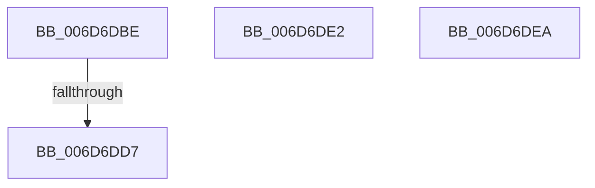

# sub_006D6DBE

- RVA: `0x006D6DBE`–`0x006D6E05` (길이 `71` bytes)
- VA: `0x00000001406D6DBE`
- 실행 섹션: `.text`
- PDB 이름 있음: `아니요`; PDB Function 태그: `아니요`
- unwind 정보 RVA: `0x0005FBBC`
- 디코드: `18`개 명령, `71/71` bytes 표시
- 미해석 바이트: `0` (있으면 어셈블리에 `.byte`로 보존)

> 이 문서는 커널 이미지의 기계어와 PDB 기호를 분석해 생성했습니다. 4번과 5번은 함수 원형과 자료형을 바이너리 사용 방식에서 추정한 C 해석이며 원본 소스 복구 결과는 아닙니다.

## 1. Dependencies

- 직접 호출 지점: **1**; 고유 호출 대상: **1**
- 직접 호출자로 확인된 함수: **0**
- RIP 상대 이미지 참조: **0**

### Outgoing calls
- `0x006D6DFF` → [KeBugCheckEx](../4F/KeBugCheckEx_function_004FD660.md) (function, `0x004FD660`)

### Direct callers
- 이 함수 시작 RVA로 연결되는 직접 call은 확인되지 않았습니다. 간접 호출은 완전히 역산할 수 없습니다.

### Static image references
- 디코드된 RIP-relative 메모리 참조가 없습니다.

## 2. Other-region calls and transfers

- 다른 실행 섹션으로 향하는 call: **0**
- call이 아닌 외부 분기/꼬리 이동: **3**
  - `0x006D6DD1` → [MmProtectMdlSystemAddress + 0x18D](../22/MmProtectMdlSystemAddress_function_00227B50.md) (`tail-transfer`)
  - `0x006D6DDD` → [MmProtectMdlSystemAddress + 0x18D](../22/MmProtectMdlSystemAddress_function_00227B50.md) (`tail-transfer`)
  - `0x006D6DE5` → [MmProtectMdlSystemAddress + 0x1DD](../22/MmProtectMdlSystemAddress_function_00227B50.md) (`tail-transfer`)

## 3. Assembly (complete function range)

```asm
006D6DBE  48 83 E3 EF                     and rbx, 0xffffffffffffffef
006D6DC2  83 64 24 38 00                  and dword ptr [rsp + 0x38], 0
006D6DC7  48 C1 EB 0C                     shr rbx, 0xc
006D6DCB  48 23 DA                        and rbx, rdx
006D6DCE  4C 3B FD                        cmp r15, rbp
006D6DD1  0F 85 06 0F B5 FF               jne 0x140227cdd
006D6DD7  A8 08                           test al, 8
006D6DD9  44 0F 45 E7                     cmovne r12d, edi
006D6DDD  E9 FB 0E B5 FF                  jmp 0x140227cdd
006D6DE2  83 CF 10                        or edi, 0x10
006D6DE5  E9 43 0F B5 FF                  jmp 0x140227d2d
006D6DEA  4C 8B CE                        mov r9, rsi
006D6DED  48 89 44 24 20                  mov qword ptr [rsp + 0x20], rax
006D6DF2  4D 8B C5                        mov r8, r13
006D6DF5  BA 35 12 00 00                  mov edx, 0x1235
006D6DFA  B9 1A 00 00 00                  mov ecx, 0x1a
006D6DFF  E8 5C 68 E2 FF                  call 0x1404fd660
006D6E04  CC                              int3
```

## 4. C-style interpretation (structured pseudocode)

```c
__int64 __fastcall sub_006D6DBE(__int64 a1, __int64 a2, __int64 a3, __int64 a4, __int64 a5, __int64 a6, unsigned int a7)
{
    __int64 v_r12;
    __int64 v_rbx;
    unsigned __int64 v_stack_p20;

    v_rbx = (v_rbx) & (-17);
    v_rbx = (v_rbx) >> (12);
    v_rbx = (v_rbx) & (a2);
    if ((((unsigned __int8)(result)) & (8)) != 0) { v_r12 = (unsigned int)(v_rdi); }
}
```

## 5. (Beta) C Style

```c
int64_t sub_006D6DBE(int64_t Arg1, int64_t Arg2, int64_t Arg3, int64_t Arg4, uint64_t Arg5, uint64_t Arg6, uint32_t Arg7)
{
    int64_t local_r12;
    int64_t local_rbx;
    uint64_t v_stack_p20;

    local_rbx = (local_rbx) & (-17);
    local_rbx = (local_rbx) >> (12);
    local_rbx = (local_rbx) & (Arg2);
    if ((((uint8_t)(result)) & (8)) != 0) { local_r12 = (uint32_t)(local_rdi); }
}
```

## 6. Execution-region graph

[열기: 2D/3D 그래프와 함수 탐색 컨트롤 패널](../../../control-panel.html?section=text&rva=0x006D6DBE&view=graph)

- 2D 그래프는 위에서 아래로 흐르고, 3D 그래프는 빈 공간을 드래그해 회전합니다. Shift+드래그는 이동, 휠은 확대·축소, 함수 노드 선택은 대상 보고서 이동입니다.

### Static fallback


