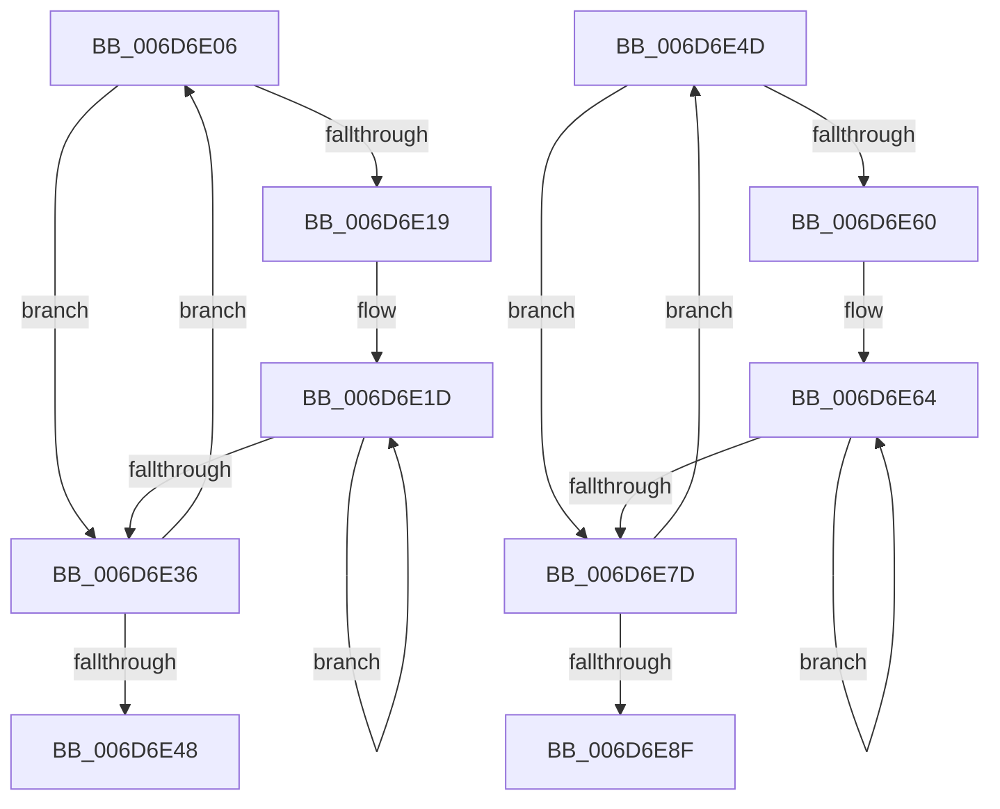

# sub_006D6E06

- RVA: `0x006D6E06`–`0x006D6E94` (길이 `142` bytes)
- VA: `0x00000001406D6E06`
- 실행 섹션: `.text`
- PDB 이름 있음: `아니요`; PDB Function 태그: `아니요`
- unwind 정보 RVA: `0x0005FC00`
- 디코드: `46`개 명령, `142/142` bytes 표시
- 미해석 바이트: `0` (있으면 어셈블리에 `.byte`로 보존)

> 이 문서는 커널 이미지의 기계어와 PDB 기호를 분석해 생성했습니다. 4번과 5번은 함수 원형과 자료형을 바이너리 사용 방식에서 추정한 C 해석이며 원본 소스 복구 결과는 아닙니다.

## 1. Dependencies

- 직접 호출 지점: **2**; 고유 호출 대상: **1**
- 직접 호출자로 확인된 함수: **0**
- RIP 상대 이미지 참조: **0**

### Outgoing calls
- `0x006D6E2B` → [KiHaltOnAddress](../4F/KiHaltOnAddress_function_004FBA3C.md) (function, `0x004FBA3C`)
- `0x006D6E72` → [KiHaltOnAddress](../4F/KiHaltOnAddress_function_004FBA3C.md) (function, `0x004FBA3C`)

### Direct callers
- 이 함수 시작 RVA로 연결되는 직접 call은 확인되지 않았습니다. 간접 호출은 완전히 역산할 수 없습니다.

### Static image references
- 디코드된 RIP-relative 메모리 참조가 없습니다.

## 2. Other-region calls and transfers

- 다른 실행 섹션으로 향하는 call: **0**
- call이 아닌 외부 분기/꼬리 이동: **2**
  - `0x006D6E48` → [KiSwapDirectoryTableBaseTarget + 0x53](../22/KiSwapDirectoryTableBaseTarget_function_00227FF0.md) (`tail-transfer`)
  - `0x006D6E8F` → [KiSwapDirectoryTableBaseTarget + 0xC8](../22/KiSwapDirectoryTableBaseTarget_function_00227FF0.md) (`tail-transfer`)

## 3. Assembly (complete function range)

```asm
006D6E06  0F BA E9 1E                     bts ecx, 0x1e
006D6E0A  8B C2                           mov eax, edx
006D6E0C  8B F1                           mov esi, ecx
006D6E0E  F0 0F B1 33                     lock cmpxchg dword ptr [rbx], esi
006D6E12  8B C8                           mov ecx, eax
006D6E14  41 3B C0                        cmp eax, r8d
006D6E17  75 1D                           jne 0x1406d6e36
006D6E19  89 74 24 68                     mov dword ptr [rsp + 0x68], esi
006D6E1D  41 B8 04 00 00 00               mov r8d, 4
006D6E23  48 8D 54 24 68                  lea rdx, [rsp + 0x68]
006D6E28  48 8B CB                        mov rcx, rbx
006D6E2B  E8 0C 4C E2 FF                  call 0x1404fba3c
006D6E30  8B 0B                           mov ecx, dword ptr [rbx]
006D6E32  3B CE                           cmp ecx, esi
006D6E34  74 E7                           je 0x1406d6e1d
006D6E36  8B C1                           mov eax, ecx
006D6E38  BE 00 00 00 80                  mov esi, 0x80000000
006D6E3D  23 C6                           and eax, esi
006D6E3F  8B D1                           mov edx, ecx
006D6E41  44 8B C1                        mov r8d, ecx
006D6E44  3B C7                           cmp eax, edi
006D6E46  75 BE                           jne 0x1406d6e06
006D6E48  E9 F6 11 B5 FF                  jmp 0x140228043
006D6E4D  0F BA E9 1E                     bts ecx, 0x1e
006D6E51  8B C2                           mov eax, edx
006D6E53  8B F1                           mov esi, ecx
006D6E55  F0 0F B1 33                     lock cmpxchg dword ptr [rbx], esi
006D6E59  8B C8                           mov ecx, eax
006D6E5B  41 3B C0                        cmp eax, r8d
006D6E5E  75 1D                           jne 0x1406d6e7d
006D6E60  89 74 24 78                     mov dword ptr [rsp + 0x78], esi
006D6E64  41 B8 04 00 00 00               mov r8d, 4
006D6E6A  48 8D 54 24 78                  lea rdx, [rsp + 0x78]
006D6E6F  48 8B CB                        mov rcx, rbx
006D6E72  E8 C5 4B E2 FF                  call 0x1404fba3c
006D6E77  8B 0B                           mov ecx, dword ptr [rbx]
006D6E79  3B CE                           cmp ecx, esi
006D6E7B  74 E7                           je 0x1406d6e64
006D6E7D  8B C1                           mov eax, ecx
006D6E7F  BE 00 00 00 80                  mov esi, 0x80000000
006D6E84  23 C6                           and eax, esi
006D6E86  8B D1                           mov edx, ecx
006D6E88  44 8B C1                        mov r8d, ecx
006D6E8B  3B C7                           cmp eax, edi
006D6E8D  75 BE                           jne 0x1406d6e4d
006D6E8F  E9 24 12 B5 FF                  jmp 0x1402280b8
```

## 4. C-style interpretation (structured pseudocode)

```c
__int64 __fastcall sub_006D6E06(int a1, int a2, int a3, __int64 a4, __int64 a5, __int64 a6, __int64 a7, __int64 a8, __int64 a9, __int64 a10, __int64 a11, __int64 a12, __int64 a13)
{
    __int64 result;
    unsigned int v_stack_p68;
    unsigned int v_stack_p78;

    if (((unsigned int)((unsigned int)(a2))) != a3) goto loc_006D6E36;
    v_stack_p68 = (unsigned int)((unsigned int)(a1));
loc_006D6E1D:
    result = KiHaltOnAddress(v_rbx, a13, 4, a4);
    if (((unsigned int)((unsigned int)(*(unsigned int *)(v_rbx)))) == ((unsigned int)((unsigned int)(a1)))) goto loc_006D6E1D;
loc_006D6E36:
    result = (unsigned int)(((unsigned int)((unsigned int)((unsigned int)(*(unsigned int *)(v_rbx))))) & ((unsigned int)((unsigned int)(0x80000000ULL))));
    if (((unsigned int)(result)) != ((unsigned int)(v_rdi))) goto loc_006D6E06;
}
```

## 5. (Beta) C Style

```c
int64_t sub_006D6E06(int32_t Arg1, int32_t Arg2, int32_t Arg3, int64_t Arg4, uint64_t Arg5, uint64_t Arg6, uint64_t Arg7, uint64_t Arg8, uint64_t Arg9, uint64_t Arg10, uint64_t Arg11, uint64_t Arg12, int64_t Arg13)
{
    int64_t result;
    uint32_t v_stack_p68;
    uint32_t v_stack_p78;

    if (((uint32_t)((uint32_t)(Arg2))) != Arg3) goto loc_006D6E36;
    v_stack_p68 = (uint32_t)((uint32_t)(Arg1));
loc_006D6E1D:
    result = KiHaltOnAddress(local_rbx, Arg13, 4, Arg4);
    if (((uint32_t)((uint32_t)(*(uint32_t *)(local_rbx)))) == ((uint32_t)((uint32_t)(Arg1)))) goto loc_006D6E1D;
loc_006D6E36:
    result = (uint32_t)(((uint32_t)((uint32_t)((uint32_t)(*(uint32_t *)(local_rbx))))) & ((uint32_t)((uint32_t)(0x80000000ULL))));
    if (((uint32_t)(result)) != ((uint32_t)(local_rdi))) goto loc_006D6E06;
}
```

## 6. Execution-region graph

[열기: 2D/3D 그래프와 함수 탐색 컨트롤 패널](../../../control-panel.html?section=text&rva=0x006D6E06&view=graph)

- 2D 그래프는 위에서 아래로 흐르고, 3D 그래프는 빈 공간을 드래그해 회전합니다. Shift+드래그는 이동, 휠은 확대·축소, 함수 노드 선택은 대상 보고서 이동입니다.

### Static fallback


