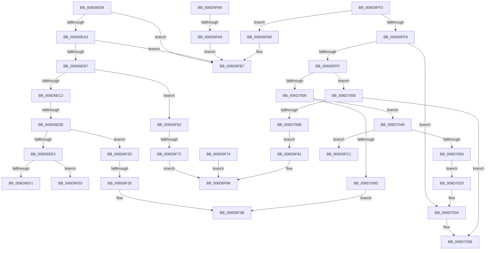

# sub_006D6E94

- RVA: `0x006D6E94`–`0x006D7070` (길이 `476` bytes)
- VA: `0x00000001406D6E94`
- 실행 섹션: `.text`
- PDB 이름 있음: `아니요`; PDB Function 태그: `아니요`
- unwind 정보 RVA: `0x0005FC84`
- 디코드: `113`개 명령, `476/476` bytes 표시
- 미해석 바이트: `0` (있으면 어셈블리에 `.byte`로 보존)

> 이 문서는 커널 이미지의 기계어와 PDB 기호를 분석해 생성했습니다. 4번과 5번은 함수 원형과 자료형을 바이너리 사용 방식에서 추정한 C 해석이며 원본 소스 복구 결과는 아닙니다.

## 1. Dependencies

- 직접 호출 지점: **11**; 고유 호출 대상: **7**
- 직접 호출자로 확인된 함수: **0**
- RIP 상대 이미지 참조: **0**

### Outgoing calls
- `0x006D6ECD` → [MiLockTransitionLeafPageEx](../40/MiLockTransitionLeafPageEx_function_00405884.md) (function, `0x00405884`)
- `0x006D6EE8` → [MiStandbyPageContentsIntact](../2A/MiStandbyPageContentsIntact_function_002AF0D4.md) (function, `0x002AF0D4`)
- `0x006D6EF8` → [MiUnlockPage](../31/MiUnlockPage_function_0031A3E0.md) (function, `0x0031A3E0`)
- `0x006D6F57` → [MiWaitForCollidedFaultComplete](../36/MiWaitForCollidedFaultComplete_function_00369EDC.md) (function, `0x00369EDC`)
- `0x006D6F65` → [MiGetPagingFileOffset](../36/MiGetPagingFileOffset_function_0036F530.md) (function, `0x0036F530`)
- `0x006D6F91` → [MiUnlockProtoPoolPage](../24/MiUnlockProtoPoolPage_function_00246090.md) (function, `0x00246090`)
- `0x006D6FB2` → [MiUnlockProtoPoolPage](../24/MiUnlockProtoPoolPage_function_00246090.md) (function, `0x00246090`)
- `0x006D7015` → [MiObtainProtoReference](../31/MiObtainProtoReference_function_00318178.md) (function, `0x00318178`)
- `0x006D703B` → [MiUnlockProtoPoolPage](../24/MiUnlockProtoPoolPage_function_00246090.md) (function, `0x00246090`)
- `0x006D7049` → [MiStandbyPageContentsIntact](../2A/MiStandbyPageContentsIntact_function_002AF0D4.md) (function, `0x002AF0D4`)
- `0x006D705B` → [MiGetPagingFileOffset](../36/MiGetPagingFileOffset_function_0036F530.md) (function, `0x0036F530`)

### Direct callers
- 이 함수 시작 RVA로 연결되는 직접 call은 확인되지 않았습니다. 간접 호출은 완전히 역산할 수 없습니다.

### Static image references
- 디코드된 RIP-relative 메모리 참조가 없습니다.

## 2. Other-region calls and transfers

- 다른 실행 섹션으로 향하는 call: **0**
- call이 아닌 외부 분기/꼬리 이동: **11**
  - `0x006D6ED8` → [MiTranslatePageForCopy + 0x332](../22/MiTranslatePageForCopy_function_00228960.md) (`tail-transfer`)
  - `0x006D6EFE` → [MiTranslatePageForCopy + 0x478](../22/MiTranslatePageForCopy_function_00228960.md) (`tail-transfer`)
  - `0x006D6F28` → [MiTranslatePageForCopy + 0x22A](../22/MiTranslatePageForCopy_function_00228960.md) (`tail-transfer`)
  - `0x006D6F2F` → [MiTranslatePageForCopy + 0x478](../22/MiTranslatePageForCopy_function_00228960.md) (`tail-transfer`)
  - `0x006D6F5D` → [MiTranslatePageForCopy + 0x478](../22/MiTranslatePageForCopy_function_00228960.md) (`tail-transfer`)
  - `0x006D6F6C` → [MiTranslatePageForCopy + 0x478](../22/MiTranslatePageForCopy_function_00228960.md) (`tail-transfer`)
  - `0x006D6F9B` → [MiTranslatePageForCopy + 0x22A](../22/MiTranslatePageForCopy_function_00228960.md) (`tail-transfer`)
  - `0x006D6FA3` → [MiTranslatePageForCopy + 0x45F](../22/MiTranslatePageForCopy_function_00228960.md) (`tail-transfer`)
  - `0x006D6FBC` → [MiTranslatePageForCopy + 0x22A](../22/MiTranslatePageForCopy_function_00228960.md) (`tail-transfer`)
  - `0x006D6FEE` → [MiTranslatePageForCopy + 0x22A](../22/MiTranslatePageForCopy_function_00228960.md) (`tail-transfer`)
  - `0x006D7041` → [MiTranslatePageForCopy + 0x478](../22/MiTranslatePageForCopy_function_00228960.md) (`tail-transfer`)

## 3. Assembly (complete function range)

```asm
006D6E94  48 8B C8                        mov rcx, rax
006D6E97  81 E1 E0 03 00 00               and ecx, 0x3e0
006D6E9D  0F 84 14 01 00 00               je 0x1406d6fb7
006D6EA3  48 81 C1 00 FE FF FF            add rcx, -0x200
006D6EAA  48 F7 C1 FF FE FF FF            test rcx, -0x101
006D6EB1  0F 84 00 01 00 00               je 0x1406d6fb7
006D6EB7  48 0F BA E0 0B                  bt rax, 0xb
006D6EBC  0F 83 A0 00 00 00               jae 0x1406d6f62
006D6EC2  45 33 C0                        xor r8d, r8d
006D6EC5  48 8D 54 24 30                  lea rdx, [rsp + 0x30]
006D6ECA  49 8B CF                        mov rcx, r15
006D6ECD  E8 B2 E9 D2 FF                  call 0x140405884
006D6ED2  48 8B F0                        mov rsi, rax
006D6ED5  48 85 C0                        test rax, rax
006D6ED8  0F 84 B4 1D B5 FF               je 0x140228c92
006D6EDE  8A 40 22                        mov al, byte ptr [rax + 0x22]
006D6EE1  A8 20                           test al, 0x20
006D6EE3  75 48                           jne 0x1406d6f2d
006D6EE5  48 8B CE                        mov rcx, rsi
006D6EE8  E8 E7 81 BD FF                  call 0x1402af0d4
006D6EED  85 C0                           test eax, eax
006D6EEF  75 12                           jne 0x1406d6f03
006D6EF1  8A 54 24 30                     mov dl, byte ptr [rsp + 0x30]
006D6EF5  48 8B CE                        mov rcx, rsi
006D6EF8  E8 E3 34 C4 FF                  call 0x14031a3e0
006D6EFD  90                              nop
006D6EFE  E9 D5 1E B5 FF                  jmp 0x140228dd8
006D6F03  48 B8 00 00 00 00 00 DE FF FF   movabs rax, 0xffffde0000000000
006D6F0D  48 8B C0                        mov rax, rax
006D6F10  48 8B FE                        mov rdi, rsi
006D6F13  48 2B F8                        sub rdi, rax
006D6F16  48 B8 AB AA AA AA AA AA AA AA   movabs rax, 0xaaaaaaaaaaaaaaab
006D6F20  48 C1 FF 04                     sar rdi, 4
006D6F24  48 0F AF F8                     imul rdi, rax
006D6F28  E9 5D 1C B5 FF                  jmp 0x140228b8a
006D6F2D  A8 08                           test al, 8
006D6F2F  0F 85 A3 1E B5 FF               jne 0x140228dd8
006D6F35  45 33 C0                        xor r8d, r8d
006D6F38  48 8B D6                        mov rdx, rsi
006D6F3B  44 8A 4C 24 30                  mov r9b, byte ptr [rsp + 0x30]
006D6F40  48 8D 44 24 34                  lea rax, [rsp + 0x34]
006D6F45  48 8D 4C 24 60                  lea rcx, [rsp + 0x60]
006D6F4A  48 89 44 24 20                  mov qword ptr [rsp + 0x20], rax
006D6F4F  C7 44 24 34 01 00 00 00         mov dword ptr [rsp + 0x34], 1
006D6F57  E8 80 2F C9 FF                  call 0x140369edc
006D6F5C  90                              nop
006D6F5D  E9 76 1E B5 FF                  jmp 0x140228dd8
006D6F62  48 8B C8                        mov rcx, rax
006D6F65  E8 C6 85 C9 FF                  call 0x14036f530
006D6F6A  85 C0                           test eax, eax
006D6F6C  0F 85 66 1E B5 FF               jne 0x140228dd8
006D6F72  EB 22                           jmp 0x1406d6f96
006D6F74  48 8B D0                        mov rdx, rax
006D6F77  48 0F BA F2 0A                  btr rdx, 0xa
006D6F7C  48 F7 C1 00 00 FF FF            test rcx, -0x10000
006D6F83  48 0F 45 D0                     cmovne rdx, rax
006D6F87  48 83 E2 FD                     and rdx, 0xfffffffffffffffd
006D6F8B  49 89 14 24                     mov qword ptr [r12], rdx
006D6F8F  EB 05                           jmp 0x1406d6f96
006D6F91  E8 FA F0 B6 FF                  call 0x140246090
006D6F96  BB 11 01 00 00                  mov ebx, 0x111
006D6F9B  E9 EA 1B B5 FF                  jmp 0x140228b8a
006D6FA0  48 85 F6                        test rsi, rsi
006D6FA3  0F 85 16 1E B5 FF               jne 0x140228dbf
006D6FA9  EB 0C                           jmp 0x1406d6fb7
006D6FAB  8A 54 24 30                     mov dl, byte ptr [rsp + 0x30]
006D6FAF  49 8B CE                        mov rcx, r14
006D6FB2  E8 D9 F0 B6 FF                  call 0x140246090
006D6FB7  BB 05 00 00 C0                  mov ebx, 0xc0000005
006D6FBC  E9 C9 1B B5 FF                  jmp 0x140228b8a
006D6FC1  48 B8 00 00 00 00 00 DE FF FF   movabs rax, 0xffffde0000000000
006D6FCB  48 8B C0                        mov rax, rax
006D6FCE  49 8B FF                        mov rdi, r15
006D6FD1  48 2B F8                        sub rdi, rax
006D6FD4  48 B8 AB AA AA AA AA AA AA AA   movabs rax, 0xaaaaaaaaaaaaaaab
006D6FDE  48 C1 FF 04                     sar rdi, 4
006D6FE2  48 0F AF F8                     imul rdi, rax
006D6FE6  48 8B 44 24 38                  mov rax, qword ptr [rsp + 0x38]
006D6FEB  4C 89 30                        mov qword ptr [rax], r14
006D6FEE  E9 97 1B B5 FF                  jmp 0x140228b8a
006D6FF3  48 85 C0                        test rax, rax
006D6FF6  74 B3                           je 0x1406d6fab
006D6FF8  48 0F BA E0 0A                  bt rax, 0xa
006D6FFD  72 35                           jb 0x1406d7034
006D6FFF  48 0F BA E0 0B                  bt rax, 0xb
006D7004  73 52                           jae 0x1406d7058
006D7006  41 F6 47 22 20                  test byte ptr [r15 + 0x22], 0x20
006D700B  74 39                           je 0x1406d7046
006D700D  BA 01 00 00 00                  mov edx, 1
006D7012  49 8B CE                        mov rcx, r14
006D7015  E8 5E 11 C4 FF                  call 0x140318178
006D701A  4D 8B C6                        mov r8, r14
006D701D  49 8B D7                        mov rdx, r15
006D7020  E9 16 FF FF FF                  jmp 0x1406d6f3b
006D7025  48 B8 FF FF FF FF FF FF FF 7F   movabs rax, 0x7fffffffffffffff
006D702F  F0 49 21 47 18                  lock and qword ptr [r15 + 0x18], rax
006D7034  8A 54 24 30                     mov dl, byte ptr [rsp + 0x30]
006D7038  49 8B CE                        mov rcx, r14
006D703B  E8 50 F0 B6 FF                  call 0x140246090
006D7040  90                              nop
006D7041  E9 92 1D B5 FF                  jmp 0x140228dd8
006D7046  49 8B CF                        mov rcx, r15
006D7049  E8 86 80 BD FF                  call 0x1402af0d4
006D704E  85 C0                           test eax, eax
006D7050  0F 85 6B FF FF FF               jne 0x1406d6fc1
006D7056  EB CD                           jmp 0x1406d7025
006D7058  48 8B C8                        mov rcx, rax
006D705B  E8 D0 84 C9 FF                  call 0x14036f530
006D7060  8A 54 24 30                     mov dl, byte ptr [rsp + 0x30]
006D7064  49 8B CE                        mov rcx, r14
006D7067  85 C0                           test eax, eax
006D7069  75 D0                           jne 0x1406d703b
006D706B  E9 21 FF FF FF                  jmp 0x1406d6f91
```

## 4. C-style interpretation (structured pseudocode)

```c
__int64 __fastcall sub_006D6E94(__int64 a1, __int64 a2, int a3, __int64 a4, __int64 a5, unsigned __int8 a6, __int64 a7, __int64 a8, __int64 a9, __int64 a10, __int64 a11, __int64 a12)
{
    __int64 result;
    __int64 v_rdi;
    unsigned __int64 v_stack_p20;
    unsigned __int8 v_stack_p30;
    unsigned __int64 v_stack_p34;
    unsigned __int64 v_stack_p38;

    a1 = (unsigned int)((result) & (992));
    if (condition_is_equal) goto loc_006D6FB7;
    a1 = (a1) + (-512);
    if (((a1) & (-257)) == 0) goto loc_006D6FB7;
    if (condition_is_above_or_equal) goto loc_006D6F62;
    a3 = 0;
    result = MiLockTransitionLeafPageEx(v_r15, a6, a3, a4);
    if ((((unsigned __int8)(*(unsigned __int8 *)(result + 34))) & (32)) != 0) goto loc_006D6F2D;
    result = MiStandbyPageContentsIntact(result, a6, a3, a4);
    if ((unsigned int)(result) != 0) goto loc_006D6F03;
    result = MiUnlockPage(result, a6, a3, a4);
loc_006D6F03:
    v_rdi = (result) - (result);
    v_rdi = (v_rdi) >> (4);
    v_rdi = (v_rdi) * (result);
loc_006D6F2D:
    a3 = 0;
loc_006D6F3B:
    v_stack_p20 = v_stack_p34;
    v_stack_p34 = 1;
    result = MiWaitForCollidedFaultComplete(a12, result, a3, a6);
loc_006D6F62:
    result = MiGetPagingFileOffset(result, result, a3, a6);
    goto loc_006D6F96;
loc_006D6F96:
loc_006D6FB7:
}
```

## 5. (Beta) C Style

```c
int64_t sub_006D6E94(int64_t Arg1, int64_t Arg2, int32_t Arg3, int64_t Arg4, uint64_t Arg5, uint8_t Arg6, uint64_t Arg7, uint64_t Arg8, uint64_t Arg9, uint64_t Arg10, uint64_t Arg11, int64_t Arg12)
{
    int64_t result;
    int64_t local_rdi;
    uint64_t v_stack_p20;
    uint8_t v_stack_p30;
    uint64_t v_stack_p34;
    uint64_t v_stack_p38;

    Arg1 = (uint32_t)((result) & (992));
    if (condition_is_equal) goto loc_006D6FB7;
    Arg1 = (Arg1) + (-512);
    if (((Arg1) & (-257)) == 0) goto loc_006D6FB7;
    if (condition_is_above_or_equal) goto loc_006D6F62;
    Arg3 = 0;
    result = MiLockTransitionLeafPageEx(local_r15, Arg6, Arg3, Arg4);
    if ((((uint8_t)(*(uint8_t *)(result + 0x22))) & (32)) != 0) goto loc_006D6F2D;
    result = MiStandbyPageContentsIntact(result, Arg6, Arg3, Arg4);
    if ((uint32_t)(result) != 0) goto loc_006D6F03;
    result = MiUnlockPage(result, Arg6, Arg3, Arg4);
loc_006D6F03:
    local_rdi = (result) - (result);
    local_rdi = (local_rdi) >> (4);
    local_rdi = (local_rdi) * (result);
loc_006D6F2D:
    Arg3 = 0;
loc_006D6F3B:
    v_stack_p20 = v_stack_p34;
    v_stack_p34 = 1;
    result = MiWaitForCollidedFaultComplete(Arg12, result, Arg3, Arg6);
loc_006D6F62:
    result = MiGetPagingFileOffset(result, result, Arg3, Arg6);
    goto loc_006D6F96;
loc_006D6F96:
loc_006D6FB7:
}
```

## 6. Execution-region graph

[열기: 2D/3D 그래프와 함수 탐색 컨트롤 패널](../../../control-panel.html?section=text&rva=0x006D6E94&view=graph)

- 2D 그래프는 위에서 아래로 흐르고, 3D 그래프는 빈 공간을 드래그해 회전합니다. Shift+드래그는 이동, 휠은 확대·축소, 함수 노드 선택은 대상 보고서 이동입니다.

### Static fallback


