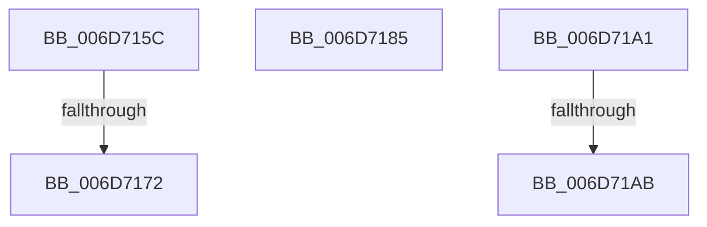

# sub_006D715C

- RVA: `0x006D715C`–`0x006D71DD` (길이 `129` bytes)
- VA: `0x00000001406D715C`
- 실행 섹션: `.text`
- PDB 이름 있음: `아니요`; PDB Function 태그: `아니요`
- unwind 정보 RVA: `0x00060068`
- 디코드: `31`개 명령, `129/129` bytes 표시
- 미해석 바이트: `0` (있으면 어셈블리에 `.byte`로 보존)

> 이 문서는 커널 이미지의 기계어와 PDB 기호를 분석해 생성했습니다. 4번과 5번은 함수 원형과 자료형을 바이너리 사용 방식에서 추정한 C 해석이며 원본 소스 복구 결과는 아닙니다.

## 1. Dependencies

- 직접 호출 지점: **5**; 고유 호출 대상: **5**
- 직접 호출자로 확인된 함수: **0**
- RIP 상대 이미지 참조: **1**

### Outgoing calls
- `0x006D717A` → [MiInsertPageInList](../2B/MiInsertPageInList_function_002BA000.md) (function, `0x002BA000`)
- `0x006D7196` → [MiReleasePageFileInfo](../28/MiReleasePageFileInfo_function_00283FD0.md) (function, `0x00283FD0`)
- `0x006D71B7` → [MiUnlockWorkingSetExclusive](../27/MiUnlockWorkingSetExclusive_function_0027EC70.md) (function, `0x0027EC70`)
- `0x006D71C7` → [KeDelayExecutionThread](../20/KeDelayExecutionThread_function_00209550.md) (function, `0x00209550`)
- `0x006D71CF` → [MiLockWorkingSetExclusive](../32/MiLockWorkingSetExclusive_function_003238A0.md) (function, `0x003238A0`)

### Direct callers
- 이 함수 시작 RVA로 연결되는 직접 call은 확인되지 않았습니다. 간접 호출은 완전히 역산할 수 없습니다.

### Static image references
- `0x006D71BC` → RVA `0x00010780` (`.rdata`; read)

## 2. Other-region calls and transfers

- 다른 실행 섹션으로 향하는 call: **0**
- call이 아닌 외부 분기/꼬리 이동: **5**
  - `0x006D716C` → [MiHandleForkTransitionPte + 0x27C](../22/MiHandleForkTransitionPte_function_0022D34C.md) (`tail-transfer`)
  - `0x006D7180` → [MiHandleForkTransitionPte + 0x27C](../22/MiHandleForkTransitionPte_function_0022D34C.md) (`tail-transfer`)
  - `0x006D719C` → [MiHandleForkTransitionPte + 0x3C2](../22/MiHandleForkTransitionPte_function_0022D34C.md) (`tail-transfer`)
  - `0x006D71A5` → [MiHandleForkTransitionPte + 0x59B](../22/MiHandleForkTransitionPte_function_0022D34C.md) (`tail-transfer`)
  - `0x006D71D8` → [MiHandleForkTransitionPte + 0x5EE](../22/MiHandleForkTransitionPte_function_0022D34C.md) (`tail-transfer`)

## 3. Assembly (complete function range)

```asm
006D715C  41 8B CA                        mov ecx, r10d
006D715F  48 8B 03                        mov rax, qword ptr [rbx]
006D7162  48 83 E0 FD                     and rax, 0xfffffffffffffffd
006D7166  48 89 45 10                     mov qword ptr [rbp + 0x10], rax
006D716A  85 C9                           test ecx, ecx
006D716C  0F 84 56 64 B5 FF               je 0x14022d5c8
006D7172  BA 08 00 00 00                  mov edx, 8
006D7177  48 8B CD                        mov rcx, rbp
006D717A  E8 81 2E BE FF                  call 0x1402ba000
006D717F  90                              nop
006D7180  E9 43 64 B5 FF                  jmp 0x14022d5c8
006D7185  48 8B 8C 24 E0 00 00 00         mov rcx, qword ptr [rsp + 0xe0]
006D718D  41 B8 01 00 00 00               mov r8d, 1
006D7193  48 8B D7                        mov rdx, rdi
006D7196  E8 35 CE BA FF                  call 0x140283fd0
006D719B  90                              nop
006D719C  E9 6D 65 B5 FF                  jmp 0x14022d70e
006D71A1  F6 45 22 08                     test byte ptr [rbp + 0x22], 8
006D71A5  0F 84 3C 67 B5 FF               je 0x14022d8e7
006D71AB  F0 48 21 55 18                  lock and qword ptr [rbp + 0x18], rdx
006D71B0  41 8A 56 1C                     mov dl, byte ptr [r14 + 0x1c]
006D71B4  49 8B CD                        mov rcx, r13
006D71B7  E8 B4 7A BA FF                  call 0x14027ec70
006D71BC  4C 8D 05 BD 95 93 FF            lea r8, [rip - 0x6c6a43]
006D71C3  33 D2                           xor edx, edx
006D71C5  33 C9                           xor ecx, ecx
006D71C7  E8 84 23 B3 FF                  call 0x140209550
006D71CC  49 8B CD                        mov rcx, r13
006D71CF  E8 CC C6 C4 FF                  call 0x1403238a0
006D71D4  41 88 46 1C                     mov byte ptr [r14 + 0x1c], al
006D71D8  E9 5D 67 B5 FF                  jmp 0x14022d93a
```

## 4. C-style interpretation (structured pseudocode)

```c
__int64 __fastcall sub_006D715C(void)
{
    __int64 result;
    unsigned __int64 v_stack_pE0;

    result = (*(unsigned __int64 *)(v_rbx)) & (-3);
    *(unsigned __int64 *)(v_rbp + 16) = result;
    result = MiInsertPageInList(v_rbp, 8, a3, a4);
}
```

## 5. (Beta) C Style

```c
void sub_006D715C(void)
{
    int64_t result;
    uint64_t v_stack_pE0;

    result = (*(uint64_t *)(local_rbx)) & (-3);
    *(uint64_t *)(local_rbp + 0x10) = result;
    result = MiInsertPageInList(local_rbp, 8, a3, a4);
}
```

## 6. Execution-region graph

[열기: 2D/3D 그래프와 함수 탐색 컨트롤 패널](../../../control-panel.html?section=text&rva=0x006D715C&view=graph)

- 2D 그래프는 위에서 아래로 흐르고, 3D 그래프는 빈 공간을 드래그해 회전합니다. Shift+드래그는 이동, 휠은 확대·축소, 함수 노드 선택은 대상 보고서 이동입니다.

### Static fallback


