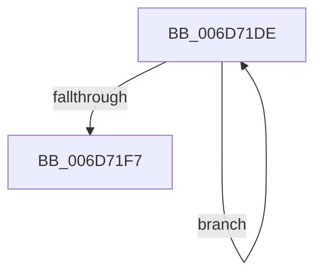

# sub_006D71DE

- RVA: `0x006D71DE`–`0x006D7206` (길이 `40` bytes)
- VA: `0x00000001406D71DE`
- 실행 섹션: `.text`
- PDB 이름 있음: `아니요`; PDB Function 태그: `아니요`
- unwind 정보 RVA: `0x0006009C`
- 디코드: `11`개 명령, `40/40` bytes 표시
- 미해석 바이트: `0` (있으면 어셈블리에 `.byte`로 보존)

> 이 문서는 커널 이미지의 기계어와 PDB 기호를 분석해 생성했습니다. 4번과 5번은 함수 원형과 자료형을 바이너리 사용 방식에서 추정한 C 해석이며 원본 소스 복구 결과는 아닙니다.

## 1. Dependencies

- 직접 호출 지점: **1**; 고유 호출 대상: **1**
- 직접 호출자로 확인된 함수: **0**
- RIP 상대 이미지 참조: **0**

### Outgoing calls
- `0x006D71EA` → [ExFreePoolWithTag](../../poolcode/B8/ExFreePoolWithTag_function_00B82870.md) (function, `0x00B82870`)

### Direct callers
- 이 함수 시작 RVA로 연결되는 직접 call은 확인되지 않았습니다. 간접 호출은 완전히 역산할 수 없습니다.

### Static image references
- 디코드된 RIP-relative 메모리 참조가 없습니다.

## 2. Other-region calls and transfers

- 다른 실행 섹션으로 향하는 call: **1**
  - `0x006D71EA` → [ExFreePoolWithTag](../../poolcode/B8/ExFreePoolWithTag_function_00B82870.md) (`.text` → `POOLCODE`)
- call이 아닌 외부 분기/꼬리 이동: **1**
  - `0x006D7201` → [MiCloneVads + 0x5A5](../22/MiCloneVads_function_0022DC1C.md) (`tail-transfer`)

## 3. Assembly (complete function range)

```asm
006D71DE  4C 03 66 40                     add r12, qword ptr [rsi + 0x40]
006D71E2  33 D2                           xor edx, edx
006D71E4  48 8B 1E                        mov rbx, qword ptr [rsi]
006D71E7  48 8B CE                        mov rcx, rsi
006D71EA  E8 81 B6 4A 00                  call 0x140b82870
006D71EF  48 8B F3                        mov rsi, rbx
006D71F2  48 85 DB                        test rbx, rbx
006D71F5  75 E7                           jne 0x1406d71de
006D71F7  4C 89 64 24 38                  mov qword ptr [rsp + 0x38], r12
006D71FC  4C 8B 64 24 60                  mov r12, qword ptr [rsp + 0x60]
006D7201  E9 BB 6F B5 FF                  jmp 0x14022e1c1
```

## 4. C-style interpretation (structured pseudocode)

```c
__int64 __fastcall sub_006D71DE(__int64 a1, int a2, __int64 a3, __int64 a4, __int64 a5, __int64 a6, __int64 a7, __int64 a8, __int64 a9, __int64 a10, __int64 a11, __int64 a12)
{
    __int64 result;
    __int64 v_r12;
    unsigned __int64 v_stack_p38;

    v_r12 = (v_r12) + (*(unsigned __int64 *)(v_rsi + 64));
    a2 = 0;
    result = ExFreePoolWithTag(v_rsi, a2, a3, a4);
    if (*(unsigned __int64 *)(v_rsi) != 0) goto loc_006D71DE;
    v_stack_p38 = v_r12;
}
```

## 5. (Beta) C Style

```c
int64_t sub_006D71DE(int64_t Arg1, int32_t Arg2, int64_t Arg3, int64_t Arg4, uint64_t Arg5, uint64_t Arg6, uint64_t Arg7, uint64_t Arg8, uint64_t Arg9, uint64_t Arg10, uint64_t Arg11, int64_t Arg12)
{
    int64_t result;
    int64_t local_r12;
    uint64_t v_stack_p38;

    local_r12 = (local_r12) + (*(uint64_t *)(local_rsi + 0x40));
    Arg2 = 0;
    result = ExFreePoolWithTag(local_rsi, Arg2, Arg3, Arg4);
    if (*(uint64_t *)(local_rsi) != 0) goto loc_006D71DE;
    v_stack_p38 = local_r12;
}
```

## 6. Execution-region graph

[열기: 2D/3D 그래프와 함수 탐색 컨트롤 패널](../../../control-panel.html?section=text&rva=0x006D71DE&view=graph)

- 2D 그래프는 위에서 아래로 흐르고, 3D 그래프는 빈 공간을 드래그해 회전합니다. Shift+드래그는 이동, 휠은 확대·축소, 함수 노드 선택은 대상 보고서 이동입니다.

### Static fallback


