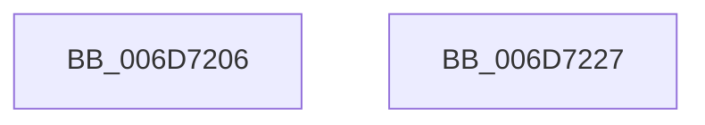

# sub_006D7206

- RVA: `0x006D7206`–`0x006D7253` (길이 `77` bytes)
- VA: `0x00000001406D7206`
- 실행 섹션: `.text`
- PDB 이름 있음: `아니요`; PDB Function 태그: `아니요`
- unwind 정보 RVA: `0x000600C8`
- 디코드: `19`개 명령, `77/77` bytes 표시
- 미해석 바이트: `0` (있으면 어셈블리에 `.byte`로 보존)

> 이 문서는 커널 이미지의 기계어와 PDB 기호를 분석해 생성했습니다. 4번과 5번은 함수 원형과 자료형을 바이너리 사용 방식에서 추정한 C 해석이며 원본 소스 복구 결과는 아닙니다.

## 1. Dependencies

- 직접 호출 지점: **4**; 고유 호출 대상: **4**
- 직접 호출자로 확인된 함수: **0**
- RIP 상대 이미지 참조: **0**

### Outgoing calls
- `0x006D720E` → [MiTransferSoftwarePte](../38/MiTransferSoftwarePte_function_003821F0.md) (function, `0x003821F0`)
- `0x006D722E` → [MiUnlockWorkingSetExclusive](../27/MiUnlockWorkingSetExclusive_function_0027EC70.md) (function, `0x0027EC70`)
- `0x006D7238` → [MiWaitForFreePage](../2A/MiWaitForFreePage_function_002A3324.md) (function, `0x002A3324`)
- `0x006D7240` → [MiLockWorkingSetExclusive](../32/MiLockWorkingSetExclusive_function_003238A0.md) (function, `0x003238A0`)

### Direct callers
- 이 함수 시작 RVA로 연결되는 직접 call은 확인되지 않았습니다. 간접 호출은 완전히 역산할 수 없습니다.

### Static image references
- 디코드된 RIP-relative 메모리 참조가 없습니다.

## 2. Other-region calls and transfers

- 다른 실행 섹션으로 향하는 call: **0**
- call이 아닌 외부 분기/꼬리 이동: **2**
  - `0x006D7222` → [MiBuildForkPte + 0x2EA](../22/MiBuildForkPte_function_0022E32C.md) (`tail-transfer`)
  - `0x006D724E` → [MiBuildForkPte + 0x46F](../22/MiBuildForkPte_function_0022E32C.md) (`tail-transfer`)

## 3. Assembly (complete function range)

```asm
006D7206  49 8B 4D 10                     mov rcx, qword ptr [r13 + 0x10]
006D720A  49 C1 E8 20                     shr r8, 0x20
006D720E  E8 DD AF CA FF                  call 0x1403821f0
006D7213  48 8B F8                        mov rdi, rax
006D7216  49 8B 45 10                     mov rax, qword ptr [r13 + 0x10]
006D721A  48 83 E0 FD                     and rax, 0xfffffffffffffffd
006D721E  49 89 45 10                     mov qword ptr [r13 + 0x10], rax
006D7222  E9 EF 73 B5 FF                  jmp 0x14022e616
006D7227  41 8A 57 1C                     mov dl, byte ptr [r15 + 0x1c]
006D722B  48 8B CE                        mov rcx, rsi
006D722E  E8 3D 7A BA FF                  call 0x14027ec70
006D7233  33 D2                           xor edx, edx
006D7235  48 8B CB                        mov rcx, rbx
006D7238  E8 E7 C0 BC FF                  call 0x1402a3324
006D723D  48 8B CE                        mov rcx, rsi
006D7240  E8 5B C6 C4 FF                  call 0x1403238a0
006D7245  41 88 47 1C                     mov byte ptr [r15 + 0x1c], al
006D7249  B8 2D 02 00 C0                  mov eax, 0xc000022d
006D724E  E9 48 75 B5 FF                  jmp 0x14022e79b
```

## 4. C-style interpretation (structured pseudocode)

```c
__int64 __fastcall sub_006D7206(__int64 a1, __int64 a2, __int64 a3)
{
    __int64 result;

    a3 = (a3) >> (32);
    result = MiTransferSoftwarePte(*(unsigned __int64 *)(v_r13 + 16), a2, a3, a4);
    result = (*(unsigned __int64 *)(v_r13 + 16)) & (-3);
    *(unsigned __int64 *)(v_r13 + 16) = result;
}
```

## 5. (Beta) C Style

```c
int64_t sub_006D7206(int64_t Arg1, int64_t Arg2, int64_t Arg3)
{
    int64_t result;

    Arg3 = (Arg3) >> (32);
    result = MiTransferSoftwarePte(*(uint64_t *)(local_r13 + 0x10), Arg2, Arg3, a4);
    result = (*(uint64_t *)(local_r13 + 0x10)) & (-3);
    *(uint64_t *)(local_r13 + 0x10) = result;
}
```

## 6. Execution-region graph

[열기: 2D/3D 그래프와 함수 탐색 컨트롤 패널](../../../control-panel.html?section=text&rva=0x006D7206&view=graph)

- 2D 그래프는 위에서 아래로 흐르고, 3D 그래프는 빈 공간을 드래그해 회전합니다. Shift+드래그는 이동, 휠은 확대·축소, 함수 노드 선택은 대상 보고서 이동입니다.

### Static fallback


