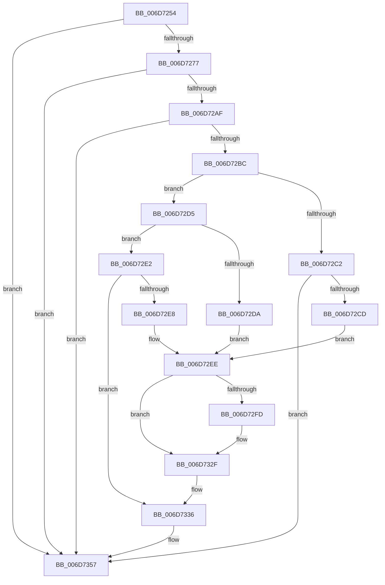

# sub_006D7254

- RVA: `0x006D7254`–`0x006D7365` (길이 `273` bytes)
- VA: `0x00000001406D7254`
- 실행 섹션: `.text`
- PDB 이름 있음: `아니요`; PDB Function 태그: `아니요`
- unwind 정보 RVA: `0x0006014C`
- 디코드: `62`개 명령, `273/273` bytes 표시
- 미해석 바이트: `0` (있으면 어셈블리에 `.byte`로 보존)

> 이 문서는 커널 이미지의 기계어와 PDB 기호를 분석해 생성했습니다. 4번과 5번은 함수 원형과 자료형을 바이너리 사용 방식에서 추정한 C 해석이며 원본 소스 복구 결과는 아닙니다.

## 1. Dependencies

- 직접 호출 지점: **5**; 고유 호출 대상: **4**
- 직접 호출자로 확인된 함수: **0**
- RIP 상대 이미지 참조: **3**

### Outgoing calls
- `0x006D7262` → [ExAcquireSpinLockExclusiveAtDpcLevel](../24/ExAcquireSpinLockExclusiveAtDpcLevel_function_00248E80.md) (function, `0x00248E80`)
- `0x006D7305` → [MiWriteEntirePageHashEntry](../38/MiWriteEntirePageHashEntry_function_003821C8.md) (function, `0x003821C8`)
- `0x006D7329` → [MiPageHashBugCheck](../69/MiPageHashBugCheck_function_00697AC8.md) (function, `0x00697AC8`)
- `0x006D7352` → [MiWriteEntirePageHashEntry](../38/MiWriteEntirePageHashEntry_function_003821C8.md) (function, `0x003821C8`)
- `0x006D735A` → [ExReleaseSpinLockExclusiveFromDpcLevel](../24/ExReleaseSpinLockExclusiveFromDpcLevel_function_002497E0.md) (function, `0x002497E0`)

### Direct callers
- 이 함수 시작 RVA로 연결되는 직접 call은 확인되지 않았습니다. 간접 호출은 완전히 역산할 수 없습니다.

### Static image references
- `0x006D727A` → RVA `0x00E3738C` (`.data`; read)
- `0x006D72EE` → RVA `0x00E30260` (`.data`; read/write)
- `0x006D72F4` → RVA `0x00E30254` (`.data`; read)

## 2. Other-region calls and transfers

- 다른 실행 섹션으로 향하는 call: **0**
- call이 아닌 외부 분기/꼬리 이동: **1**
  - `0x006D7360` → [MiUpdatePageFileBlockOwner + 0x38](../22/MiUpdatePageFileBlockOwner_function_0022F6BC.md) (`tail-transfer`)

## 3. Assembly (complete function range)

```asm
006D7254  48 8D 99 C8 00 00 00            lea rbx, [rcx + 0xc8]
006D725B  48 83 CF 01                     or rdi, 1
006D725F  48 8B CB                        mov rcx, rbx
006D7262  E8 19 1C B7 FF                  call 0x140248e80
006D7267  48 8B 8D B8 00 00 00            mov rcx, qword ptr [rbp + 0xb8]
006D726E  48 85 C9                        test rcx, rcx
006D7271  0F 84 E0 00 00 00               je 0x1406d7357
006D7277  44 8B C6                        mov r8d, esi
006D727A  44 0F AF 05 0A 01 76 00         imul r8d, dword ptr [rip + 0x76010a]
006D7282  4C 03 C1                        add r8, rcx
006D7285  48 B9 F8 FF FF FF 7F 00 00 00   movabs rcx, 0x7ffffffff8
006D728F  49 8B C0                        mov rax, r8
006D7292  48 C1 E8 09                     shr rax, 9
006D7296  48 23 C1                        and rax, rcx
006D7299  48 B9 00 00 00 00 80 F6 FF FF   movabs rcx, 0xfffff68000000000
006D72A3  48 8B 04 08                     mov rax, qword ptr [rax + rcx]
006D72A7  A8 01                           test al, 1
006D72A9  0F 84 A8 00 00 00               je 0x1406d7357
006D72AF  49 8B 40 08                     mov rax, qword ptr [r8 + 8]
006D72B3  48 85 C0                        test rax, rax
006D72B6  0F 84 9B 00 00 00               je 0x1406d7357
006D72BC  41 83 38 01                     cmp dword ptr [r8], 1
006D72C0  75 13                           jne 0x1406d72d5
006D72C2  83 7C 24 70 00                  cmp dword ptr [rsp + 0x70], 0
006D72C7  0F 85 8A 00 00 00               jne 0x1406d7357
006D72CD  41 BA 3C 00 00 00               mov r10d, 0x3c
006D72D3  EB 19                           jmp 0x1406d72ee
006D72D5  48 3B C7                        cmp rax, rdi
006D72D8  74 08                           je 0x1406d72e2
006D72DA  41 BA 3B 00 00 00               mov r10d, 0x3b
006D72E0  EB 0C                           jmp 0x1406d72ee
006D72E2  41 39 70 04                     cmp dword ptr [r8 + 4], esi
006D72E6  74 4E                           je 0x1406d7336
006D72E8  41 BA 38 00 00 00               mov r10d, 0x38
006D72EE  FF 05 6C 8F 75 00               inc dword ptr [rip + 0x758f6c]
006D72F4  83 3D 59 8F 75 00 00            cmp dword ptr [rip + 0x758f59], 0
006D72FB  75 32                           jne 0x1406d732f
006D72FD  49 8B D0                        mov rdx, r8
006D7300  48 8D 4C 24 30                  lea rcx, [rsp + 0x30]
006D7305  E8 BE AE CA FF                  call 0x1403821c8
006D730A  41 8B 40 04                     mov eax, dword ptr [r8 + 4]
006D730E  4C 8D 4C 24 30                  lea r9, [rsp + 0x30]
006D7313  8B D6                           mov edx, esi
006D7315  89 44 24 34                     mov dword ptr [rsp + 0x34], eax
006D7319  41 8B CA                        mov ecx, r10d
006D731C  48 89 7C 24 38                  mov qword ptr [rsp + 0x38], rdi
006D7321  C7 44 24 20 01 00 00 00         mov dword ptr [rsp + 0x20], 1
006D7329  E8 9A 07 FC FF                  call 0x140697ac8
006D732E  CC                              int3
006D732F  48 8D 9D C8 00 00 00            lea rbx, [rbp + 0xc8]
006D7336  41 8B 00                        mov eax, dword ptr [r8]
006D7339  48 8D 54 24 30                  lea rdx, [rsp + 0x30]
006D733E  49 83 CE 01                     or r14, 1
006D7342  89 44 24 30                     mov dword ptr [rsp + 0x30], eax
006D7346  49 8B C8                        mov rcx, r8
006D7349  4C 89 74 24 38                  mov qword ptr [rsp + 0x38], r14
006D734E  89 74 24 34                     mov dword ptr [rsp + 0x34], esi
006D7352  E8 71 AE CA FF                  call 0x1403821c8
006D7357  48 8B CB                        mov rcx, rbx
006D735A  E8 81 24 B7 FF                  call 0x1402497e0
006D735F  90                              nop
006D7360  E9 8F 83 B5 FF                  jmp 0x14022f6f4
```

## 4. C-style interpretation (structured pseudocode)

```c
__int64 __fastcall sub_006D7254(__int64 a1, __int64 a2, __int64 a3, __int64 a4, __int64 a5, __int64 a6, __int64 a7, __int64 a8, __int64 a9, __int64 a10, __int64 a11, __int64 a12, __int64 a13, unsigned int a14)
{
    __int64 result;
    __int64 v_r14;
    __int64 v_rdi;
    unsigned int v_stack_p20;
    unsigned int v_stack_p30;
    unsigned int v_stack_p34;
    unsigned __int64 v_stack_p38;

    v_rdi = (v_rdi) | (1);
    result = ExAcquireSpinLockExclusiveAtDpcLevel(a1 + 200, a2, a3, a4);
    if (*(unsigned __int64 *)(v_rbp + 184) == 0) goto loc_006D7357;
    a3 = (unsigned int)(((unsigned int)((unsigned int)(v_rsi))) * (*(unsigned int *)(v_rip + 7733514)));
    a3 = (a3) + (*(unsigned __int64 *)(v_rbp + 184));
    result = (a3) >> (9);
    result = (result) & (*(unsigned __int64 *)(v_rbp + 184));
    if ((((unsigned __int8)(*(unsigned __int64 *)(result + *(unsigned __int64 *)(v_rbp + 184) * 1))) & (1)) == 0) goto loc_006D7357;
    if (*(unsigned __int64 *)(a3 + 8) == 0) goto loc_006D7357;
    if ((*(unsigned int *)(a3)) != 1) goto loc_006D72D5;
    if (a14 != 0) goto loc_006D7357;
    goto loc_006D72EE;
loc_006D72D5:
    if ((*(unsigned __int64 *)(a3 + 8)) == v_rdi) goto loc_006D72E2;
    goto loc_006D72EE;
loc_006D72E2:
    if ((*(unsigned int *)(a3 + 4)) == ((unsigned int)(v_rsi))) goto loc_006D7336;
loc_006D72EE:
    result = *(unsigned __int64 *)(a3 + 8);
    if ((*(unsigned int *)(v_rip + 7704409)) == 0) {
        a2 = a3;
        a1 = a6;
        result = MiWriteEntirePageHashEntry(a1, a2, a3, a4);
        result = *(unsigned int *)(a3 + 4);
        a4 = a6;
        a2 = (unsigned int)(v_rsi);
        v_stack_p34 = (unsigned int)(result);
        a1 = 56;
        v_stack_p38 = v_rdi;
        v_stack_p20 = 1;
        result = MiPageHashBugCheck(a1, a2, a3, a4);
    }
loc_006D7336:
    v_r14 = (v_r14) | (1);
    v_stack_p30 = (unsigned int)((unsigned int)(*(unsigned int *)(a3)));
    v_stack_p38 = v_r14;
    v_stack_p34 = (unsigned int)(v_rsi);
    result = MiWriteEntirePageHashEntry(a3, a6, a3, a4);
loc_006D7357:
    result = ExReleaseSpinLockExclusiveFromDpcLevel(v_rbp + 200, a6, a3, a4);
}
```

## 5. (Beta) C Style

```c
int64_t sub_006D7254(void *Arg1, int64_t Arg2, int64_t Arg3, int64_t Arg4, uint64_t Arg5, int64_t Arg6, uint64_t Arg7, uint64_t Arg8, uint64_t Arg9, uint64_t Arg10, uint64_t Arg11, uint64_t Arg12, uint64_t Arg13, uint32_t Arg14)
{
    uint8_t *arg1 = (uint8_t *)Arg1;

    int64_t result;
    int64_t local_r14;
    int64_t local_rdi;
    uint32_t v_stack_p20;
    uint32_t v_stack_p30;
    uint32_t v_stack_p34;
    uint64_t v_stack_p38;

    local_rdi = (local_rdi) | (1);
    result = ExAcquireSpinLockExclusiveAtDpcLevel(Arg1 + 200, Arg2, Arg3, Arg4);
    if (*(uint64_t *)(local_rbp + 0xB8) == 0) goto loc_006D7357;
    Arg3 = (uint32_t)(((uint32_t)((uint32_t)(local_rsi))) * (*(uint32_t *)(v_rip + 0x76010A)));
    Arg3 = (Arg3) + (*(uint64_t *)(local_rbp + 0xB8));
    result = (Arg3) >> (9);
    result = (result) & (*(uint64_t *)(local_rbp + 0xB8));
    if ((((uint8_t)(*(uint64_t *)(result + *(uint64_t *)(local_rbp + 0xB8) * 1))) & (1)) == 0) goto loc_006D7357;
    if (*(uint64_t *)(Arg3 + 0x8) == 0) goto loc_006D7357;
    if ((*(uint32_t *)(Arg3)) != 1) goto loc_006D72D5;
    if (Arg14 != 0) goto loc_006D7357;
    goto loc_006D72EE;
loc_006D72D5:
    if ((*(uint64_t *)(Arg3 + 0x8)) == local_rdi) goto loc_006D72E2;
    goto loc_006D72EE;
loc_006D72E2:
    if ((*(uint32_t *)(Arg3 + 0x4)) == ((uint32_t)(local_rsi))) goto loc_006D7336;
loc_006D72EE:
    result = *(uint64_t *)(Arg3 + 0x8);
    if ((*(uint32_t *)(v_rip + 0x758F59)) == 0) {
        Arg2 = Arg3;
        Arg1 = Arg6;
        result = MiWriteEntirePageHashEntry(Arg1, Arg2, Arg3, Arg4);
        result = *(uint32_t *)(Arg3 + 0x4);
        Arg4 = Arg6;
        Arg2 = (uint32_t)(local_rsi);
        v_stack_p34 = (uint32_t)(result);
        Arg1 = 56;
        v_stack_p38 = local_rdi;
        v_stack_p20 = 1;
        result = MiPageHashBugCheck(Arg1, Arg2, Arg3, Arg4);
    }
loc_006D7336:
    local_r14 = (local_r14) | (1);
    v_stack_p30 = (uint32_t)((uint32_t)(*(uint32_t *)(Arg3)));
    v_stack_p38 = local_r14;
    v_stack_p34 = (uint32_t)(local_rsi);
    result = MiWriteEntirePageHashEntry(Arg3, Arg6, Arg3, Arg4);
loc_006D7357:
    result = ExReleaseSpinLockExclusiveFromDpcLevel(local_rbp + 200, Arg6, Arg3, Arg4);
}
```

### 관측된 메모리 오프셋

구조체 형식이 확인되지 않은 접근은 인자 기준의 오프셋으로만 기록했습니다.

| 기준 인자 | 오프셋 표현 | 폭 (bit) | 접근 |
|---|---:|---:|---|
| `Arg1` | `+ 0xC8` | `64` | `R` |

## 6. Execution-region graph

[열기: 2D/3D 그래프와 함수 탐색 컨트롤 패널](../../../control-panel.html?section=text&rva=0x006D7254&view=graph)

- 2D 그래프는 위에서 아래로 흐르고, 3D 그래프는 빈 공간을 드래그해 회전합니다. Shift+드래그는 이동, 휠은 확대·축소, 함수 노드 선택은 대상 보고서 이동입니다.

### Static fallback


