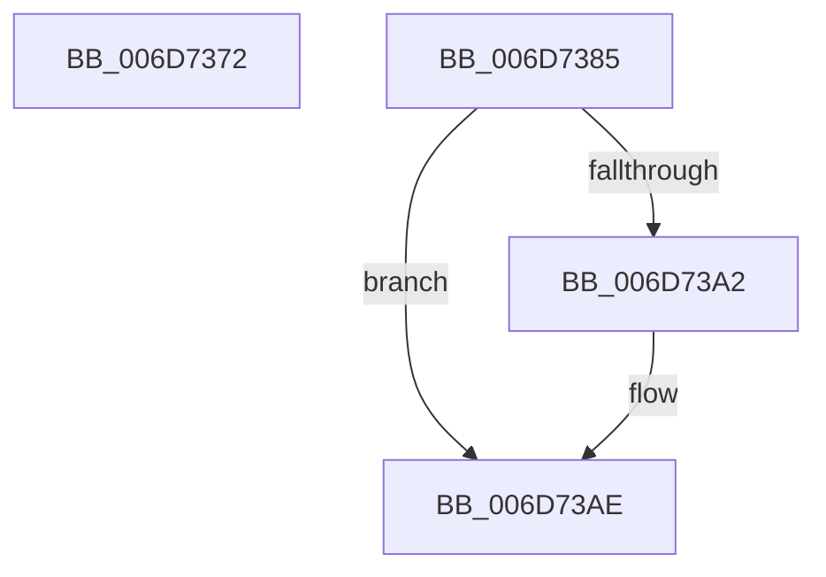

# sub_006D7372

- RVA: `0x006D7372`–`0x006D73CA` (길이 `88` bytes)
- VA: `0x00000001406D7372`
- 실행 섹션: `.text`
- PDB 이름 있음: `아니요`; PDB Function 태그: `아니요`
- unwind 정보 RVA: `0x00060380`
- 디코드: `21`개 명령, `88/88` bytes 표시
- 미해석 바이트: `0` (있으면 어셈블리에 `.byte`로 보존)

> 이 문서는 커널 이미지의 기계어와 PDB 기호를 분석해 생성했습니다. 4번과 5번은 함수 원형과 자료형을 바이너리 사용 방식에서 추정한 C 해석이며 원본 소스 복구 결과는 아닙니다.

## 1. Dependencies

- 직접 호출 지점: **4**; 고유 호출 대상: **4**
- 직접 호출자로 확인된 함수: **0**
- RIP 상대 이미지 참조: **2**

### Outgoing calls
- `0x006D737A` → [ExpSetTimerObject2](../3A/ExpSetTimerObject2_function_003A0658.md) (function, `0x003A0658`)
- `0x006D73A9` → [ExfTryToWakePushLock](../26/ExfTryToWakePushLock_function_00265DD0.md) (function, `0x00265DD0`)
- `0x006D73B5` → [KeAbPostRelease](../2E/KeAbPostRelease_function_002E1600.md) (function, `0x002E1600`)
- `0x006D73BF` → [KiLeaveCriticalRegionUnsafe](../25/KiLeaveCriticalRegionUnsafe_function_0025F010.md) (function, `0x0025F010`)

### Direct callers
- 이 함수 시작 RVA로 연결되는 직접 call은 확인되지 않았습니다. 간접 호출은 완전히 역산할 수 없습니다.

### Static image references
- `0x006D7393` → RVA `0x00EFABA8` (`.data`; read/write)
- `0x006D73A2` → RVA `0x00EFABA8` (`.data`; read)

## 2. Other-region calls and transfers

- 다른 실행 섹션으로 향하는 call: **0**
- call이 아닌 외부 분기/꼬리 이동: **2**
  - `0x006D7380` → [NtCancelTimer + 0x1A6](../23/NtCancelTimer_function_00230D90.md) (`tail-transfer`)
  - `0x006D73C5` → [NtCancelTimer + 0x149](../23/NtCancelTimer_function_00230D90.md) (`tail-transfer`)

## 3. Assembly (complete function range)

```asm
006D7372  45 33 C9                        xor r9d, r9d
006D7375  45 33 C0                        xor r8d, r8d
006D7378  33 D2                           xor edx, edx
006D737A  E8 D9 92 CC FF                  call 0x1403a0658
006D737F  90                              nop
006D7380  E9 B1 9B B5 FF                  jmp 0x140230f36
006D7385  B9 03 00 00 00                  mov ecx, 3
006D738A  CD 29                           int 0x29
006D738C  48 C7 C0 FF FF FF FF            mov rax, 0xffffffffffffffff
006D7393  F0 48 0F C1 05 0C 38 82 00      lock xadd qword ptr [rip + 0x82380c], rax
006D739C  24 06                           and al, 6
006D739E  3C 02                           cmp al, 2
006D73A0  75 0C                           jne 0x1406d73ae
006D73A2  48 8D 0D FF 37 82 00            lea rcx, [rip + 0x8237ff]
006D73A9  E8 22 EA B8 FF                  call 0x140265dd0
006D73AE  48 8D 0D F3 37 82 00            lea rcx, [rip + 0x8237f3]
006D73B5  E8 46 A2 C0 FF                  call 0x1402e1600
006D73BA  48 8B 4C 24 40                  mov rcx, qword ptr [rsp + 0x40]
006D73BF  E8 4C 7C B8 FF                  call 0x14025f010
006D73C4  90                              nop
006D73C5  E9 0F 9B B5 FF                  jmp 0x140230ed9
```

## 4. C-style interpretation (structured pseudocode)

```c
__int64 __fastcall sub_006D7372(__int64 a1, int a2, int a3, int a4)
{
    __int64 result;
    unsigned __int64 v_stack_p40;

    a4 = 0;
    a3 = 0;
    a2 = 0;
    result = ExpSetTimerObject2(a1, a2, a3, a4);
}
```

## 5. (Beta) C Style

```c
int64_t sub_006D7372(int64_t Arg1, int32_t Arg2, int32_t Arg3, int32_t Arg4)
{
    int64_t result;
    uint64_t v_stack_p40;

    Arg4 = 0;
    Arg3 = 0;
    Arg2 = 0;
    result = ExpSetTimerObject2(Arg1, Arg2, Arg3, Arg4);
}
```

## 6. Execution-region graph

[열기: 2D/3D 그래프와 함수 탐색 컨트롤 패널](../../../control-panel.html?section=text&rva=0x006D7372&view=graph)

- 2D 그래프는 위에서 아래로 흐르고, 3D 그래프는 빈 공간을 드래그해 회전합니다. Shift+드래그는 이동, 휠은 확대·축소, 함수 노드 선택은 대상 보고서 이동입니다.

### Static fallback


