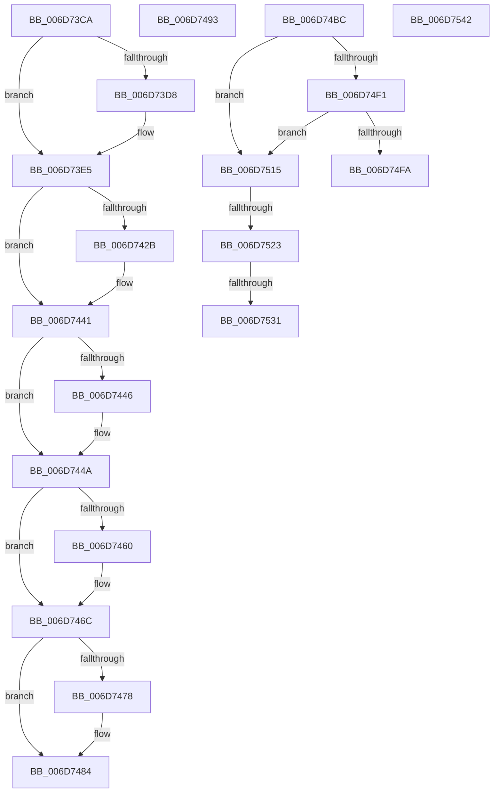

# sub_006D73CA

- RVA: `0x006D73CA`–`0x006D754E` (길이 `388` bytes)
- VA: `0x00000001406D73CA`
- 실행 섹션: `.text`
- PDB 이름 있음: `아니요`; PDB Function 태그: `아니요`
- unwind 정보 RVA: `0x00060450`
- 디코드: `87`개 명령, `388/388` bytes 표시
- 미해석 바이트: `0` (있으면 어셈블리에 `.byte`로 보존)

> 이 문서는 커널 이미지의 기계어와 PDB 기호를 분석해 생성했습니다. 4번과 5번은 함수 원형과 자료형을 바이너리 사용 방식에서 추정한 C 해석이며 원본 소스 복구 결과는 아닙니다.

## 1. Dependencies

- 직접 호출 지점: **7**; 고유 호출 대상: **6**
- 직접 호출자로 확인된 함수: **0**
- RIP 상대 이미지 참조: **3**

### Outgoing calls
- `0x006D73E0` → [KiLowerIrqlProcessIrqlFlags](../4F/KiLowerIrqlProcessIrqlFlags_function_004F5698.md) (function, `0x004F5698`)
- `0x006D7417` → [KeAbPreAcquire](../21/KeAbPreAcquire_function_00210230.md) (function, `0x00210230`)
- `0x006D743C` → [ExfAcquirePushLockExclusiveEx](../20/ExfAcquirePushLockExclusiveEx_function_0020FC90.md) (function, `0x0020FC90`)
- `0x006D7467` → [KiRaiseIrqlProcessIrqlFlags](../4F/KiRaiseIrqlProcessIrqlFlags_function_004F56FC.md) (function, `0x004F56FC`)
- `0x006D747F` → [KeAcquireSpinLockAtDpcLevel](../20/KeAcquireSpinLockAtDpcLevel_function_00208430.md) (function, `0x00208430`)
- `0x006D7488` → [KeAcquireSpinLockAtDpcLevel](../20/KeAcquireSpinLockAtDpcLevel_function_00208430.md) (function, `0x00208430`)
- `0x006D74A5` → [PsInsertVirtualizedTimer](../46/PsInsertVirtualizedTimer_function_0046C130.md) (function, `0x0046C130`)

### Direct callers
- 이 함수 시작 RVA로 연결되는 직접 call은 확인되지 않았습니다. 간접 호출은 완전히 역산할 수 없습니다.

### Static image references
- `0x006D73CF` → RVA `0x00FC6D20` (`ALMOSTRO`; read)
- `0x006D7410` → RVA `0x00EFABA8` (`.data`; read)
- `0x006D741F` → RVA `0x00EFABA8` (`.data`; read/write)

## 2. Other-region calls and transfers

- 다른 실행 섹션으로 향하는 call: **0**
- call이 아닌 외부 분기/꼬리 이동: **7**
  - `0x006D748E` → [ExpSetTimerObject + 0x128](../23/ExpSetTimerObject_function_00231730.md) (`tail-transfer`)
  - `0x006D74B7` → [ExpSetTimerObject + 0x779](../23/ExpSetTimerObject_function_00231730.md) (`tail-transfer`)
  - `0x006D7510` → [ExpSetTimerObject + 0x798](../23/ExpSetTimerObject_function_00231730.md) (`tail-transfer`)
  - `0x006D751D` → [ExpSetTimerObject + 0x798](../23/ExpSetTimerObject_function_00231730.md) (`tail-transfer`)
  - `0x006D752B` → [ExpSetTimerObject + 0x303](../23/ExpSetTimerObject_function_00231730.md) (`tail-transfer`)
  - `0x006D753D` → [ExpSetTimerObject + 0x303](../23/ExpSetTimerObject_function_00231730.md) (`tail-transfer`)
  - `0x006D7549` → [ExpSetTimerObject + 0x69F](../23/ExpSetTimerObject_function_00231730.md) (`tail-transfer`)

## 3. Assembly (complete function range)

```asm
006D73CA  48 8B 74 24 60                  mov rsi, qword ptr [rsp + 0x60]
006D73CF  83 3D 4A F9 8E 00 00            cmp dword ptr [rip + 0x8ef94a], 0
006D73D6  74 0D                           je 0x1406d73e5
006D73D8  44 0F 20 C1                     mov rcx, cr8
006D73DC  40 0F B6 D6                     movzx edx, sil
006D73E0  E8 B3 E2 E1 FF                  call 0x1404f5698
006D73E5  40 0F B6 C6                     movzx eax, sil
006D73E9  44 0F 22 C0                     mov cr8, rax
006D73ED  C6 44 24 31 01                  mov byte ptr [rsp + 0x31], 1
006D73F2  65 48 8B 04 25 88 01 00 00      mov rax, qword ptr gs:[0x188]
006D73FB  48 89 84 24 80 00 00 00         mov qword ptr [rsp + 0x80], rax
006D7403  66 FF 88 E4 01 00 00            dec word ptr [rax + 0x1e4]
006D740A  90                              nop
006D740B  45 33 C0                        xor r8d, r8d
006D740E  33 D2                           xor edx, edx
006D7410  48 8D 0D 91 37 82 00            lea rcx, [rip + 0x823791]
006D7417  E8 14 8E B3 FF                  call 0x140210230
006D741C  48 8B F0                        mov rsi, rax
006D741F  F0 48 0F BA 2D 7F 37 82 00 00   lock bts qword ptr [rip + 0x82377f], 0
006D7429  73 16                           jae 0x1406d7441
006D742B  4C 8D 05 76 37 82 00            lea r8, [rip + 0x823776]
006D7432  48 8B D0                        mov rdx, rax
006D7435  48 8D 0D 6C 37 82 00            lea rcx, [rip + 0x82376c]
006D743C  E8 4F 88 B3 FF                  call 0x14020fc90
006D7441  48 85 F6                        test rsi, rsi
006D7444  74 04                           je 0x1406d744a
006D7446  C6 46 0A 01                     mov byte ptr [rsi + 0xa], 1
006D744A  44 0F 20 C6                     mov rsi, cr8
006D744E  B8 02 00 00 00                  mov eax, 2
006D7453  44 0F 22 C0                     mov cr8, rax
006D7457  83 3D C2 F8 8E 00 00            cmp dword ptr [rip + 0x8ef8c2], 0
006D745E  74 0C                           je 0x1406d746c
006D7460  0F B6 D0                        movzx edx, al
006D7463  40 0F B6 CE                     movzx ecx, sil
006D7467  E8 90 E2 E1 FF                  call 0x1404f56fc
006D746C  40 88 74 24 60                  mov byte ptr [rsp + 0x60], sil
006D7471  80 7C 24 30 00                  cmp byte ptr [rsp + 0x30], 0
006D7476  74 0C                           je 0x1406d7484
006D7478  49 8D 8D 08 07 00 00            lea rcx, [r13 + 0x708]
006D747F  E8 AC 0F B3 FF                  call 0x140208430
006D7484  48 8D 4F 40                     lea rcx, [rdi + 0x40]
006D7488  E8 A3 0F B3 FF                  call 0x140208430
006D748D  90                              nop
006D748E  E9 C5 A3 B5 FF                  jmp 0x140231858
006D7493  48 8D 97 20 01 00 00            lea rdx, [rdi + 0x120]
006D749A  4C 89 44 24 20                  mov qword ptr [rsp + 0x20], r8
006D749F  45 33 C0                        xor r8d, r8d
006D74A2  49 8B CE                        mov rcx, r14
006D74A5  E8 86 4C D9 FF                  call 0x14046c130
006D74AA  44 8B 94 24 48 01 00 00         mov r10d, dword ptr [rsp + 0x148]
006D74B2  4C 8B 5C 24 70                  mov r11, qword ptr [rsp + 0x70]
006D74B7  E9 ED A9 B5 FF                  jmp 0x140231ea9
006D74BC  48 BB 14 00 00 00 80 F7 FF FF   movabs rbx, 0xfffff78000000014
006D74C6  48 8B 1B                        mov rbx, qword ptr [rbx]
006D74C9  48 3B C3                        cmp rax, rbx
006D74CC  48 0F 47 D8                     cmova rbx, rax
006D74D0  48 03 D9                        add rbx, rcx
006D74D3  49 8B 07                        mov rax, qword ptr [r15]
006D74D6  48 3B D8                        cmp rbx, rax
006D74D9  48 0F 4C D8                     cmovl rbx, rax
006D74DD  48 89 5C 24 68                  mov qword ptr [rsp + 0x68], rbx
006D74E2  B8 59 17 B7 D1                  mov eax, 0xd1b71759
006D74E7  F7 E1                           mul ecx
006D74E9  C1 EA 0D                        shr edx, 0xd
006D74EC  45 85 D2                        test r10d, r10d
006D74EF  74 24                           je 0x1406d7515
006D74F1  42 8D 04 12                     lea eax, [rdx + r10]
006D74F5  41 3B C2                        cmp eax, r10d
006D74F8  76 1B                           jbe 0x1406d7515
006D74FA  44 8B D0                        mov r10d, eax
006D74FD  89 84 24 48 01 00 00            mov dword ptr [rsp + 0x148], eax
006D7504  01 97 F0 00 00 00               add dword ptr [rdi + 0xf0], edx
006D750A  89 97 F4 00 00 00               mov dword ptr [rdi + 0xf4], edx
006D7510  E9 B3 A9 B5 FF                  jmp 0x140231ec8
006D7515  8B 87 F0 00 00 00               mov eax, dword ptr [rdi + 0xf0]
006D751B  85 C0                           test eax, eax
006D751D  0F 84 A5 A9 B5 FF               je 0x140231ec8
006D7523  8D 0C 10                        lea ecx, [rax + rdx]
006D7526  45 33 C0                        xor r8d, r8d
006D7529  3B C8                           cmp ecx, eax
006D752B  0F 86 02 A5 B5 FF               jbe 0x140231a33
006D7531  89 8F F0 00 00 00               mov dword ptr [rdi + 0xf0], ecx
006D7537  89 97 F4 00 00 00               mov dword ptr [rdi + 0xf4], edx
006D753D  E9 F1 A4 B5 FF                  jmp 0x140231a33
006D7542  0F B6 44 24 33                  movzx eax, byte ptr [rsp + 0x33]
006D7547  88 02                           mov byte ptr [rdx], al
006D7549  E9 81 A8 B5 FF                  jmp 0x140231dcf
```

## 4. C-style interpretation (structured pseudocode)

```c
__int64 __fastcall sub_006D73CA(__int64 a1, __int64 a2, int a3, __int64 a4, __int64 a5, unsigned __int8 a6, __int64 a7, __int64 a8, __int64 a9, __int64 a10, __int64 a11, __int64 a12)
{
    __int64 result;
    unsigned int v_stack_p148;
    unsigned __int64 v_stack_p20;
    unsigned __int8 v_stack_p31;
    unsigned __int8 v_stack_p33;
    unsigned __int8 v_stack_p60;
    unsigned __int64 v_stack_p68;
    unsigned __int64 v_stack_p70;
    unsigned __int64 v_stack_p80;

    if ((*(unsigned int *)(v_rip + 9369930)) != 0) {
        a1 = v_cr8;
        a2 = (unsigned __int8)(a12);
        result = KiLowerIrqlProcessIrqlFlags(a1, a2, a3, a4);
    }
    v_stack_p31 = 1;
    v_stack_p80 = *(unsigned __int64 *)(gs_base + (0 + 392));
    a3 = 0;
    a2 = 0;
    result = KeAbPreAcquire(v_rip + 8533905, a2, a3, a4);
    if (!(condition_is_above_or_equal)) {
        a3 = v_rip + 8533878;
        a2 = result;
        a1 = v_rip + 8533868;
        result = ExfAcquirePushLockExclusiveEx(a1, a2, a3, a4);
    }
    if (result != 0) {
        *(unsigned __int8 *)(result + 10) = 1;
    }
    result = 2;
    if ((*(unsigned int *)(v_rip + 9369794)) != 0) {
        a2 = 2;
        a1 = (unsigned __int8)((unsigned __int8)(a12));
        result = KiRaiseIrqlProcessIrqlFlags(a1, a2, a3, a4);
    }
    v_stack_p60 = (unsigned __int8)((unsigned __int8)(a12));
    if (a6 != 0) {
        a1 = v_r13 + 1800;
        result = KeAcquireSpinLockAtDpcLevel(a1, a2, a3, a4);
    }
    result = KeAcquireSpinLockAtDpcLevel(v_rdi + 64, a2, a3, a4);
}
```

## 5. (Beta) C Style

```c
int64_t sub_006D73CA(int64_t Arg1, int64_t Arg2, int32_t Arg3, int64_t Arg4, uint64_t Arg5, uint8_t Arg6, uint64_t Arg7, uint64_t Arg8, uint64_t Arg9, uint64_t Arg10, uint64_t Arg11, int64_t Arg12)
{
    int64_t result;
    uint32_t v_stack_p148;
    uint64_t v_stack_p20;
    uint8_t v_stack_p31;
    uint8_t v_stack_p33;
    uint8_t v_stack_p60;
    uint64_t v_stack_p68;
    uint64_t v_stack_p70;
    uint64_t v_stack_p80;

    if ((*(uint32_t *)(v_rip + 0x8EF94A)) != 0) {
        Arg1 = v_cr8;
        Arg2 = (uint8_t)(Arg12);
        result = KiLowerIrqlProcessIrqlFlags(Arg1, Arg2, Arg3, Arg4);
    }
    v_stack_p31 = 1;
    v_stack_p80 = *(uint64_t *)(gs_base + (0 + 0x188));
    Arg3 = 0;
    Arg2 = 0;
    result = KeAbPreAcquire(v_rip + 8533905, Arg2, Arg3, Arg4);
    if (!(condition_is_above_or_equal)) {
        Arg3 = v_rip + 8533878;
        Arg2 = result;
        Arg1 = v_rip + 8533868;
        result = ExfAcquirePushLockExclusiveEx(Arg1, Arg2, Arg3, Arg4);
    }
    if (result != 0) {
        *(uint8_t *)(result + 0xA) = 1;
    }
    result = 2;
    if ((*(uint32_t *)(v_rip + 0x8EF8C2)) != 0) {
        Arg2 = 2;
        Arg1 = (uint8_t)((uint8_t)(Arg12));
        result = KiRaiseIrqlProcessIrqlFlags(Arg1, Arg2, Arg3, Arg4);
    }
    v_stack_p60 = (uint8_t)((uint8_t)(Arg12));
    if (Arg6 != 0) {
        Arg1 = local_r13 + 1800;
        result = KeAcquireSpinLockAtDpcLevel(Arg1, Arg2, Arg3, Arg4);
    }
    result = KeAcquireSpinLockAtDpcLevel(local_rdi + 64, Arg2, Arg3, Arg4);
}
```

## 6. Execution-region graph

[열기: 2D/3D 그래프와 함수 탐색 컨트롤 패널](../../../control-panel.html?section=text&rva=0x006D73CA&view=graph)

- 2D 그래프는 위에서 아래로 흐르고, 3D 그래프는 빈 공간을 드래그해 회전합니다. Shift+드래그는 이동, 휠은 확대·축소, 함수 노드 선택은 대상 보고서 이동입니다.

### Static fallback


