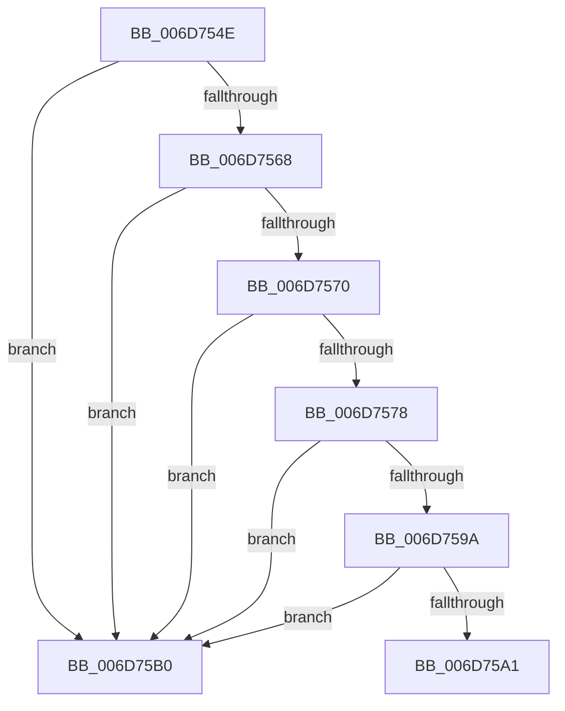

# sub_006D754E

- RVA: `0x006D754E`–`0x006D75BC` (길이 `110` bytes)
- VA: `0x00000001406D754E`
- 실행 섹션: `.text`
- PDB 이름 있음: `아니요`; PDB Function 태그: `아니요`
- unwind 정보 RVA: `0x000607A0`
- 디코드: `31`개 명령, `110/110` bytes 표시
- 미해석 바이트: `0` (있으면 어셈블리에 `.byte`로 보존)

> 이 문서는 커널 이미지의 기계어와 PDB 기호를 분석해 생성했습니다. 4번과 5번은 함수 원형과 자료형을 바이너리 사용 방식에서 추정한 C 해석이며 원본 소스 복구 결과는 아닙니다.

## 1. Dependencies

- 직접 호출 지점: **0**; 고유 호출 대상: **0**
- 직접 호출자로 확인된 함수: **0**
- RIP 상대 이미지 참조: **1**

### Outgoing calls
- 직접 디코드된 call 명령이 없습니다.

### Direct callers
- 이 함수 시작 RVA로 연결되는 직접 call은 확인되지 않았습니다. 간접 호출은 완전히 역산할 수 없습니다.

### Static image references
- `0x006D75A1` → RVA `0x00E0A830` (`.data`; write)

## 2. Other-region calls and transfers

- 다른 실행 섹션으로 향하는 call: **0**
- call이 아닌 외부 분기/꼬리 이동: **2**
  - `0x006D75AB` → [sub_00235D85 + 0x34](../23/Unknown_function_00235D85.md) (`tail-transfer`)
  - `0x006D75B7` → [sub_00235B5D + 0x83](../23/Unknown_function_00235B5D.md) (`tail-transfer`)

## 3. Assembly (complete function range)

```asm
006D754E  33 C0                           xor eax, eax
006D7550  33 C9                           xor ecx, ecx
006D7552  0F A2                           cpuid
006D7554  89 45 D0                        mov dword ptr [rbp - 0x30], eax
006D7557  89 5D D4                        mov dword ptr [rbp - 0x2c], ebx
006D755A  89 4D D8                        mov dword ptr [rbp - 0x28], ecx
006D755D  89 55 DC                        mov dword ptr [rbp - 0x24], edx
006D7560  81 FB 41 75 74 68               cmp ebx, 0x68747541
006D7566  75 48                           jne 0x1406d75b0
006D7568  81 FA 65 6E 74 69               cmp edx, 0x69746e65
006D756E  75 40                           jne 0x1406d75b0
006D7570  81 F9 63 41 4D 44               cmp ecx, 0x444d4163
006D7576  75 38                           jne 0x1406d75b0
006D7578  33 C9                           xor ecx, ecx
006D757A  B8 01 00 00 00                  mov eax, 1
006D757F  0F A2                           cpuid
006D7581  89 4D D8                        mov dword ptr [rbp - 0x28], ecx
006D7584  8B C8                           mov ecx, eax
006D7586  C1 E9 08                        shr ecx, 8
006D7589  83 E1 0F                        and ecx, 0xf
006D758C  89 45 D0                        mov dword ptr [rbp - 0x30], eax
006D758F  89 5D D4                        mov dword ptr [rbp - 0x2c], ebx
006D7592  89 55 DC                        mov dword ptr [rbp - 0x24], edx
006D7595  83 F9 0F                        cmp ecx, 0xf
006D7598  75 16                           jne 0x1406d75b0
006D759A  A9 00 00 F0 0F                  test eax, 0xff00000
006D759F  75 0F                           jne 0x1406d75b0
006D75A1  C7 05 85 32 73 00 01 00 00 00   mov dword ptr [rip + 0x733285], 1
006D75AB  E9 09 E8 B5 FF                  jmp 0x140235db9
006D75B0  44 89 2D 79 32 73 00            mov dword ptr [rip + 0x733279], r13d
006D75B7  E9 24 E6 B5 FF                  jmp 0x140235be0
```

## 4. C-style interpretation (structured pseudocode)

```c
__int64 __fastcall sub_006D754E(int a1, int a2)
{
    __int64 result;

    result = 0;
    a1 = 0;
    *(unsigned int *)(v_rbp - 48) = 0;
    *(unsigned int *)(v_rbp - 44) = (unsigned int)(v_rbx);
    *(unsigned int *)(v_rbp - 40) = 0;
    *(unsigned int *)(v_rbp - 36) = a2;
    if (((unsigned int)(v_rbx)) != 0x68747541ULL) goto loc_006D75B0;
    if (a2 != 0x69746E65ULL) goto loc_006D75B0;
    if (0 != 0x444D4163ULL) goto loc_006D75B0;
    a1 = 0;
    *(unsigned int *)(v_rbp - 40) = 0;
    a1 = (unsigned int)((1) >> (8));
    a1 = (unsigned int)((a1) & (15));
    *(unsigned int *)(v_rbp - 48) = 1;
    *(unsigned int *)(v_rbp - 44) = (unsigned int)(v_rbx);
    *(unsigned int *)(v_rbp - 36) = a2;
    if (a1 != 15) goto loc_006D75B0;
    if (((1) & (0xFF00000ULL)) != 0) goto loc_006D75B0;
    *(unsigned int *)(v_rip + 7549573) = 1;
loc_006D75B0:
    *(unsigned int *)(v_rip + 7549561) = (unsigned int)(v_r13);
}
```

## 5. (Beta) C Style

```c
int64_t sub_006D754E(int32_t Arg1, int32_t Arg2)
{
    int64_t result;

    result = 0;
    Arg1 = 0;
    *(uint32_t *)(local_rbp - 0x30) = 0;
    *(uint32_t *)(local_rbp - 0x2C) = (uint32_t)(local_rbx);
    *(uint32_t *)(local_rbp - 0x28) = 0;
    *(uint32_t *)(local_rbp - 0x24) = Arg2;
    if (((uint32_t)(local_rbx)) != 0x68747541ULL) goto loc_006D75B0;
    if (Arg2 != 0x69746E65ULL) goto loc_006D75B0;
    if (0 != 0x444D4163ULL) goto loc_006D75B0;
    Arg1 = 0;
    *(uint32_t *)(local_rbp - 0x28) = 0;
    Arg1 = (uint32_t)((1) >> (8));
    Arg1 = (uint32_t)((Arg1) & (15));
    *(uint32_t *)(local_rbp - 0x30) = 1;
    *(uint32_t *)(local_rbp - 0x2C) = (uint32_t)(local_rbx);
    *(uint32_t *)(local_rbp - 0x24) = Arg2;
    if (Arg1 != 15) goto loc_006D75B0;
    if (((1) & (0xFF00000ULL)) != 0) goto loc_006D75B0;
    *(uint32_t *)(v_rip + 0x733285) = 1;
loc_006D75B0:
    *(uint32_t *)(v_rip + 0x733279) = (uint32_t)(local_r13);
}
```

## 6. Execution-region graph

[열기: 2D/3D 그래프와 함수 탐색 컨트롤 패널](../../../control-panel.html?section=text&rva=0x006D754E&view=graph)

- 2D 그래프는 위에서 아래로 흐르고, 3D 그래프는 빈 공간을 드래그해 회전합니다. Shift+드래그는 이동, 휠은 확대·축소, 함수 노드 선택은 대상 보고서 이동입니다.

### Static fallback


