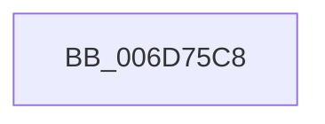

# sub_006D75C8

- RVA: `0x006D75C8`–`0x006D772F` (길이 `359` bytes)
- VA: `0x00000001406D75C8`
- 실행 섹션: `.text`
- PDB 이름 있음: `아니요`; PDB Function 태그: `아니요`
- unwind 정보 RVA: `0x0006088C`
- 디코드: `65`개 명령, `359/359` bytes 표시
- 미해석 바이트: `0` (있으면 어셈블리에 `.byte`로 보존)

> 이 문서는 커널 이미지의 기계어와 PDB 기호를 분석해 생성했습니다. 4번과 5번은 함수 원형과 자료형을 바이너리 사용 방식에서 추정한 C 해석이며 원본 소스 복구 결과는 아닙니다.

## 1. Dependencies

- 직접 호출 지점: **1**; 고유 호출 대상: **1**
- 직접 호출자로 확인된 함수: **0**
- RIP 상대 이미지 참조: **2**

### Outgoing calls
- `0x006D7724` → [tlgWriteTransfer_EtwWriteTransfer](../42/tlgWriteTransfer_EtwWriteTransfer_function_004260E0.md) (function, `0x004260E0`)

### Direct callers
- 이 함수 시작 RVA로 연결되는 직접 call은 확인되지 않았습니다. 간접 호출은 완전히 역산할 수 없습니다.

### Static image references
- `0x006D75D5` → RVA `0x00E070D8` (`.data`; read)
- `0x006D767C` → RVA `0x000480AC` (`.rdata`; read)

## 2. Other-region calls and transfers

- 다른 실행 섹션으로 향하는 call: **0**
- call이 아닌 외부 분기/꼬리 이동: **1**
  - `0x006D772A` → [KiSetNextClockTickDueTime + 0x140](../23/KiSetNextClockTickDueTime_function_002363F0.md) (`tail-transfer`)

## 3. Assembly (complete function range)

```asm
006D75C8  48 8D 44 24 78                  lea rax, [rsp + 0x78]
006D75CD  4C 89 6D 80                     mov qword ptr [rbp - 0x80], r13
006D75D1  48 89 45 F0                     mov qword ptr [rbp - 0x10], rax
006D75D5  48 8D 0D FC FA 72 00            lea rcx, [rip + 0x72fafc]
006D75DC  0F B6 47 21                     movzx eax, byte ptr [rdi + 0x21]
006D75E0  4C 2B EE                        sub r13, rsi
006D75E3  88 44 24 40                     mov byte ptr [rsp + 0x40], al
006D75E7  48 8D 44 24 40                  lea rax, [rsp + 0x40]
006D75EC  48 89 45 00                     mov qword ptr [rbp], rax
006D75F0  48 8D 44 24 50                  lea rax, [rsp + 0x50]
006D75F5  48 89 45 10                     mov qword ptr [rbp + 0x10], rax
006D75F9  48 8D 44 24 54                  lea rax, [rsp + 0x54]
006D75FE  48 89 45 20                     mov qword ptr [rbp + 0x20], rax
006D7602  48 8D 44 24 41                  lea rax, [rsp + 0x41]
006D7607  48 89 45 30                     mov qword ptr [rbp + 0x30], rax
006D760B  48 8D 44 24 42                  lea rax, [rsp + 0x42]
006D7610  48 89 45 40                     mov qword ptr [rbp + 0x40], rax
006D7614  48 8D 44 24 58                  lea rax, [rsp + 0x58]
006D7619  48 89 45 50                     mov qword ptr [rbp + 0x50], rax
006D761D  48 8D 44 24 5C                  lea rax, [rsp + 0x5c]
006D7622  48 89 45 60                     mov qword ptr [rbp + 0x60], rax
006D7626  48 8D 45 80                     lea rax, [rbp - 0x80]
006D762A  48 89 45 70                     mov qword ptr [rbp + 0x70], rax
006D762E  48 8D 45 88                     lea rax, [rbp - 0x78]
006D7632  48 89 85 80 00 00 00            mov qword ptr [rbp + 0x80], rax
006D7639  48 8D 45 90                     lea rax, [rbp - 0x70]
006D763D  48 89 85 90 00 00 00            mov qword ptr [rbp + 0x90], rax
006D7644  48 8D 45 98                     lea rax, [rbp - 0x68]
006D7648  48 89 85 A0 00 00 00            mov qword ptr [rbp + 0xa0], rax
006D764F  0F B6 44 24 43                  movzx eax, byte ptr [rsp + 0x43]
006D7654  88 44 24 44                     mov byte ptr [rsp + 0x44], al
006D7658  48 8D 44 24 44                  lea rax, [rsp + 0x44]
006D765D  48 89 85 B0 00 00 00            mov qword ptr [rbp + 0xb0], rax
006D7664  48 8D 45 D0                     lea rax, [rbp - 0x30]
006D7668  44 88 44 24 42                  mov byte ptr [rsp + 0x42], r8b
006D766D  45 33 C0                        xor r8d, r8d
006D7670  44 89 4C 24 58                  mov dword ptr [rsp + 0x58], r9d
006D7675  45 33 C9                        xor r9d, r9d
006D7678  48 89 55 90                     mov qword ptr [rbp - 0x70], rdx
006D767C  48 8D 15 29 0A 97 FF            lea rdx, [rip - 0x68f5d7]
006D7683  48 89 44 24 28                  mov qword ptr [rsp + 0x28], rax
006D7688  C7 44 24 20 0F 00 00 00         mov dword ptr [rsp + 0x20], 0xf
006D7690  48 89 74 24 78                  mov qword ptr [rsp + 0x78], rsi
006D7695  48 C7 45 F8 08 00 00 00         mov qword ptr [rbp - 8], 8
006D769D  48 C7 45 08 01 00 00 00         mov qword ptr [rbp + 8], 1
006D76A5  89 5C 24 50                     mov dword ptr [rsp + 0x50], ebx
006D76A9  48 C7 45 18 04 00 00 00         mov qword ptr [rbp + 0x18], 4
006D76B1  44 89 74 24 54                  mov dword ptr [rsp + 0x54], r14d
006D76B6  48 C7 45 28 04 00 00 00         mov qword ptr [rbp + 0x28], 4
006D76BE  44 88 64 24 41                  mov byte ptr [rsp + 0x41], r12b
006D76C3  48 C7 45 38 01 00 00 00         mov qword ptr [rbp + 0x38], 1
006D76CB  48 C7 45 48 01 00 00 00         mov qword ptr [rbp + 0x48], 1
006D76D3  48 C7 45 58 04 00 00 00         mov qword ptr [rbp + 0x58], 4
006D76DB  44 89 54 24 5C                  mov dword ptr [rsp + 0x5c], r10d
006D76E0  48 C7 45 68 04 00 00 00         mov qword ptr [rbp + 0x68], 4
006D76E8  48 C7 45 78 08 00 00 00         mov qword ptr [rbp + 0x78], 8
006D76F0  4C 89 7D 88                     mov qword ptr [rbp - 0x78], r15
006D76F4  48 C7 85 88 00 00 00 08 00 00 00  mov qword ptr [rbp + 0x88], 8
006D76FF  48 C7 85 98 00 00 00 08 00 00 00  mov qword ptr [rbp + 0x98], 8
006D770A  4C 89 6D 98                     mov qword ptr [rbp - 0x68], r13
006D770E  48 C7 85 A8 00 00 00 08 00 00 00  mov qword ptr [rbp + 0xa8], 8
006D7719  48 C7 85 B8 00 00 00 01 00 00 00  mov qword ptr [rbp + 0xb8], 1
006D7724  E8 B7 E9 D4 FF                  call 0x1404260e0
006D7729  90                              nop
006D772A  E9 01 EE B5 FF                  jmp 0x140236530
```

## 4. C-style interpretation (structured pseudocode)

```c
__int64 __fastcall sub_006D75C8(__int64 a1, __int64 a2, int a3, int a4, __int64 a5, __int64 a6, __int64 a7, __int64 a8, __int64 a9, __int64 a10, __int64 a11, __int64 a12, __int64 a13, __int64 a14, __int64 a15)
{
    __int64 result;
    __int64 v_r13;
    unsigned int v_stack_p20;
    unsigned __int64 v_stack_p28;
    unsigned __int8 v_stack_p40;
    unsigned __int64 v_stack_p41;
    unsigned __int64 v_stack_p42;
    unsigned __int8 v_stack_p43;
    unsigned __int8 v_stack_p44;
    unsigned int v_stack_p50;
    unsigned __int64 v_stack_p54;
    unsigned int v_stack_p58;
    unsigned __int64 v_stack_p5C;
    unsigned __int64 v_stack_p78;

    *(unsigned __int64 *)(v_rbp - 128) = v_r13;
    *(unsigned __int64 *)(v_rbp - 16) = a15;
    v_r13 = (v_r13) - (v_rsi);
    v_stack_p40 = (unsigned __int8)(*(unsigned __int8 *)(v_rdi + 33));
    *(unsigned __int64 *)(v_rbp) = a8;
    *(unsigned __int64 *)(v_rbp + 16) = a10;
    *(unsigned __int64 *)(v_rbp + 32) = v_stack_p54;
    *(unsigned __int64 *)(v_rbp + 48) = v_stack_p41;
    *(unsigned __int64 *)(v_rbp + 64) = v_stack_p42;
    *(unsigned __int64 *)(v_rbp + 80) = a11;
    *(unsigned __int64 *)(v_rbp + 96) = v_stack_p5C;
    *(unsigned __int64 *)(v_rbp + 112) = v_rbp - 128;
    *(unsigned __int64 *)(v_rbp + 128) = v_rbp - 120;
    *(unsigned __int64 *)(v_rbp + 144) = v_rbp - 112;
    *(unsigned __int64 *)(v_rbp + 160) = v_rbp - 104;
    v_stack_p44 = (unsigned __int8)(v_stack_p43);
    *(unsigned __int64 *)(v_rbp + 176) = v_stack_p44;
    v_stack_p42 = (unsigned __int8)(a3);
    a3 = 0;
    v_stack_p58 = a4;
    a4 = 0;
    *(unsigned __int64 *)(v_rbp - 112) = a2;
    v_stack_p28 = v_rbp - 48;
    v_stack_p20 = 15;
    v_stack_p78 = v_rsi;
    *(unsigned __int64 *)(v_rbp - 8) = 8;
    *(unsigned __int64 *)(v_rbp + 8) = 1;
    v_stack_p50 = (unsigned int)(v_rbx);
    *(unsigned __int64 *)(v_rbp + 24) = 4;
    v_stack_p54 = (unsigned int)(v_r14);
    *(unsigned __int64 *)(v_rbp + 40) = 4;
    v_stack_p41 = (unsigned __int8)(v_r12);
    *(unsigned __int64 *)(v_rbp + 56) = 1;
    *(unsigned __int64 *)(v_rbp + 72) = 1;
    *(unsigned __int64 *)(v_rbp + 88) = 4;
    v_stack_p5C = (unsigned int)(v_r10);
    *(unsigned __int64 *)(v_rbp + 104) = 4;
    *(unsigned __int64 *)(v_rbp + 120) = 8;
    *(unsigned __int64 *)(v_rbp - 120) = v_r15;
    *(unsigned __int64 *)(v_rbp + 136) = 8;
    *(unsigned __int64 *)(v_rbp + 152) = 8;
    *(unsigned __int64 *)(v_rbp - 104) = v_r13;
    *(unsigned __int64 *)(v_rbp + 168) = 8;
    *(unsigned __int64 *)(v_rbp + 184) = 1;
    result = tlgWriteTransfer_EtwWriteTransfer(v_rip + 7535356, v_rip - 6878679, a3, a4);
}
```

## 5. (Beta) C Style

```c
int64_t sub_006D75C8(int64_t Arg1, int64_t Arg2, int32_t Arg3, int32_t Arg4, uint64_t Arg5, uint64_t Arg6, uint64_t Arg7, int64_t Arg8, uint64_t Arg9, int64_t Arg10, int64_t Arg11, uint64_t Arg12, uint64_t Arg13, uint64_t Arg14, int64_t Arg15)
{
    int64_t result;
    int64_t local_r13;
    uint32_t v_stack_p20;
    uint64_t v_stack_p28;
    uint8_t v_stack_p40;
    uint64_t v_stack_p41;
    uint64_t v_stack_p42;
    uint8_t v_stack_p43;
    uint8_t v_stack_p44;
    uint32_t v_stack_p50;
    uint64_t v_stack_p54;
    uint32_t v_stack_p58;
    uint64_t v_stack_p5C;
    uint64_t v_stack_p78;

    *(uint64_t *)(local_rbp - 0x80) = local_r13;
    *(uint64_t *)(local_rbp - 0x10) = Arg15;
    local_r13 = (local_r13) - (local_rsi);
    v_stack_p40 = (uint8_t)(*(uint8_t *)(local_rdi + 0x21));
    *(uint64_t *)(local_rbp) = Arg8;
    *(uint64_t *)(local_rbp + 0x10) = Arg10;
    *(uint64_t *)(local_rbp + 0x20) = v_stack_p54;
    *(uint64_t *)(local_rbp + 0x30) = v_stack_p41;
    *(uint64_t *)(local_rbp + 0x40) = v_stack_p42;
    *(uint64_t *)(local_rbp + 0x50) = Arg11;
    *(uint64_t *)(local_rbp + 0x60) = v_stack_p5C;
    *(uint64_t *)(local_rbp + 0x70) = local_rbp - 128;
    *(uint64_t *)(local_rbp + 0x80) = local_rbp - 120;
    *(uint64_t *)(local_rbp + 0x90) = local_rbp - 112;
    *(uint64_t *)(local_rbp + 0xA0) = local_rbp - 104;
    v_stack_p44 = (uint8_t)(v_stack_p43);
    *(uint64_t *)(local_rbp + 0xB0) = v_stack_p44;
    v_stack_p42 = (uint8_t)(Arg3);
    Arg3 = 0;
    v_stack_p58 = Arg4;
    Arg4 = 0;
    *(uint64_t *)(local_rbp - 0x70) = Arg2;
    v_stack_p28 = local_rbp - 48;
    v_stack_p20 = 15;
    v_stack_p78 = local_rsi;
    *(uint64_t *)(local_rbp - 0x8) = 8;
    *(uint64_t *)(local_rbp + 0x8) = 1;
    v_stack_p50 = (uint32_t)(local_rbx);
    *(uint64_t *)(local_rbp + 0x18) = 4;
    v_stack_p54 = (uint32_t)(local_r14);
    *(uint64_t *)(local_rbp + 0x28) = 4;
    v_stack_p41 = (uint8_t)(local_r12);
    *(uint64_t *)(local_rbp + 0x38) = 1;
    *(uint64_t *)(local_rbp + 0x48) = 1;
    *(uint64_t *)(local_rbp + 0x58) = 4;
    v_stack_p5C = (uint32_t)(local_r10);
    *(uint64_t *)(local_rbp + 0x68) = 4;
    *(uint64_t *)(local_rbp + 0x78) = 8;
    *(uint64_t *)(local_rbp - 0x78) = local_r15;
    *(uint64_t *)(local_rbp + 0x88) = 8;
    *(uint64_t *)(local_rbp + 0x98) = 8;
    *(uint64_t *)(local_rbp - 0x68) = local_r13;
    *(uint64_t *)(local_rbp + 0xA8) = 8;
    *(uint64_t *)(local_rbp + 0xB8) = 1;
    result = tlgWriteTransfer_EtwWriteTransfer(v_rip + 7535356, v_rip - 6878679, Arg3, Arg4);
}
```

## 6. Execution-region graph

[열기: 2D/3D 그래프와 함수 탐색 컨트롤 패널](../../../control-panel.html?section=text&rva=0x006D75C8&view=graph)

- 2D 그래프는 위에서 아래로 흐르고, 3D 그래프는 빈 공간을 드래그해 회전합니다. Shift+드래그는 이동, 휠은 확대·축소, 함수 노드 선택은 대상 보고서 이동입니다.

### Static fallback


