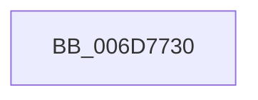

# sub_006D7730

- RVA: `0x006D7730`–`0x006D781C` (길이 `236` bytes)
- VA: `0x00000001406D7730`
- 실행 섹션: `.text`
- PDB 이름 있음: `아니요`; PDB Function 태그: `아니요`
- unwind 정보 RVA: `0x000608C4`
- 디코드: `44`개 명령, `236/236` bytes 표시
- 미해석 바이트: `0` (있으면 어셈블리에 `.byte`로 보존)

> 이 문서는 커널 이미지의 기계어와 PDB 기호를 분석해 생성했습니다. 4번과 5번은 함수 원형과 자료형을 바이너리 사용 방식에서 추정한 C 해석이며 원본 소스 복구 결과는 아닙니다.

## 1. Dependencies

- 직접 호출 지점: **1**; 고유 호출 대상: **1**
- 직접 호출자로 확인된 함수: **0**
- RIP 상대 이미지 참조: **2**

### Outgoing calls
- `0x006D780F` → [tlgWriteTransfer_EtwWriteTransfer](../42/tlgWriteTransfer_EtwWriteTransfer_function_004260E0.md) (function, `0x004260E0`)

### Direct callers
- 이 함수 시작 RVA로 연결되는 직접 call은 확인되지 않았습니다. 간접 호출은 완전히 역산할 수 없습니다.

### Static image references
- `0x006D773E` → RVA `0x00048592` (`.rdata`; read)
- `0x006D7785` → RVA `0x00E070D8` (`.data`; read)

## 2. Other-region calls and transfers

- 다른 실행 섹션으로 향하는 call: **0**
- call이 아닌 외부 분기/꼬리 이동: **1**
  - `0x006D7817` → [KiSetClockTimerKTimerDeadlines + 0x7A](../23/KiSetClockTimerKTimerDeadlines_function_0023671C.md) (`tail-transfer`)

## 3. Assembly (complete function range)

```asm
006D7730  48 8D 44 24 58                  lea rax, [rsp + 0x58]
006D7735  48 89 4C 24 58                  mov qword ptr [rsp + 0x58], rcx
006D773A  48 89 45 90                     mov qword ptr [rbp - 0x70], rax
006D773E  48 8D 15 4D 0E 97 FF            lea rdx, [rip - 0x68f1b3]
006D7745  48 8D 44 24 44                  lea rax, [rsp + 0x44]
006D774A  44 88 4C 24 41                  mov byte ptr [rsp + 0x41], r9b
006D774F  48 89 45 A0                     mov qword ptr [rbp - 0x60], rax
006D7753  45 33 C9                        xor r9d, r9d
006D7756  48 8D 44 24 60                  lea rax, [rsp + 0x60]
006D775B  48 C7 45 98 08 00 00 00         mov qword ptr [rbp - 0x68], 8
006D7763  48 89 45 B0                     mov qword ptr [rbp - 0x50], rax
006D7767  45 33 C0                        xor r8d, r8d
006D776A  48 8B C3                        mov rax, rbx
006D776D  C7 44 24 44 01 00 00 00         mov dword ptr [rsp + 0x44], 1
006D7775  48 2B C1                        sub rax, rcx
006D7778  48 C7 45 A8 04 00 00 00         mov qword ptr [rbp - 0x58], 4
006D7780  48 89 44 24 68                  mov qword ptr [rsp + 0x68], rax
006D7785  48 8D 0D 4C F9 72 00            lea rcx, [rip + 0x72f94c]
006D778C  48 8D 44 24 68                  lea rax, [rsp + 0x68]
006D7791  48 89 7C 24 60                  mov qword ptr [rsp + 0x60], rdi
006D7796  48 89 45 C0                     mov qword ptr [rbp - 0x40], rax
006D779A  48 8D 44 24 50                  lea rax, [rsp + 0x50]
006D779F  48 89 45 D0                     mov qword ptr [rbp - 0x30], rax
006D77A3  48 8D 44 24 48                  lea rax, [rsp + 0x48]
006D77A8  48 89 45 E0                     mov qword ptr [rbp - 0x20], rax
006D77AC  48 8D 44 24 40                  lea rax, [rsp + 0x40]
006D77B1  48 89 45 F0                     mov qword ptr [rbp - 0x10], rax
006D77B5  48 8D 44 24 41                  lea rax, [rsp + 0x41]
006D77BA  48 89 45 00                     mov qword ptr [rbp], rax
006D77BE  48 8D 44 24 70                  lea rax, [rsp + 0x70]
006D77C3  48 89 44 24 28                  mov qword ptr [rsp + 0x28], rax
006D77C8  C7 44 24 20 0A 00 00 00         mov dword ptr [rsp + 0x20], 0xa
006D77D0  48 C7 45 B8 08 00 00 00         mov qword ptr [rbp - 0x48], 8
006D77D8  48 C7 45 C8 08 00 00 00         mov qword ptr [rbp - 0x38], 8
006D77E0  48 89 5C 24 50                  mov qword ptr [rsp + 0x50], rbx
006D77E5  48 C7 45 D8 08 00 00 00         mov qword ptr [rbp - 0x28], 8
006D77ED  44 89 64 24 48                  mov dword ptr [rsp + 0x48], r12d
006D77F2  48 C7 45 E8 04 00 00 00         mov qword ptr [rbp - 0x18], 4
006D77FA  44 88 74 24 40                  mov byte ptr [rsp + 0x40], r14b
006D77FF  48 C7 45 F8 01 00 00 00         mov qword ptr [rbp - 8], 1
006D7807  48 C7 45 08 01 00 00 00         mov qword ptr [rbp + 8], 1
006D780F  E8 CC E8 D4 FF                  call 0x1404260e0
006D7814  45 33 C9                        xor r9d, r9d
006D7817  E9 7A EF B5 FF                  jmp 0x140236796
```

## 4. C-style interpretation (structured pseudocode)

```c
__int64 __fastcall sub_006D7730(__int64 a1, __int64 a2, int a3, int a4, __int64 a5, __int64 a6, __int64 a7, __int64 a8, __int64 a9, __int64 a10, __int64 a11, __int64 a12, __int64 a13, __int64 a14)
{
    __int64 result;
    unsigned int v_stack_p20;
    unsigned __int64 v_stack_p28;
    unsigned __int8 v_stack_p40;
    unsigned __int8 v_stack_p41;
    unsigned __int64 v_stack_p44;
    unsigned int v_stack_p48;
    unsigned __int64 v_stack_p50;
    unsigned __int64 v_stack_p58;
    unsigned __int64 v_stack_p60;
    unsigned __int64 v_stack_p68;

    v_stack_p58 = a1;
    *(unsigned __int64 *)(v_rbp - 112) = a11;
    v_stack_p41 = (unsigned __int8)(a4);
    *(unsigned __int64 *)(v_rbp - 96) = v_stack_p44;
    a4 = 0;
    *(unsigned __int64 *)(v_rbp - 104) = 8;
    *(unsigned __int64 *)(v_rbp - 80) = a12;
    a3 = 0;
    v_stack_p44 = 1;
    result = (v_rbx) - (a1);
    *(unsigned __int64 *)(v_rbp - 88) = 4;
    v_stack_p68 = result;
    v_stack_p60 = v_rdi;
    *(unsigned __int64 *)(v_rbp - 64) = a13;
    *(unsigned __int64 *)(v_rbp - 48) = a10;
    *(unsigned __int64 *)(v_rbp - 32) = a9;
    *(unsigned __int64 *)(v_rbp - 16) = a8;
    *(unsigned __int64 *)(v_rbp) = v_stack_p41;
    v_stack_p28 = a14;
    v_stack_p20 = 10;
    *(unsigned __int64 *)(v_rbp - 72) = 8;
    *(unsigned __int64 *)(v_rbp - 56) = 8;
    v_stack_p50 = v_rbx;
    *(unsigned __int64 *)(v_rbp - 40) = 8;
    v_stack_p48 = (unsigned int)(v_r12);
    *(unsigned __int64 *)(v_rbp - 24) = 4;
    v_stack_p40 = (unsigned __int8)(v_r14);
    *(unsigned __int64 *)(v_rbp - 8) = 1;
    *(unsigned __int64 *)(v_rbp + 8) = 1;
    result = tlgWriteTransfer_EtwWriteTransfer(v_rip + 7534924, v_rip - 6877619, a3, a4);
    a4 = 0;
}
```

## 5. (Beta) C Style

```c
int64_t sub_006D7730(int64_t Arg1, int64_t Arg2, int32_t Arg3, int32_t Arg4, uint64_t Arg5, uint64_t Arg6, uint64_t Arg7, int64_t Arg8, int64_t Arg9, int64_t Arg10, int64_t Arg11, int64_t Arg12, int64_t Arg13, int64_t Arg14)
{
    int64_t result;
    uint32_t v_stack_p20;
    uint64_t v_stack_p28;
    uint8_t v_stack_p40;
    uint8_t v_stack_p41;
    uint64_t v_stack_p44;
    uint32_t v_stack_p48;
    uint64_t v_stack_p50;
    uint64_t v_stack_p58;
    uint64_t v_stack_p60;
    uint64_t v_stack_p68;

    v_stack_p58 = Arg1;
    *(uint64_t *)(local_rbp - 0x70) = Arg11;
    v_stack_p41 = (uint8_t)(Arg4);
    *(uint64_t *)(local_rbp - 0x60) = v_stack_p44;
    Arg4 = 0;
    *(uint64_t *)(local_rbp - 0x68) = 8;
    *(uint64_t *)(local_rbp - 0x50) = Arg12;
    Arg3 = 0;
    v_stack_p44 = 1;
    result = (local_rbx) - (Arg1);
    *(uint64_t *)(local_rbp - 0x58) = 4;
    v_stack_p68 = result;
    v_stack_p60 = local_rdi;
    *(uint64_t *)(local_rbp - 0x40) = Arg13;
    *(uint64_t *)(local_rbp - 0x30) = Arg10;
    *(uint64_t *)(local_rbp - 0x20) = Arg9;
    *(uint64_t *)(local_rbp - 0x10) = Arg8;
    *(uint64_t *)(local_rbp) = v_stack_p41;
    v_stack_p28 = Arg14;
    v_stack_p20 = 10;
    *(uint64_t *)(local_rbp - 0x48) = 8;
    *(uint64_t *)(local_rbp - 0x38) = 8;
    v_stack_p50 = local_rbx;
    *(uint64_t *)(local_rbp - 0x28) = 8;
    v_stack_p48 = (uint32_t)(local_r12);
    *(uint64_t *)(local_rbp - 0x18) = 4;
    v_stack_p40 = (uint8_t)(local_r14);
    *(uint64_t *)(local_rbp - 0x8) = 1;
    *(uint64_t *)(local_rbp + 0x8) = 1;
    result = tlgWriteTransfer_EtwWriteTransfer(v_rip + 7534924, v_rip - 6877619, Arg3, Arg4);
    Arg4 = 0;
}
```

## 6. Execution-region graph

[열기: 2D/3D 그래프와 함수 탐색 컨트롤 패널](../../../control-panel.html?section=text&rva=0x006D7730&view=graph)

- 2D 그래프는 위에서 아래로 흐르고, 3D 그래프는 빈 공간을 드래그해 회전합니다. Shift+드래그는 이동, 휠은 확대·축소, 함수 노드 선택은 대상 보고서 이동입니다.

### Static fallback


