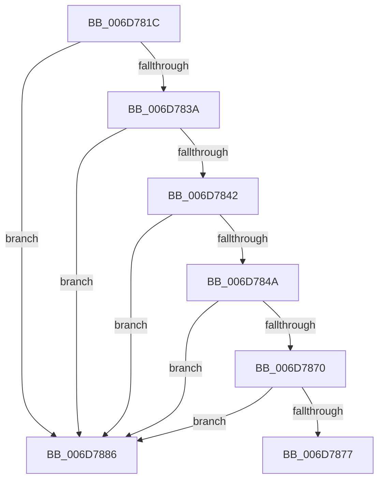

# sub_006D781C

- RVA: `0x006D781C`–`0x006D7892` (길이 `118` bytes)
- VA: `0x00000001406D781C`
- 실행 섹션: `.text`
- PDB 이름 있음: `아니요`; PDB Function 태그: `아니요`
- unwind 정보 RVA: `0x000608F4`
- 디코드: `31`개 명령, `118/118` bytes 표시
- 미해석 바이트: `0` (있으면 어셈블리에 `.byte`로 보존)

> 이 문서는 커널 이미지의 기계어와 PDB 기호를 분석해 생성했습니다. 4번과 5번은 함수 원형과 자료형을 바이너리 사용 방식에서 추정한 C 해석이며 원본 소스 복구 결과는 아닙니다.

## 1. Dependencies

- 직접 호출 지점: **0**; 고유 호출 대상: **0**
- 직접 호출자로 확인된 함수: **0**
- RIP 상대 이미지 참조: **1**

### Outgoing calls
- 직접 디코드된 call 명령이 없습니다.

### Direct callers
- 이 함수 시작 RVA로 연결되는 직접 call은 확인되지 않았습니다. 간접 호출은 완전히 역산할 수 없습니다.

### Static image references
- `0x006D7877` → RVA `0x00E0A830` (`.data`; write)

## 2. Other-region calls and transfers

- 다른 실행 섹션으로 향하는 call: **0**
- call이 아닌 외부 분기/꼬리 이동: **2**
  - `0x006D7881` → [HalpPciAccessMmConfigSpace + 0x15A](../23/HalpPciAccessMmConfigSpace_function_0023683C.md) (`tail-transfer`)
  - `0x006D788D` → [HalpPciAccessMmConfigSpace + 0x69](../23/HalpPciAccessMmConfigSpace_function_0023683C.md) (`tail-transfer`)

## 3. Assembly (complete function range)

```asm
006D781C  33 C0                           xor eax, eax
006D781E  33 C9                           xor ecx, ecx
006D7820  0F A2                           cpuid
006D7822  89 44 24 20                     mov dword ptr [rsp + 0x20], eax
006D7826  89 5C 24 24                     mov dword ptr [rsp + 0x24], ebx
006D782A  89 4C 24 28                     mov dword ptr [rsp + 0x28], ecx
006D782E  89 54 24 2C                     mov dword ptr [rsp + 0x2c], edx
006D7832  81 FB 41 75 74 68               cmp ebx, 0x68747541
006D7838  75 4C                           jne 0x1406d7886
006D783A  81 FA 65 6E 74 69               cmp edx, 0x69746e65
006D7840  75 44                           jne 0x1406d7886
006D7842  81 F9 63 41 4D 44               cmp ecx, 0x444d4163
006D7848  75 3C                           jne 0x1406d7886
006D784A  33 C9                           xor ecx, ecx
006D784C  B8 01 00 00 00                  mov eax, 1
006D7851  0F A2                           cpuid
006D7853  89 4C 24 28                     mov dword ptr [rsp + 0x28], ecx
006D7857  8B C8                           mov ecx, eax
006D7859  C1 E9 08                        shr ecx, 8
006D785C  83 E1 0F                        and ecx, 0xf
006D785F  89 44 24 20                     mov dword ptr [rsp + 0x20], eax
006D7863  89 5C 24 24                     mov dword ptr [rsp + 0x24], ebx
006D7867  89 54 24 2C                     mov dword ptr [rsp + 0x2c], edx
006D786B  83 F9 0F                        cmp ecx, 0xf
006D786E  75 16                           jne 0x1406d7886
006D7870  A9 00 00 F0 0F                  test eax, 0xff00000
006D7875  75 0F                           jne 0x1406d7886
006D7877  C7 05 AF 2F 73 00 01 00 00 00   mov dword ptr [rip + 0x732faf], 1
006D7881  E9 10 F1 B5 FF                  jmp 0x140236996
006D7886  44 89 3D A3 2F 73 00            mov dword ptr [rip + 0x732fa3], r15d
006D788D  E9 13 F0 B5 FF                  jmp 0x1402368a5
```

## 4. C-style interpretation (structured pseudocode)

```c
__int64 __fastcall sub_006D781C(int a1, int a2)
{
    __int64 result;
    unsigned int v_stack_p20;
    unsigned int v_stack_p24;
    unsigned int v_stack_p28;
    unsigned int v_stack_p2C;

    result = 0;
    a1 = 0;
    v_stack_p20 = 0;
    v_stack_p24 = (unsigned int)(v_rbx);
    v_stack_p28 = 0;
    v_stack_p2C = a2;
    if (((unsigned int)(v_rbx)) != 0x68747541ULL) goto loc_006D7886;
    if (a2 != 0x69746E65ULL) goto loc_006D7886;
    if (0 != 0x444D4163ULL) goto loc_006D7886;
    a1 = 0;
    v_stack_p28 = 0;
    a1 = (unsigned int)((1) >> (8));
    a1 = (unsigned int)((a1) & (15));
    v_stack_p20 = 1;
    v_stack_p24 = (unsigned int)(v_rbx);
    v_stack_p2C = a2;
    if (a1 != 15) goto loc_006D7886;
    if (((1) & (0xFF00000ULL)) != 0) goto loc_006D7886;
    *(unsigned int *)(v_rip + 7548847) = 1;
loc_006D7886:
    *(unsigned int *)(v_rip + 7548835) = (unsigned int)(v_r15);
}
```

## 5. (Beta) C Style

```c
int64_t sub_006D781C(int32_t Arg1, int32_t Arg2)
{
    int64_t result;
    uint32_t v_stack_p20;
    uint32_t v_stack_p24;
    uint32_t v_stack_p28;
    uint32_t v_stack_p2C;

    result = 0;
    Arg1 = 0;
    v_stack_p20 = 0;
    v_stack_p24 = (uint32_t)(local_rbx);
    v_stack_p28 = 0;
    v_stack_p2C = Arg2;
    if (((uint32_t)(local_rbx)) != 0x68747541ULL) goto loc_006D7886;
    if (Arg2 != 0x69746E65ULL) goto loc_006D7886;
    if (0 != 0x444D4163ULL) goto loc_006D7886;
    Arg1 = 0;
    v_stack_p28 = 0;
    Arg1 = (uint32_t)((1) >> (8));
    Arg1 = (uint32_t)((Arg1) & (15));
    v_stack_p20 = 1;
    v_stack_p24 = (uint32_t)(local_rbx);
    v_stack_p2C = Arg2;
    if (Arg1 != 15) goto loc_006D7886;
    if (((1) & (0xFF00000ULL)) != 0) goto loc_006D7886;
    *(uint32_t *)(v_rip + 0x732FAF) = 1;
loc_006D7886:
    *(uint32_t *)(v_rip + 0x732FA3) = (uint32_t)(local_r15);
}
```

## 6. Execution-region graph

[열기: 2D/3D 그래프와 함수 탐색 컨트롤 패널](../../../control-panel.html?section=text&rva=0x006D781C&view=graph)

- 2D 그래프는 위에서 아래로 흐르고, 3D 그래프는 빈 공간을 드래그해 회전합니다. Shift+드래그는 이동, 휠은 확대·축소, 함수 노드 선택은 대상 보고서 이동입니다.

### Static fallback


