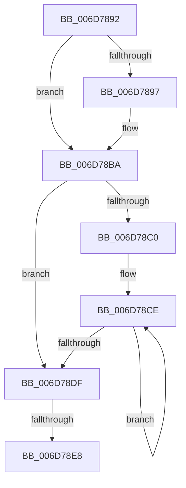

# sub_006D7892

- RVA: `0x006D7892`–`0x006D78ED` (길이 `91` bytes)
- VA: `0x00000001406D7892`
- 실행 섹션: `.text`
- PDB 이름 있음: `아니요`; PDB Function 태그: `아니요`
- unwind 정보 RVA: `0x00060A90`
- 디코드: `27`개 명령, `91/91` bytes 표시
- 미해석 바이트: `0` (있으면 어셈블리에 `.byte`로 보존)

> 이 문서는 커널 이미지의 기계어와 PDB 기호를 분석해 생성했습니다. 4번과 5번은 함수 원형과 자료형을 바이너리 사용 방식에서 추정한 C 해석이며 원본 소스 복구 결과는 아닙니다.

## 1. Dependencies

- 직접 호출 지점: **0**; 고유 호출 대상: **0**
- 직접 호출자로 확인된 함수: **0**
- RIP 상대 이미지 참조: **0**

### Outgoing calls
- 직접 디코드된 call 명령이 없습니다.

### Direct callers
- 이 함수 시작 RVA로 연결되는 직접 call은 확인되지 않았습니다. 간접 호출은 완전히 역산할 수 없습니다.

### Static image references
- 디코드된 RIP-relative 메모리 참조가 없습니다.

## 2. Other-region calls and transfers

- 다른 실행 섹션으로 향하는 call: **0**
- call이 아닌 외부 분기/꼬리 이동: **2**
  - `0x006D78E2` → [RtlInterlockedSetClearRunEx + 0x163](../23/RtlInterlockedSetClearRunEx_function_00238660.md) (`tail-transfer`)
  - `0x006D78E8` → [RtlInterlockedSetClearRunEx + 0x1B1](../23/RtlInterlockedSetClearRunEx_function_00238660.md) (`tail-transfer`)

## 3. Assembly (complete function range)

```asm
006D7892  4D 85 D2                        test r10, r10
006D7895  74 23                           je 0x1406d78ba
006D7897  41 83 E3 1F                     and r11d, 0x1f
006D789B  45 2B F3                        sub r14d, r11d
006D789E  41 8B CE                        mov ecx, r14d
006D78A1  D3 E2                           shl edx, cl
006D78A3  49 8B CA                        mov rcx, r10
006D78A6  FF CA                           dec edx
006D78A8  D3 E2                           shl edx, cl
006D78AA  F7 D2                           not edx
006D78AC  F0 41 21 10                     lock and dword ptr [r8], edx
006D78B0  41 8B C6                        mov eax, r14d
006D78B3  48 2B F8                        sub rdi, rax
006D78B6  49 83 C0 04                     add r8, 4
006D78BA  48 83 FF 20                     cmp rdi, 0x20
006D78BE  72 1F                           jb 0x1406d78df
006D78C0  48 8B CF                        mov rcx, rdi
006D78C3  48 C1 E9 05                     shr rcx, 5
006D78C7  48 6B C1 E0                     imul rax, rcx, -0x20
006D78CB  48 03 F8                        add rdi, rax
006D78CE  41 C7 00 00 00 00 00            mov dword ptr [r8], 0
006D78D5  49 83 C0 04                     add r8, 4
006D78D9  48 83 E9 01                     sub rcx, 1
006D78DD  75 EF                           jne 0x1406d78ce
006D78DF  48 85 FF                        test rdi, rdi
006D78E2  0F 84 DB 0E B6 FF               je 0x1402387c3
006D78E8  E9 24 0F B6 FF                  jmp 0x140238811
```

## 4. C-style interpretation (structured pseudocode)

```c
__int64 __fastcall sub_006D7892(__int64 a1, int a2, __int64 a3)
{
    __int64 result;
    __int64 v_r11;
    __int64 v_r14;
    __int64 v_rdi;

    if (v_r10 != 0) {
        v_r11 = (unsigned int)((v_r11) & (31));
        v_r14 = (unsigned int)((v_r14) - ((unsigned int)(v_r11)));
        a1 = (unsigned int)(v_r14);
        a2 = (unsigned int)((a2) << ((unsigned __int8)(a1)));
        a1 = v_r10;
        a2 = (unsigned int)((a2) - 1);
        a2 = (unsigned int)((a2) << ((unsigned __int8)(a1)));
        a2 = (unsigned int)(~(a2));
        result = (unsigned int)(v_r14);
        v_rdi = (v_rdi) - (result);
        a3 = (a3) + (4);
    }
    if (v_rdi < 32) goto loc_006D78DF;
    a1 = (v_rdi) >> (5);
    result = (result) * (a1);
    v_rdi = (v_rdi) + (result);
loc_006D78CE:
    *(unsigned int *)(a3) = 0;
    a3 = (a3) + (4);
    a1 = (a1) - (1);
    if (condition_is_not_equal) goto loc_006D78CE;
loc_006D78DF:
}
```

## 5. (Beta) C Style

```c
int64_t sub_006D7892(int64_t Arg1, int32_t Arg2, void *Arg3)
{
    uint8_t *arg3 = (uint8_t *)Arg3;

    int64_t result;
    int64_t local_r11;
    int64_t local_r14;
    int64_t local_rdi;

    if (local_r10 != 0) {
        local_r11 = (uint32_t)((local_r11) & (31));
        local_r14 = (uint32_t)((local_r14) - ((uint32_t)(local_r11)));
        Arg1 = (uint32_t)(local_r14);
        Arg2 = (uint32_t)((Arg2) << ((uint8_t)(Arg1)));
        Arg1 = local_r10;
        Arg2 = (uint32_t)((Arg2) - 1);
        Arg2 = (uint32_t)((Arg2) << ((uint8_t)(Arg1)));
        Arg2 = (uint32_t)(~(Arg2));
        result = (uint32_t)(local_r14);
        local_rdi = (local_rdi) - (result);
        Arg3 = (Arg3) + (4);
    }
    if (local_rdi < 32) goto loc_006D78DF;
    Arg1 = (local_rdi) >> (5);
    result = (result) * (Arg1);
    local_rdi = (local_rdi) + (result);
loc_006D78CE:
    *(uint32_t *)(arg3) = 0;
    Arg3 = (Arg3) + (4);
    Arg1 = (Arg1) - (1);
    if (condition_is_not_equal) goto loc_006D78CE;
loc_006D78DF:
}
```

### 관측된 메모리 오프셋

구조체 형식이 확인되지 않은 접근은 인자 기준의 오프셋으로만 기록했습니다.

| 기준 인자 | 오프셋 표현 | 폭 (bit) | 접근 |
|---|---:|---:|---|
| `Arg3` | `+ 0x0` | `32` | `R/W` |
| `Arg3` | `+ 0x0` | `32` | `W` |

## 6. Execution-region graph

[열기: 2D/3D 그래프와 함수 탐색 컨트롤 패널](../../../control-panel.html?section=text&rva=0x006D7892&view=graph)

- 2D 그래프는 위에서 아래로 흐르고, 3D 그래프는 빈 공간을 드래그해 회전합니다. Shift+드래그는 이동, 휠은 확대·축소, 함수 노드 선택은 대상 보고서 이동입니다.

### Static fallback


