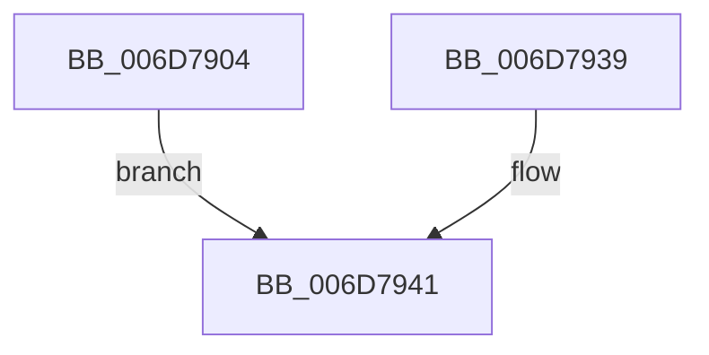

# sub_006D7904

- RVA: `0x006D7904`–`0x006D794C` (길이 `72` bytes)
- VA: `0x00000001406D7904`
- 실행 섹션: `.text`
- PDB 이름 있음: `아니요`; PDB Function 태그: `아니요`
- unwind 정보 RVA: `0x00060DB0`
- 디코드: `17`개 명령, `72/72` bytes 표시
- 미해석 바이트: `0` (있으면 어셈블리에 `.byte`로 보존)

> 이 문서는 커널 이미지의 기계어와 PDB 기호를 분석해 생성했습니다. 4번과 5번은 함수 원형과 자료형을 바이너리 사용 방식에서 추정한 C 해석이며 원본 소스 복구 결과는 아닙니다.

## 1. Dependencies

- 직접 호출 지점: **1**; 고유 호출 대상: **1**
- 직접 호출자로 확인된 함수: **0**
- RIP 상대 이미지 참조: **1**

### Outgoing calls
- `0x006D793C` → [MmUnlockPages](../29/MmUnlockPages_function_0029EEE0.md) (function, `0x0029EEE0`)

### Direct callers
- 이 함수 시작 RVA로 연결되는 직접 call은 확인되지 않았습니다. 간접 호출은 완전히 역산할 수 없습니다.

### Static image references
- `0x006D7941` → RVA `0x00E30224` (`.data`; read/write)

## 2. Other-region calls and transfers

- 다른 실행 섹션으로 향하는 call: **0**
- call이 아닌 외부 분기/꼬리 이동: **1**
  - `0x006D7947` → [MiProbeAndLockPages + 0x104](../23/MiProbeAndLockPages_function_0023B4F0.md) (`tail-transfer`)

## 3. Assembly (complete function range)

```asm
006D7904  65 8B 0C 25 A4 01 00 00         mov ecx, dword ptr gs:[0x1a4]
006D790C  48 8B 55 B7                     mov rdx, qword ptr [rbp - 0x49]
006D7910  48 8B 45 FF                     mov rax, qword ptr [rbp - 1]
006D7914  48 2B D3                        sub rdx, rbx
006D7917  48 D1 E9                        shr rcx, 1
006D791A  83 E1 03                        and ecx, 3
006D791D  48 C1 EA 0C                     shr rdx, 0xc
006D7921  48 83 C1 08                     add rcx, 8
006D7925  48 F7 DA                        neg rdx
006D7928  48 C1 E1 06                     shl rcx, 6
006D792C  48 03 88 10 04 00 00            add rcx, qword ptr [rax + 0x410]
006D7933  F0 48 01 11                     lock add qword ptr [rcx], rdx
006D7937  EB 08                           jmp 0x1406d7941
006D7939  48 8B CE                        mov rcx, rsi
006D793C  E8 9F 75 BC FF                  call 0x14029eee0
006D7941  FF 05 DD 88 75 00               inc dword ptr [rip + 0x7588dd]
006D7947  E9 A8 3C B6 FF                  jmp 0x14023b5f4
```

## 4. C-style interpretation (structured pseudocode)

```c
__int64 __fastcall sub_006D7904(void)
{
    a2 = (*(unsigned __int64 *)(v_rbp - 73)) - (v_rbx);
    a1 = ((unsigned int)(*(unsigned int *)(gs_base + (0 + 420)))) >> (1);
    a1 = (unsigned int)((a1) & (3));
    a2 = (a2) >> (12);
    a1 = (a1) + (8);
    a2 = -(a2);
    a1 = (a1) << (6);
    a1 = (a1) + (*(unsigned __int64 *)(*(unsigned __int64 *)(v_rbp - 1) + 1040));
    goto loc_006D7941;
loc_006D7941:
}
```

## 5. (Beta) C Style

```c
void sub_006D7904(void)
{
    a2 = (*(uint64_t *)(local_rbp - 0x49)) - (local_rbx);
    a1 = ((uint32_t)(*(uint32_t *)(gs_base + (0 + 0x1A4)))) >> (1);
    a1 = (uint32_t)((a1) & (3));
    a2 = (a2) >> (12);
    a1 = (a1) + (8);
    a2 = -(a2);
    a1 = (a1) << (6);
    a1 = (a1) + (*(uint64_t *)(*(uint64_t *)(local_rbp - 0x1) + 0x410));
    goto loc_006D7941;
loc_006D7941:
}
```

## 6. Execution-region graph

[열기: 2D/3D 그래프와 함수 탐색 컨트롤 패널](../../../control-panel.html?section=text&rva=0x006D7904&view=graph)

- 2D 그래프는 위에서 아래로 흐르고, 3D 그래프는 빈 공간을 드래그해 회전합니다. Shift+드래그는 이동, 휠은 확대·축소, 함수 노드 선택은 대상 보고서 이동입니다.

### Static fallback


