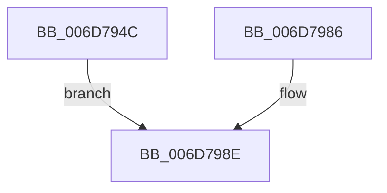

# sub_006D794C

- RVA: `0x006D794C`–`0x006D7999` (길이 `77` bytes)
- VA: `0x00000001406D794C`
- 실행 섹션: `.text`
- PDB 이름 있음: `아니요`; PDB Function 태그: `아니요`
- unwind 정보 RVA: `0x00060E20`
- 디코드: `17`개 명령, `77/77` bytes 표시
- 미해석 바이트: `0` (있으면 어셈블리에 `.byte`로 보존)

> 이 문서는 커널 이미지의 기계어와 PDB 기호를 분석해 생성했습니다. 4번과 5번은 함수 원형과 자료형을 바이너리 사용 방식에서 추정한 C 해석이며 원본 소스 복구 결과는 아닙니다.

## 1. Dependencies

- 직접 호출 지점: **1**; 고유 호출 대상: **1**
- 직접 호출자로 확인된 함수: **0**
- RIP 상대 이미지 참조: **1**

### Outgoing calls
- `0x006D7989` → [MmUnlockPages](../29/MmUnlockPages_function_0029EEE0.md) (function, `0x0029EEE0`)

### Direct callers
- 이 함수 시작 RVA로 연결되는 직접 call은 확인되지 않았습니다. 간접 호출은 완전히 역산할 수 없습니다.

### Static image references
- `0x006D798E` → RVA `0x00E30224` (`.data`; read/write)

## 2. Other-region calls and transfers

- 다른 실행 섹션으로 향하는 call: **0**
- call이 아닌 외부 분기/꼬리 이동: **1**
  - `0x006D7994` → [MmProbeAndLockPages + 0xAE](../23/MmProbeAndLockPages_function_0023B990.md) (`tail-transfer`)

## 3. Assembly (complete function range)

```asm
006D794C  65 8B 0C 25 A4 01 00 00         mov ecx, dword ptr gs:[0x1a4]
006D7954  48 8B 54 24 50                  mov rdx, qword ptr [rsp + 0x50]
006D7959  48 8B 84 24 98 00 00 00         mov rax, qword ptr [rsp + 0x98]
006D7961  48 2B D7                        sub rdx, rdi
006D7964  48 D1 E9                        shr rcx, 1
006D7967  83 E1 03                        and ecx, 3
006D796A  48 C1 EA 0C                     shr rdx, 0xc
006D796E  48 83 C1 08                     add rcx, 8
006D7972  48 F7 DA                        neg rdx
006D7975  48 C1 E1 06                     shl rcx, 6
006D7979  48 03 88 10 04 00 00            add rcx, qword ptr [rax + 0x410]
006D7980  F0 48 01 11                     lock add qword ptr [rcx], rdx
006D7984  EB 08                           jmp 0x1406d798e
006D7986  48 8B CE                        mov rcx, rsi
006D7989  E8 52 75 BC FF                  call 0x14029eee0
006D798E  FF 05 90 88 75 00               inc dword ptr [rip + 0x758890]
006D7994  E9 A5 40 B6 FF                  jmp 0x14023ba3e
```

## 4. C-style interpretation (structured pseudocode)

```c
__int64 __fastcall sub_006D794C(__int64 a1, __int64 a2, __int64 a3, __int64 a4, __int64 a5, __int64 a6, __int64 a7, __int64 a8, __int64 a9, __int64 a10, __int64 a11, __int64 a12, __int64 a13, __int64 a14, __int64 a15, __int64 a16, __int64 a17, __int64 a18, __int64 a19)
{
    a2 = (a10) - (v_rdi);
    a1 = ((unsigned int)(*(unsigned int *)(gs_base + (0 + 420)))) >> (1);
    a1 = (unsigned int)((a1) & (3));
    a2 = (a2) >> (12);
    a1 = (a1) + (8);
    a2 = -(a2);
    a1 = (a1) << (6);
    a1 = (a1) + (*(unsigned __int64 *)(a19 + 1040));
    goto loc_006D798E;
loc_006D798E:
}
```

## 5. (Beta) C Style

```c
int64_t sub_006D794C(int64_t Arg1, int64_t Arg2, int64_t Arg3, int64_t Arg4, uint64_t Arg5, uint64_t Arg6, uint64_t Arg7, uint64_t Arg8, uint64_t Arg9, int64_t Arg10, uint64_t Arg11, uint64_t Arg12, uint64_t Arg13, uint64_t Arg14, uint64_t Arg15, uint64_t Arg16, uint64_t Arg17, uint64_t Arg18, void *Arg19)
{
    uint8_t *arg19 = (uint8_t *)Arg19;

    Arg2 = (Arg10) - (local_rdi);
    Arg1 = ((uint32_t)(*(uint32_t *)(gs_base + (0 + 0x1A4)))) >> (1);
    Arg1 = (uint32_t)((Arg1) & (3));
    Arg2 = (Arg2) >> (12);
    Arg1 = (Arg1) + (8);
    Arg2 = -(Arg2);
    Arg1 = (Arg1) << (6);
    Arg1 = (Arg1) + (*(uint64_t *)(arg19 + 0x410));
    goto loc_006D798E;
loc_006D798E:
}
```

### 관측된 메모리 오프셋

구조체 형식이 확인되지 않은 접근은 인자 기준의 오프셋으로만 기록했습니다.

| 기준 인자 | 오프셋 표현 | 폭 (bit) | 접근 |
|---|---:|---:|---|
| `Arg19` | `+ 0x410` | `64` | `R` |

## 6. Execution-region graph

[열기: 2D/3D 그래프와 함수 탐색 컨트롤 패널](../../../control-panel.html?section=text&rva=0x006D794C&view=graph)

- 2D 그래프는 위에서 아래로 흐르고, 3D 그래프는 빈 공간을 드래그해 회전합니다. Shift+드래그는 이동, 휠은 확대·축소, 함수 노드 선택은 대상 보고서 이동입니다.

### Static fallback


