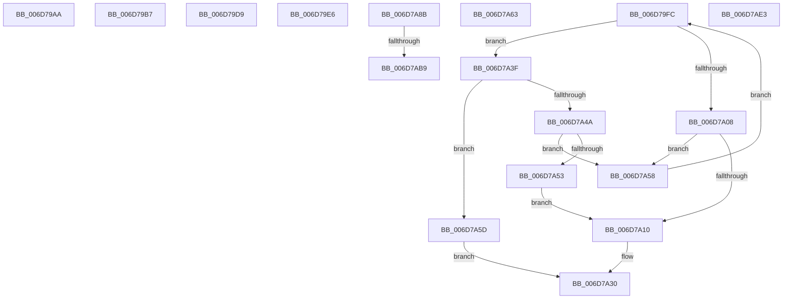

# sub_006D79AA

- RVA: `0x006D79AA`–`0x006D7AED` (길이 `323` bytes)
- VA: `0x00000001406D79AA`
- 실행 섹션: `.text`
- PDB 이름 있음: `아니요`; PDB Function 태그: `아니요`
- unwind 정보 RVA: `0x00061028`
- 디코드: `84`개 명령, `323/323` bytes 표시
- 미해석 바이트: `0` (있으면 어셈블리에 `.byte`로 보존)

> 이 문서는 커널 이미지의 기계어와 PDB 기호를 분석해 생성했습니다. 4번과 5번은 함수 원형과 자료형을 바이너리 사용 방식에서 추정한 C 해석이며 원본 소스 복구 결과는 아닙니다.

## 1. Dependencies

- 직접 호출 지점: **4**; 고유 호출 대상: **4**
- 직접 호출자로 확인된 함수: **0**
- RIP 상대 이미지 참조: **0**

### Outgoing calls
- `0x006D79F1` → [MiIoSpaceGetBounds](../2A/MiIoSpaceGetBounds_function_002AC728.md) (function, `0x002AC728`)
- `0x006D7A1D` → [RtlAvlInsertNodeEx](../26/RtlAvlInsertNodeEx_function_00265790.md) (function, `0x00265790`)
- `0x006D7A30` → [MiConvertIoPfnTreeLockExclusiveToShared](../4C/MiConvertIoPfnTreeLockExclusiveToShared_function_004CEEC8.md) (function, `0x004CEEC8`)
- `0x006D7AC1` → [MiFlushCachedIoPfnRange](../67/MiFlushCachedIoPfnRange_function_0067BC24.md) (function, `0x0067BC24`)

### Direct callers
- 이 함수 시작 RVA로 연결되는 직접 call은 확인되지 않았습니다. 간접 호출은 완전히 역산할 수 없습니다.

### Static image references
- 디코드된 RIP-relative 메모리 참조가 없습니다.

## 2. Other-region calls and transfers

- 다른 실행 섹션으로 향하는 call: **0**
- call이 아닌 외부 분기/꼬리 이동: **9**
  - `0x006D79B2` → [MiReferenceIoPages + 0x548](../23/MiReferenceIoPages_function_0023C804.md) (`tail-transfer`)
  - `0x006D79D4` → [MiReferenceIoPages + 0x145](../23/MiReferenceIoPages_function_0023C804.md) (`tail-transfer`)
  - `0x006D79E1` → [MiReferenceIoPages + 0x562](../23/MiReferenceIoPages_function_0023C804.md) (`tail-transfer`)
  - `0x006D79F7` → [MiReferenceIoPages + 0x209](../23/MiReferenceIoPages_function_0023C804.md) (`tail-transfer`)
  - `0x006D7A3A` → [MiReferenceIoPages + 0x2DB](../23/MiReferenceIoPages_function_0023C804.md) (`tail-transfer`)
  - `0x006D7A86` → [MiReferenceIoPages + 0x32A](../23/MiReferenceIoPages_function_0023C804.md) (`tail-transfer`)
  - `0x006D7AB3` → [MiReferenceIoPages + 0x69D](../23/MiReferenceIoPages_function_0023C804.md) (`tail-transfer`)
  - `0x006D7ADE` → [MiReferenceIoPages + 0x69D](../23/MiReferenceIoPages_function_0023C804.md) (`tail-transfer`)
  - `0x006D7AE8` → [MiReferenceIoPages + 0x28A](../23/MiReferenceIoPages_function_0023C804.md) (`tail-transfer`)

## 3. Assembly (complete function range)

```asm
006D79AA  41 0F B6 C5                     movzx eax, r13b
006D79AE  44 0F 22 C0                     mov cr8, rax
006D79B2  E9 95 53 B6 FF                  jmp 0x14023cd4c
006D79B7  48 8B 44 24 50                  mov rax, qword ptr [rsp + 0x50]
006D79BC  48 2B C3                        sub rax, rbx
006D79BF  48 03 C7                        add rax, rdi
006D79C2  49 3B C0                        cmp rax, r8
006D79C5  49 0F 47 C0                     cmova rax, r8
006D79C9  48 03 D8                        add rbx, rax
006D79CC  4C 2B C0                        sub r8, rax
006D79CF  4C 89 44 24 20                  mov qword ptr [rsp + 0x20], r8
006D79D4  E9 70 4F B6 FF                  jmp 0x14023c949
006D79D9  41 0F B6 C5                     movzx eax, r13b
006D79DD  44 0F 22 C0                     mov cr8, rax
006D79E1  E9 80 53 B6 FF                  jmp 0x14023cd66
006D79E6  44 8A EE                        mov r13b, sil
006D79E9  48 8B D3                        mov rdx, rbx
006D79EC  48 8D 4C 24 48                  lea rcx, [rsp + 0x48]
006D79F1  E8 32 4D BD FF                  call 0x1402ac728
006D79F6  90                              nop
006D79F7  E9 11 50 B6 FF                  jmp 0x14023ca0d
006D79FC  48 8B 42 18                     mov rax, qword ptr [rdx + 0x18]
006D7A00  48 8B F2                        mov rsi, rdx
006D7A03  48 3B D8                        cmp rbx, rax
006D7A06  73 37                           jae 0x1406d7a3f
006D7A08  48 8B 02                        mov rax, qword ptr [rdx]
006D7A0B  48 85 C0                        test rax, rax
006D7A0E  75 48                           jne 0x1406d7a58
006D7A10  4D 8B CE                        mov r9, r14
006D7A13  49 8B F6                        mov rsi, r14
006D7A16  4C 8B 75 88                     mov r14, qword ptr [rbp - 0x78]
006D7A1A  49 8B CE                        mov rcx, r14
006D7A1D  E8 6E DD B8 FF                  call 0x140265790
006D7A22  F0 49 01 7E 18                  lock add qword ptr [r14 + 0x18], rdi
006D7A27  48 83 65 90 00                  and qword ptr [rbp - 0x70], 0
006D7A2C  89 7C 24 34                     mov dword ptr [rsp + 0x34], edi
006D7A30  E8 93 74 DF FF                  call 0x1404ceec8
006D7A35  4C 8B 44 24 20                  mov r8, qword ptr [rsp + 0x20]
006D7A3A  E9 A0 50 B6 FF                  jmp 0x14023cadf
006D7A3F  48 05 00 02 00 00               add rax, 0x200
006D7A45  48 3B D8                        cmp rbx, rax
006D7A48  72 13                           jb 0x1406d7a5d
006D7A4A  48 8B 42 08                     mov rax, qword ptr [rdx + 8]
006D7A4E  48 85 C0                        test rax, rax
006D7A51  75 05                           jne 0x1406d7a58
006D7A53  44 8A C7                        mov r8b, dil
006D7A56  EB B8                           jmp 0x1406d7a10
006D7A58  48 8B D0                        mov rdx, rax
006D7A5B  EB 9F                           jmp 0x1406d79fc
006D7A5D  4C 89 75 90                     mov qword ptr [rbp - 0x70], r14
006D7A61  EB CD                           jmp 0x1406d7a30
006D7A63  48 8B 44 24 50                  mov rax, qword ptr [rsp + 0x50]
006D7A68  48 8B CA                        mov rcx, rdx
006D7A6B  48 2B C3                        sub rax, rbx
006D7A6E  49 2B CE                        sub rcx, r14
006D7A71  48 FF C0                        inc rax
006D7A74  48 3B C1                        cmp rax, rcx
006D7A77  48 0F 46 C8                     cmovbe rcx, rax
006D7A7B  48 03 D9                        add rbx, rcx
006D7A7E  4C 03 F1                        add r14, rcx
006D7A81  48 29 4C 24 20                  sub qword ptr [rsp + 0x20], rcx
006D7A86  E9 A3 50 B6 FF                  jmp 0x14023cb2e
006D7A8B  44 8B 54 24 30                  mov r10d, dword ptr [rsp + 0x30]
006D7A90  4C 8D 4D B0                     lea r9, [rbp - 0x50]
006D7A94  4C 89 4C 24 78                  mov qword ptr [rsp + 0x78], r9
006D7A99  4C 8D 7D E0                     lea r15, [rbp - 0x20]
006D7A9D  49 89 1F                        mov qword ptr [r15], rbx
006D7AA0  49 8D 81 B0 00 00 00            lea rax, [r9 + 0xb0]
006D7AA7  49 83 C7 08                     add r15, 8
006D7AAB  44 89 54 24 64                  mov dword ptr [rsp + 0x64], r10d
006D7AB0  4C 3B F8                        cmp r15, rax
006D7AB3  0F 85 E8 53 B6 FF               jne 0x14023cea1
006D7AB9  BA 10 00 00 00                  mov edx, 0x10
006D7ABE  49 8B C9                        mov rcx, r9
006D7AC1  E8 5E 41 FA FF                  call 0x14067bc24
006D7AC6  44 8B 54 24 30                  mov r10d, dword ptr [rsp + 0x30]
006D7ACB  45 33 DB                        xor r11d, r11d
006D7ACE  85 C0                           test eax, eax
006D7AD0  4C 89 5C 24 78                  mov qword ptr [rsp + 0x78], r11
006D7AD5  44 0F 45 E7                     cmovne r12d, edi
006D7AD9  44 89 64 24 68                  mov dword ptr [rsp + 0x68], r12d
006D7ADE  E9 BE 53 B6 FF                  jmp 0x14023cea1
006D7AE3  48 8B 74 24 20                  mov rsi, qword ptr [rsp + 0x20]
006D7AE8  E9 A1 4F B6 FF                  jmp 0x14023ca8e
```

## 4. C-style interpretation (structured pseudocode)

```c
__int64 __fastcall sub_006D79AA(__int64 a1, __int64 a2, __int64 a3)
{
    unsigned __int64 v_stack_p20;
    unsigned int v_stack_p30;
    unsigned int v_stack_p34;
    unsigned __int64 v_stack_p48;
    unsigned __int64 v_stack_p50;
    unsigned int v_stack_p64;
    unsigned int v_stack_p68;
    unsigned __int64 v_stack_p78;
}
```

## 5. (Beta) C Style

```c
int64_t sub_006D79AA(int64_t Arg1, int64_t Arg2, int64_t Arg3)
{
    uint64_t v_stack_p20;
    uint32_t v_stack_p30;
    uint32_t v_stack_p34;
    uint64_t v_stack_p48;
    uint64_t v_stack_p50;
    uint32_t v_stack_p64;
    uint32_t v_stack_p68;
    uint64_t v_stack_p78;
}
```

## 6. Execution-region graph

[열기: 2D/3D 그래프와 함수 탐색 컨트롤 패널](../../../control-panel.html?section=text&rva=0x006D79AA&view=graph)

- 2D 그래프는 위에서 아래로 흐르고, 3D 그래프는 빈 공간을 드래그해 회전합니다. Shift+드래그는 이동, 휠은 확대·축소, 함수 노드 선택은 대상 보고서 이동입니다.

### Static fallback


