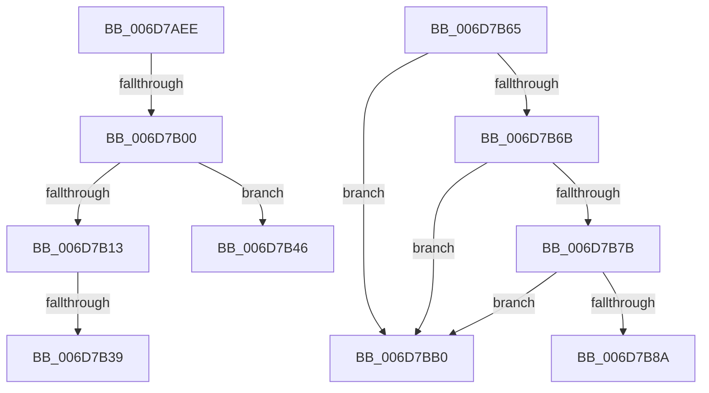

# sub_006D7AEE

- RVA: `0x006D7AEE`–`0x006D7BC0` (길이 `210` bytes)
- VA: `0x00000001406D7AEE`
- 실행 섹션: `.text`
- PDB 이름 있음: `아니요`; PDB Function 태그: `아니요`
- unwind 정보 RVA: `0x0006120C`
- 디코드: `50`개 명령, `210/210` bytes 표시
- 미해석 바이트: `0` (있으면 어셈블리에 `.byte`로 보존)

> 이 문서는 커널 이미지의 기계어와 PDB 기호를 분석해 생성했습니다. 4번과 5번은 함수 원형과 자료형을 바이너리 사용 방식에서 추정한 C 해석이며 원본 소스 복구 결과는 아닙니다.

## 1. Dependencies

- 직접 호출 지점: **7**; 고유 호출 대상: **5**
- 직접 호출자로 확인된 함수: **0**
- RIP 상대 이미지 참조: **1**

### Outgoing calls
- `0x006D7B06` → [MiIsDriverPage](../2A/MiIsDriverPage_function_002A5514.md) (function, `0x002A5514`)
- `0x006D7B16` → [MiUnlockProbePacketWorkingSet](../23/MiUnlockProbePacketWorkingSet_function_0023B800.md) (function, `0x0023B800`)
- `0x006D7B22` → [MiSplitDriverPage](../../page/7F/MiSplitDriverPage_function_007F8EB8.md) (function, `0x007F8EB8`)
- `0x006D7B2C` → [MiLockProbePacketWorkingSet](../40/MiLockProbePacketWorkingSet_function_0040E500.md) (function, `0x0040E500`)
- `0x006D7B8D` → [MiUnlockProbePacketWorkingSet](../23/MiUnlockProbePacketWorkingSet_function_0023B800.md) (function, `0x0023B800`)
- `0x006D7B9D` → [MiCopyOnWriteCheckConditions](../2A/MiCopyOnWriteCheckConditions_function_002A750C.md) (function, `0x002A750C`)
- `0x006D7BA5` → [MiLockProbePacketWorkingSet](../40/MiLockProbePacketWorkingSet_function_0040E500.md) (function, `0x0040E500`)

### Direct callers
- 이 함수 시작 RVA로 연결되는 직접 call은 확인되지 않았습니다. 간접 호출은 완전히 역산할 수 없습니다.

### Static image references
- `0x006D7B39` → RVA `0x00E30234` (`.data`; read/write)

## 2. Other-region calls and transfers

- 다른 실행 섹션으로 향하는 call: **1**
  - `0x006D7B22` → [MiSplitDriverPage](../../page/7F/MiSplitDriverPage_function_007F8EB8.md) (`.text` → `PAGE`)
- call이 아닌 외부 분기/꼬리 이동: **6**
  - `0x006D7AFA` → [sub_0023D7AA + 0x4E](../23/Unknown_function_0023D7AA.md) (`tail-transfer`)
  - `0x006D7B33` → [sub_0023DB14 + 0x5D](../23/Unknown_function_0023DB14.md) (`tail-transfer`)
  - `0x006D7B41` → [sub_0023D7AA + 0x8B](../23/Unknown_function_0023D7AA.md) (`tail-transfer`)
  - `0x006D7B60` → [sub_0023D7AA + 0x4E](../23/Unknown_function_0023D7AA.md) (`tail-transfer`)
  - `0x006D7BAB` → [sub_0023DB14 + 0x5D](../23/Unknown_function_0023DB14.md) (`tail-transfer`)
  - `0x006D7BBB` → [sub_0023D7AA + 0x8B](../23/Unknown_function_0023D7AA.md) (`tail-transfer`)

## 3. Assembly (complete function range)

```asm
006D7AEE  48 C1 F8 10                     sar rax, 0x10
006D7AF2  48 8B 08                        mov rcx, qword ptr [rax]
006D7AF5  8B 41 38                        mov eax, dword ptr [rcx + 0x38]
006D7AF8  A8 20                           test al, 0x20
006D7AFA  0F 84 F8 5C B6 FF               je 0x14023d7f8
006D7B00  48 8B 4E 18                     mov rcx, qword ptr [rsi + 0x18]
006D7B04  33 D2                           xor edx, edx
006D7B06  E8 09 DA BC FF                  call 0x1402a5514
006D7B0B  48 8B E8                        mov rbp, rax
006D7B0E  48 85 C0                        test rax, rax
006D7B11  74 33                           je 0x1406d7b46
006D7B13  48 8B CE                        mov rcx, rsi
006D7B16  E8 E5 3C B6 FF                  call 0x14023b800
006D7B1B  48 8B 56 18                     mov rdx, qword ptr [rsi + 0x18]
006D7B1F  48 8B CD                        mov rcx, rbp
006D7B22  E8 91 13 12 00                  call 0x1407f8eb8
006D7B27  48 8B CE                        mov rcx, rsi
006D7B2A  8B D8                           mov ebx, eax
006D7B2C  E8 CF 69 D3 FF                  call 0x14040e500
006D7B31  85 DB                           test ebx, ebx
006D7B33  0F 89 38 60 B6 FF               jns 0x14023db71
006D7B39  FF 05 F5 86 75 00               inc dword ptr [rip + 0x7586f5]
006D7B3F  8B C3                           mov eax, ebx
006D7B41  E9 EF 5C B6 FF                  jmp 0x14023d835
006D7B46  49 B9 00 00 00 00 00 01 00 00   movabs r9, 0x10000000000
006D7B50  49 BA 00 00 00 00 00 00 00 10   movabs r10, 0x1000000000000000
006D7B5A  41 BB 01 00 00 00               mov r11d, 1
006D7B60  E9 93 5C B6 FF                  jmp 0x14023d7f8
006D7B65  80 7E 4C 02                     cmp byte ptr [rsi + 0x4c], 2
006D7B69  74 45                           je 0x1406d7bb0
006D7B6B  65 8B 0C 25 3C 3A 00 00         mov ecx, dword ptr gs:[0x3a3c]
006D7B73  F7 C1 01 00 01 00               test ecx, 0x10001
006D7B79  75 35                           jne 0x1406d7bb0
006D7B7B  48 8B 46 50                     mov rax, qword ptr [rsi + 0x50]
006D7B7F  8B 88 A4 05 00 00               mov ecx, dword ptr [rax + 0x5a4]
006D7B85  F6 C1 0C                        test cl, 0xc
006D7B88  75 26                           jne 0x1406d7bb0
006D7B8A  48 8B CE                        mov rcx, rsi
006D7B8D  E8 6E 3C B6 FF                  call 0x14023b800
006D7B92  4C 8B 44 24 70                  mov r8, qword ptr [rsp + 0x70]
006D7B97  8B D3                           mov edx, ebx
006D7B99  48 8B 4E 68                     mov rcx, qword ptr [rsi + 0x68]
006D7B9D  E8 6A F9 BC FF                  call 0x1402a750c
006D7BA2  48 8B CE                        mov rcx, rsi
006D7BA5  E8 56 69 D3 FF                  call 0x14040e500
006D7BAA  90                              nop
006D7BAB  E9 C1 5F B6 FF                  jmp 0x14023db71
006D7BB0  FF 05 7E 86 75 00               inc dword ptr [rip + 0x75867e]
006D7BB6  B8 17 00 00 C0                  mov eax, 0xc0000017
006D7BBB  E9 75 5C B6 FF                  jmp 0x14023d835
```

## 4. C-style interpretation (structured pseudocode)

```c
__int64 __fastcall sub_006D7AEE(__int64 a1, int a2)
{
    __int64 result;
    unsigned __int64 v_stack_p70;

    result = (result) >> (16);
    a2 = 0;
    result = MiIsDriverPage(*(unsigned __int64 *)(v_rsi + 24), a2, a3, a4);
    if (result == 0) goto loc_006D7B46;
    result = MiUnlockProbePacketWorkingSet(v_rsi, a2, a3, a4);
    result = MiSplitDriverPage(result, *(unsigned __int64 *)(v_rsi + 24), a3, a4);
    result = MiLockProbePacketWorkingSet(v_rsi, *(unsigned __int64 *)(v_rsi + 24), a3, a4);
loc_006D7B46:
}
```

## 5. (Beta) C Style

```c
int64_t sub_006D7AEE(int64_t Arg1, int32_t Arg2)
{
    int64_t result;
    uint64_t v_stack_p70;

    result = (result) >> (16);
    Arg2 = 0;
    result = MiIsDriverPage(*(uint64_t *)(local_rsi + 0x18), Arg2, a3, a4);
    if (result == 0) goto loc_006D7B46;
    result = MiUnlockProbePacketWorkingSet(local_rsi, Arg2, a3, a4);
    result = MiSplitDriverPage(result, *(uint64_t *)(local_rsi + 0x18), a3, a4);
    result = MiLockProbePacketWorkingSet(local_rsi, *(uint64_t *)(local_rsi + 0x18), a3, a4);
loc_006D7B46:
}
```

## 6. Execution-region graph

[열기: 2D/3D 그래프와 함수 탐색 컨트롤 패널](../../../control-panel.html?section=text&rva=0x006D7AEE&view=graph)

- 2D 그래프는 위에서 아래로 흐르고, 3D 그래프는 빈 공간을 드래그해 회전합니다. Shift+드래그는 이동, 휠은 확대·축소, 함수 노드 선택은 대상 보고서 이동입니다.

### Static fallback


