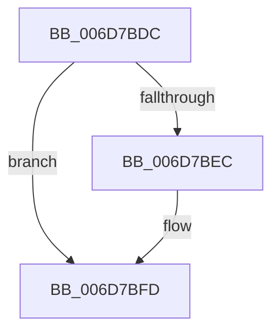

# sub_006D7BDC

- RVA: `0x006D7BDC`–`0x006D7C07` (길이 `43` bytes)
- VA: `0x00000001406D7BDC`
- 실행 섹션: `.text`
- PDB 이름 있음: `아니요`; PDB Function 태그: `아니요`
- unwind 정보 RVA: `0x000615C4`
- 디코드: `12`개 명령, `43/43` bytes 표시
- 미해석 바이트: `0` (있으면 어셈블리에 `.byte`로 보존)

> 이 문서는 커널 이미지의 기계어와 PDB 기호를 분석해 생성했습니다. 4번과 5번은 함수 원형과 자료형을 바이너리 사용 방식에서 추정한 C 해석이며 원본 소스 복구 결과는 아닙니다.

## 1. Dependencies

- 직접 호출 지점: **2**; 고유 호출 대상: **2**
- 직접 호출자로 확인된 함수: **0**
- RIP 상대 이미지 참조: **0**

### Outgoing calls
- `0x006D7BE3` → [MiPteInShadowRange](../23/MiPteInShadowRange_function_0023FB00.md) (function, `0x0023FB00`)
- `0x006D7BF1` → [MiSanitizeShadowPxe](../29/MiSanitizeShadowPxe_function_00294B68.md) (function, `0x00294B68`)

### Direct callers
- 이 함수 시작 RVA로 연결되는 직접 call은 확인되지 않았습니다. 간접 호출은 완전히 역산할 수 없습니다.

### Static image references
- 디코드된 RIP-relative 메모리 참조가 없습니다.

## 2. Other-region calls and transfers

- 다른 실행 섹션으로 향하는 call: **0**
- call이 아닌 외부 분기/꼬리 이동: **1**
  - `0x006D7C02` → [MiUnlockNestedPageTableWritePte + 0xF8](../23/MiUnlockNestedPageTableWritePte_function_0023F4E4.md) (`tail-transfer`)

## 3. Assembly (complete function range)

```asm
006D7BDC  48 89 5C 24 58                  mov qword ptr [rsp + 0x58], rbx
006D7BE1  33 F6                           xor esi, esi
006D7BE3  E8 18 7F B6 FF                  call 0x14023fb00
006D7BE8  85 C0                           test eax, eax
006D7BEA  74 11                           je 0x1406d7bfd
006D7BEC  48 8D 54 24 58                  lea rdx, [rsp + 0x58]
006D7BF1  E8 72 CF BB FF                  call 0x140294b68
006D7BF6  48 8B 5C 24 58                  mov rbx, qword ptr [rsp + 0x58]
006D7BFB  8B F0                           mov esi, eax
006D7BFD  85 F6                           test esi, esi
006D7BFF  48 89 1F                        mov qword ptr [rdi], rbx
006D7C02  E9 D5 79 B6 FF                  jmp 0x14023f5dc
```

## 4. C-style interpretation (structured pseudocode)

```c
__int64 __fastcall sub_006D7BDC(__int64 a1, __int64 a2, __int64 a3, __int64 a4, __int64 a5, __int64 a6, __int64 a7, __int64 a8, __int64 a9, __int64 a10, __int64 a11)
{
    __int64 result;
    __int64 v_rbx;
    __int64 v_rsi;
    unsigned __int64 v_stack_p58;

    v_stack_p58 = v_rbx;
    v_rsi = 0;
    result = MiPteInShadowRange(a1, a2, a3, a4);
    if ((unsigned int)(result) != 0) {
        a2 = a11;
        result = MiSanitizeShadowPxe(a1, a2, a3, a4);
        v_rbx = a11;
        v_rsi = (unsigned int)(result);
    }
    *(unsigned __int64 *)(v_rdi) = v_rbx;
}
```

## 5. (Beta) C Style

```c
int64_t sub_006D7BDC(int64_t Arg1, int64_t Arg2, int64_t Arg3, int64_t Arg4, uint64_t Arg5, uint64_t Arg6, uint64_t Arg7, uint64_t Arg8, uint64_t Arg9, uint64_t Arg10, int64_t Arg11)
{
    int64_t result;
    int64_t local_rbx;
    int64_t local_rsi;
    uint64_t v_stack_p58;

    v_stack_p58 = local_rbx;
    local_rsi = 0;
    result = MiPteInShadowRange(Arg1, Arg2, Arg3, Arg4);
    if ((uint32_t)(result) != 0) {
        Arg2 = Arg11;
        result = MiSanitizeShadowPxe(Arg1, Arg2, Arg3, Arg4);
        local_rbx = Arg11;
        local_rsi = (uint32_t)(result);
    }
    *(uint64_t *)(local_rdi) = local_rbx;
}
```

## 6. Execution-region graph

[열기: 2D/3D 그래프와 함수 탐색 컨트롤 패널](../../../control-panel.html?section=text&rva=0x006D7BDC&view=graph)

- 2D 그래프는 위에서 아래로 흐르고, 3D 그래프는 빈 공간을 드래그해 회전합니다. Shift+드래그는 이동, 휠은 확대·축소, 함수 노드 선택은 대상 보고서 이동입니다.

### Static fallback


