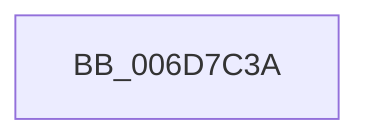

# sub_006D7C3A

- RVA: `0x006D7C3A`–`0x006D7C5C` (길이 `34` bytes)
- VA: `0x00000001406D7C3A`
- 실행 섹션: `.text`
- PDB 이름 있음: `아니요`; PDB Function 태그: `아니요`
- unwind 정보 RVA: `0x00061920`
- 디코드: `7`개 명령, `34/34` bytes 표시
- 미해석 바이트: `0` (있으면 어셈블리에 `.byte`로 보존)

> 이 문서는 커널 이미지의 기계어와 PDB 기호를 분석해 생성했습니다. 4번과 5번은 함수 원형과 자료형을 바이너리 사용 방식에서 추정한 C 해석이며 원본 소스 복구 결과는 아닙니다.

## 1. Dependencies

- 직접 호출 지점: **0**; 고유 호출 대상: **0**
- 직접 호출자로 확인된 함수: **0**
- RIP 상대 이미지 참조: **0**

### Outgoing calls
- 직접 디코드된 call 명령이 없습니다.

### Direct callers
- 이 함수 시작 RVA로 연결되는 직접 call은 확인되지 않았습니다. 간접 호출은 완전히 역산할 수 없습니다.

### Static image references
- 디코드된 RIP-relative 메모리 참조가 없습니다.

## 2. Other-region calls and transfers

- 다른 실행 섹션으로 향하는 call: **0**
- call이 아닌 외부 분기/꼬리 이동: **1**
  - `0x006D7C57` → [sub_00241A6E + 0x39](../24/Unknown_function_00241A6E.md) (`tail-transfer`)

## 3. Assembly (complete function range)

```asm
006D7C3A  48 8B 87 C0 00 00 00            mov rax, qword ptr [rdi + 0xc0]
006D7C41  48 C1 E0 03                     shl rax, 3
006D7C45  48 2B C1                        sub rax, rcx
006D7C48  48 03 47 58                     add rax, qword ptr [rdi + 0x58]
006D7C4C  48 C1 F8 03                     sar rax, 3
006D7C50  48 89 87 D8 00 00 00            mov qword ptr [rdi + 0xd8], rax
006D7C57  E9 4B 9E B6 FF                  jmp 0x140241aa7
```

## 4. C-style interpretation (structured pseudocode)

```c
__int64 __fastcall sub_006D7C3A(__int64 a1)
{
    __int64 result;

    result = (*(unsigned __int64 *)(v_rdi + 192)) << (3);
    result = (result) - (a1);
    result = (result) + (*(unsigned __int64 *)(v_rdi + 88));
    result = (result) >> (3);
    *(unsigned __int64 *)(v_rdi + 216) = result;
}
```

## 5. (Beta) C Style

```c
int64_t sub_006D7C3A(int64_t Arg1)
{
    int64_t result;

    result = (*(uint64_t *)(local_rdi + 0xC0)) << (3);
    result = (result) - (Arg1);
    result = (result) + (*(uint64_t *)(local_rdi + 0x58));
    result = (result) >> (3);
    *(uint64_t *)(local_rdi + 0xD8) = result;
}
```

## 6. Execution-region graph

[열기: 2D/3D 그래프와 함수 탐색 컨트롤 패널](../../../control-panel.html?section=text&rva=0x006D7C3A&view=graph)

- 2D 그래프는 위에서 아래로 흐르고, 3D 그래프는 빈 공간을 드래그해 회전합니다. Shift+드래그는 이동, 휠은 확대·축소, 함수 노드 선택은 대상 보고서 이동입니다.

### Static fallback


