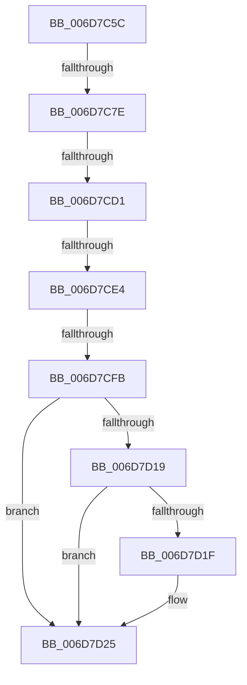

# sub_006D7C5C

- RVA: `0x006D7C5C`–`0x006D7D3F` (길이 `227` bytes)
- VA: `0x00000001406D7C5C`
- 실행 섹션: `.text`
- PDB 이름 있음: `아니요`; PDB Function 태그: `아니요`
- unwind 정보 RVA: `0x000619B0`
- 디코드: `53`개 명령, `227/227` bytes 표시
- 미해석 바이트: `0` (있으면 어셈블리에 `.byte`로 보존)

> 이 문서는 커널 이미지의 기계어와 PDB 기호를 분석해 생성했습니다. 4번과 5번은 함수 원형과 자료형을 바이너리 사용 방식에서 추정한 C 해석이며 원본 소스 복구 결과는 아닙니다.

## 1. Dependencies

- 직접 호출 지점: **3**; 고유 호출 대상: **3**
- 직접 호출자로 확인된 함수: **0**
- RIP 상대 이미지 참조: **2**

### Outgoing calls
- `0x006D7CB8` → [KeBugCheckEx](../4F/KeBugCheckEx_function_004FD660.md) (function, `0x004FD660`)
- `0x006D7CC4` → [MI_IS_PTE_IN_WS_SWAP_SET](../38/MI_IS_PTE_IN_WS_SWAP_SET_function_00385DD8.md) (function, `0x00385DD8`)
- `0x006D7D32` → [MiTransferSoftwarePte](../38/MiTransferSoftwarePte_function_003821F0.md) (function, `0x003821F0`)

### Direct callers
- 이 함수 시작 RVA로 연결되는 직접 call은 확인되지 않았습니다. 간접 호출은 완전히 역산할 수 없습니다.

### Static image references
- `0x006D7C60` → RVA `0x00E30088` (`.data`; read)
- `0x006D7D0D` → RVA `0x00E2DC80` (`.data`; read)

## 2. Other-region calls and transfers

- 다른 실행 섹션으로 향하는 call: **0**
- call이 아닌 외부 분기/꼬리 이동: **5**
  - `0x006D7C78` → [MiDecommitAddToList + 0x65F](../24/MiDecommitAddToList_function_00242264.md) (`tail-transfer`)
  - `0x006D7CCB` → [MiDecommitAddToList + 0x5A2](../24/MiDecommitAddToList_function_00242264.md) (`tail-transfer`)
  - `0x006D7CDE` → [MiDecommitAddToList + 0x5A2](../24/MiDecommitAddToList_function_00242264.md) (`tail-transfer`)
  - `0x006D7CF5` → [MiDecommitAddToList + 0x5A2](../24/MiDecommitAddToList_function_00242264.md) (`tail-transfer`)
  - `0x006D7D3A` → [MiDecommitAddToList + 0x5A2](../24/MiDecommitAddToList_function_00242264.md) (`tail-transfer`)

## 3. Assembly (complete function range)

```asm
006D7C5C  48 8B 46 28                     mov rax, qword ptr [rsi + 0x28]
006D7C60  48 8B 0D 21 84 75 00            mov rcx, qword ptr [rip + 0x758421]
006D7C67  48 8B 55 08                     mov rdx, qword ptr [rbp + 8]
006D7C6B  48 C1 E8 2B                     shr rax, 0x2b
006D7C6F  25 FF 03 00 00                  and eax, 0x3ff
006D7C74  48 39 14 C1                     cmp qword ptr [rcx + rax*8], rdx
006D7C78  0F 84 45 AC B6 FF               je 0x1402428c3
006D7C7E  8B 46 20                        mov eax, dword ptr [rsi + 0x20]
006D7C81  0F B7 C8                        movzx ecx, ax
006D7C84  48 B8 00 00 00 00 00 DE FF FF   movabs rax, 0xffffde0000000000
006D7C8E  48 8B C0                        mov rax, rax
006D7C91  48 2B F0                        sub rsi, rax
006D7C94  48 89 4C 24 20                  mov qword ptr [rsp + 0x20], rcx
006D7C99  48 C1 FE 04                     sar rsi, 4
006D7C9D  49 B9 AB AA AA AA AA AA AA AA   movabs r9, 0xaaaaaaaaaaaaaaab
006D7CA7  4C 0F AF CE                     imul r9, rsi
006D7CAB  4D 8B C5                        mov r8, r13
006D7CAE  BA 06 04 00 00                  mov edx, 0x406
006D7CB3  B9 1A 00 00 00                  mov ecx, 0x1a
006D7CB8  E8 A3 59 E2 FF                  call 0x1404fd660
006D7CBD  CC                              int3
006D7CBE  48 8B D7                        mov rdx, rdi
006D7CC1  49 8B CE                        mov rcx, r14
006D7CC4  E8 0F E1 CA FF                  call 0x140385dd8
006D7CC9  85 C0                           test eax, eax
006D7CCB  0F 85 35 AB B6 FF               jne 0x140242806
006D7CD1  8B 46 20                        mov eax, dword ptr [rsi + 0x20]
006D7CD4  41 BF 01 00 00 00               mov r15d, 1
006D7CDA  66 41 3B C7                     cmp ax, r15w
006D7CDE  0F 85 22 AB B6 FF               jne 0x140242806
006D7CE4  48 8B 07                        mov rax, qword ptr [rdi]
006D7CE7  4C 8B 07                        mov r8, qword ptr [rdi]
006D7CEA  48 83 E0 FD                     and rax, 0xfffffffffffffffd
006D7CEE  48 89 46 10                     mov qword ptr [rsi + 0x10], rax
006D7CF2  4D 85 C0                        test r8, r8
006D7CF5  0F 84 0B AB B6 FF               je 0x140242806
006D7CFB  49 8B C0                        mov rax, r8
006D7CFE  48 C1 E8 0C                     shr rax, 0xc
006D7D02  83 E0 0F                        and eax, 0xf
006D7D05  49 8B 94 C6 60 48 00 00         mov rdx, qword ptr [r14 + rax*8 + 0x4860]
006D7D0D  48 8B 05 6C 5F 75 00            mov rax, qword ptr [rip + 0x755f6c]
006D7D14  48 85 C0                        test rax, rax
006D7D17  74 0C                           je 0x1406d7d25
006D7D19  41 F6 C0 10                     test r8b, 0x10
006D7D1D  75 06                           jne 0x1406d7d25
006D7D1F  48 F7 D0                        not rax
006D7D22  4C 23 C0                        and r8, rax
006D7D25  49 C1 E8 20                     shr r8, 0x20
006D7D29  41 B9 02 00 00 00               mov r9d, 2
006D7D2F  48 8B CB                        mov rcx, rbx
006D7D32  E8 B9 A4 CA FF                  call 0x1403821f0
006D7D37  48 8B D8                        mov rbx, rax
006D7D3A  E9 C7 AA B6 FF                  jmp 0x140242806
```

## 4. C-style interpretation (structured pseudocode)

```c
__int64 __fastcall sub_006D7C5C(void)
{
    __int64 result;
    __int64 v_rsi;
    unsigned __int64 v_stack_p20;

    result = (*(unsigned __int64 *)(v_rsi + 40)) >> (43);
    result = (unsigned int)((result) & (0x3FFULL));
    v_rsi = (v_rsi) - ((unsigned int)(*(unsigned int *)(v_rsi + 32)));
    v_stack_p20 = (unsigned __int16)((unsigned int)(*(unsigned int *)(v_rsi + 32)));
    v_rsi = (v_rsi) >> (4);
    a4 = (a4) * (v_rsi);
    result = KeBugCheckEx(26, (unsigned int)(0x406ULL), v_r13, a4);
    result = MI_IS_PTE_IN_WS_SWAP_SET(v_r14, v_rdi, v_r13, a4);
    result = (*(unsigned __int64 *)(v_rdi)) & (-3);
    *(unsigned __int64 *)(v_rsi + 16) = result;
    result = (*(unsigned __int64 *)(v_rdi)) >> (12);
    result = (unsigned int)((result) & (15));
    if (*(unsigned __int64 *)(v_rip + 7692140) == 0) goto loc_006D7D25;
    result = *(unsigned __int64 *)(v_rip + 7692140);
    if ((((unsigned __int8)(*(unsigned __int64 *)(v_rdi))) & (16)) == 0) {
        result = ~(*(unsigned __int64 *)(v_rip + 7692140));
        a3 = (*(unsigned __int64 *)(v_rdi)) & (result);
    }
    a3 = (a3) >> (32);
    result = MiTransferSoftwarePte(v_rbx, *(unsigned __int64 *)(v_r14 + result * 8 + 18528), a3, 2);
}
```

## 5. (Beta) C Style

```c
void sub_006D7C5C(void)
{
    int64_t result;
    int64_t local_rsi;
    uint64_t v_stack_p20;

    result = (*(uint64_t *)(local_rsi + 0x28)) >> (43);
    result = (uint32_t)((result) & (0x3FFULL));
    local_rsi = (local_rsi) - ((uint32_t)(*(uint32_t *)(local_rsi + 0x20)));
    v_stack_p20 = (uint16_t)((uint32_t)(*(uint32_t *)(local_rsi + 0x20)));
    local_rsi = (local_rsi) >> (4);
    a4 = (a4) * (local_rsi);
    result = KeBugCheckEx(26, (uint32_t)(0x406ULL), local_r13, a4);
    result = MI_IS_PTE_IN_WS_SWAP_SET(local_r14, local_rdi, local_r13, a4);
    result = (*(uint64_t *)(local_rdi)) & (-3);
    *(uint64_t *)(local_rsi + 0x10) = result;
    result = (*(uint64_t *)(local_rdi)) >> (12);
    result = (uint32_t)((result) & (15));
    if (*(uint64_t *)(v_rip + 0x755F6C) == 0) goto loc_006D7D25;
    result = *(uint64_t *)(v_rip + 0x755F6C);
    if ((((uint8_t)(*(uint64_t *)(local_rdi))) & (16)) == 0) {
        result = ~(*(uint64_t *)(v_rip + 0x755F6C));
        a3 = (*(uint64_t *)(local_rdi)) & (result);
    }
    a3 = (a3) >> (32);
    result = MiTransferSoftwarePte(local_rbx, *(uint64_t *)(local_r14 + result * 8 + 0x4860), a3, 2);
}
```

## 6. Execution-region graph

[열기: 2D/3D 그래프와 함수 탐색 컨트롤 패널](../../../control-panel.html?section=text&rva=0x006D7C5C&view=graph)

- 2D 그래프는 위에서 아래로 흐르고, 3D 그래프는 빈 공간을 드래그해 회전합니다. Shift+드래그는 이동, 휠은 확대·축소, 함수 노드 선택은 대상 보고서 이동입니다.

### Static fallback


