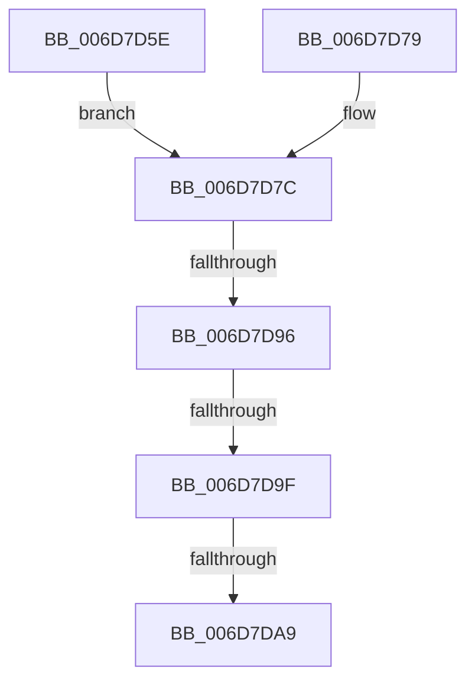

# sub_006D7D5E

- RVA: `0x006D7D5E`–`0x006D7DB1` (길이 `83` bytes)
- VA: `0x00000001406D7D5E`
- 실행 섹션: `.text`
- PDB 이름 있음: `아니요`; PDB Function 태그: `아니요`
- unwind 정보 RVA: `0x00061A14`
- 디코드: `21`개 명령, `83/83` bytes 표시
- 미해석 바이트: `0` (있으면 어셈블리에 `.byte`로 보존)

> 이 문서는 커널 이미지의 기계어와 PDB 기호를 분석해 생성했습니다. 4번과 5번은 함수 원형과 자료형을 바이너리 사용 방식에서 추정한 C 해석이며 원본 소스 복구 결과는 아닙니다.

## 1. Dependencies

- 직접 호출 지점: **1**; 고유 호출 대상: **1**
- 직접 호출자로 확인된 함수: **0**
- RIP 상대 이미지 참조: **0**

### Outgoing calls
- `0x006D7D86` → [MiDecrementCombinedPteEx](../22/MiDecrementCombinedPteEx_function_0022B940.md) (function, `0x0022B940`)

### Direct callers
- 이 함수 시작 RVA로 연결되는 직접 call은 확인되지 않았습니다. 간접 호출은 완전히 역산할 수 없습니다.

### Static image references
- 디코드된 RIP-relative 메모리 참조가 없습니다.

## 2. Other-region calls and transfers

- 다른 실행 섹션으로 향하는 call: **0**
- call이 아닌 외부 분기/꼬리 이동: **4**
  - `0x006D7D90` → [MiDecommitHandleProtoFormatPte + 0x109](../24/MiDecommitHandleProtoFormatPte_function_00242D54.md) (`tail-transfer`)
  - `0x006D7D99` → [MiDecommitHandleProtoFormatPte + 0x112](../24/MiDecommitHandleProtoFormatPte_function_00242D54.md) (`tail-transfer`)
  - `0x006D7DA3` → [MiDecommitHandleProtoFormatPte + 0x1BA](../24/MiDecommitHandleProtoFormatPte_function_00242D54.md) (`tail-transfer`)
  - `0x006D7DAC` → [MiDecommitHandleProtoFormatPte + 0x109](../24/MiDecommitHandleProtoFormatPte_function_00242D54.md) (`tail-transfer`)

## 3. Assembly (complete function range)

```asm
006D7D5E  48 8B 43 18                     mov rax, qword ptr [rbx + 0x18]
006D7D62  48 FF 40 18                     inc qword ptr [rax + 0x18]
006D7D66  48 8D 46 E0                     lea rax, [rsi - 0x20]
006D7D6A  48 25 00 F0 FF FF               and rax, 0xfffffffffffff000
006D7D70  48 8B 40 10                     mov rax, qword ptr [rax + 0x10]
006D7D74  4C 8B 30                        mov r14, qword ptr [rax]
006D7D77  EB 03                           jmp 0x1406d7d7c
006D7D79  45 33 F6                        xor r14d, r14d
006D7D7C  48 8B 4B 20                     mov rcx, qword ptr [rbx + 0x20]
006D7D80  45 33 C0                        xor r8d, r8d
006D7D83  48 8B D6                        mov rdx, rsi
006D7D86  E8 B5 3B B5 FF                  call 0x14022b940
006D7D8B  8B F8                           mov edi, eax
006D7D8D  48 85 ED                        test rbp, rbp
006D7D90  0F 85 C7 B0 B6 FF               jne 0x140242e5d
006D7D96  83 F8 03                        cmp eax, 3
006D7D99  0F 85 C7 B0 B6 FF               jne 0x140242e66
006D7D9F  4C 3B 73 08                     cmp r14, qword ptr [rbx + 8]
006D7DA3  0F 84 65 B1 B6 FF               je 0x140242f0e
006D7DA9  8D 78 01                        lea edi, [rax + 1]
006D7DAC  E9 AC B0 B6 FF                  jmp 0x140242e5d
```

## 4. C-style interpretation (structured pseudocode)

```c
__int64 __fastcall sub_006D7D5E(__int64 a1, __int64 a2, int a3)
{
    __int64 result;

    result = (v_rsi - 32) & (0xFFFFFFFFFFFFF000ULL);
    goto loc_006D7D7C;
loc_006D7D7C:
    a3 = 0;
    result = MiDecrementCombinedPteEx(*(unsigned __int64 *)(v_rbx + 32), v_rsi, a3, a4);
}
```

## 5. (Beta) C Style

```c
int64_t sub_006D7D5E(int64_t Arg1, int64_t Arg2, int32_t Arg3)
{
    int64_t result;

    result = (local_rsi - 32) & (0xFFFFFFFFFFFFF000ULL);
    goto loc_006D7D7C;
loc_006D7D7C:
    Arg3 = 0;
    result = MiDecrementCombinedPteEx(*(uint64_t *)(local_rbx + 0x20), local_rsi, Arg3, a4);
}
```

## 6. Execution-region graph

[열기: 2D/3D 그래프와 함수 탐색 컨트롤 패널](../../../control-panel.html?section=text&rva=0x006D7D5E&view=graph)

- 2D 그래프는 위에서 아래로 흐르고, 3D 그래프는 빈 공간을 드래그해 회전합니다. Shift+드래그는 이동, 휠은 확대·축소, 함수 노드 선택은 대상 보고서 이동입니다.

### Static fallback


