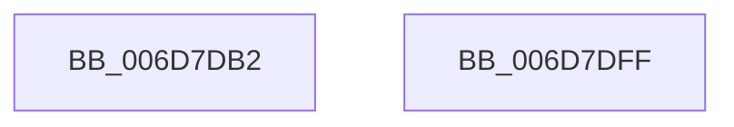

# sub_006D7DB2

- RVA: `0x006D7DB2`–`0x006D7E55` (길이 `163` bytes)
- VA: `0x00000001406D7DB2`
- 실행 섹션: `.text`
- PDB 이름 있음: `아니요`; PDB Function 태그: `아니요`
- unwind 정보 RVA: `0x00061A48`
- 디코드: `33`개 명령, `163/163` bytes 표시
- 미해석 바이트: `0` (있으면 어셈블리에 `.byte`로 보존)

> 이 문서는 커널 이미지의 기계어와 PDB 기호를 분석해 생성했습니다. 4번과 5번은 함수 원형과 자료형을 바이너리 사용 방식에서 추정한 C 해석이며 원본 소스 복구 결과는 아닙니다.

## 1. Dependencies

- 직접 호출 지점: **1**; 고유 호출 대상: **1**
- 직접 호출자로 확인된 함수: **0**
- RIP 상대 이미지 참조: **1**

### Outgoing calls
- `0x006D7DF4` → [EtwTraceKernelEvent](../23/EtwTraceKernelEvent_function_00235350.md) (function, `0x00235350`)

### Direct callers
- 이 함수 시작 RVA로 연결되는 직접 call은 확인되지 않았습니다. 간접 호출은 완전히 역산할 수 없습니다.

### Static image references
- `0x006D7E03` → RVA `0x00000000` (`image boundary/outside`; read)

## 2. Other-region calls and transfers

- 다른 실행 섹션으로 향하는 call: **0**
- call이 아닌 외부 분기/꼬리 이동: **2**
  - `0x006D7DFA` → [MiDecommitInitializePacket + 0x101](../24/MiDecommitInitializePacket_function_00242F30.md) (`tail-transfer`)
  - `0x006D7E50` → [MiDecommitInitializePacket + 0x1A0](../24/MiDecommitInitializePacket_function_00242F30.md) (`tail-transfer`)

## 3. Assembly (complete function range)

```asm
006D7DB2  33 C0                           xor eax, eax
006D7DB4  48 83 E0 F6                     and rax, 0xfffffffffffffff6
006D7DB8  48 83 C8 06                     or rax, 6
006D7DBC  83 64 24 64 00                  and dword ptr [rsp + 0x64], 0
006D7DC1  48 8D 4C 24 58                  lea rcx, [rsp + 0x58]
006D7DC6  48 89 44 24 40                  mov qword ptr [rsp + 0x40], rax
006D7DCB  41 B9 79 02 00 00               mov r9d, 0x279
006D7DD1  48 8D 44 24 40                  lea rax, [rsp + 0x40]
006D7DD6  C7 44 24 60 18 00 00 00         mov dword ptr [rsp + 0x60], 0x18
006D7DDE  41 B8 01 00 00 20               mov r8d, 0x20000001
006D7DE4  48 89 44 24 58                  mov qword ptr [rsp + 0x58], rax
006D7DE9  41 8B D2                        mov edx, r10d
006D7DEC  C7 44 24 20 04 1B 50 11         mov dword ptr [rsp + 0x20], 0x11501b04
006D7DF4  E8 57 D5 B5 FF                  call 0x140235350
006D7DF9  90                              nop
006D7DFA  E9 32 B2 B6 FF                  jmp 0x140243031
006D7DFF  48 C1 E8 13                     shr rax, 0x13
006D7E03  48 8D 0D F6 81 92 FF            lea rcx, [rip - 0x6d7e0a]
006D7E0A  83 E0 03                        and eax, 3
006D7E0D  48 8B 84 C1 78 45 01 00         mov rax, qword ptr [rcx + rax*8 + 0x14578]
006D7E15  48 89 83 90 00 00 00            mov qword ptr [rbx + 0x90], rax
006D7E1C  8B 47 30                        mov eax, dword ptr [rdi + 0x30]
006D7E1F  48 C1 E8 13                     shr rax, 0x13
006D7E23  83 E0 03                        and eax, 3
006D7E26  4C 39 A4 C1 78 45 01 00         cmp qword ptr [rcx + rax*8 + 0x14578], r12
006D7E2E  4C 0F 45 E2                     cmovne r12, rdx
006D7E32  4C 89 A3 C0 00 00 00            mov qword ptr [rbx + 0xc0], r12
006D7E39  8B 47 30                        mov eax, dword ptr [rdi + 0x30]
006D7E3C  48 C1 E8 13                     shr rax, 0x13
006D7E40  83 E0 03                        and eax, 3
006D7E43  8B 84 81 10 3F 01 00            mov eax, dword ptr [rcx + rax*4 + 0x13f10]
006D7E4A  89 83 CC 00 00 00               mov dword ptr [rbx + 0xcc], eax
006D7E50  E9 7B B2 B6 FF                  jmp 0x1402430d0
```

## 4. C-style interpretation (structured pseudocode)

```c
__int64 __fastcall sub_006D7DB2(__int64 a1, __int64 a2, __int64 a3, __int64 a4, __int64 a5, __int64 a6, __int64 a7, __int64 a8, __int64 a9, __int64 a10, __int64 a11)
{
    __int64 result;
    unsigned int v_stack_p20;
    unsigned __int64 v_stack_p40;
    unsigned __int64 v_stack_p58;
    unsigned int v_stack_p60;
    unsigned int v_stack_p64;

    result = 0;
    result = (result) & (-10);
    result = (result) | (6);
    v_stack_p40 = result;
    v_stack_p60 = 24;
    v_stack_p58 = a8;
    v_stack_p20 = 0x11501B04ULL;
    result = EtwTraceKernelEvent(a11, (unsigned int)((unsigned int)(v_r10)), (unsigned int)(0x20000001ULL), 633);
}
```

## 5. (Beta) C Style

```c
int64_t sub_006D7DB2(int64_t Arg1, int64_t Arg2, int64_t Arg3, int64_t Arg4, uint64_t Arg5, uint64_t Arg6, uint64_t Arg7, int64_t Arg8, uint64_t Arg9, uint64_t Arg10, int64_t Arg11)
{
    int64_t result;
    uint32_t v_stack_p20;
    uint64_t v_stack_p40;
    uint64_t v_stack_p58;
    uint32_t v_stack_p60;
    uint32_t v_stack_p64;

    result = 0;
    result = (result) & (-10);
    result = (result) | (6);
    v_stack_p40 = result;
    v_stack_p60 = 24;
    v_stack_p58 = Arg8;
    v_stack_p20 = 0x11501B04ULL;
    result = EtwTraceKernelEvent(Arg11, (uint32_t)((uint32_t)(local_r10)), (uint32_t)(0x20000001ULL), 633);
}
```

## 6. Execution-region graph

[열기: 2D/3D 그래프와 함수 탐색 컨트롤 패널](../../../control-panel.html?section=text&rva=0x006D7DB2&view=graph)

- 2D 그래프는 위에서 아래로 흐르고, 3D 그래프는 빈 공간을 드래그해 회전합니다. Shift+드래그는 이동, 휠은 확대·축소, 함수 노드 선택은 대상 보고서 이동입니다.

### Static fallback


