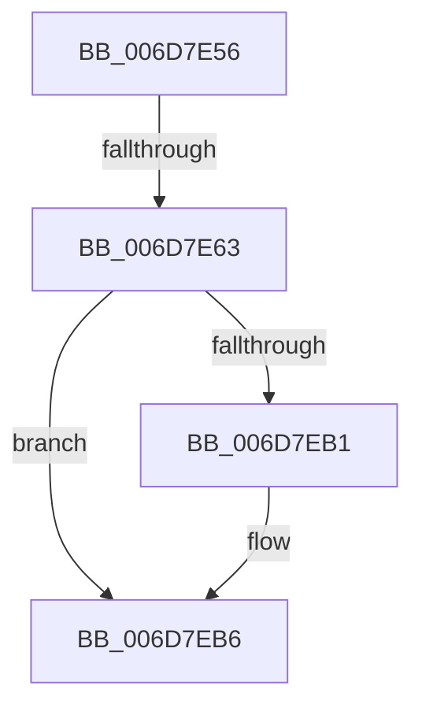

# sub_006D7E56

- RVA: `0x006D7E56`–`0x006D7EC5` (길이 `111` bytes)
- VA: `0x00000001406D7E56`
- 실행 섹션: `.text`
- PDB 이름 있음: `아니요`; PDB Function 태그: `아니요`
- unwind 정보 RVA: `0x00061CB0`
- 디코드: `26`개 명령, `111/111` bytes 표시
- 미해석 바이트: `0` (있으면 어셈블리에 `.byte`로 보존)

> 이 문서는 커널 이미지의 기계어와 PDB 기호를 분석해 생성했습니다. 4번과 5번은 함수 원형과 자료형을 바이너리 사용 방식에서 추정한 C 해석이며 원본 소스 복구 결과는 아닙니다.

## 1. Dependencies

- 직접 호출 지점: **1**; 고유 호출 대상: **1**
- 직접 호출자로 확인된 함수: **0**
- RIP 상대 이미지 참조: **0**

### Outgoing calls
- `0x006D7E7B` → [MiGetBaseResidentPage](../31/MiGetBaseResidentPage_function_0031C750.md) (function, `0x0031C750`)

### Direct callers
- 이 함수 시작 RVA로 연결되는 직접 call은 확인되지 않았습니다. 간접 호출은 완전히 역산할 수 없습니다.

### Static image references
- 디코드된 RIP-relative 메모리 참조가 없습니다.

## 2. Other-region calls and transfers

- 다른 실행 섹션으로 향하는 call: **0**
- call이 아닌 외부 분기/꼬리 이동: **2**
  - `0x006D7E5D` → [MiProbeUnlockPage + 0x184](../24/MiProbeUnlockPage_function_00243860.md) (`tail-transfer`)
  - `0x006D7EC0` → [MiProbeUnlockPage + 0x184](../24/MiProbeUnlockPage_function_00243860.md) (`tail-transfer`)

## 3. Assembly (complete function range)

```asm
006D7E56  8B 47 20                        mov eax, dword ptr [rdi + 0x20]
006D7E59  66 83 F8 02                     cmp ax, 2
006D7E5D  0F 85 81 BB B6 FF               jne 0x1402439e4
006D7E63  48 8B 47 18                     mov rax, qword ptr [rdi + 0x18]
006D7E67  48 B9 FF FF FF FF FF FF FF BF   movabs rcx, 0xbfffffffffffffff
006D7E71  48 23 C1                        and rax, rcx
006D7E74  48 8B CF                        mov rcx, rdi
006D7E77  48 89 47 18                     mov qword ptr [rdi + 0x18], rax
006D7E7B  E8 D0 48 C4 FF                  call 0x14031c750
006D7E80  49 B8 FF FF FF FF FF 00 00 00   movabs r8, 0xffffffffff
006D7E8A  48 8B 08                        mov rcx, qword ptr [rax]
006D7E8D  48 8B D1                        mov rdx, rcx
006D7E90  49 23 D0                        and rdx, r8
006D7E93  49 B8 00 00 00 00 00 FF FF FF   movabs r8, 0xffffff0000000000
006D7E9D  48 FF CA                        dec rdx
006D7EA0  48 33 CA                        xor rcx, rdx
006D7EA3  49 23 C8                        and rcx, r8
006D7EA6  48 33 CA                        xor rcx, rdx
006D7EA9  48 89 08                        mov qword ptr [rax], rcx
006D7EAC  48 3B C7                        cmp rax, rdi
006D7EAF  74 05                           je 0x1406d7eb6
006D7EB1  F0 48 21 68 18                  lock and qword ptr [rax + 0x18], rbp
006D7EB6  48 85 D2                        test rdx, rdx
006D7EB9  48 0F 45 C6                     cmovne rax, rsi
006D7EBD  48 8B F0                        mov rsi, rax
006D7EC0  E9 1F BB B6 FF                  jmp 0x1402439e4
```

## 4. C-style interpretation (structured pseudocode)

```c
__int64 __fastcall sub_006D7E56(void)
{
    __int64 result;

    result = (*(unsigned __int64 *)(v_rdi + 24)) & (a1);
    *(unsigned __int64 *)(v_rdi + 24) = result;
    result = MiGetBaseResidentPage(v_rdi, a2, a3, a4);
    a2 = (*(unsigned __int64 *)(result)) & (a3);
    a2 = (a2) - 1;
    a1 = (*(unsigned __int64 *)(result)) ^ (a2);
    a1 = (a1) & (a3);
    a1 = (a1) ^ (a2);
    *(unsigned __int64 *)(result) = a1;
    if (result != v_rdi) {
    }
    if (a2 != 0) { result = v_rsi; }
}
```

## 5. (Beta) C Style

```c
void sub_006D7E56(void)
{
    int64_t result;

    result = (*(uint64_t *)(local_rdi + 0x18)) & (a1);
    *(uint64_t *)(local_rdi + 0x18) = result;
    result = MiGetBaseResidentPage(local_rdi, a2, a3, a4);
    a2 = (*(uint64_t *)(result)) & (a3);
    a2 = (a2) - 1;
    a1 = (*(uint64_t *)(result)) ^ (a2);
    a1 = (a1) & (a3);
    a1 = (a1) ^ (a2);
    *(uint64_t *)(result) = a1;
    if (result != local_rdi) {
    }
    if (a2 != 0) { result = local_rsi; }
}
```

## 6. Execution-region graph

[열기: 2D/3D 그래프와 함수 탐색 컨트롤 패널](../../../control-panel.html?section=text&rva=0x006D7E56&view=graph)

- 2D 그래프는 위에서 아래로 흐르고, 3D 그래프는 빈 공간을 드래그해 회전합니다. Shift+드래그는 이동, 휠은 확대·축소, 함수 노드 선택은 대상 보고서 이동입니다.

### Static fallback


