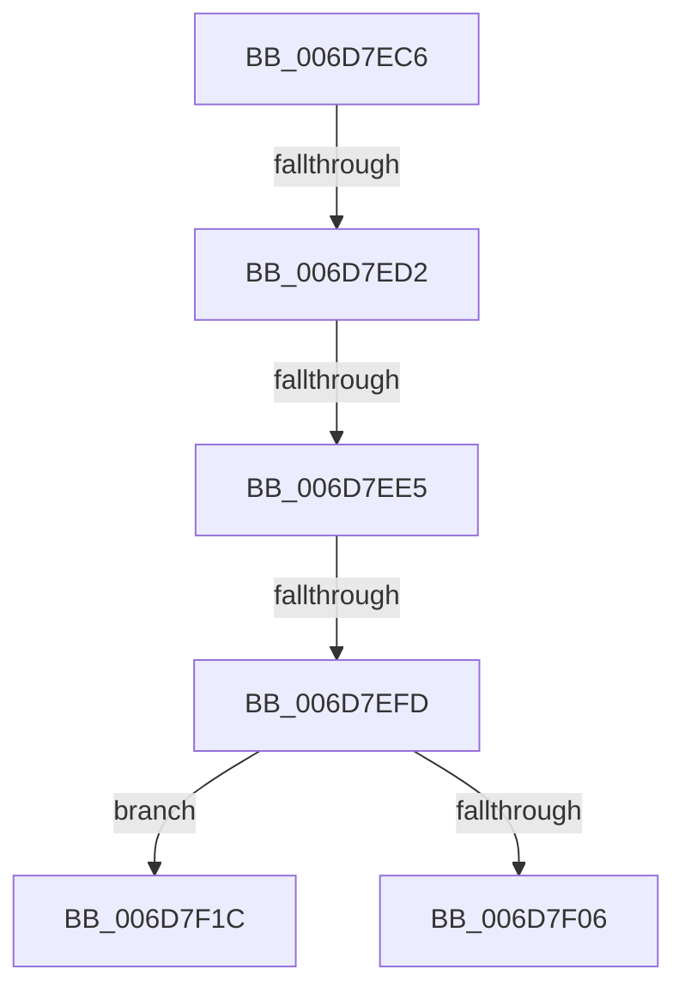

# sub_006D7EC6

- RVA: `0x006D7EC6`–`0x006D7F56` (길이 `144` bytes)
- VA: `0x00000001406D7EC6`
- 실행 섹션: `.text`
- PDB 이름 있음: `아니요`; PDB Function 태그: `아니요`
- unwind 정보 RVA: `0x00061CDC`
- 디코드: `30`개 명령, `144/144` bytes 표시
- 미해석 바이트: `0` (있으면 어셈블리에 `.byte`로 보존)

> 이 문서는 커널 이미지의 기계어와 PDB 기호를 분석해 생성했습니다. 4번과 5번은 함수 원형과 자료형을 바이너리 사용 방식에서 추정한 C 해석이며 원본 소스 복구 결과는 아닙니다.

## 1. Dependencies

- 직접 호출 지점: **3**; 고유 호출 대상: **3**
- 직접 호출자로 확인된 함수: **0**
- RIP 상대 이미지 참조: **1**

### Outgoing calls
- `0x006D7F11` → [MiReplenishSlabAllocator](../37/MiReplenishSlabAllocator_function_003788E4.md) (function, `0x003788E4`)
- `0x006D7F25` → [MiGetCurrentSlabIdentity](../3B/MiGetCurrentSlabIdentity_function_003BD020.md) (function, `0x003BD020`)
- `0x006D7F4B` → [MiWaitForFreePage](../2A/MiWaitForFreePage_function_002A3324.md) (function, `0x002A3324`)

### Direct callers
- 이 함수 시작 RVA로 연결되는 직접 call은 확인되지 않았습니다. 간접 호출은 완전히 역산할 수 없습니다.

### Static image references
- `0x006D7F2A` → RVA `0x00E30088` (`.data`; read)

## 2. Other-region calls and transfers

- 다른 실행 섹션으로 향하는 call: **0**
- call이 아닌 외부 분기/꼬리 이동: **5**
  - `0x006D7ECC` → [MiWalkVaRange + 0x6BC](../24/MiWalkVaRange_function_00243BF0.md) (`tail-transfer`)
  - `0x006D7EDF` → [MiWalkVaRange + 0x6BC](../24/MiWalkVaRange_function_00243BF0.md) (`tail-transfer`)
  - `0x006D7EF7` → [MiWalkVaRange + 0x6BC](../24/MiWalkVaRange_function_00243BF0.md) (`tail-transfer`)
  - `0x006D7F17` → [MiWalkVaRange + 0x6BC](../24/MiWalkVaRange_function_00243BF0.md) (`tail-transfer`)
  - `0x006D7F51` → [MiWalkVaRange + 0x6BC](../24/MiWalkVaRange_function_00243BF0.md) (`tail-transfer`)

## 3. Assembly (complete function range)

```asm
006D7EC6  44 0F 20 C0                     mov rax, cr8
006D7ECA  3C 02                           cmp al, 2
006D7ECC  0F 83 DA C3 B6 FF               jae 0x1402442ac
006D7ED2  65 8B 04 25 3C 3A 00 00         mov eax, dword ptr gs:[0x3a3c]
006D7EDA  A9 01 00 01 00                  test eax, 0x10001
006D7EDF  0F 85 C7 C3 B6 FF               jne 0x1402442ac
006D7EE5  65 48 8B 04 25 88 01 00 00      mov rax, qword ptr gs:[0x188]
006D7EEE  8B 88 A4 05 00 00               mov ecx, dword ptr [rax + 0x5a4]
006D7EF4  F6 C1 0C                        test cl, 0xc
006D7EF7  0F 85 AF C3 B6 FF               jne 0x1402442ac
006D7EFD  48 8B 4D 98                     mov rcx, qword ptr [rbp - 0x68]
006D7F01  48 85 C9                        test rcx, rcx
006D7F04  74 16                           je 0x1406d7f1c
006D7F06  BA 01 00 00 00                  mov edx, 1
006D7F0B  41 B8 00 00 02 00               mov r8d, 0x20000
006D7F11  E8 CE 09 CA FF                  call 0x1403788e4
006D7F16  90                              nop
006D7F17  E9 90 C3 B6 FF                  jmp 0x1402442ac
006D7F1C  65 48 8B 0C 25 88 01 00 00      mov rcx, qword ptr gs:[0x188]
006D7F25  E8 F6 50 CE FF                  call 0x1403bd020
006D7F2A  48 8B 0D 57 81 75 00            mov rcx, qword ptr [rip + 0x758157]
006D7F31  3C FF                           cmp al, 0xff
006D7F33  B8 01 00 00 00                  mov eax, 1
006D7F38  BA 03 00 00 00                  mov edx, 3
006D7F3D  0F 44 D0                        cmove edx, eax
006D7F40  0F B7 86 AE 00 00 00            movzx eax, word ptr [rsi + 0xae]
006D7F47  48 8B 0C C1                     mov rcx, qword ptr [rcx + rax*8]
006D7F4B  E8 D4 B3 BC FF                  call 0x1402a3324
006D7F50  90                              nop
006D7F51  E9 56 C3 B6 FF                  jmp 0x1402442ac
```

## 4. C-style interpretation (structured pseudocode)

```c
__int64 __fastcall sub_006D7EC6(void)
{
    __int64 result;

    if (*(unsigned __int64 *)(v_rbp - 104) == 0) goto loc_006D7F1C;
    result = MiReplenishSlabAllocator(*(unsigned __int64 *)(v_rbp - 104), 1, (unsigned int)(0x20000ULL), a4);
loc_006D7F1C:
    result = MiGetCurrentSlabIdentity(*(unsigned __int64 *)(gs_base + (0 + 392)), 1, (unsigned int)(0x20000ULL), a4);
    a2 = 3;
    if (((unsigned __int8)(result)) == 255) { a2 = 1; }
    result = MiWaitForFreePage(*(unsigned __int64 *)(*(unsigned __int64 *)(v_rip + 7700823) + *(unsigned __int16 *)(v_rsi + 174) * 8), a2, (unsigned int)(0x20000ULL), a4);
}
```

## 5. (Beta) C Style

```c
void sub_006D7EC6(void)
{
    int64_t result;

    if (*(uint64_t *)(local_rbp - 0x68) == 0) goto loc_006D7F1C;
    result = MiReplenishSlabAllocator(*(uint64_t *)(local_rbp - 0x68), 1, (uint32_t)(0x20000ULL), a4);
loc_006D7F1C:
    result = MiGetCurrentSlabIdentity(*(uint64_t *)(gs_base + (0 + 0x188)), 1, (uint32_t)(0x20000ULL), a4);
    a2 = 3;
    if (((uint8_t)(result)) == 255) { a2 = 1; }
    result = MiWaitForFreePage(*(uint64_t *)(*(uint64_t *)(v_rip + 0x758157) + *(uint16_t *)(local_rsi + 0xAE) * 8), a2, (uint32_t)(0x20000ULL), a4);
}
```

## 6. Execution-region graph

[열기: 2D/3D 그래프와 함수 탐색 컨트롤 패널](../../../control-panel.html?section=text&rva=0x006D7EC6&view=graph)

- 2D 그래프는 위에서 아래로 흐르고, 3D 그래프는 빈 공간을 드래그해 회전합니다. Shift+드래그는 이동, 휠은 확대·축소, 함수 노드 선택은 대상 보고서 이동입니다.

### Static fallback


