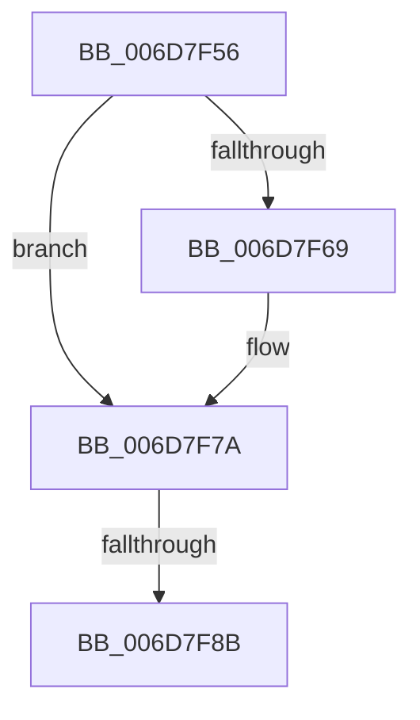

# sub_006D7F56

- RVA: `0x006D7F56`–`0x006D7F90` (길이 `58` bytes)
- VA: `0x00000001406D7F56`
- 실행 섹션: `.text`
- PDB 이름 있음: `아니요`; PDB Function 태그: `아니요`
- unwind 정보 RVA: `0x00061EB8`
- 디코드: `12`개 명령, `58/58` bytes 표시
- 미해석 바이트: `0` (있으면 어셈블리에 `.byte`로 보존)

> 이 문서는 커널 이미지의 기계어와 PDB 기호를 분석해 생성했습니다. 4번과 5번은 함수 원형과 자료형을 바이너리 사용 방식에서 추정한 C 해석이며 원본 소스 복구 결과는 아닙니다.

## 1. Dependencies

- 직접 호출 지점: **1**; 고유 호출 대상: **1**
- 직접 호출자로 확인된 함수: **0**
- RIP 상대 이미지 참조: **0**

### Outgoing calls
- `0x006D7F75` → [KeSetEvent](../33/KeSetEvent_function_0033F310.md) (function, `0x0033F310`)

### Direct callers
- 이 함수 시작 RVA로 연결되는 직접 call은 확인되지 않았습니다. 간접 호출은 완전히 역산할 수 없습니다.

### Static image references
- 디코드된 RIP-relative 메모리 참조가 없습니다.

## 2. Other-region calls and transfers

- 다른 실행 섹션으로 향하는 call: **0**
- call이 아닌 외부 분기/꼬리 이동: **2**
  - `0x006D7F85` → [sub_00245F85 + 0x5C](../24/Unknown_function_00245F85.md) (`tail-transfer`)
  - `0x006D7F8B` → [sub_00245F85 + 0x57](../24/Unknown_function_00245F85.md) (`tail-transfer`)

## 3. Assembly (complete function range)

```asm
006D7F56  48 8B 8E 98 4C 00 00            mov rcx, qword ptr [rsi + 0x4c98]
006D7F5D  48 8B 86 C8 41 00 00            mov rax, qword ptr [rsi + 0x41c8]
006D7F64  48 3B C8                        cmp rcx, rax
006D7F67  75 11                           jne 0x1406d7f7a
006D7F69  48 8B 8E 38 01 00 00            mov rcx, qword ptr [rsi + 0x138]
006D7F70  45 33 C0                        xor r8d, r8d
006D7F73  33 D2                           xor edx, edx
006D7F75  E8 96 73 C6 FF                  call 0x14033f310
006D7F7A  48 8B 8E 28 01 00 00            mov rcx, qword ptr [rsi + 0x128]
006D7F81  83 79 04 01                     cmp dword ptr [rcx + 4], 1
006D7F85  0F 85 56 E0 B6 FF               jne 0x140245fe1
006D7F8B  E9 4C E0 B6 FF                  jmp 0x140245fdc
```

## 4. C-style interpretation (structured pseudocode)

```c
__int64 __fastcall sub_006D7F56(__int64 a1, int a2, int a3)
{
    __int64 result;

    result = *(unsigned __int64 *)(v_rsi + 16840);
    if ((*(unsigned __int64 *)(v_rsi + 19608)) == (*(unsigned __int64 *)(v_rsi + 16840))) {
        a1 = *(unsigned __int64 *)(v_rsi + 312);
        a3 = 0;
        a2 = 0;
        result = KeSetEvent(a1, a2, a3, a4);
    }
}
```

## 5. (Beta) C Style

```c
int64_t sub_006D7F56(int64_t Arg1, int32_t Arg2, int32_t Arg3)
{
    int64_t result;

    result = *(uint64_t *)(local_rsi + 0x41C8);
    if ((*(uint64_t *)(local_rsi + 0x4C98)) == (*(uint64_t *)(local_rsi + 0x41C8))) {
        Arg1 = *(uint64_t *)(local_rsi + 0x138);
        Arg3 = 0;
        Arg2 = 0;
        result = KeSetEvent(Arg1, Arg2, Arg3, a4);
    }
}
```

## 6. Execution-region graph

[열기: 2D/3D 그래프와 함수 탐색 컨트롤 패널](../../../control-panel.html?section=text&rva=0x006D7F56&view=graph)

- 2D 그래프는 위에서 아래로 흐르고, 3D 그래프는 빈 공간을 드래그해 회전합니다. Shift+드래그는 이동, 휠은 확대·축소, 함수 노드 선택은 대상 보고서 이동입니다.

### Static fallback


