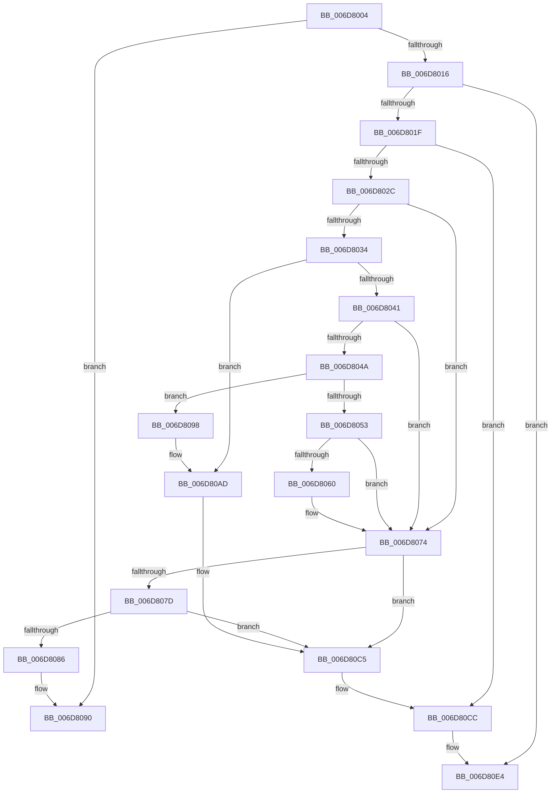

# sub_006D8004

- RVA: `0x006D8004`–`0x006D80FC` (길이 `248` bytes)
- VA: `0x00000001406D8004`
- 실행 섹션: `.text`
- PDB 이름 있음: `아니요`; PDB Function 태그: `아니요`
- unwind 정보 RVA: `0x00062394`
- 디코드: `66`개 명령, `248/248` bytes 표시
- 미해석 바이트: `0` (있으면 어셈블리에 `.byte`로 보존)

> 이 문서는 커널 이미지의 기계어와 PDB 기호를 분석해 생성했습니다. 4번과 5번은 함수 원형과 자료형을 바이너리 사용 방식에서 추정한 C 해석이며 원본 소스 복구 결과는 아닙니다.

## 1. Dependencies

- 직접 호출 지점: **5**; 고유 호출 대상: **1**
- 직접 호출자로 확인된 함수: **0**
- RIP 상대 이미지 참조: **1**

### Outgoing calls
- `0x006D806E` → [KeBugCheckEx](../4F/KeBugCheckEx_function_004FD660.md) (function, `0x004FD660`)
- `0x006D80A7` → [KeBugCheckEx](../4F/KeBugCheckEx_function_004FD660.md) (function, `0x004FD660`)
- `0x006D80BF` → [KeBugCheckEx](../4F/KeBugCheckEx_function_004FD660.md) (function, `0x004FD660`)
- `0x006D80DE` → [KeBugCheckEx](../4F/KeBugCheckEx_function_004FD660.md) (function, `0x004FD660`)
- `0x006D80F6` → [KeBugCheckEx](../4F/KeBugCheckEx_function_004FD660.md) (function, `0x004FD660`)

### Direct callers
- 이 함수 시작 RVA로 연결되는 직접 call은 확인되지 않았습니다. 간접 호출은 완전히 역산할 수 없습니다.

### Static image references
- `0x006D8041` → RVA `0x00E3741C` (`.data`; read)

## 2. Other-region calls and transfers

- 다른 실행 섹션으로 향하는 call: **0**
- call이 아닌 외부 분기/꼬리 이동: **1**
  - `0x006D8093` → [sub_00246F4D + 0x17D](../24/Unknown_function_00246F4D.md) (`tail-transfer`)

## 3. Assembly (complete function range)

```asm
006D8004  4D 8B 48 20                     mov r9, qword ptr [r8 + 0x20]
006D8008  49 8B C1                        mov rax, r9
006D800B  48 25 00 F0 FF FF               and rax, 0xfffffffffffff000
006D8011  48 3B E8                        cmp rbp, rax
006D8014  75 7A                           jne 0x1406d8090
006D8016  4D 85 F6                        test r14, r14
006D8019  0F 85 C5 00 00 00               jne 0x1406d80e4
006D801F  49 8B 40 18                     mov rax, qword ptr [r8 + 0x18]
006D8023  48 3B C7                        cmp rax, rdi
006D8026  0F 85 A0 00 00 00               jne 0x1406d80cc
006D802C  66 0F BA 66 0A 09               bt word ptr [rsi + 0xa], 9
006D8032  72 40                           jb 0x1406d8074
006D8034  49 8B 40 38                     mov rax, qword ptr [r8 + 0x38]
006D8038  48 8B 56 30                     mov rdx, qword ptr [rsi + 0x30]
006D803C  48 3B C2                        cmp rax, rdx
006D803F  75 6C                           jne 0x1406d80ad
006D8041  44 38 35 D4 F3 75 00            cmp byte ptr [rip + 0x75f3d4], r14b
006D8048  75 2A                           jne 0x1406d8074
006D804A  48 8B 46 18                     mov rax, qword ptr [rsi + 0x18]
006D804E  4C 3B C8                        cmp r9, rax
006D8051  75 45                           jne 0x1406d8098
006D8053  4D 8B 48 28                     mov r9, qword ptr [r8 + 0x28]
006D8057  48 8B 46 20                     mov rax, qword ptr [rsi + 0x20]
006D805B  4C 3B C8                        cmp r9, rax
006D805E  74 14                           je 0x1406d8074
006D8060  41 8D 56 05                     lea edx, [r14 + 5]
006D8064  48 89 44 24 20                  mov qword ptr [rsp + 0x20], rax
006D8069  B9 DA 00 00 00                  mov ecx, 0xda
006D806E  E8 ED 55 E2 FF                  call 0x1404fd660
006D8073  CC                              int3
006D8074  49 8B 10                        mov rdx, qword ptr [r8]
006D8077  4C 39 42 08                     cmp qword ptr [rdx + 8], r8
006D807B  75 48                           jne 0x1406d80c5
006D807D  49 8B 40 08                     mov rax, qword ptr [r8 + 8]
006D8081  4C 39 00                        cmp qword ptr [rax], r8
006D8084  75 3F                           jne 0x1406d80c5
006D8086  48 89 10                        mov qword ptr [rax], rdx
006D8089  4D 8B F0                        mov r14, r8
006D808C  48 89 42 08                     mov qword ptr [rdx + 8], rax
006D8090  4D 8B 00                        mov r8, qword ptr [r8]
006D8093  E9 32 F0 B6 FF                  jmp 0x1402470ca
006D8098  BA 03 00 00 00                  mov edx, 3
006D809D  48 89 44 24 20                  mov qword ptr [rsp + 0x20], rax
006D80A2  B9 DA 00 00 00                  mov ecx, 0xda
006D80A7  E8 B4 55 E2 FF                  call 0x1404fd660
006D80AC  CC                              int3
006D80AD  48 89 54 24 20                  mov qword ptr [rsp + 0x20], rdx
006D80B2  4C 8B C8                        mov r9, rax
006D80B5  BA 04 00 00 00                  mov edx, 4
006D80BA  B9 DA 00 00 00                  mov ecx, 0xda
006D80BF  E8 9C 55 E2 FF                  call 0x1404fd660
006D80C4  CC                              int3
006D80C5  B9 03 00 00 00                  mov ecx, 3
006D80CA  CD 29                           int 0x29
006D80CC  4C 8B C8                        mov r9, rax
006D80CF  48 89 7C 24 20                  mov qword ptr [rsp + 0x20], rdi
006D80D4  BA 02 00 00 00                  mov edx, 2
006D80D9  B9 DA 00 00 00                  mov ecx, 0xda
006D80DE  E8 7D 55 E2 FF                  call 0x1404fd660
006D80E3  CC                              int3
006D80E4  4C 8B CE                        mov r9, rsi
006D80E7  4C 89 74 24 20                  mov qword ptr [rsp + 0x20], r14
006D80EC  BA 01 00 00 00                  mov edx, 1
006D80F1  B9 DA 00 00 00                  mov ecx, 0xda
006D80F6  E8 65 55 E2 FF                  call 0x1404fd660
006D80FB  CC                              int3
```

## 4. C-style interpretation (structured pseudocode)

```c
__int64 __fastcall sub_006D8004(__int64 a1, __int64 a2, __int64 a3)
{
    __int64 result;
    unsigned __int64 v_stack_p20;

    result = (*(unsigned __int64 *)(a3 + 32)) & (0xFFFFFFFFFFFFF000ULL);
    if (v_rbp != result) goto loc_006D8090;
    if (v_r14 != 0) goto loc_006D80E4;
    if ((*(unsigned __int64 *)(a3 + 24)) != v_rdi) goto loc_006D80CC;
    if ((*(unsigned __int64 *)(a3 + 24)) < v_rdi) goto loc_006D8074;
    if ((*(unsigned __int64 *)(a3 + 56)) != (*(unsigned __int64 *)(v_rsi + 48))) goto loc_006D80AD;
    if ((*(unsigned __int8 *)(v_rip + 7730132)) != ((unsigned __int8)(v_r14))) goto loc_006D8074;
    if ((*(unsigned __int64 *)(a3 + 32)) != (*(unsigned __int64 *)(v_rsi + 24))) goto loc_006D8098;
    result = *(unsigned __int64 *)(v_rsi + 32);
    if ((*(unsigned __int64 *)(a3 + 40)) != (*(unsigned __int64 *)(v_rsi + 32))) {
        a2 = v_r14 + 5;
        v_stack_p20 = *(unsigned __int64 *)(v_rsi + 32);
        a1 = 218;
        result = KeBugCheckEx(a1, a2, a3, *(unsigned __int64 *)(a3 + 40));
    }
    if ((*(unsigned __int64 *)(*(unsigned __int64 *)(a3) + 8)) != a3) goto loc_006D80C5;
    if ((*(unsigned __int64 *)(*(unsigned __int64 *)(a3 + 8))) != a3) goto loc_006D80C5;
    *(unsigned __int64 *)(*(unsigned __int64 *)(a3 + 8)) = *(unsigned __int64 *)(a3);
    *(unsigned __int64 *)(*(unsigned __int64 *)(a3) + 8) = *(unsigned __int64 *)(a3 + 8);
loc_006D8090:
loc_006D8098:
    v_stack_p20 = *(unsigned __int64 *)(a3 + 8);
    result = KeBugCheckEx(218, 3, *(unsigned __int64 *)(a3), *(unsigned __int64 *)(a3 + 40));
loc_006D80AD:
    v_stack_p20 = 3;
    result = KeBugCheckEx(218, 4, *(unsigned __int64 *)(a3), result);
loc_006D80C5:
loc_006D80CC:
    v_stack_p20 = v_rdi;
    result = KeBugCheckEx(218, 2, *(unsigned __int64 *)(a3), result);
loc_006D80E4:
    v_stack_p20 = a3;
    result = KeBugCheckEx(218, 1, *(unsigned __int64 *)(a3), v_rsi);
    return result;
}
```

## 5. (Beta) C Style

```c
int64_t sub_006D8004(int64_t Arg1, int64_t Arg2, void *Arg3)
{
    uint8_t *arg3 = (uint8_t *)Arg3;

    int64_t result;
    uint64_t v_stack_p20;

    result = (*(uint64_t *)(arg3 + 0x20)) & (0xFFFFFFFFFFFFF000ULL);
    if (local_rbp != result) goto loc_006D8090;
    if (local_r14 != 0) goto loc_006D80E4;
    if ((*(uint64_t *)(arg3 + 0x18)) != local_rdi) goto loc_006D80CC;
    if ((*(uint64_t *)(arg3 + 0x18)) < local_rdi) goto loc_006D8074;
    if ((*(uint64_t *)(arg3 + 0x38)) != (*(uint64_t *)(local_rsi + 0x30))) goto loc_006D80AD;
    if ((*(uint8_t *)(v_rip + 0x75F3D4)) != ((uint8_t)(local_r14))) goto loc_006D8074;
    if ((*(uint64_t *)(arg3 + 0x20)) != (*(uint64_t *)(local_rsi + 0x18))) goto loc_006D8098;
    result = *(uint64_t *)(local_rsi + 0x20);
    if ((*(uint64_t *)(arg3 + 0x28)) != (*(uint64_t *)(local_rsi + 0x20))) {
        Arg2 = local_r14 + 5;
        v_stack_p20 = *(uint64_t *)(local_rsi + 0x20);
        Arg1 = 218;
        result = KeBugCheckEx(Arg1, Arg2, Arg3, *(uint64_t *)(arg3 + 0x28));
    }
    if ((*(uint64_t *)(*(uint64_t *)(arg3) + 0x8)) != Arg3) goto loc_006D80C5;
    if ((*(uint64_t *)(*(uint64_t *)(arg3 + 0x8))) != Arg3) goto loc_006D80C5;
    *(uint64_t *)(*(uint64_t *)(arg3 + 0x8)) = *(uint64_t *)(arg3);
    *(uint64_t *)(*(uint64_t *)(arg3) + 0x8) = *(uint64_t *)(arg3 + 0x8);
loc_006D8090:
loc_006D8098:
    v_stack_p20 = *(uint64_t *)(arg3 + 0x8);
    result = KeBugCheckEx(218, 3, *(uint64_t *)(arg3), *(uint64_t *)(arg3 + 0x28));
loc_006D80AD:
    v_stack_p20 = 3;
    result = KeBugCheckEx(218, 4, *(uint64_t *)(arg3), result);
loc_006D80C5:
loc_006D80CC:
    v_stack_p20 = local_rdi;
    result = KeBugCheckEx(218, 2, *(uint64_t *)(arg3), result);
loc_006D80E4:
    v_stack_p20 = Arg3;
    result = KeBugCheckEx(218, 1, *(uint64_t *)(arg3), local_rsi);
    return result;
}
```

### 관측된 메모리 오프셋

구조체 형식이 확인되지 않은 접근은 인자 기준의 오프셋으로만 기록했습니다.

| 기준 인자 | 오프셋 표현 | 폭 (bit) | 접근 |
|---|---:|---:|---|
| `Arg3` | `+ 0x18` | `64` | `R` |
| `Arg3` | `+ 0x20` | `64` | `R` |
| `Arg3` | `+ 0x28` | `64` | `R` |
| `Arg3` | `+ 0x38` | `64` | `R` |

## 6. Execution-region graph

[열기: 2D/3D 그래프와 함수 탐색 컨트롤 패널](../../../control-panel.html?section=text&rva=0x006D8004&view=graph)

- 2D 그래프는 위에서 아래로 흐르고, 3D 그래프는 빈 공간을 드래그해 회전합니다. Shift+드래그는 이동, 휠은 확대·축소, 함수 노드 선택은 대상 보고서 이동입니다.

### Static fallback


