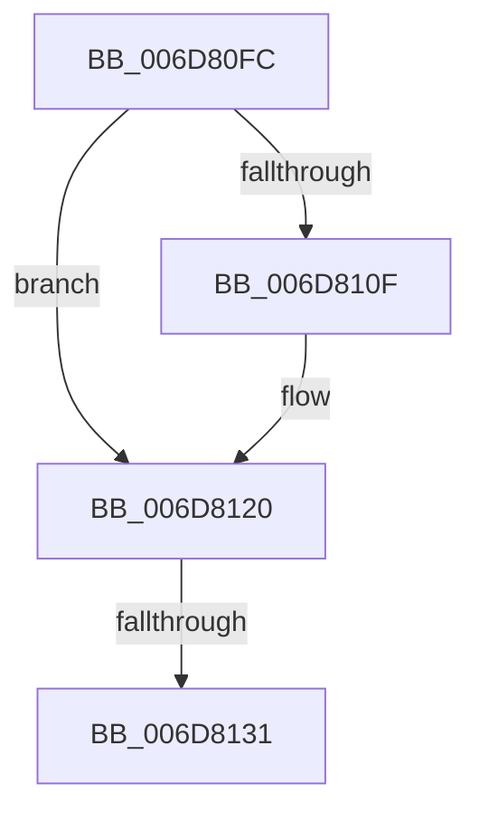

# sub_006D80FC

- RVA: `0x006D80FC`–`0x006D8136` (길이 `58` bytes)
- VA: `0x00000001406D80FC`
- 실행 섹션: `.text`
- PDB 이름 있음: `아니요`; PDB Function 태그: `아니요`
- unwind 정보 RVA: `0x0006251C`
- 디코드: `12`개 명령, `58/58` bytes 표시
- 미해석 바이트: `0` (있으면 어셈블리에 `.byte`로 보존)

> 이 문서는 커널 이미지의 기계어와 PDB 기호를 분석해 생성했습니다. 4번과 5번은 함수 원형과 자료형을 바이너리 사용 방식에서 추정한 C 해석이며 원본 소스 복구 결과는 아닙니다.

## 1. Dependencies

- 직접 호출 지점: **1**; 고유 호출 대상: **1**
- 직접 호출자로 확인된 함수: **0**
- RIP 상대 이미지 참조: **0**

### Outgoing calls
- `0x006D811B` → [KeSetEvent](../33/KeSetEvent_function_0033F310.md) (function, `0x0033F310`)

### Direct callers
- 이 함수 시작 RVA로 연결되는 직접 call은 확인되지 않았습니다. 간접 호출은 완전히 역산할 수 없습니다.

### Static image references
- 디코드된 RIP-relative 메모리 참조가 없습니다.

## 2. Other-region calls and transfers

- 다른 실행 섹션으로 향하는 call: **0**
- call이 아닌 외부 분기/꼬리 이동: **2**
  - `0x006D812B` → [sub_002484B4 + 0xE6](../24/Unknown_function_002484B4.md) (`tail-transfer`)
  - `0x006D8131` → [sub_002484B4 + 0xE1](../24/Unknown_function_002484B4.md) (`tail-transfer`)

## 3. Assembly (complete function range)

```asm
006D80FC  48 8B 8B 98 4C 00 00            mov rcx, qword ptr [rbx + 0x4c98]
006D8103  48 8B 83 C8 41 00 00            mov rax, qword ptr [rbx + 0x41c8]
006D810A  48 3B C8                        cmp rcx, rax
006D810D  75 11                           jne 0x1406d8120
006D810F  48 8B 8B 38 01 00 00            mov rcx, qword ptr [rbx + 0x138]
006D8116  45 33 C0                        xor r8d, r8d
006D8119  33 D2                           xor edx, edx
006D811B  E8 F0 71 C6 FF                  call 0x14033f310
006D8120  48 8B 8B 28 01 00 00            mov rcx, qword ptr [rbx + 0x128]
006D8127  83 79 04 01                     cmp dword ptr [rcx + 4], 1
006D812B  0F 85 69 04 B7 FF               jne 0x14024859a
006D8131  E9 5F 04 B7 FF                  jmp 0x140248595
```

## 4. C-style interpretation (structured pseudocode)

```c
__int64 __fastcall sub_006D80FC(__int64 a1, int a2, int a3)
{
    __int64 result;

    result = *(unsigned __int64 *)(v_rbx + 16840);
    if ((*(unsigned __int64 *)(v_rbx + 19608)) == (*(unsigned __int64 *)(v_rbx + 16840))) {
        a1 = *(unsigned __int64 *)(v_rbx + 312);
        a3 = 0;
        a2 = 0;
        result = KeSetEvent(a1, a2, a3, a4);
    }
}
```

## 5. (Beta) C Style

```c
int64_t sub_006D80FC(int64_t Arg1, int32_t Arg2, int32_t Arg3)
{
    int64_t result;

    result = *(uint64_t *)(local_rbx + 0x41C8);
    if ((*(uint64_t *)(local_rbx + 0x4C98)) == (*(uint64_t *)(local_rbx + 0x41C8))) {
        Arg1 = *(uint64_t *)(local_rbx + 0x138);
        Arg3 = 0;
        Arg2 = 0;
        result = KeSetEvent(Arg1, Arg2, Arg3, a4);
    }
}
```

## 6. Execution-region graph

[열기: 2D/3D 그래프와 함수 탐색 컨트롤 패널](../../../control-panel.html?section=text&rva=0x006D80FC&view=graph)

- 2D 그래프는 위에서 아래로 흐르고, 3D 그래프는 빈 공간을 드래그해 회전합니다. Shift+드래그는 이동, 휠은 확대·축소, 함수 노드 선택은 대상 보고서 이동입니다.

### Static fallback


