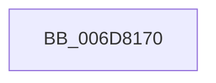

# sub_006D8170

- RVA: `0x006D8170`–`0x006D81CC` (길이 `92` bytes)
- VA: `0x00000001406D8170`
- 실행 섹션: `.text`
- PDB 이름 있음: `아니요`; PDB Function 태그: `아니요`
- unwind 정보 RVA: `0x000629E4`
- 디코드: `22`개 명령, `92/92` bytes 표시
- 미해석 바이트: `0` (있으면 어셈블리에 `.byte`로 보존)

> 이 문서는 커널 이미지의 기계어와 PDB 기호를 분석해 생성했습니다. 4번과 5번은 함수 원형과 자료형을 바이너리 사용 방식에서 추정한 C 해석이며 원본 소스 복구 결과는 아닙니다.

## 1. Dependencies

- 직접 호출 지점: **3**; 고유 호출 대상: **3**
- 직접 호출자로 확인된 함수: **0**
- RIP 상대 이미지 참조: **0**

### Outgoing calls
- `0x006D818C` → [KiStackAttachProcess](../21/KiStackAttachProcess_function_00216820.md) (function, `0x00216820`)
- `0x006D81B5` → [MmAdjustWorkingSetSizeEx](../47/MmAdjustWorkingSetSizeEx_function_0047D8D4.md) (function, `0x0047D8D4`)
- `0x006D81C1` → [KiUnstackDetachProcess](../21/KiUnstackDetachProcess_function_00217D30.md) (function, `0x00217D30`)

### Direct callers
- 이 함수 시작 RVA로 연결되는 직접 call은 확인되지 않았습니다. 간접 호출은 완전히 역산할 수 없습니다.

### Static image references
- 디코드된 RIP-relative 메모리 참조가 없습니다.

## 2. Other-region calls and transfers

- 다른 실행 섹션으로 향하는 call: **0**
- call이 아닌 외부 분기/꼬리 이동: **1**
  - `0x006D81C7` → [sub_00249C6B + 0x1EF](../24/Unknown_function_00249C6B.md) (`tail-transfer`)

## 3. Assembly (complete function range)

```asm
006D8170  0F 57 C0                        xorps xmm0, xmm0
006D8173  4C 8D 44 24 48                  lea r8, [rsp + 0x48]
006D8178  33 D2                           xor edx, edx
006D817A  48 8B CF                        mov rcx, rdi
006D817D  0F 11 44 24 48                  movups xmmword ptr [rsp + 0x48], xmm0
006D8182  0F 11 44 24 58                  movups xmmword ptr [rsp + 0x58], xmm0
006D8187  0F 11 44 24 68                  movups xmmword ptr [rsp + 0x68], xmm0
006D818C  E8 8F E6 B3 FF                  call 0x140216820
006D8191  48 8D 44 24 30                  lea rax, [rsp + 0x30]
006D8196  44 88 7C 24 30                  mov byte ptr [rsp + 0x30], r15b
006D819B  48 C7 C2 FF FF FF FF            mov rdx, 0xffffffffffffffff
006D81A2  48 89 44 24 28                  mov qword ptr [rsp + 0x28], rax
006D81A7  48 8B CA                        mov rcx, rdx
006D81AA  44 89 7C 24 20                  mov dword ptr [rsp + 0x20], r15d
006D81AF  45 33 C9                        xor r9d, r9d
006D81B2  45 33 C0                        xor r8d, r8d
006D81B5  E8 1A 57 DA FF                  call 0x14047d8d4
006D81BA  33 D2                           xor edx, edx
006D81BC  48 8D 4C 24 48                  lea rcx, [rsp + 0x48]
006D81C1  E8 6A FB B3 FF                  call 0x140217d30
006D81C6  90                              nop
006D81C7  E9 8E 1C B7 FF                  jmp 0x140249e5a
```

## 4. C-style interpretation (structured pseudocode)

```c
__int64 __fastcall sub_006D8170(__int64 a1, int a2, __int64 a3, int a4, __int64 a5, __int64 a6, __int64 a7, __int64 a8, __int64 a9, __int64 a10, __int64 a11, __int64 a12, __int64 a13)
{
    __int64 result;
    unsigned int v_stack_p20;
    unsigned __int64 v_stack_p28;
    unsigned __int8 v_stack_p30;

    a2 = 0;
    a9 = v_xmm0;
    a11 = v_xmm0;
    a13 = v_xmm0;
    result = KiStackAttachProcess(v_rdi, a2, a9, a4);
    v_stack_p30 = (unsigned __int8)(v_r15);
    v_stack_p28 = a6;
    v_stack_p20 = (unsigned int)(v_r15);
    a4 = 0;
    a3 = 0;
    result = MmAdjustWorkingSetSizeEx(-1, -1, a3, a4);
    a2 = 0;
    result = KiUnstackDetachProcess(a9, a2, a3, a4);
}
```

## 5. (Beta) C Style

```c
int64_t sub_006D8170(int64_t Arg1, int32_t Arg2, int64_t Arg3, int32_t Arg4, uint64_t Arg5, int64_t Arg6, uint64_t Arg7, uint64_t Arg8, int64_t Arg9, uint64_t Arg10, int64_t Arg11, uint64_t Arg12, int64_t Arg13)
{
    int64_t result;
    uint32_t v_stack_p20;
    uint64_t v_stack_p28;
    uint8_t v_stack_p30;

    Arg2 = 0;
    Arg9 = v_xmm0;
    Arg11 = v_xmm0;
    Arg13 = v_xmm0;
    result = KiStackAttachProcess(local_rdi, Arg2, Arg9, Arg4);
    v_stack_p30 = (uint8_t)(local_r15);
    v_stack_p28 = Arg6;
    v_stack_p20 = (uint32_t)(local_r15);
    Arg4 = 0;
    Arg3 = 0;
    result = MmAdjustWorkingSetSizeEx(-1, -1, Arg3, Arg4);
    Arg2 = 0;
    result = KiUnstackDetachProcess(Arg9, Arg2, Arg3, Arg4);
}
```

## 6. Execution-region graph

[열기: 2D/3D 그래프와 함수 탐색 컨트롤 패널](../../../control-panel.html?section=text&rva=0x006D8170&view=graph)

- 2D 그래프는 위에서 아래로 흐르고, 3D 그래프는 빈 공간을 드래그해 회전합니다. Shift+드래그는 이동, 휠은 확대·축소, 함수 노드 선택은 대상 보고서 이동입니다.

### Static fallback


