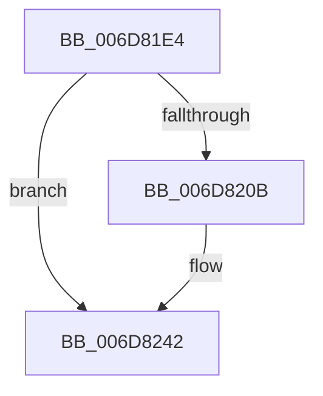

# sub_006D81E4

- RVA: `0x006D81E4`–`0x006D8255` (길이 `113` bytes)
- VA: `0x00000001406D81E4`
- 실행 섹션: `.text`
- PDB 이름 있음: `아니요`; PDB Function 태그: `아니요`
- unwind 정보 RVA: `0x00062FCC`
- 디코드: `26`개 명령, `113/113` bytes 표시
- 미해석 바이트: `0` (있으면 어셈블리에 `.byte`로 보존)

> 이 문서는 커널 이미지의 기계어와 PDB 기호를 분석해 생성했습니다. 4번과 5번은 함수 원형과 자료형을 바이너리 사용 방식에서 추정한 C 해석이며 원본 소스 복구 결과는 아닙니다.

## 1. Dependencies

- 직접 호출 지점: **4**; 고유 호출 대상: **4**
- 직접 호출자로 확인된 함수: **0**
- RIP 상대 이미지 참조: **2**

### Outgoing calls
- `0x006D81F6` → [EtwActivityIdControl](../41/EtwActivityIdControl_function_0041E720.md) (function, `0x0041E720`)
- `0x006D8202` → [IopIsActivityTracingEventEnabled](../4B/IopIsActivityTracingEventEnabled_function_004BA134.md) (function, `0x004BA134`)
- `0x006D823D` → [EtwWriteEx](../25/EtwWriteEx_function_0025F0D0.md) (function, `0x0025F0D0`)
- `0x006D824A` → [IoSetActivityIdIrp](../45/IoSetActivityIdIrp_function_0045B220.md) (function, `0x0045B220`)

### Direct callers
- 이 함수 시작 RVA로 연결되는 직접 call은 확인되지 않았습니다. 간접 호출은 완전히 역산할 수 없습니다.

### Static image references
- `0x006D81FB` → RVA `0x00023048` (`.rdata`; read)
- `0x006D8231` → RVA `0x00F8D7E0` (`.data`; read)

## 2. Other-region calls and transfers

- 다른 실행 섹션으로 향하는 call: **0**
- call이 아닌 외부 분기/꼬리 이동: **1**
  - `0x006D8250` → [IoReuseIrp + 0x11D](../24/IoReuseIrp_function_0024DD70.md) (`tail-transfer`)

## 3. Assembly (complete function range)

```asm
006D81E4  0F 57 C0                        xorps xmm0, xmm0
006D81E7  48 8D 54 24 40                  lea rdx, [rsp + 0x40]
006D81EC  B9 03 00 00 00                  mov ecx, 3
006D81F1  0F 11 44 24 40                  movups xmmword ptr [rsp + 0x40], xmm0
006D81F6  E8 25 65 D4 FF                  call 0x14041e720
006D81FB  48 8D 0D 46 AE 94 FF            lea rcx, [rip - 0x6b51ba]
006D8202  E8 2D 1F DE FF                  call 0x1404ba134
006D8207  84 C0                           test al, al
006D8209  74 37                           je 0x1406d8242
006D820B  33 C9                           xor ecx, ecx
006D820D  48 8D 45 18                     lea rax, [rbp + 0x18]
006D8211  48 89 4C 24 38                  mov qword ptr [rsp + 0x38], rcx
006D8216  48 8D 15 2B AE 94 FF            lea rdx, [rip - 0x6b51d5]
006D821D  89 4C 24 30                     mov dword ptr [rsp + 0x30], ecx
006D8221  45 33 C9                        xor r9d, r9d
006D8224  48 8D 4C 24 40                  lea rcx, [rsp + 0x40]
006D8229  45 33 C0                        xor r8d, r8d
006D822C  48 89 4C 24 28                  mov qword ptr [rsp + 0x28], rcx
006D8231  48 8B 0D A8 55 8B 00            mov rcx, qword ptr [rip + 0x8b55a8]
006D8238  48 89 44 24 20                  mov qword ptr [rsp + 0x20], rax
006D823D  E8 8E 6E B8 FF                  call 0x14025f0d0
006D8242  48 8D 54 24 40                  lea rdx, [rsp + 0x40]
006D8247  48 8B CB                        mov rcx, rbx
006D824A  E8 D1 2F D8 FF                  call 0x14045b220
006D824F  90                              nop
006D8250  E9 38 5C B7 FF                  jmp 0x14024de8d
```

## 4. C-style interpretation (structured pseudocode)

```c
__int64 __fastcall sub_006D81E4(__int64 a1, __int64 a2, int a3, int a4, __int64 a5, __int64 a6, __int64 a7, __int64 a8)
{
    __int64 result;
    unsigned __int64 v_stack_p20;
    unsigned __int64 v_stack_p28;
    unsigned int v_stack_p30;
    unsigned __int64 v_stack_p38;

    a8 = v_xmm0;
    result = EtwActivityIdControl(3, a8, a3, a4);
    result = IopIsActivityTracingEventEnabled(v_rip - 7033274, a8, a3, a4);
    if ((unsigned __int8)(result) != 0) {
        a1 = 0;
        result = v_rbp + 24;
        v_stack_p38 = 0;
        a2 = v_rip - 7033301;
        v_stack_p30 = 0;
        a4 = 0;
        a1 = a8;
        a3 = 0;
        v_stack_p28 = a1;
        a1 = *(unsigned __int64 *)(v_rip + 9131432);
        v_stack_p20 = result;
        result = EtwWriteEx(a1, a2, a3, a4);
    }
    result = IoSetActivityIdIrp(v_rbx, a8, a3, a4);
}
```

## 5. (Beta) C Style

```c
int64_t sub_006D81E4(int64_t Arg1, int64_t Arg2, int32_t Arg3, int32_t Arg4, uint64_t Arg5, uint64_t Arg6, uint64_t Arg7, int64_t Arg8)
{
    int64_t result;
    uint64_t v_stack_p20;
    uint64_t v_stack_p28;
    uint32_t v_stack_p30;
    uint64_t v_stack_p38;

    Arg8 = v_xmm0;
    result = EtwActivityIdControl(3, Arg8, Arg3, Arg4);
    result = IopIsActivityTracingEventEnabled(v_rip - 7033274, Arg8, Arg3, Arg4);
    if ((uint8_t)(result) != 0) {
        Arg1 = 0;
        result = local_rbp + 24;
        v_stack_p38 = 0;
        Arg2 = v_rip - 7033301;
        v_stack_p30 = 0;
        Arg4 = 0;
        Arg1 = Arg8;
        Arg3 = 0;
        v_stack_p28 = Arg1;
        Arg1 = *(uint64_t *)(v_rip + 0x8B55A8);
        v_stack_p20 = result;
        result = EtwWriteEx(Arg1, Arg2, Arg3, Arg4);
    }
    result = IoSetActivityIdIrp(local_rbx, Arg8, Arg3, Arg4);
}
```

## 6. Execution-region graph

[열기: 2D/3D 그래프와 함수 탐색 컨트롤 패널](../../../control-panel.html?section=text&rva=0x006D81E4&view=graph)

- 2D 그래프는 위에서 아래로 흐르고, 3D 그래프는 빈 공간을 드래그해 회전합니다. Shift+드래그는 이동, 휠은 확대·축소, 함수 노드 선택은 대상 보고서 이동입니다.

### Static fallback


