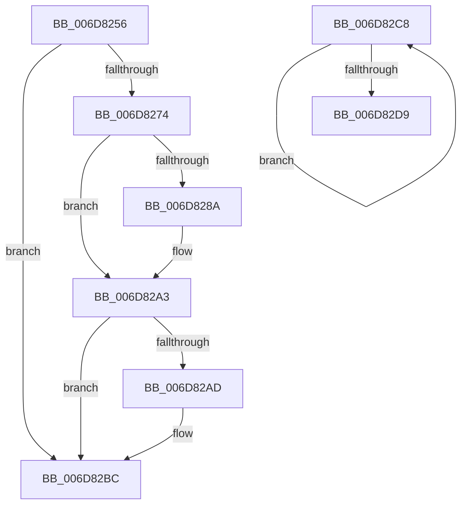

# sub_006D8256

- RVA: `0x006D8256`–`0x006D82DE` (길이 `136` bytes)
- VA: `0x00000001406D8256`
- 실행 섹션: `.text`
- PDB 이름 있음: `아니요`; PDB Function 태그: `아니요`
- unwind 정보 RVA: `0x00063784`
- 디코드: `33`개 명령, `136/136` bytes 표시
- 미해석 바이트: `0` (있으면 어셈블리에 `.byte`로 보존)

> 이 문서는 커널 이미지의 기계어와 PDB 기호를 분석해 생성했습니다. 4번과 5번은 함수 원형과 자료형을 바이너리 사용 방식에서 추정한 C 해석이며 원본 소스 복구 결과는 아닙니다.

## 1. Dependencies

- 직접 호출 지점: **2**; 고유 호출 대상: **2**
- 직접 호출자로 확인된 함수: **0**
- RIP 상대 이미지 참조: **0**

### Outgoing calls
- `0x006D829D` → [KeBugCheckEx](../4F/KeBugCheckEx_function_004FD660.md) (function, `0x004FD660`)
- `0x006D82CC` → [KeYieldProcessorEx](../3F/KeYieldProcessorEx_function_003FBD00.md) (function, `0x003FBD00`)

### Direct callers
- 이 함수 시작 RVA로 연결되는 직접 call은 확인되지 않았습니다. 간접 호출은 완전히 역산할 수 없습니다.

### Static image references
- 디코드된 RIP-relative 메모리 참조가 없습니다.

## 2. Other-region calls and transfers

- 다른 실행 섹션으로 향하는 call: **0**
- call이 아닌 외부 분기/꼬리 이동: **2**
  - `0x006D82C3` → [sub_002546EC + 0x26F](../25/Unknown_function_002546EC.md) (`tail-transfer`)
  - `0x006D82D9` → [sub_0025308F + 0x122C](../25/Unknown_function_0025308F.md) (`tail-transfer`)

## 3. Assembly (complete function range)

```asm
006D8256  FE C1                           inc cl
006D8258  88 88 38 03 00 00               mov byte ptr [rax + 0x338], cl
006D825E  8B 83 58 03 00 00               mov eax, dword ptr [rbx + 0x358]
006D8264  44 0F AB D0                     bts eax, r10d
006D8268  89 83 58 03 00 00               mov dword ptr [rbx + 0x358], eax
006D826E  41 83 F9 20                     cmp r9d, 0x20
006D8272  74 48                           je 0x1406d82bc
006D8274  49 0F BE D1                     movsx rdx, r9b
006D8278  4C 8B C2                        mov r8, rdx
006D827B  48 8D 0C 1A                     lea rcx, [rdx + rbx]
006D827F  0F B6 81 38 03 00 00            movzx eax, byte ptr [rcx + 0x338]
006D8286  84 C0                           test al, al
006D8288  75 19                           jne 0x1406d82a3
006D828A  41 B9 02 00 00 00               mov r9d, 2
006D8290  48 89 7C 24 20                  mov qword ptr [rsp + 0x20], rdi
006D8295  48 8B D3                        mov rdx, rbx
006D8298  B9 57 01 00 00                  mov ecx, 0x157
006D829D  E8 BE 53 E2 FF                  call 0x1404fd660
006D82A2  CC                              int3
006D82A3  2C 01                           sub al, 1
006D82A5  88 81 38 03 00 00               mov byte ptr [rcx + 0x338], al
006D82AB  75 0F                           jne 0x1406d82bc
006D82AD  8B 83 58 03 00 00               mov eax, dword ptr [rbx + 0x358]
006D82B3  0F BB D0                        btc eax, edx
006D82B6  89 83 58 03 00 00               mov dword ptr [rbx + 0x358], eax
006D82BC  44 89 B3 00 04 00 00            mov dword ptr [rbx + 0x400], r14d
006D82C3  E9 93 C6 B7 FF                  jmp 0x14025495b
006D82C8  48 8D 4D D8                     lea rcx, [rbp - 0x28]
006D82CC  E8 2F 3A D2 FF                  call 0x1403fbd00
006D82D1  48 8B 03                        mov rax, qword ptr [rbx]
006D82D4  48 85 C0                        test rax, rax
006D82D7  75 EF                           jne 0x1406d82c8
006D82D9  E9 DD BF B7 FF                  jmp 0x1402542bb
```

## 4. C-style interpretation (structured pseudocode)

```c
__int64 __fastcall sub_006D8256(unsigned __int8 a1, __int64 a2, __int64 a3, int a4)
{
    __int64 result;
    unsigned __int64 v_stack_p20;

    a1 = (unsigned __int8)((a1) + 1);
    *(unsigned __int8 *)(result + 824) = a1;
    *(unsigned int *)(v_rbx + 856) = (unsigned int)((unsigned int)(*(unsigned int *)(v_rbx + 856)));
    if (a4 == 32) goto loc_006D82BC;
    result = *(unsigned __int8 *)((__int8)((unsigned __int8)(a4)) + v_rbx * 1 + 824);
    if ((unsigned __int8)(*(unsigned __int8 *)((__int8)((unsigned __int8)(a4)) + v_rbx * 1 + 824)) == 0) {
        a4 = 2;
        v_stack_p20 = v_rdi;
        a2 = v_rbx;
        a1 = 343;
        result = KeBugCheckEx(a1, a2, (__int8)((unsigned __int8)(a4)), a4);
    }
    result = (unsigned __int8)((result) - (1));
    *(unsigned __int8 *)(a1 + 824) = (unsigned __int8)(result);
    if (!(condition_is_not_equal)) {
        result = *(unsigned int *)(v_rbx + 856);
        *(unsigned int *)(v_rbx + 856) = (unsigned int)(result);
    }
    *(unsigned int *)(v_rbx + 1024) = (unsigned int)(v_r14);
}
```

## 5. (Beta) C Style

```c
int64_t sub_006D8256(uint8_t Arg1, int64_t Arg2, int64_t Arg3, int32_t Arg4)
{
    int64_t result;
    uint64_t v_stack_p20;

    Arg1 = (uint8_t)((Arg1) + 1);
    *(uint8_t *)(result + 0x338) = Arg1;
    *(uint32_t *)(local_rbx + 0x358) = (uint32_t)((uint32_t)(*(uint32_t *)(local_rbx + 0x358)));
    if (Arg4 == 32) goto loc_006D82BC;
    result = *(uint8_t *)((int8_t)((uint8_t)(Arg4)) + local_rbx * 1 + 0x338);
    if ((uint8_t)(*(uint8_t *)((int8_t)((uint8_t)(Arg4)) + local_rbx * 1 + 0x338)) == 0) {
        Arg4 = 2;
        v_stack_p20 = local_rdi;
        Arg2 = local_rbx;
        Arg1 = 343;
        result = KeBugCheckEx(Arg1, Arg2, (int8_t)((uint8_t)(Arg4)), Arg4);
    }
    result = (uint8_t)((result) - (1));
    *(uint8_t *)(Arg1 + 0x338) = (uint8_t)(result);
    if (!(condition_is_not_equal)) {
        result = *(uint32_t *)(local_rbx + 0x358);
        *(uint32_t *)(local_rbx + 0x358) = (uint32_t)(result);
    }
    *(uint32_t *)(local_rbx + 0x400) = (uint32_t)(local_r14);
}
```

## 6. Execution-region graph

[열기: 2D/3D 그래프와 함수 탐색 컨트롤 패널](../../../control-panel.html?section=text&rva=0x006D8256&view=graph)

- 2D 그래프는 위에서 아래로 흐르고, 3D 그래프는 빈 공간을 드래그해 회전합니다. Shift+드래그는 이동, 휠은 확대·축소, 함수 노드 선택은 대상 보고서 이동입니다.

### Static fallback


