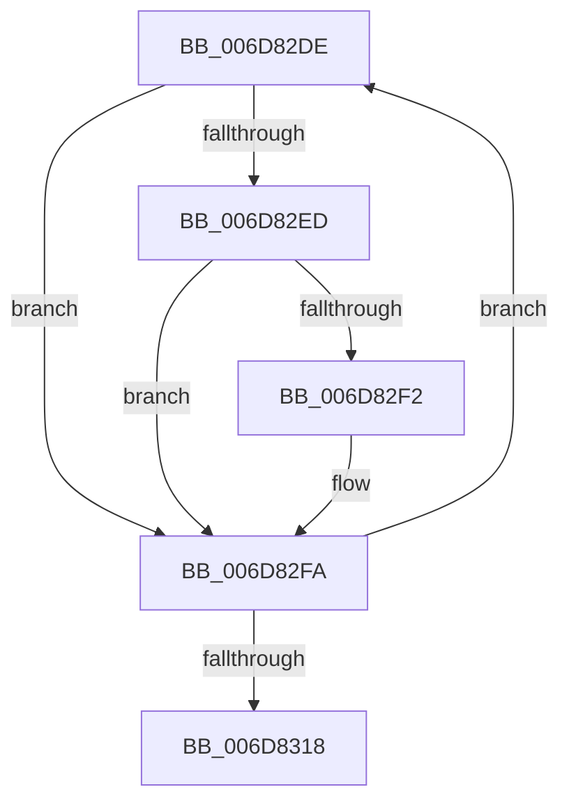

# sub_006D82DE

- RVA: `0x006D82DE`–`0x006D831D` (길이 `63` bytes)
- VA: `0x00000001406D82DE`
- 실행 섹션: `.text`
- PDB 이름 있음: `아니요`; PDB Function 태그: `아니요`
- unwind 정보 RVA: `0x000637B8`
- 디코드: `17`개 명령, `63/63` bytes 표시
- 미해석 바이트: `0` (있으면 어셈블리에 `.byte`로 보존)

> 이 문서는 커널 이미지의 기계어와 PDB 기호를 분석해 생성했습니다. 4번과 5번은 함수 원형과 자료형을 바이너리 사용 방식에서 추정한 C 해석이며 원본 소스 복구 결과는 아닙니다.

## 1. Dependencies

- 직접 호출 지점: **0**; 고유 호출 대상: **0**
- 직접 호출자로 확인된 함수: **0**
- RIP 상대 이미지 참조: **0**

### Outgoing calls
- 직접 디코드된 call 명령이 없습니다.

### Direct callers
- 이 함수 시작 RVA로 연결되는 직접 call은 확인되지 않았습니다. 간접 호출은 완전히 역산할 수 없습니다.

### Static image references
- 디코드된 RIP-relative 메모리 참조가 없습니다.

## 2. Other-region calls and transfers

- 다른 실행 섹션으로 향하는 call: **0**
- call이 아닌 외부 분기/꼬리 이동: **1**
  - `0x006D8318` → [KeIsEmptyGroupMask + 0xBB](../25/KeIsEmptyGroupMask_function_002553B0.md) (`tail-transfer`)

## 3. Assembly (complete function range)

```asm
006D82DE  0F B6 11                        movzx edx, byte ptr [rcx]
006D82E1  48 8D 49 01                     lea rcx, [rcx + 1]
006D82E5  41 8B C1                        mov eax, r9d
006D82E8  48 3B C7                        cmp rax, rdi
006D82EB  75 0D                           jne 0x1406d82fa
006D82ED  4D 85 FF                        test r15, r15
006D82F0  74 08                           je 0x1406d82fa
006D82F2  43 22 94 27 90 C8 02 00         and dl, byte ptr [r15 + r12 + 0x2c890]
006D82FA  0F B6 D2                        movzx edx, dl
006D82FD  41 FF C1                        inc r9d
006D8300  F7 D2                           not edx
006D8302  44 0F B6 C2                     movzx r8d, dl
006D8306  43 0F B6 94 20 40 41 03 00      movzx edx, byte ptr [r8 + r12 + 0x34140]
006D830F  4C 03 DA                        add r11, rdx
006D8312  41 83 C6 FF                     add r14d, -1
006D8316  75 C6                           jne 0x1406d82de
006D8318  E9 4E D1 B7 FF                  jmp 0x14025546b
```

## 4. C-style interpretation (structured pseudocode)

```c
__int64 __fastcall sub_006D82DE(__int64 a1, __int64 a2, __int64 a3, int a4)
{
    __int64 v_r11;
    __int64 v_r14;

    if (((unsigned int)(a4)) != v_rdi) goto loc_006D82FA;
    if (v_r15 != 0) {
        a2 = (unsigned __int8)((*(unsigned __int8 *)(a1)) & (*(unsigned __int8 *)(v_r15 + v_r12 * 1 + 182416)));
    }
    a4 = (unsigned int)((a4) + 1);
    a2 = (unsigned int)(~((unsigned __int8)(a2)));
    v_r11 = (v_r11) + (*(unsigned __int8 *)((unsigned __int8)(a2) + v_r12 * 1 + 213312));
    v_r14 = (unsigned int)((v_r14) + (-1));
    if (condition_is_not_equal) goto loc_006D82DE;
}
```

## 5. (Beta) C Style

```c
int64_t sub_006D82DE(void *Arg1, int64_t Arg2, int64_t Arg3, int32_t Arg4)
{
    uint8_t *arg1 = (uint8_t *)Arg1;

    int64_t local_r11;
    int64_t local_r14;

    if (((uint32_t)(Arg4)) != local_rdi) goto loc_006D82FA;
    if (local_r15 != 0) {
        Arg2 = (uint8_t)((*(uint8_t *)(arg1)) & (*(uint8_t *)(local_r15 + local_r12 * 1 + 0x2C890)));
    }
    Arg4 = (uint32_t)((Arg4) + 1);
    Arg2 = (uint32_t)(~((uint8_t)(Arg2)));
    local_r11 = (local_r11) + (*(uint8_t *)((uint8_t)(Arg2) + local_r12 * 1 + 0x34140));
    local_r14 = (uint32_t)((local_r14) + (-1));
    if (condition_is_not_equal) goto loc_006D82DE;
}
```

### 관측된 메모리 오프셋

구조체 형식이 확인되지 않은 접근은 인자 기준의 오프셋으로만 기록했습니다.

| 기준 인자 | 오프셋 표현 | 폭 (bit) | 접근 |
|---|---:|---:|---|
| `Arg1` | `+ 0x0` | `8` | `R` |
| `Arg1` | `+ 0x1` | `64` | `R` |

## 6. Execution-region graph

[열기: 2D/3D 그래프와 함수 탐색 컨트롤 패널](../../../control-panel.html?section=text&rva=0x006D82DE&view=graph)

- 2D 그래프는 위에서 아래로 흐르고, 3D 그래프는 빈 공간을 드래그해 회전합니다. Shift+드래그는 이동, 휠은 확대·축소, 함수 노드 선택은 대상 보고서 이동입니다.

### Static fallback


